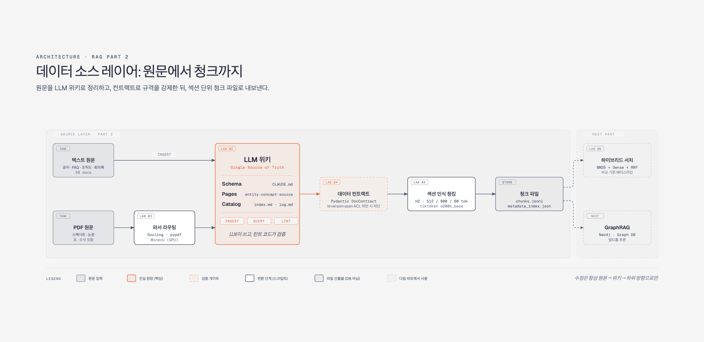
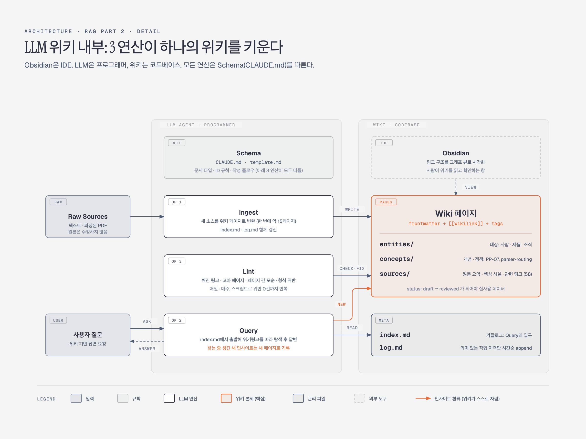

원본 데이터가 흔들리면 그 위의 벡터 RAG와 지식 그래프가 모두 흔들린다. Part 2는 이 문제를 소스 레이어에서 막는다. **원문을 LLM 위키로 정리하고, 데이터 컨트랙트로 규격을 강제하고, 섹션 단위 청크 파일로 내보내는** 흐름 전체를 만든다.

그 청크로 **GraphRAG와 비교할 하이브리드 베이스라인**까지 세운다. 강의 2개와 실습 5개를 하나로 묶었다.



| # | 컴포넌트 | 역할 | 실습 | 산출물 |
| --- | --- | --- | --- | --- |
| 1 | Raw Sources | 통제되지 않은 원문 | | `corpus/raw/` |
| 2 | 파서 라우팅 | 문서 유형별 파서 선택 | 실습 03 | `wiki/concepts/parser-routing.md` |
| 3 | LLM 위키 | 원문을 구조화된 마크다운으로 정리 (진실 원장) | 실습 02 | entity·concept·source 페이지, `index.md`, `log.md` |
| 4 | 데이터 컨트랙트 | 메타데이터 규격 강제, 위반 시 반영 차단 | 실습 04 | `DocContract`, 위반 리포트 |
| 5 | 청킹 + 인덱스 | 섹션 단위 청크와 필터용 인덱스를 파일로 출력 | 실습 05 | `chunks.jsonl`, `metadata_index.json` |
| 6 | 베이스라인 | BM25 + Dense + RRF 하이브리드 RAG, Golden Question 채점 | 실습 06 | `lab06_baseline_scores.json` |
| 7 | 활용 | GraphRAG | | 다음 Part |

## 1. 소스 레이어가 필요한 이유

소스 레이어는 **입력 데이터가 들어오는 부분을 통제하는 레이어**이다. 벡터 DB 기준으로는 청킹과 전처리가 여기에 해당한다. 예전에는 정규 표현식으로 불필요한 텍스트를 지우고, `LLM`·`Large Language Model`·`라지 랭귀지 모델` 같은 표현을 하나의 정규형(canonical form)으로 맞췄다(텍스트 정규화).

지식 그래프에서는 이 레이어가 더 중요하다. 소스 레이어 없이 원문에서 그래프를 바로 만들면 두 가지 문제가 생긴다.

1. 데이터가 바뀌거나 그래프에 오류가 생길 때마다 원본 전체를 다시 확인해야 한다.
2. 번거로워서 그래프를 직접 고치면 **원본과 그래프의 일관성이 깨진다.** 이후 파이프라인을 처음부터 다시 돌려도 결과가 맞지 않는다.

그래서 **"원본 → 위키 → 하위 저장소" 방향을 정해 두고 수정은 항상 이 방향으로만 한다.** 중간의 LLM 위키가 기준이 되는 데이터, 즉 Single Source of Truth(진실 원장)가 된다.

## 2. LLM 위키

### 패턴

LLM 위키는 Andrej Karpathy가 개인 지식 관리용으로 제안한 패턴이다. 기존 벡터 RAG는 검색해서 답하는 데서 끝나고, 소스가 계속 늘어나는 상황에서는 매번 청킹하고 벡터 DB를 갱신해야 한다. LLM 위키는 자기 데이터를 **위키피디아처럼 구조화되고 서로 연결된 마크다운 파일**로 관리하자는 발상이다.

> Obsidian is the IDE, the LLM is the programmer, the wiki is the codebase.

| 코딩 | LLM 위키 |
| --- | --- |
| IDE | **Obsidian**: 마크다운 에디터, 링크 구조를 그래프 뷰로 시각화 |
| 프로그래머 | **LLM**: 위키를 실제로 작성하고 관리 |
| 코드베이스 | **위키**: 무엇이 어디에 어떤 구조로 있는지 |

이런 정리는 예전에도 원하는 사람이 많았지만, 모든 자료를 읽고 마크다운으로 옮기는 일을 사람이 하기는 어려웠다. 지금은 에이전트가 그 일을 맡는다. 원형은 1945년 Vannevar Bush의 Memex까지 거슬러 올라간다.



### 세 가지 구성 요소

| 구성 | 설명 |
| --- | --- |
| **Raw Sources** | 원문. 수정하지 않는다 |
| **Wiki** | LLM이 원문을 정리해 만든 마크다운 파일들 |
| **Schema** | LLM이 위키를 만들 때 따르는 규칙 (Claude Code의 `CLAUDE.md`, Codex의 `AGENTS.md`) |

스키마는 원래 데이터베이스 용어이다. 에이전트 시대에는 에이전트가 따르는 규칙 파일이 같은 역할을 하고, 위키의 컨벤션·구조·작성 플로우를 여기에 정의한다.

### 세 가지 연산

| 연산 | 역할 |
| --- | --- |
| **Ingest** | 새 소스를 스키마에 따라 위키 페이지로 변환. 한 번에 약 15페이지 단위로 처리 |
| **Query** | 위키를 탐색해 답변. **찾는 과정에서 생긴 새 인사이트를 새 페이지로 기록**하는 것이 핵심 |
| **Lint** | 주기적 점검. 끊어진 링크, 고아 페이지, 페이지 간 모순, 형식 위반을 찾아 정리 |

고아 페이지는 자신을 가리키던 유일한 링크가 끊겨 더는 접근할 수 없는 페이지이다. 모순은 LLM이 위키를 계속 고치면서 오류가 쌓여 페이지끼리 다른 결론을 내리는 경우이다.

### 두 가지 관리 파일

| 파일 | 역할 |
| --- | --- |
| `index.md` | 위키 전체 카탈로그. Query가 관련 문서를 찾아가는 입구 |
| `log.md` | 의미 있는 작업 이력만 시간순으로 append |

`index.md` 하나로 충분한 규모는 **위키 수백 페이지, 소스 100개 안팎**까지이다. 그보다 커지면 HNSW 같은 벡터 인덱스 인프라를 쓰는 편이 낫다.

## 3. 실습 02: 원문을 LLM 위키로 변환

사내 원문 58개(공지, FAQ, 조직도, 회의록)를 **마크다운 + YAML frontmatter + 위키링크 + 태그** 구조로 바꾼다. 원본 LLM 위키 문서는 토큰이 많이 들어서 실습용으로 단순화한 템플릿(`wiki/template.md`)을 쓴다.

- **문서 종류**: entity(대상: 사람·제품·조직), concept(개념·정책), source(원문 요약)
- **문서 ID**: 소문자·숫자·하이픈만 쓰고, 이 ID가 위키링크의 키가 된다.
- **결과**: 강의에서는 변환 직후 entity 17개, concept 2개, source 58개와 `index.md`, `log.md`가 나왔다. 아래 린트를 거친 실습 환경의 최종 결과는 entity 18개, concept 3개, source 58개다.
- **status**: `draft`로 생성되고, 검토를 거쳐 `reviewed`가 되어야 실제로 쓰는 데이터가 된다.
- **concept**: 변환 중에 새로 발견한 개념이 쌓인다(예: PP-07 듀얼 소싱 구매 정책).

### 린트는 코드로 돌린다

변환 직후 LLM은 "무결성 통과"라고 보고했다. 그런데 링크 무결성 검사 스크립트(frontmatter 형식, 깨진 위키링크, 고아 문서)를 실제로 돌리자 위반이 쏟아졌고, 강의 환경에서는 누락된 entity 24개를 새로 만들고서야 위반이 0이 됐다. **LLM의 자기 보고보다 코드 검증을 믿는다.**

- LLM의 결과는 입력, 프롬프트, 언어, temperature에 따라 매번 달라진다.
- 데이터 단계의 오류는 지식 그래프와 RAG 인덱스로 그대로 번져 큰 기술 부채가 된다. 생성 직후에 검증하는 편이 훨씬 싸다.
- 코드는 인터프리터가 논리적으로 맞아야만 실행되므로 신뢰할 수 있는 최소 기준이 된다. LLM 위키는 미리 구조화되어 있어서 링크 존재 여부 같은 것을 코드로 명확하게 검사할 수 있다.

상위 모델로 한 번에 처리하는 실험도 했다. 오류는 줄지만 토큰을 훨씬 많이 쓰고, 큰 컨텍스트에 한꺼번에 넣으면 세부의 정확도가 보장되지 않는다. 결론은 **작은 모델로 작업을 잘게 나누고 린트를 여러 번 돌리는 편이 낫다**는 것이다.

## 4. 실습 03: PDF 파싱과 파서 라우팅

PDF는 텍스트 배치를 이미지처럼 고정한 포맷이라 어디서나 똑같이 보이지만, 데이터를 다시 뽑아내기는 어렵다. 텍스트만 긁으면 표와 구조가 깨지고, 깨진 채로 위키에 들어가면 그 뒤의 그래프까지 오류가 이어진다. 그래서 **어떤 문서에 어떤 파서를 쓸지를 정책으로 정한다.**

| 파서 | 특징 | 실습에서 |
| --- | --- | --- |
| **pypdf** | 가장 기본적인 파이썬 라이브러리 (LangChain `PyPDFLoader` 계열) | 비교 기준 |
| **Docling** | IBM 오픈소스. 레이아웃 모델과 TableFormer로 구조를 인식해 Markdown/JSON으로 출력. CPU로 동작, PPTX·DOCX·HTML·이미지 지원 | **주력 파서** |
| **MinerU** | 수식(LaTeX)과 레이아웃 품질이 좋아 복잡한 논문에 강함 | GPU 필요, 대안으로 기록 |
| **RAG-Anything** | LightRAG 팀의 엔드투엔드 RAG 프레임워크 | 파싱에 GPU 의존, 대안으로 기록 |
| Upstage Document Parse, Azure Document Intelligence | 유료 API. 품질이 가장 좋음, 페이지당 약 $0.01 | 강의에서 소개 |

전처리는 파일당 한 번이면 되므로 중요한 데이터는 유료 API가 오히려 깔끔하다. 오픈소스는 하나만 고집하지 말고, Docling이 안 맞으면 다른 것으로 바꾼다.

### 비교 결과

입력은 표 2개와 수식 1개가 있는 단일 컬럼 배터리 스펙시트 PDF이다. CPU 기준으로 약 3분 걸렸다.

| 항목 | pypdf | Docling |
| --- | --- | --- |
| 표 구조 | **소실**: 공백으로만 구분되어 칸 경계를 알 수 없음 | 보존: Markdown 표로 출력 |
| 단위 | **부분 손상**: 값과 단위가 붙거나 떨어짐 | 보존 |
| 수식 | **부분 손상**: 글자는 남지만 공백이 깨짐 | 보존 |
| 섹션 제목 | **소실**: 일반 텍스트로 바뀜 | **부분 보존**: 모든 제목이 H2로 나와 위계를 구분하지 못함 |

Docling의 제목 위계 문제는 당장 치명적이지는 않다. 다만 뒤에서 헤딩 기준으로 청킹하므로 확인해야 할 지점이다.

### 파서 라우팅 규칙

결과를 근거로 `wiki/concepts/parser-routing.md`에 정책을 남겼다.

- **깨끗한 텍스트 PDF**: pypdf, Docling 둘 다 가능
- **표나 숫자가 많은 스펙시트**: Docling
- **스캔본이나 수식이 많은 논문**: Docling, 필요하면 MinerU

판단 근거를 위키에 정책 문서로 남겨 두면, 이후 에이전트가 프로젝트 전체를 이해하고 같은 규칙을 재사용할 수 있다.

## 5. 실습 04: 데이터 컨트랙트

데이터 컨트랙트는 **데이터를 관리하기 위한 틀**이다. 은행 가입 신청서처럼 처음부터 정해진 양식으로 받으면 정보가 규격화되고, 모두가 같은 기준으로 데이터를 다룬다. 틀이 없으면 같은 작업에도 에이전트의 결과가 매번 달라진다.

팀이나 회사 단위에서는 신뢰성(믿을 수 있는 소스인가), 검증(누가 검토했는가), 접근 권한이 추가로 필요하다. 예를 들어 인턴이 연봉 체계를 물으면 에이전트가 답하면 안 된다. 컨트랙트에 이런 속성을 정의해 두어야 에이전트가 허용 여부를 판단할 수 있다.

### 필드

| 필드 | 보장하는 것 | 제약 예시 |
| --- | --- | --- |
| **Stable ID** | 문서당 하나, 바뀌지 않는 키 | 정규식 `doc:nuritech:[a-z0-9-]+` |
| **Version / Hash** | 원본 변경 추적. ID에 시간을 넣지 않고 버전과 해시로 시점을 관리 | `int`, `ge=1` / 12자리 16진수 |
| **Source Span** | 원문 안의 근거 위치. 위키는 서로 내용을 가져다 쓰므로 출처 추적이 필요 | 필수 |
| **ACL** | 접근 등급 | `public / internal / confidential / restricted` |
| **Provenance** | 어떤 원본에서 어떻게 변환됐는가 | 필수 |
| **Owner / Status** | 관리자와 상태 | `draft` → `reviewed` → `deprecated` |

필드는 상황에 따라 늘리거나 줄인다. 이런 정의와 관리 체계 전체를 데이터 거버넌스라고 한다.

### Pydantic으로 강제한다

데이터는 대부분 JSON으로 주고받는데, 파이썬은 키나 구조가 틀려도 미리 잡아 주지 않는다. Pydantic으로 스키마를 정의하면 규칙을 어긴 데이터는 객체 생성 단계에서 `ValidationError`를 내고 아예 반영되지 않는다.

```python {title="DocContract (요지)"}
from typing import Literal
from pydantic import BaseModel, Field

class DocContract(BaseModel):
    id: str = Field(pattern=r"^doc:nuritech:[a-z0-9-]+$")
    doc_type: Literal["entity", "source", "concept"]
    version: int = Field(ge=1)
    hash: str = Field(pattern=r"^[0-9a-f]{12}$")
    acl: Literal["public", "internal", "confidential", "restricted"]
    source_span: str
    provenance: str
```

주석은 사람이 읽는 용도일 뿐이고, 실제 제약은 `Field`와 `Literal`에 넣어야 효력이 있다.

진행 순서는 세 단계이다.

1. 컨트랙트 코드를 작성한다.
2. 실습 02의 위키 문서 전체의 frontmatter를 규격에 맞게 고친다(약 15분). 위반 리포트로 0건을 확인하고, 다시 돌려도 같은 결과가 나오는 것(멱등성)을 확인한다.
3. 문서 하나의 ACL을 존재하지 않는 값으로 바꿔 에러가 나는지 보고 되돌린다.

### 실제로 자주 깨지는 것

가장 자주 깨지는 것은 ACL이 아니라 **source span과 version**이다. 업데이트하다가 출처 정보가 사라지거나 버전이 어긋난다. Pydantic을 거치게 하면 필수 정보가 빠질 수 없고, 빠지면 에러가 나므로 LLM도 그 사실을 알게 된다.

지식 그래프는 업데이트에 특히 약하다. 노드끼리 직접 연결되어 있어서 노드 하나가 바뀌면 연결된 관계 전체에 영향이 간다. 퇴사자처럼 사라지는 대상은 노드를 삭제할지 `deprecated`로 표시할지 정책을 먼저 정해야 한다.

스키마는 처음부터 완성하는 것이 아니라 반복하며 다듬는다. "뒤에서 무엇을 만들 것인가"를 기준으로 필요한 필드를 정한다.

## 6. 실습 05: 섹션 인식 청킹과 메타데이터 인덱스

위키 문서를 헤딩 기준으로 잘라 청크로 만들고, 각 청크에 원본 문서의 ID와 메타데이터를 물려준 뒤 JSONL 파일과 메타데이터 인덱스로 저장한다. 이 결과물이 이후 벡터 RAG와 지식 그래프의 원천 데이터가 된다.

### 섹션 인식 청킹

일반적인 방식은 LangChain `RecursiveCharacterTextSplitter`처럼 글자 수 기준으로 자르는 것이다. 위키는 이미 마크다운으로 정리되어 있으므로 **H2 헤딩을 기준으로 섹션 단위로 자르고, 크기는 토큰 수로 맞춘다.**

| 항목 | 값 |
| --- | --- |
| 목표 크기 | 512 토큰 |
| 최대 크기 | 800 토큰 |
| 오버랩 | 60 토큰 |
| 토크나이저 | `tiktoken` `o200k_base` (한국어 약 1.6글자당 1토큰) |

이 값은 현재 위키를 보고 정한 하이퍼파라미터이며, 데이터에 따라 실험으로 정한다. 시맨틱 청킹은 이상적이지만 임베딩 연산이 많아 데이터가 늘면 확장성이 떨어진다. 요즘은 **청크는 적당히 자르고, 가져온 뒤 LLM이 유연하게 다루는 방식**이 더 실용적이다.

### 처리 흐름

1. frontmatter와 본문을 분리한다.
2. 본문을 H2 헤딩 기준으로 섹션으로 나누고 토큰 수를 계산한다.
3. 800 토큰을 넘는 섹션은 문단 단위로 다시 자르고 60 토큰씩 겹친다.
4. 각 청크는 frontmatter의 doc_type, ACL, tags를 상속받고 `chunks.jsonl`에 저장된다.

청크 ID는 원본 문서 ID를 물려받아 `{문서 ID}#{섹션 번호}` 형태가 된다. 검색은 청크 단위로 하므로, 어느 문서의 어느 섹션에서 왔는지 추적하려면 이 상속이 필요하다.

### 메타데이터 인덱스

doc_type, ACL, tags처럼 **잘 바뀌지 않지만 필터 조건으로 자주 쓰는 속성**을 `metadata_index.json`에 미리 인덱스로 만든다. 인덱스가 없으면 "confidential 청크만" 같은 단순 필터도 전체를 훑어야 한다. 어떤 속성을 인덱스로 만들지는 실습 04의 스키마가 결정한다.

### 검증

회의록과 제품 사양서에서 청크를 3개씩 뽑아 안건이 중간에 잘리지 않는지 확인했다. 가장 긴 섹션도 800 토큰 이하였다. 다만 **빈 줄 없이 800 토큰을 넘는 덩어리는 나뉘지 않는 잠재 버그**가 있어서 문단 분리 함수를 고쳤다.

원천 데이터는 아직 DB가 아니라 파일(JSONL)로 둔다. 벡터 DB, Neo4j, MongoDB, RDB 어디로든 옮기기 쉬운 가장 단순한 형식이기 때문이다.

## 7. 실습 06: 하이브리드 베이스라인 RAG

그래프 기반 RAG가 항상 나은 것은 아니다. 벡터 검색만으로 잘 풀리는 질문이 많고, 반대로 벡터 검색으로는 안 풀리는 질문도 있다.

이 과정이 겨냥하는 것은 후자다. 그 지점을 확인하려면 **같은 데이터로 돌린 베이스라인**이 먼저 있어야 한다.

베이스라인의 가치는 성능이 아니라 **비교 가능성**에 있다. 같은 질문 세트, 같은 생성 모델, 같은 판정 기준을 고정해 두어야 뒤의 GraphRAG 실험이 의미를 가진다. 이후 실습은 모두 이 실습의 점수(`data/lab06_baseline_scores.json`)와 비교한다.

### BM25, Dense, RRF

| 방식 | 표현 | 강점 |
| --- | --- | --- |
| **BM25** (sparse retrieval) | 코퍼스의 어휘 수만큼의 차원에서, 문서에 등장한 단어 자리에만 BM25 가중치가 있고 나머지는 0인 희소 벡터 | 모델명, 로트 번호처럼 **어휘가 정확히 일치**하는 경우 |
| **Dense** (`text-embedding-3-small`) | 1536차원 밀집 벡터 | 표현은 달라도 **의미가 비슷한** 문장 (코사인 유사도) |

사내 문서 질문에는 두 경우가 섞여 들어오므로 현장에서는 하이브리드가 기본값이다. 두 점수는 스케일이 달라서 단순 평균으로 합치면, 한쪽만 잘 맞은 결과가 평균에서 묻힌다. **RRF(Reciprocal Rank Fusion)**는 점수 대신 순위만 보고 합쳐서 양쪽에서 각각 상위에 오른 결과를 살린다.

```python {title="RRF"}
def rrf(rankings: list[list[str]], k: int = 60) -> dict[str, float]:
    """rankings: 검색기별 chunk_id 순위 목록. 순위는 1부터."""
    scores: dict[str, float] = {}
    for ranking in rankings:
        for rank, chunk_id in enumerate(ranking, start=1):
            scores[chunk_id] = scores.get(chunk_id, 0.0) + 1 / (k + rank)
    return dict(sorted(scores.items(), key=lambda x: x[1], reverse=True))
```

`k`는 상위 순위 사이의 점수 차를 완만하게 만드는 보정값이며 보통 60을 쓴다. RRF도 만능은 아니다. 벡터 유사도가 모두 낮아 사실상 구분이 안 되는 경우에도 순위는 매겨지므로, 그 순위가 융합 결과를 흐릴 수 있다.

### 인덱스 만들기 (`lab06_build_index.py`)

1. `data/chunks.jsonl`의 각 청크를 `text-embedding-3-small`로 임베딩해 `data/lab06_vectors.npy`에, chunk_id 순서를 `data/lab06_ids.json`에 저장한다.
2. 같은 청크로 `rank_bm25.BM25Okapi` 인덱스를 만들어 pickle로 저장한다. pickle로 직렬화해 두면 코드에서 언제든 다시 불러 쓸 수 있다.
3. 텍스트의 sha256을 키로 임베딩 캐시를 붙인다. 오버랩 때문에 겹치는 청크를 다시 임베딩하지 않기 위해서이다.

Chroma 같은 벡터 DB에 넣는 방법도 있지만, 여기서는 numpy 배열과 ID 목록을 직접 쓴다. 벡터 DB의 기능에 가려지지 않은 단순한 인덱스로 기준을 잡기 위해서이다.

**한국어 BM25 토큰화**는 공백 분리 + 2-gram으로 단순하게 간다. 공백으로만 자르면 조사가 붙은 어절이 모두 다른 토큰이 되므로, 2-gram을 더해 비슷한 어절끼리 겹치게 한다.

형태소 분석기(kiwipiepy, mecab-ko)를 쓰면 더 잘게 나눌 수 있지만, `NB-100` 같은 제품명이 잘리지 않게 고유명사를 하나하나 등록해야 한다. 공백 분리는 고유명사를 그대로 보존한다.

```python {title="공백 + 2-gram 토크나이저"}
def tokenize_ko(text: str) -> list[str]:
    tokens: list[str] = []
    for word in text.split():
        tokens.append(word)
        tokens.extend(word[i:i + 2] for i in range(len(word) - 1))
    return tokens
```

### 검색하고 인용을 강제해 답하기 (`lab06_baseline_rag.py`)

- **`search(query, top_k=10)`**: 벡터 코사인 상위 20개와 BM25 상위 20개를 구해 RRF(`k=60`)로 융합하고 상위 10개를 반환한다. 후보마다 순위와 점수 출처(BM25인지 Dense인지)를 남긴다.
- **`answer(query)`**: 검색된 청크를 `[chunk_id]` 라벨과 함께 프롬프트에 넣고 `gpt-4o-mini`로 답한다. 시스템 프롬프트 규칙은 세 가지이다.
  - 제공된 청크에 없는 내용은 답하지 않는다.
  - 모든 사실 문장 끝에 `[chunk_id]` 인용을 붙인다.
  - 근거가 없으면 "제공된 문서에서 확인할 수 없습니다"라고 답한다.
- CLI로 질문을 받아 답변과 사용된 청크 목록을 출력한다.

### Golden Question으로 채점하기 (`lab06_eval.py`)

Golden Question 17문항에는 네 가지 유형이 섞여 있다.

| 유형 | 의미 |
| --- | --- |
| single-hop | 그래프 기준으로 한 번 이동하면 답이 나오는 질문 |
| multi-hop | 여러 번 이동하며 추론해야 하는 질문 |
| global | 여러 문서를 모아서 봐야 하는 전체 요약형 질문 |
| unanswerable | 코퍼스에 답이 없는 질문. "확인할 수 없습니다"가 정답 |

문항마다 세 가지를 기록하고, 유형별 정답률로 나눠 본다.

1. **retrieval hit**: 기대 근거 문서가 검색 상위 10에 들었는가 (Recall@k). 하이브리드 검색기 자체를 평가한다.
2. **정답 포함 여부**: 기대 정답을 요소(키워드) 목록으로 쪼개고, 답변이 각 요소를 담고 있는지 본다. 문자 그대로 들어 있으면 규칙으로 판정하고, 표현이 다른 경우만 `gpt-4o-mini`에 묻는다.
3. **인용 준수**: 사실 문장마다 `[chunk_id]`가 붙었는가.

이 실습은 비용 때문에 생성과 채점에 같은 `gpt-4o-mini`를 쓴다. 실제 평가에서는 채점 LLM을 생성 LLM과 분리하는 편이 좋다. 같은 모델이 자기 답을 후하게 채점하는 경향(self-preference)이 있기 때문이다.

### 코퍼스 A: 베이스라인이 강하다

실습 환경에서 돌린 `lab06_baseline_scores.json`의 결과다. 강의에서 보여 준 수치와는 실행마다 조금씩 다르다.

| 유형 | 문항 | 정답률 | retrieval hit | 인용 준수 |
| --- | --- | --- | --- | --- |
| single-hop | 3 | 66.7% | 100% | 100% |
| multi-hop | 9 | 66.7% | 100% | 88.9% |
| global | 3 | 33.3% | 100% | 66.7% |
| unanswerable | 2 | 100% | 해당 없음 | 100% |
| 전체 | 17 | 64.7% | 100% | 88.2% |

retrieval hit은 모든 유형에서 100%다. 근거 문서는 매번 상위 10에 들어왔고, 틀린 것은 그 뒤의 답변 쪽이다.

single-hop의 오답 1건(GQ-02)은 "에어웰 A1의 헤파필터 등급과 모델명은?"이다. 기대 정답은 등급 H13과 필터 모델 HF-13인데, 답변은 등급은 맞히고 모델명 자리에 제품 모델 AW-A1을 넣었다. 근거 청크는 들어왔지만 생성 단계에서 **필터 모델과 제품 모델을 혼동**한 경우다.

global의 정답률이 낮은 이유도 비슷하다. 요약형 질문은 기대 정답 요소가 6~11개인데, 답변은 상위 10 청크에 들어온 일부만 다룬다. 엄격 재현율(strict recall)은 52.8%로, 근거는 들어와도 절반만 답에 반영된다.

multi-hop을 66.7% 맞힌 이유는 데이터에 있다. 실습 02에서 위키를 만들 때 LLM이 관련 사실을 엔티티 요약 청크 하나에 이미 모아 두었고, 청크 풀이 작아서 top-10이 거의 항상 정답 근거를 물고 온다.

실패가 없다면 **"왜 실패하지 않는가"를 기록하는 것**이 이 단계의 과제다. 그 관찰이 쌓여 GraphRAG를 써야 하는 지점이 보인다.

### 코퍼스 B: 베이스라인이 구조적으로 무너지는 지점

같은 코드를 합성 코퍼스 B에 돌린다. 문서 271개, 정답 그래프, 질문 42문항으로 이루어져 있고 **사실 하나가 문서 하나에만 존재하도록** 설계되어 있다.

한 문서가 이미 청크 하나 크기라 문서 단위로 인덱싱하고, path 10문항과 enumeration 8문항만 골라 실행한다. retrieval hit은 "gold 문서 전부가 상위 10에 들었는가"로 엄격하게 판정한다.

강의에서 실행한 결과는 크게 떨어진다. **path 문항은 retrieval hit이 0%**였고, enumeration 문항도 대부분 놓쳤다.

**path가 무너지는 이유.** BQ-01 "가온봇 G1 리콜의 원인이 된 로트의 부품에 들어가는 소재를 공급하는 회사는 어디인가?"를 풀려면 리콜 → 로트 → 부품 → 소재 → 공급사 순서로 문서 4개를 따라가야 한다. 그런데 중간 다리가 되는 로트 번호, 부품 코드, 소재명은 **질문에 한 번도 등장하지 않는다.**

첫 홉 문서는 찾아도 두 번째 홉부터는 검색할 단서가 질문 안에 없다. 입력과 비슷한 것을 찾을 뿐인 벡터·키워드 검색은 따라갈 수 없다.

**enumeration이 무너지는 이유.** BQ-27 "대한정밀이 납품처로 등록된 품목을 모두 나열하라"는 정답 문서가 4개로 흩어져 있다. top-10에 걸린 문서만 답에 들어가므로 재현율이 모자라다.

정답 문서에 질문과 같은 어휘가 있으면 운 좋게 걸리고, 없으면 빠진다.

벡터 쪽에서도 대응책은 있다. 에이전트가 복합 질문을 단순 질문 여러 개로 분해하거나(decomposition), 질문을 문서 표현에 맞게 다시 쓰는(query rewriting) 방식이다. 다만 이 과정은 단순 벡터 검색과 비교하는 것이 목적이고, 앞으로 풀 방법은 텍스트를 바꾸는 쪽이 아니라 **LLM으로 Knowledge Graph를 만들어 경로 자체를 데이터로 갖는 쪽**이다.

### 체크리스트와 트러블슈팅

- single-hop은 대부분 맞아야 한다. 베이스라인이 너무 약하면 비교가 무의미하다.
- unanswerable 문항(GQ-10)에 "확인할 수 없습니다"로 답하는지, 모든 답변 문장에 `[chunk_id]`가 붙었는지 확인한다.
- 코퍼스 B의 path 문항에서 retrieval miss나 오답이 실제로 나오는지 확인한다.
- 임베딩 호출이 rate limit에 걸리면 배치 크기를 줄이고 지수 백오프 재시도를 넣는다.
- 채점자 판정이 흔들리면, 기대 정답 요소를 필수 키워드 목록으로 바꿔 규칙 기반으로 먼저 판정한다.
- **판정 문자열 파싱 함정**: "포함"은 "불포함"의 부분 문자열이다. `("포함", "부분", "불포함")` 순서로 부분 문자열 검사를 하면, 모델이 "불포함"이라고 답해도 "포함"으로 오판정된다. 정확 일치를 먼저 보거나 `("불포함", "부분", "포함")` 순서로 검사한다. 실제로 이 버그 하나가 전체 벤치마크 수치를 부풀린 적이 있다.

### 다음 단계

코퍼스 A처럼 잘 저작된 데이터에서는 베이스라인으로 충분하다. 코퍼스 B처럼 증거가 흩어진 데이터에서는 베이스라인이 구조적으로 무너진다.

다음 Part에서는 이 문제를 풀기 위해 문서를 Entity, Relation, Claim, Event로 구조화하는 Knowledge Graph 구축에 들어간다. 구조화는 정답률만을 위한 것이 아니라 인용, 거버넌스, 관계 질의, 증분 운영처럼 베이스라인 RAG로는 손댈 수 없는 일의 토대이기도 하다.

## 8. Part 2를 관통하는 원칙

| 원칙 | 내용 |
| --- | --- |
| 소스부터 통제한다 | 그래프를 직접 고치면 원본과 일관성이 깨진다. 수정은 항상 "원본 → 위키 → 하위" 방향 |
| LLM은 틀린다, 코드로 검증한다 | 린트 스크립트와 Pydantic처럼 인터프리터가 판정하는 기준을 둔다 |
| LLM에게 직접 시키지 말고 코드를 만들게 한다 | 전체 텍스트를 매번 읽히면 토큰 낭비. 규칙을 스크립트로 만들어 실행 |
| 작은 모델, 잘게, 여러 번 린트 | 상위 모델에 한 번에 넣는 것보다 정확하고 싸다 |
| 정책도 위키에 남긴다 | 파서 라우팅 같은 판단 근거를 마크다운으로 남겨 재사용 |
| 토큰 비용은 구축 단계에 몰린다 | 파이프라인을 만들고 검증할 때 많이 쓰고, 완성 후 운영 비용이 낮은 구조를 고른다 |
| 베이스라인은 비교를 위해 고정한다 | 같은 질문 세트, 같은 생성 모델, 같은 판정 기준. 수치보다 비교 가능성이 중요하다 |
| 채점기부터 검증한다 | 채점 LLM은 생성 LLM과 분리하고, 판정 파싱 같은 평가 코드의 버그부터 의심한다 |
