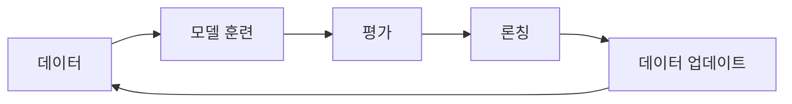
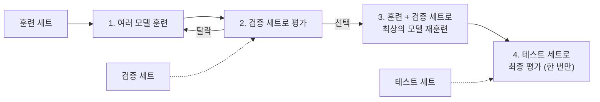

`핸즈온 머신러닝 with 사이킷런, 파이토치` 완독 챌린지를 시작합니다. 

먼저 1장에서 다루는 내용은 아래와 같습니다. 

1. 머신러닝이 무엇이며 왜 사용하는지
2. 애플리케이션의 사례는 무엇이 있는지
3. 머신러닝 시스템의 종류
4. 머신러닝의 주요 도전 과제
5. 테스트 및 검증

## 1. 머신러닝이란 무엇이며 왜 사용하는가

머신러닝(Machine Learning)은 사람이 규칙을 직접 코딩하지 않고, 프로그램이 **데이터에서 규칙을 스스로 배우게** 하는 기술이다. 스팸 필터라면 스팸 메일과 정상 메일 샘플을 보여 주고, 둘을 가르는 패턴을 모델이 찾게 한다.

전통적인 방식은 "이 단어가 들어가면 스팸" 같은 규칙을 사람이 계속 써 넣는다. 스패머가 단어를 바꾸면 규칙도 다시 써야 해서, 규칙 목록이 끝없이 길어진다. 머신러닝은 이런 문제를 아래 네 가지 이유로 더 잘 푼다.

| 사용 이유           | 설명                              | 예시                     |
| --------------- | ------------------------------- | ---------------------- |
| 규칙이 너무 많은 문제    | 수많은 규칙을 손으로 관리하는 대신 모델 하나로 대체한다 | 스팸 필터                  |
| 변화에 자동 적응       | 새 데이터로 다시 훈련하면 규칙을 고치지 않아도 따라간다 | 스패머가 "4U"를 "For U"로 바꿈 |
| 알고리즘이 없는 복잡한 문제 | 사람이 규칙을 정의하기 어려운 문제를 샘플로 학습한다   | 음성 인식                  |
| 사람의 학습을 도움      | 모델이 배운 패턴에서 몰랐던 상관관계를 찾는다       | 데이터 마이닝(data mining)   |

변화에 적응하는 흐름은 아래처럼 반복된다. 이 반복을 자동화할 수 있다는 점이 머신러닝을 쓰는 가장 큰 이유다.

## 2. 애플리케이션의 사례는 무엇이 있는지

| 실제 사례              | 작업 유형   | 대표 기법                                           | 다루는 장    |
| ------------------ | ------- | ----------------------------------------------- | -------- |
| 생산 라인 제품 이미지 자동 분류 | 이미지 분류  | CNN, Vision Transformer                         | 12장, 16장 |
| 신용카드 부정 거래 감지      | 이상치 탐지  | Isolation Forest, Gaussian Mixture, Autoencoder | 8장, 18장  |
| 구매 이력 기반 고객 분할     | 군집      | k-means, DBSCAN                                 | 8장       |
| 고차원 데이터셋 시각화       | 데이터 시각화 | 차원 축소                                           | 7장       |
| 구매 이력 기반 상품 추천     | 추천 시스템  | 인공 신경망                                          | 9장       |
| 지능형 게임 봇           | 강화 학습   | RL 에이전트                                         | 19장      |

- **이상치 탐지**: 정상 거래가 대부분이고 부정 거래는 드물어서, 정상 패턴에서 벗어난 데이터를 찾는 문제로 본다.
- **군집**: 정답 레이블 없이 비슷한 고객끼리 묶고, 묶음마다 다른 마케팅 전략을 세운다.
- **차원 축소**: 고차원 데이터를 2차원이나 3차원으로 내려 그래프로 그린다. 학습 속도와 메모리를 줄이는 전처리로도 쓴다.
- **추천 시스템**: 전체 고객의 구매 이력으로 훈련하고, 다음에 살 가능성이 높은 상품을 출력한다.
- **강화 학습**: 환경에서 보상이 최대가 되는 행동을 고르도록 에이전트를 훈련한다. AlphaGo가 대표 사례다.

같은 "고객 데이터"라도 목적에 따라 작업 유형이 갈린다. 고객을 **나누면** 군집이고, 상품을 **골라 주면** 추천 시스템이다. 사례를 나누는 축은 세 가지로 정리된다.

- **레이블 유무**: 이미지 분류와 추천은 정답이 있는 지도 학습, 이상치 탐지·군집·차원 축소는 레이블 없는 비지도 학습이다.
- **데이터 종류**: 이미지는 CNN과 Vision Transformer, 표 형태 데이터는 Isolation Forest나 k-means처럼 데이터 형태가 기법을 거의 정한다.
- **학습 방식**: 게임 봇만 데이터셋이 아니라 환경과 보상으로 배우는 강화 학습이다.

## 3. 머신러닝 시스템의 종류

머신러닝 시스템은 세 가지 기준으로 나눈다. 기준끼리는 서로 겹칠 수 있어서, 하나의 시스템이 "지도 학습이면서 온라인 학습이고 모델 기반"일 수 있다.

### 훈련 지도 방식

훈련할 때 어떤 정보를 주는지에 따라 나눈다.

| 종류                                 | 설명                             | 예시            |
| ---------------------------------- | ------------------------------ | ------------- |
| 지도 학습(supervised learning)         | 정답(레이블)이 붙은 데이터로 훈련한다          | 스팸 분류, 집값 예측  |
| 비지도 학습(unsupervised learning)      | 레이블 없이 데이터 구조를 스스로 찾는다         | 고객 군집, 차원 축소  |
| 준지도 학습(semi-supervised learning)   | 레이블이 일부만 있는 데이터로 훈련한다          | 사진 앱의 인물 태그   |
| 자기 지도 학습(self-supervised learning) | 레이블 없는 데이터에서 레이블을 스스로 만들어 훈련한다 | 가린 이미지 영역 복원  |
| 강화 학습(reinforcement learning)      | 환경에서 행동하고 보상을 받으며 배운다          | 게임 봇, AlphaGo |

### 배치 학습과 온라인 학습

데이터가 계속 들어올 때 점진적으로 학습할 수 있는지에 따라 나눈다.

- **배치 학습(batch learning)**: 가진 데이터 전체로 한 번에 훈련한 뒤 배포한다. 새 데이터를 반영하려면 처음부터 다시 훈련해야 한다.
- **온라인 학습(online learning)**: 데이터를 하나씩 또는 작은 묶음(미니배치)으로 넣어 계속 학습한다. 변화가 빠른 데이터나 메모리에 다 올릴 수 없는 큰 데이터에 맞다.

### 사례 기반 학습과 모델 기반 학습

새 데이터를 어떻게 예측하는지에 따라 나눈다.

- **사례 기반 학습(instance-based learning)**: 훈련 샘플을 기억해 두고, 새 데이터와 가장 비슷한 샘플을 찾아 예측한다. 기존 스팸 메일과 단어가 많이 겹치면 스팸으로 판단하는 방식이다.
- **모델 기반 학습(model-based learning)**: 과학자가 관찰에서 법칙을 세우듯, 훈련 데이터에서 패턴을 찾아 모델을 만들고 그 모델로 예측한다. 1인당 GDP로 삶의 만족도를 예측하는 선형 모델이 책의 예시다.

## 4. 머신러닝의 주요 도전 과제

머신러닝은 모델을 골라 데이터로 훈련하는 일이다. 그래서 문제도 **나쁜 데이터**와 **나쁜 모델** 둘 중 하나에서 생긴다.

| 구분 | 문제 | 원인 | 대응 |
| --- | --- | --- | --- |
| 나쁜 데이터 | 충분하지 않은 양 | 간단한 문제도 수천 개, 복잡한 문제는 수백만 개가 필요 | 데이터 추가 수집, 전이 학습 |
| 나쁜 데이터 | 대표성 없는 데이터 | 샘플링 잡음, 샘플링 편향 | 일반화 대상을 대표하는 표본 설계 |
| 나쁜 데이터 | 낮은 품질 | 오류, 이상치, 잡음, 누락 | 데이터 정제 |
| 나쁜 데이터 | 관련 없는 특성 | garbage in, garbage out | 특성 공학 |
| 나쁜 모델 | 과대적합 | 데이터 양과 잡음에 비해 모델이 복잡 | 규제, 단순한 모델, 데이터 추가 |
| 나쁜 모델 | 과소적합 | 모델이 너무 단순 | 강력한 모델, 더 좋은 특성, 규제 완화 |
| 그 외 | 배포 문제 | 크기, 속도, 확장, 보안, 구식화 | MLOps |

표에 나온 용어는 아래처럼 정리한다.

- **샘플링 잡음(sampling noise)과 샘플링 편향(sampling bias)**: 샘플이 작아 우연히 대표성이 깨지는 것이 잡음이고, 샘플이 커도 뽑는 방법이 잘못된 것이 편향이다.
- **특성 공학(feature engineering)**: 유용한 특성을 고르고(특성 선택), 합치고(특성 추출), 새로 모으는 작업이다.
- **과대적합(overfitting)**: 훈련 데이터에는 잘 맞지만 새 데이터에는 일반화되지 않는 상태다.
- **과소적합(underfitting)**: 모델이 너무 단순해 훈련 데이터조차 제대로 맞추지 못하는 상태다.
- **규제(regularization)**: 과대적합을 막으려고 모델에 제약을 거는 것이다. 규제 강도는 훈련 전에 정하는 **하이퍼파라미터(hyperparameter)** 로 조절한다.

## 5. 테스트와 검증

모델이 새 데이터에서 잘 동작하는지 보려면 데이터를 **훈련 세트**와 **테스트 세트**로 나눈다. 테스트 세트에서 잰 오차가 **일반화 오차(generalization error)** 이고, 훈련 오차는 낮은데 일반화 오차가 높으면 과대적합이다. 보통 80%를 훈련에, 20%를 테스트에 쓴다.

### 하이퍼파라미터 튜닝과 모델 선택

테스트 세트로 하이퍼파라미터를 여러 번 고르면 모델이 테스트 세트에 맞춰져 실제 성능이 더 나빠진다. 그래서 훈련 세트 일부를 **검증 세트(validation set)** 로 떼어 모델을 고르고, 테스트 세트는 마지막에 한 번만 쓴다. 이 방식이 **홀드아웃 검증(holdout validation)** 이다.

검증 세트가 너무 작거나 크면 평가가 흔들린다. 작은 검증 세트 여러 개로 번갈아 평가해 평균을 내는 방법이 **교차 검증(cross-validation)** 이다.

### 데이터 불일치

훈련 데이터(웹 사진)와 실제 데이터(앱 사진)가 다르면, 검증 성능이 나쁠 때 원인이 과대적합인지 데이터 차이인지 알 수 없다. 이때 훈련 세트 일부를 **훈련-개발 세트(train-dev set)** 로 떼어 둘을 구분한다.

| 세트 | 출처 | 역할 |
| --- | --- | --- |
| 훈련 세트 | 웹 사진 | 모델 훈련 |
| 훈련-개발 세트 | 웹 사진 | 과대적합 여부 판단 |
| 검증 세트 | 앱 사진 | 데이터 불일치 판단, 모델 선택 |
| 테스트 세트 | 앱 사진 | 최종 성능 추정 |

### 공짜 점심 없음 이론

데이터에 아무 가정도 하지 않으면 어떤 모델이 더 낫다고 말할 근거가 없다(**no free lunch, NFL**). 그래서 실전에서는 데이터에 타당한 가정을 세우고, 그에 맞는 모델 몇 가지만 평가한다.

## 6. 1주차 감상

1장 전반부는 **문제를 작업 유형으로 번역하는 연습**이고, 후반부는 그 작업이 실패하는 지점(나쁜 데이터, 나쁜 모델)과 실패를 측정하는 방법(검증 세트, 테스트 세트)을 다룬다. 사례마다 장 번호가 붙어 있어서 1.3절의 표가 책 전체의 지도 역할을 한다.

다음 주차부터는 2장의 엔드 투 엔드 프로젝트를 따라가며, 위 표의 작업 유형 중 회귀 문제를 실제 코드로 다룬다.