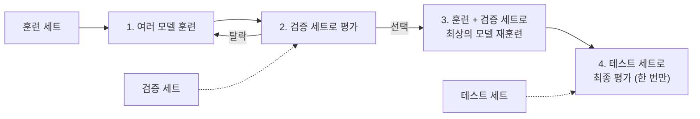

`핸즈온 머신러닝 with 사이킷런, 파이토치` 1장을 읽고 정리한 글이다. 1장은 머신러닝이 무엇인지보다 **어떤 문제에 어떤 기법을 쓰는지**를 먼저 보여 준다. 이 글은 1.3절의 애플리케이션 사례를 기준으로 작업 유형, 기법, 책에서 다루는 장을 묶어 정리하고, 이어서 1.5절의 도전 과제와 1.6절의 테스트·검증을 정리한다.

## 1. 사례 한눈에 보기

| 실제 사례 | 작업 유형 | 대표 기법 | 다루는 장 |
| --- | --- | --- | --- |
| 생산 라인에서 제품 이미지를 분석해 자동 분류 | 이미지 분류 | CNN, Vision Transformer | 12장, 16장 |
| 신용카드 부정 거래 감지 | 이상치 탐지 | Isolation Forest, Gaussian Mixture, Autoencoder | 8장, 18장 |
| 구매 이력 기반 고객 분할과 마케팅 전략 | 군집 | k-means, DBSCAN | 8장 |
| 고차원 데이터셋을 의미 있는 그래프로 표현 | 데이터 시각화 | 차원 축소 | 7장 |
| 과거 구매 이력 기반 상품 추천 | 추천 시스템 | 인공 신경망 | 9장 |
| 지능형 게임 봇 | 강화 학습 | RL 에이전트 | 19장 |

표를 보면 같은 "고객 데이터"라도 목적에 따라 작업 유형이 갈린다. 고객을 **나누는** 일은 군집이고, 고객에게 상품을 **골라 주는** 일은 추천 시스템이다. 기법보다 먼저 작업 유형을 정하는 순서가 1장의 핵심이다.

## 2. 사례별 정리

### 생산 라인 제품 이미지 자동 분류

이미지 분류(image classification) 작업이다. 일반적으로 합성곱 신경망(convolutional neural network, CNN)이나 Vision Transformer를 사용한다.

CNN은 12장, Vision Transformer는 16장에서 다룬다. 두 기법이 서로 다른 장에 있다는 점에서, 책 후반부가 이미지 문제를 두 가지 계열로 나누어 설명한다는 구조를 미리 알 수 있다.

### 신용카드 부정 거래 감지

이상치 탐지(outlier detection) 작업이다. 정상 거래가 대부분이고 부정 거래는 드물기 때문에, 정상 패턴에서 벗어난 데이터를 찾는 문제로 본다.

Isolation Forest, Gaussian Mixture 모델(8장), Autoencoder(18장)를 사용할 수 있다. 같은 문제에 전통적인 모델과 신경망 계열 모델이 모두 후보로 올라온다는 점이 눈에 띈다.

### 구매 이력 기반 고객 분할

군집(clustering) 작업이다. 정답 레이블 없이 비슷한 고객끼리 집합을 만들고, 집합마다 다른 마케팅 전략을 세운다.

k-means, DBSCAN 등을 사용한다(8장). 이상치 탐지와 같은 8장에 묶여 있는데, 둘 다 레이블 없이 데이터 구조를 찾는 **비지도 학습**이기 때문이다.

### 고차원 데이터셋의 시각화

데이터 시각화 작업이다. 사람이 볼 수 있는 2차원이나 3차원으로 내려야 하므로 차원 축소(dimensionality reduction) 기법을 많이 사용한다(7장).

차원 축소는 시각화만을 위한 기법이 아니다. 7장은 학습 속도와 메모리를 줄이는 전처리 용도도 함께 다룬다.

### 과거 구매 이력 기반 상품 추천

추천 시스템(recommender system)이다. 과거 구매 이력 같은 고객 정보를 인공 신경망(9장)에 주입하고, 다음에 구매할 가능성이 가장 높은 상품을 출력하는 것이 한 가지 방법이다.

일반적으로 모든 고객의 구매 이력을 기반으로 훈련한다. 한 고객의 데이터가 아니라 전체 고객의 패턴에서 배운다는 점이 군집과 다르다.

### 지능형 게임 봇

보통 강화 학습(reinforcement learning, RL)으로 해결한다(19장). 주어진 환경에서 보상이 최대가 되는 행동을 선택하도록 에이전트를 훈련하는 머신러닝의 한 분야다.

예를 들어 상대 플레이어가 점수를 잃을 때마다 봇이 보상을 받도록 설계할 수 있다. 바둑 세계 챔피언을 이긴 AlphaGo가 강화 학습으로 구축되었다.

## 3. 사례에서 보이는 분류 기준

위 사례를 다시 보면 1장이 머신러닝을 나누는 축이 드러난다.

- **레이블 유무**: 이미지 분류, 추천은 정답이 있는 지도 학습에 가깝고, 이상치 탐지, 군집, 차원 축소는 레이블 없는 비지도 학습이다.
- **데이터 종류**: 이미지는 CNN과 Vision Transformer, 표 형태 데이터는 Isolation Forest나 k-means처럼 데이터 형태가 기법을 거의 정한다.
- **학습 방식**: 게임 봇만 데이터셋이 아니라 환경과 보상으로 학습하는 강화 학습이다.

## 4. 머신러닝의 주요 도전 과제 (1.5절)

머신러닝의 주요 작업은 모델을 선택해서 데이터로 훈련시키는 일이다. 따라서 문제가 생기는 곳도 **나쁜 데이터**와 **나쁜 모델** 둘 중 하나다.

| 구분 | 문제 | 원인 | 대응 |
| --- | --- | --- | --- |
| 나쁜 데이터 | 충분하지 않은 양 | 간단한 문제도 수천 개, 복잡한 문제는 수백만 개가 필요 | 데이터 추가 수집, 전이 학습 |
| 나쁜 데이터 | 대표성 없는 데이터 | 샘플링 잡음, 샘플링 편향 | 일반화 대상을 대표하는 표본 설계 |
| 나쁜 데이터 | 낮은 품질 | 오류, 이상치, 잡음, 누락 | 데이터 정제 |
| 나쁜 데이터 | 관련 없는 특성 | garbage in, garbage out | 특성 공학 |
| 나쁜 모델 | 과대적합 | 데이터 양과 잡음에 비해 모델이 복잡 | 규제, 단순한 모델, 데이터 추가 |
| 나쁜 모델 | 과소적합 | 모델이 너무 단순 | 강력한 모델, 더 좋은 특성, 규제 완화 |
| 그 외 | 배포 문제 | 크기, 속도, 확장, 보안, 구식화 | MLOps |

### 충분하지 않은 양의 훈련 데이터

어린아이는 사과를 몇 번 보면 구분하지만, 머신러닝 알고리즘은 아주 간단한 문제에도 수천 개의 데이터가 필요하다. 이미지나 음성 인식 같은 복잡한 문제는 수백만 개가 필요할 수 있다. 이미 만들어진 모델을 재사용하는 전이 학습이 예외다.

2001년 Microsoft 연구자 Banko와 Brill의 논문은 자연어 중의성 해소 문제에서 **데이터가 충분하면 아주 단순한 모델을 포함한 여러 알고리즘이 비슷한 성능**을 낸다는 점을 보였다. 2009년 Peter Norvig 등의 "The Unreasonable Effectiveness of Data"로 이 생각이 더 유명해졌다.

다만 책은 알고리즘을 무시하지 말라고 덧붙인다. 소규모, 중간 규모 데이터셋이 여전히 흔하고, 데이터를 더 모으는 일이 항상 싸거나 쉽지는 않기 때문이다.

### 대표성 없는 훈련 데이터

일반화가 잘되려면 훈련 데이터가 **일반화하고 싶은 새로운 사례를 대표**해야 한다. 1인당 GDP와 삶의 만족도 예제에서 23,500달러 미만과 62,500달러 초과 국가를 빼고 훈련하면, 누락 국가를 추가했을 때 선형 모델이 크게 바뀐다.

대표성이 깨지는 경로는 두 가지다. 샘플이 작으면 우연히 대표성이 없어지는 **샘플링 잡음(sampling noise)** 이 생기고, 샘플이 커도 표본 추출 방법이 잘못되면 **샘플링 편향(sampling bias)** 이 생긴다.

1936년 미국 대선에서 The Literary Digest는 천만 명에게 우편을 보내 240만 명의 응답으로 Landon의 승리를 예측했지만, Roosevelt가 62%로 당선됐다. 전화번호부, 구독자 명부, 클럽 명부로 주소를 모아 부유층에 편중됐고, 25% 미만만 응답해 **비응답 편향(nonresponse bias)** 까지 더해졌다.

유튜브에서 "펑크 음악"을 검색해 훈련 세트를 만드는 것도 같은 문제다. 검색 결과는 인기 음악가로 편중되고, 지역에 따라 전혀 다른 장르(브라질의 funk carioca)가 섞인다.

### 낮은 품질의 데이터

오류, 이상치, 잡음이 가득한 데이터에서는 내재된 패턴을 찾기 어렵다. 대부분의 데이터 과학자가 데이터 정제에 많은 시간을 쓰는 이유다.

- 이상치가 명확하면 해당 샘플을 무시하거나 수동으로 고친다.
- 일부 샘플에 특성이 빠져 있으면(예: 고객 5%의 나이 누락) 그 특성을 무시할지, 그 샘플을 무시할지, 빠진 값을 채울지(예: 평균 나이), 특성을 넣은 모델과 뺀 모델을 따로 훈련할지 결정한다.

### 관련 없는 특성

"garbage in, garbage out". 관련 없는 특성이 적고 관련 있는 특성이 충분해야 시스템이 학습한다. 좋은 특성을 찾는 과정이 **특성 공학(feature engineering)** 이다.

- **특성 선택(feature selection)**: 가진 특성 중 훈련에 가장 유용한 것을 고른다.
- **특성 추출(feature extraction)**: 특성을 결합해 더 유용한 특성을 만든다. 차원 축소가 여기에 쓰인다.
- **데이터 수집**: 새 데이터를 모아 새 특성을 만든다.

### 훈련 데이터 과대적합

해외여행 중 택시 기사에게 물건을 도둑맞고 "그 나라 택시 기사는 다 도둑"이라고 결론 내리는 것이 과도한 일반화다. 모델이 훈련 데이터에는 너무 잘 맞지만 일반성이 떨어지는 상태를 **과대적합(overfitting)** 이라 한다.

고차원 다항 회귀 모델은 삶의 만족도 훈련 데이터에 선형 모델보다 잘 맞지만, 그 예측을 믿기는 어렵다. 나라 이름 같은 관련 없는 특성을 넣으면 "이름에 w가 들어간 나라는 만족도가 7보다 높다"는 식의 우연한 패턴을 잡아낼 수 있다. 뉴질랜드(7.6), 노르웨이(7.3), 스웨덴(7.2), 스위스(7.5)가 그 예이고, 이 규칙을 르완다나 짐바브웨에 일반화할 근거는 없다.

과대적합은 **데이터의 양과 잡음에 비해 모델이 너무 복잡할 때** 일어난다. 해결 방법은 세 가지다.

- 파라미터가 적은 모델을 고르거나, 특성 수를 줄이거나, 모델에 제약을 가해 단순화한다.
- 훈련 데이터를 더 모은다.
- 오류 데이터 수정, 이상치 제거로 잡음을 줄인다.

모델에 제약을 가해 단순하게 만드는 것을 **규제(regularization)** 라 한다. 선형 모델의 파라미터 \(\theta_0\), \(\theta_1\)은 두 개의 **자유도(degree of freedom)** 인데, \(\theta_1 = 0\)으로 강제하면 자유도가 1이 되어 평균 근처의 수평선만 남는다. \(\theta_1\)을 수정하되 작은 값으로 유지시키면 자유도 1과 2 사이의 모델이 된다.

그림 1-24에서 규제를 적용한 선형 모델은 기울기가 더 작다. 훈련 데이터(원)에는 덜 맞지만 훈련 중 보지 못한 새 샘플(사각형)에는 더 잘 일반화된다.

규제의 양은 **하이퍼파라미터(hyperparameter)** 가 정한다. 하이퍼파라미터는 모델이 아니라 학습 알고리즘의 파라미터이며, 훈련 전에 지정되고 훈련 중에는 상수로 남는다. 규제 하이퍼파라미터를 매우 크게 잡으면 기울기가 0에 가까운 평평한 모델이 나와 과대적합은 피하지만 좋은 모델도 얻지 못한다.

### 훈련 데이터 과소적합

**과소적합(underfitting)** 은 반대로 모델이 너무 단순해서 데이터의 내재된 구조를 학습하지 못하는 상태다. 삶의 만족도에 대한 선형 모델이 대표적이며, 현실이 모델보다 복잡하므로 훈련 샘플에서조차 부정확한 예측을 만든다.

- 모델 파라미터가 더 많은 강력한 모델을 고른다.
- 특성 공학으로 더 좋은 특성을 제공한다.
- 규제 하이퍼파라미터를 줄여 모델 제약을 완화한다.

### 배포 문제

데이터가 크고 잘 정제되어 있고 과소적합도 과대적합도 아닌 모델을 얻어도 배포(deployment) 단계에서 문제가 생긴다. 유지 보수하기에 너무 복잡하거나, 메모리에 맞지 않거나, 너무 느리거나, 확장되지 않거나, 보안 취약점이 있거나, 업데이트가 뜸해 구식이 되는 경우다.

이런 운영상의 문제를 다루는 기술은 데이터 모델링 기술과 다르다. 기업들이 별도의 **MLOps** 팀을 두는 이유다.

### 1.5절 핵심 요약

- 머신러닝은 명시적인 규칙을 코딩하지 않고 기계가 데이터로부터 학습하여 어떤 작업을 더 잘하도록 만드는 것이다.
- 지도 학습과 비지도 학습, 배치 학습과 온라인 학습, 사례 기반 학습과 모델 기반 학습 등 여러 종류의 시스템이 있다.
- 모델 기반이면 모델 파라미터를 조정해 훈련 세트에 맞추고 새 데이터에서도 좋은 예측을 기대한다. 사례 기반이면 샘플을 기억하고 유사도 측정으로 새 샘플과 비교한다.
- 훈련 세트가 너무 작거나, 대표성이 없거나, 잡음이 많거나, 관련 없는 특성으로 오염되면 시스템이 잘 작동하지 않는다. 모델은 너무 단순(과소적합)해도 너무 복잡(과대적합)해도 안 되고, 배포 제약도 고려해야 한다.

## 5. 테스트와 검증 (1.6절)

모델이 새 샘플에 얼마나 잘 일반화되는지 아는 유일한 방법은 새 샘플에 실제로 적용해 보는 것이다. 실제 서비스에 넣고 모니터링하는 방법도 있지만, 모델이 나쁘면 고객이 불만을 토로한다.

더 나은 방법은 데이터를 **훈련 세트**와 **테스트 세트**로 나누는 것이다. 새 샘플에 대한 오차 비율을 **일반화 오차(generalization error, out-of-sample error)** 라 하고, 테스트 세트로 이 값을 추정한다. 훈련 오차는 작은데 일반화 오차가 크면 과대적합이다.

보통 데이터의 80%를 훈련에, 20%를 테스트에 쓴다. 다만 데이터셋 크기에 따라 달라지며, 샘플이 천만 개면 1%만 떼어도 테스트 세트에 십만 개가 있어 충분하다. 옮긴이 주에 따르면 scikit-learn의 `train_test_split`은 기본값으로 25%를 테스트 세트로 뗀다.

### 하이퍼파라미터 튜닝과 모델 선택

두 모델 중 하나를 고르는 일은 단순하다. 둘 다 훈련 세트로 훈련하고 테스트 세트로 일반화 성능을 비교하면 된다.

문제는 하이퍼파라미터 선택이다. 100개의 하이퍼파라미터값으로 100개의 모델을 훈련하고 테스트 세트에서 일반화 오차가 가장 낮은 모델(5%)을 골랐는데, 실제 서비스에서 오차가 15%가 나오는 상황이 생긴다. 테스트 세트에서 일반화 오차를 여러 번 측정했으므로 **모델과 하이퍼파라미터가 테스트 세트에 최적화**되었기 때문이다.

해결책은 **홀드아웃 검증(holdout validation)** 이다. 훈련 세트의 일부를 떼어 **검증 세트(validation set, development set, dev set)** 를 만들고, 줄어든 훈련 세트에서 여러 후보 모델을 훈련한 뒤 검증 세트에서 가장 좋은 모델을 고른다. 그다음 검증 세트를 포함한 전체 훈련 세트에서 최선의 모델을 다시 훈련하고, 마지막에 한 번만 테스트 세트로 일반화 오차를 추정한다.

검증 세트 크기에는 양쪽 위험이 있다. 너무 작으면 평가가 부정확해 최적이 아닌 모델을 고를 수 있고, 너무 크면 남은 훈련 세트가 전체보다 훨씬 작아진다. 최종 모델은 전체 훈련 세트에서 훈련되므로, 작은 훈련 세트로 후보를 비교하는 것은 **가장 빠른 단거리 주자를 골라 마라톤에 내보내는 것**과 같다.

이 문제를 푸는 방법이 작은 검증 세트 여러 개를 쓰는 **교차 검증(cross-validation)** 이다. 검증 세트마다 나머지 데이터로 훈련한 모델을 그 검증 세트에서 평가하고 결과를 평균한다. 대신 훈련 시간이 검증 세트 개수에 비례해 늘어난다.

### 데이터 불일치

훈련 데이터는 많이 구할 수 있지만 실제 제품에 들어올 데이터를 대표하지 못하는 경우가 있다. 꽃 사진으로 꽃 이름을 찾는 모바일 앱을 만들 때, 웹에서 수백만 장을 내려받을 수 있지만 실제 앱으로 찍을 사진은 1,000장뿐일 수 있다.

가장 중요한 규칙은 **검증 세트와 테스트 세트가 실전에서 기대하는 데이터를 대표**해야 한다는 것이다. 대표성 있는 사진 1,000장을 섞어 반은 검증 세트, 반은 테스트 세트에 넣는다(두 세트에 중복이나 비슷한 사진이 들어가지 않게 한다).

웹 사진으로 훈련한 모델이 검증 세트에서 성능이 나쁘면, 과대적합 때문인지 웹 사진과 앱 사진의 **데이터 불일치** 때문인지 구분할 수 없다. Andrew Ng이 제안한 **훈련-개발 세트(train-dev set)** 가 이를 가른다.

| 세트 | 출처 | 역할 |
| --- | --- | --- |
| 훈련 세트 | 웹 사진 | 모델 훈련 |
| 훈련-개발 세트 | 웹 사진 (훈련 세트에서 떼어냄) | 과대적합 여부 판단 |
| 검증 세트 | 앱 사진 | 데이터 불일치 판단, 모델 선택 |
| 테스트 세트 | 앱 사진 | 최종 성능 추정 |

훈련 세트로 훈련한 모델을 훈련-개발 세트에서 평가해 성능이 나쁘면 과대적합이다. 규제, 데이터 추가 수집, 데이터 정제를 시도한다. 훈련-개발 세트에서는 잘 되는데 검증 세트에서 나쁘면 데이터 불일치이므로, 웹 이미지를 앱 사진처럼 보이도록 전처리한 뒤 다시 훈련한다.

### 공짜 점심 없음 이론

모델은 데이터의 간소화된 표현이다. 모델 종류를 고르는 순간 데이터에 대한 암묵적인 **가정(assumption)** 을 하게 되며, 선형 모델을 골랐다면 데이터가 근본적으로 선형이고 직선과의 거리는 무시할 수 있는 잡음이라고 가정한 것이다.

1996년 David Wolpert는 데이터에 관해 아무 가정도 하지 않으면 한 모델을 다른 모델보다 선호할 근거가 없음을 보였다. 이것이 **공짜 점심 없음(no free lunch, NFL)** 이론이다. 어떤 모델이 최선인지 확실히 아는 방법은 모든 모델을 평가하는 것뿐인데 그것은 불가능하므로, 실전에서는 데이터에 관해 타당한 가정을 하고 적절한 모델 몇 가지만 평가한다.

## 6. 1주차 정리

1장 전반부는 **문제를 작업 유형으로 번역하는 연습**이고, 후반부는 그 작업이 실패하는 지점(나쁜 데이터, 나쁜 모델)과 실패를 측정하는 방법(검증 세트, 테스트 세트)을 다룬다. 사례마다 장 번호가 붙어 있어서 1.3절의 표가 책 전체의 지도 역할을 한다.

다음 주차부터는 2장의 엔드 투 엔드 프로젝트를 따라가며, 위 표의 작업 유형 중 회귀 문제를 실제 코드로 다룬다.
