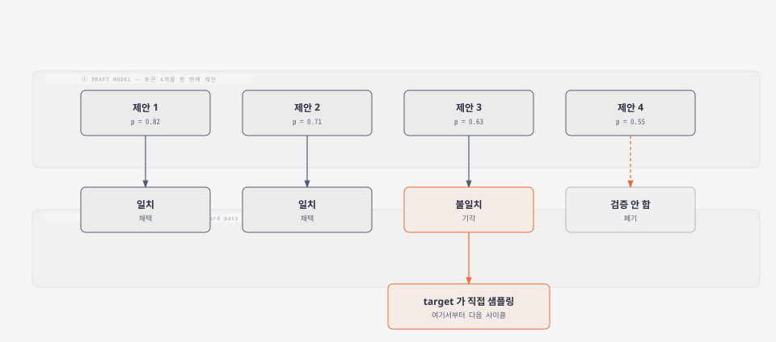
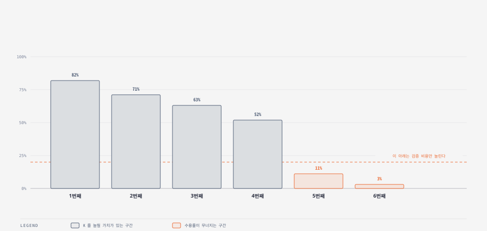
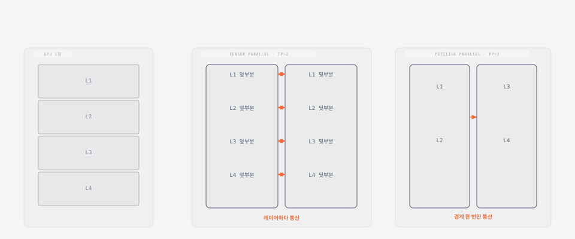
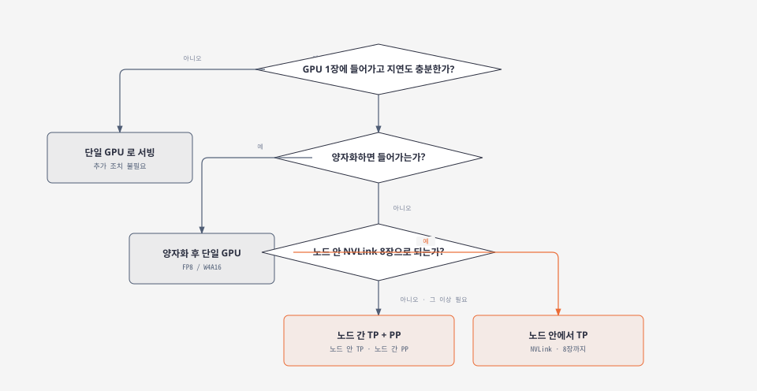
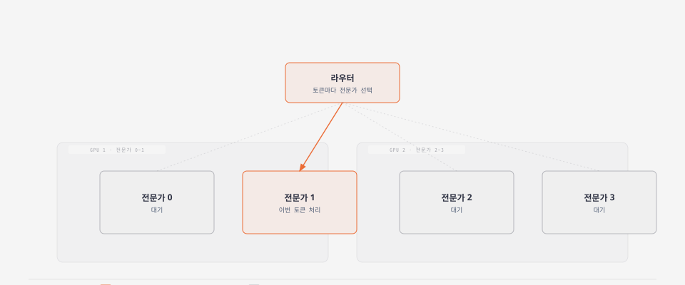
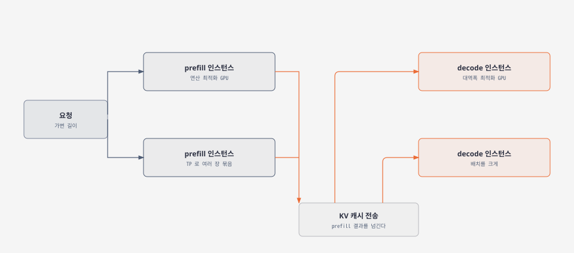
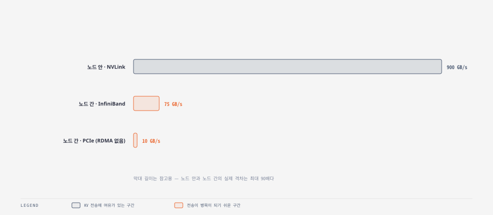
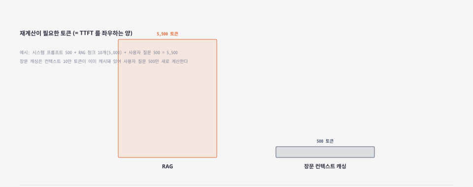
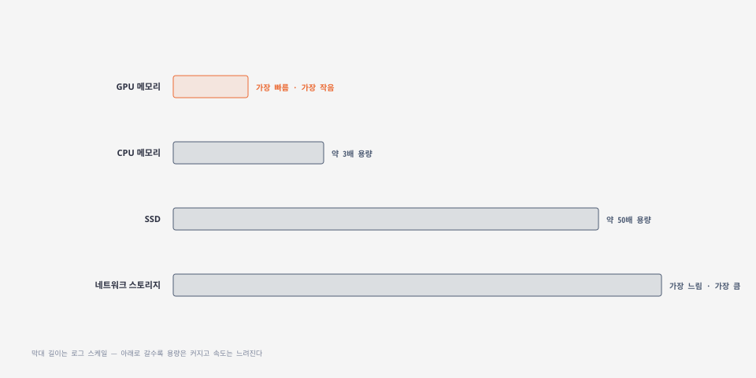
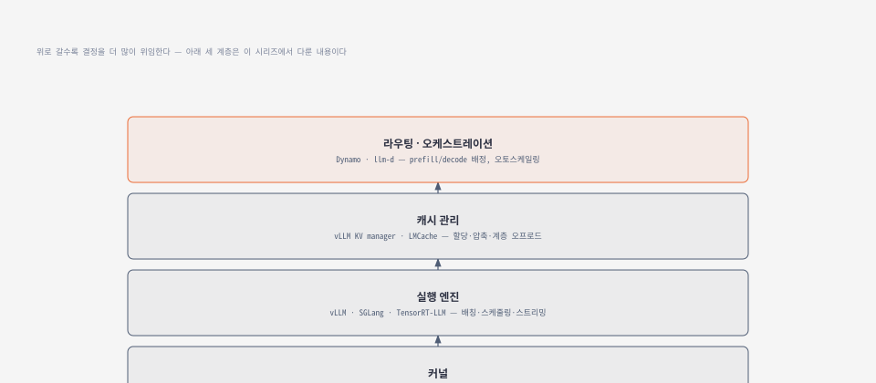

## 1. 추측 디코딩 — 작은 모델이 먼저 찍는다

decode는 토큰 하나를 만들 때마다 가중치 전체를 다시 읽는다. **연산은 남는데 대역폭이 모자란 상태**다. 추측 디코딩은 이 남는 연산을 활용해 대역폭 병목을 우회한다.

작고 빠른 **draft 모델**이 다음 토큰 여러 개를 먼저 추측한다. 그다음 크고 정확한 **target 모델**이 그 추측을 한 번의 forward pass로 한꺼번에 검증한다. draft가 맞힌 부분까지는 그대로 채택하고, 처음 틀린 지점부터는 target이 직접 새로 뽑는다.

**핵심은 결과가 똑같다는 점이다.** target의 검증을 거치므로 최종 출력은 추측 디코딩 없이 순수하게 하나씩 생성했을 때와 동일하다. 속도만 오르고 품질은 그대로다.

한 번에 검증할 수 있는 이유는 6절에서 본 것과 같다. **여러 토큰을 동시에 넣으면 prefill처럼 연산 강도가 오른다.** decode 한 스텝이 마치 짧은 prefill처럼 동작하는 셈이다.

### 몇 개까지 추측할까

추측 개수를 K라 하면, K를 늘릴수록 이론상 얻을 수 있는 속도 상한은 올라간다. 문제는 **뒤쪽 토큰일수록 draft가 틀릴 확률이 높다**는 것이다.

앞쪽 한두 개는 수용률이 높지만 대여섯 번째로 가면 뚝 떨어지는 패턴이 흔하다. **이 구간을 넘어서까지 K를 키우면 검증 비용만 늘고 실익은 없다.** 그래서 실서비스에서는 K를 4~8 사이에서 시작해 위치별 수용률을 보며 조정한다.

### draft 모델을 무엇으로 쓸까

가장 단순한 방법은 같은 계열의 작은 모델을 그대로 쓰는 것이다. 토크나이저가 같으면 궁합이 좋다.

더 정교한 접근은 **self-drafting**이다. 별도 모델 없이, target 모델 자체에 가벼운 예측 헤드를 몇 개 더 달아 같은 forward pass 안에서 다음 몇 토큰까지 미리 뽑는다. Medusa와 EAGLE 계열이 이 방식이다.

가장 가벼운 방법은 **n-gram**이다. 별도 모델도 헤드도 없이, 지금까지 나온 텍스트에서 반복되는 짧은 패턴을 찾아 다음 토큰을 제안한다. JSON처럼 구조가 뻔한 출력이나, 프롬프트 내용을 그대로 되풀이하는 작업에서 특히 잘 듣는다. **오버헤드가 거의 없어서, 다른 방법을 시도하기 전에 먼저 켜볼 만하다.**

### 언제 안 통하나

추측 디코딩은 **decode에만** 듣는다. prefill처럼 이미 연산에 묶인 구간에서는 여윳값이 없어 효과가 없다.

배치가 커져도 마찬가지다. 배치를 충분히 키우면 decode 자체가 연산 쪽으로 넘어가는데, 그 지점을 넘으면 draft 모델이 쓰는 연산이 오히려 순수 손해가 된다. **지연에 민감하고 배치가 작은 워크로드**에서 가장 값어치가 크다.

## 2. 모델을 여러 GPU에 나눈다

모델이 GPU 한 장의 메모리를 넘으면 선택지가 넷으로 갈린다.

- **데이터 병렬(DP)** — 모델을 통째로 복제해 요청을 나눠 받는다. 처리량을 늘리는 용도
- **텐서 병렬(TP)** — 레이어 하나를 옆으로 잘라 나눠 든다. 지연을 줄이는 용도
- **파이프라인 병렬(PP)** — 레이어 묶음을 세로로 잘라 순서대로 넘긴다. 역시 크기를 감당하는 용도
- **전문가 병렬(EP)** — MoE 모델의 전문가들을 GPU별로 나눠 든다

DP는 앞서 여러 글에서 다룬 로드밸런싱과 같은 이야기라 여기서는 TP·PP·EP에 집중한다.

### TP와 PP — 너비냐 깊이냐

TP는 레이어의 **너비**를 자른다. 가중치 행렬을 절반씩 나눠 각 GPU가 부분 계산을 하고 결과를 합친다. PP는 **깊이**를 자른다. 앞쪽 레이어는 GPU 1이, 뒤쪽 레이어는 GPU 2가 맡고 중간 결과만 넘긴다.

**통신 빈도가 정반대다.** TP는 레이어를 지날 때마다 GPU끼리 부분 결과를 주고받아야 한다. PP는 담당 구간의 경계에서 딱 한 번만 넘기면 된다.

그렇다고 PP가 항상 이긴다는 뜻은 아니다. **파이프라인 버블**이라는 대가가 있다. 한 구간이 다른 구간보다 느리면 뒤쪽 GPU가 놀면서 기다린다. 조립 라인에서 한 공정이 막히면 뒷공정 전체가 멈추는 것과 같다.

### 어디까지 밀어붙일까

앞 글에서 GPU 메모리 대역폭이 GPU 간 인터커넥트보다 훨씬 빠르다고 확인했다. H100 기준 메모리 대역폭이 3TB/s대인데 NVLink로 묶인 GPU 간 대역폭은 900GB/s 남짓이다. **GPU를 늘리는 것 자체가 공짜가 아니라는 뜻이다.**

순서는 이렇다. **GPU 한 장으로 되면 무조건 그게 낫다.** 안 되면 양자화로 줄여본다. 그래도 안 되면 노드 안 NVLink로 묶어 TP를 쓴다. 그마저 부족하면 노드를 넘어야 하는데, 이때는 **노드 안에서는 TP, 노드 간에는 PP**로 역할을 나눈다. 느린 인터커넥트로는 TP의 잦은 통신을 감당할 수 없어서다.

### 전문가 병렬 — MoE 전용

Mixtral이나 DeepSeek-V3 같은 MoE 모델은 토큰마다 전문가 몇 개만 골라 쓴다. 전체 파라미터는 크지만 토큰 하나가 실제로 건드리는 연산량은 작다.

문제는 **전체 파라미터가 GPU 한 장에 안 들어간다**는 것이다. 그래서 전문가들을 GPU별로 나눠 두고, 라우터가 고른 전문가가 있는 GPU로만 그 토큰을 보낸다.

**나머지 전문가가 있는 GPU는 이번 토큰과 무관하다.** 실제로는 EP가 TP·PP와 함께 쓰여 MoE가 아닌 레이어는 TP로, 전문가는 EP로 나누는 조합이 흔하다.

## 3. prefill 과 decode 를 아예 다른 GPU 로

지금까지의 병렬화는 **모델을 어떻게 나눌지**였다. 여기서부터는 다른 질문이다. **같은 GPU가 prefill과 decode를 번갈아 하는 게 최선인가.**

연산 강도로 보면 둘은 정반대 워크로드다. prefill은 연산에, decode는 대역폭에 묶인다. 같은 GPU에 몰아넣으면 한쪽이 처리되는 동안 다른 쪽 자원은 논다. chunked prefill로 어느 정도 완화되지만, 두 워크로드의 **자원 사용 패턴 자체가 다르다는 근본 문제**는 남는다.

**PD 분리**는 아예 GPU를 나눈다. prefill 전용 인스턴스가 컨텍스트를 처리해 KV 캐시를 만들고, 그 캐시를 decode 전용 인스턴스로 넘겨 이어서 생성한다.

### 얻는 것

**TTFT와 ITL을 따로 조정할 수 있다.** 입력이 긴 워크로드라면 prefill 쪽 자원을 늘려 TTFT를 줄이고, 출력이 긴 워크로드라면 decode 쪽을 늘려 ITL을 줄인다. 한 GPU에 몰려 있으면 이 둘을 독립적으로 조정할 수 없다.

**하드웨어도 따로 고를 수 있다.** prefill은 연산이 강한 칩이, decode는 대역폭이 큰 칩이 유리하다. 앞 글에서 본 H100과 H200처럼 같은 FLOPS라도 메모리 스펙이 다른 칩을 각 단계에 맞게 배정할 수 있다.

### 대가는 KV 캐시 전송

prefill이 만든 KV 캐시를 decode로 옮기는 과정이 새로 생긴다. **이 전송 비용이 분리로 얻는 이득보다 작아야만 의미가 있다.**

관건은 인터커넥트다. 같은 노드 안이면 NVLink로 넉넉하지만, 노드를 넘으면 상황이 급격히 나빠진다.

**RDMA 없는 PCIe로는 사실상 못 쓴다.** InfiniBand 같은 RDMA가 있어야 노드 간 전송이 병목이 되지 않는다. 그래서 prefill과 decode를 같은 노드 안에 배치하는 것이 기본 전략이고, 여기에 청크 단위 전송이나 레이어별 스트리밍처럼 계산과 전송을 겹치는 최적화를 더하면 전송 오버헤드를 전체 지연의 몇 퍼센트 이하로 누를 수 있다.

### 언제 쓰나

PD 분리는 공짜가 아니다. 인스턴스 두 종류를 따로 운영하고 KV 전송 경로까지 관리해야 한다. **대형 모델을 높은 트래픽으로 서빙하면서 TTFT와 ITL을 정밀하게 맞춰야 하는 경우**가 아니면 굳이 쓸 이유가 없다. 작은 모델이나 트래픽이 적은 환경에서는 한 GPU가 prefill과 decode를 같이 처리하는 지금까지의 구조로 충분하다.

## 4. 고급 KV 캐싱 — 컨텍스트를 미리 캐시해 둔다

여기까지는 계산을 빨리 하는 이야기였다. 이번엔 **계산 자체를 안 하는** 이야기다.

### RAG 대신 통째로 캐시한다

RAG는 질문마다 관련 문서를 검색해 프롬프트에 끼워 넣는다. 매번 다른 청크가 붙으므로 prefix 캐시 적중률이 낮다.

컨텍스트 윈도우가 10만 토큰을 넘는 모델이 흔해지면서 다른 선택지가 생겼다. **관련 지식 전체를 고정된 prefix로 두고 미리 캐시해 버리는 것**이다. 매 요청마다 검색하는 대신, 이미 캐시된 컨텍스트에 사용자 질문만 붙인다.

시스템 프롬프트 500토큰에 청크 10개(5,000토큰), 사용자 질문 500토큰을 합친 RAG는 매번 **5,500토큰을 새로 계산**한다. 컨텍스트를 통째로 캐시해 두면 10만 토큰이 이미 캐시에 있으니 **사용자 질문 500토큰만** 새로 읽으면 된다. TTFT가 자릿수 단위로 줄어드는 이유다.

**다만 비용까지 줄어드는 건 아니다.** 캐시된 토큰도 저장·유지 비용이 들고, 총 입력량 자체는 장문 캐싱 쪽이 훨씬 크다. 실시간성이 중요하거나 지식 베이스가 자주 바뀐다면 RAG가 여전히 유리하다. **어느 쪽이 싼지는 캐시 토큰 단가와 컨텍스트 크기에 달려 있어 워크로드마다 계산해봐야 한다.**

### KV 캐시는 GPU에만 있지 않다

장문 컨텍스트를 여러 개 캐시하려면 GPU 메모리만으로는 금방 바닥난다. 그래서 KV 캐시를 계층으로 늘어놓는다.

GPU 메모리가 가장 빠르고 가장 작다. CPU 메모리로 내리면 용량이 몇 배로 늘고, SSD까지 가면 수십 배로 늘어난다. **속도는 그만큼 희생한다.** LMCache 같은 시스템은 이 계층을 자동으로 관리해, 자주 쓰는 컨텍스트는 GPU 가까이에 두고 덜 쓰는 것은 아래로 내린다.

같은 GPU 메모리로 여러 배 많은 컨텍스트를 캐시할 수 있다는 뜻이고, 이는 곧 **모델 인스턴스를 늘리지 않고도 더 많은 테넌트나 문서를 감당할 수 있다**는 뜻이다.

### 압축과 블렌딩

캐시를 옮기는 비용을 더 줄이려면 **압축**한다. KV 캐시를 양자화하거나, 분포에 맞춰 더 촘촘하게 인코딩하는 전용 기법을 쓴다. 캐시가 작아지면 전송도 빨라지고 계층 이동도 가벼워진다.

RAG는 이 흐름에서도 여전히 쓸모가 있다. 검색 범위가 넓거나 최신성이 중요하면 캐시보다 RAG가 낫다. 문제는 **RAG 청크의 KV 캐시를 단순히 이어 붙이면 안 된다**는 점이다. 어텐션은 캐시 안에서만 계산되는 게 아니라 청크 사이의 관계도 학습하므로, 순서를 바꾸거나 그냥 붙이면 그 관계가 깨진다.

**CacheBlend** 같은 기법은 전체를 다시 계산하는 대신 일부(흔히 10~20%)만 다시 계산해 청크 간 관계를 복원한다. 완전 재계산보다 훨씬 싸면서 품질 저하는 미미하다.

## 5. 지금까지 다룬 것은 스택의 일부다

세 편에 걸쳐 GPU 스펙부터 배칭, 어텐션, 양자화, prefix 캐싱, 그리고 이번 편의 추측 디코딩과 병렬화, PD 분리, 고급 캐싱까지 왔다. 이걸 한데 모으면 현대 LLM 서빙은 네 개 층으로 쌓인 스택이다.

가장 아래는 **커널**이다. CUDA·Triton으로 짠 연산 코드가 GPU를 얼마나 알뜰하게 쓰는지를 정한다. 그 위가 **실행 엔진**이다. vLLM·SGLang·TensorRT-LLM이 배칭과 스케줄링, prefill·decode 조율을 맡는다. 그 위가 **캐시 관리**다. KV 캐시를 어디에 얼마나 담고 어떻게 옮길지를 vLLM의 KV manager나 LMCache 같은 시스템이 결정한다.

**맨 위는 라우팅과 오케스트레이션이다.** 요청을 어느 prefill·decode 인스턴스로 보낼지, 어느 캐시가 있는 노드로 보낼지, 언제 인스턴스를 늘릴지를 정한다. NVIDIA Dynamo나 llm-d 같은 시스템이 이 층을 맡는다.

**이 세 편의 시리즈가 다룬 것은 아래 세 층이다.** 한 층에서 아무리 최적화해도 위층 결정이 나쁘면 그 이득이 사라진다. 실서비스급 성능은 네 층을 함께 맞출 때만 나온다.

정리하면 이렇다. **추측 디코딩**은 decode의 남는 연산을 활용하고, **TP·PP·EP**는 모델을 여러 GPU에 나누는 세 가지 방식이며, **PD 분리**는 두 단계의 자원 프로파일이 다르다는 근본 문제를 물리적으로 풀고, **고급 KV 캐싱**은 계산을 아예 생략하는 쪽으로 최적화를 밀어붙인다. 넷 다 방향은 다르지만 목표는 하나, **같은 하드웨어로 더 많은 요청을 더 빠르게 처리하는 것**이다.
