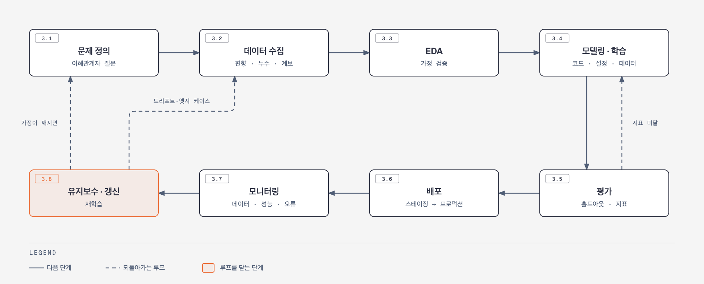

`Machine Learning Platform Engineering` 의 2장은 MLOps가 왜 루프여야만 하는지 다룬다.

기억하자. **모델은 조직의 최종 산출물이 아니라 수단이다.**

## 1. 모델 만들기는 어려운 부분이 아니다

모델 아키텍처를 처음부터 연구하는 회사는 드물다. 대부분 기존 구조를 재사용하거나 공개 모델을 도메인에 적응시킨다. Hugging Face 같은 생태계가 이 과정을 더 간단하게 만들었다.

정말 어려운 것은 이제부터다.

- 모델을 **어떻게** 학습시킬 것인가
- 데이터는 모델까지 **어떻게** 도달하는가
- 모델은 다른 서비스와 **어떻게** 상호작용하는가
- 모델은 **어디서** 실행되는가
- 시간이 지나도 정확도를 **어떻게** 유지하는가

다섯 개 모두 모델링보다는 **플랫폼의 문제**다. 비즈니스 가치와 인프라 사이의 이 간극이 MLOps를 어렵게 만든다.

## 2. MLOps의 루프 그려보기

ML을 직선 모양의 일련의 과정으로 생각한다면 배포가 종착지가 된다. 하지만 ML 특성상 재학습과 드리프트 대응이 필수적이다.

루프로 그리면 모델·데이터·하이퍼파라미터가 **잠시 머무는 상태**일 뿐이다. 그래서 "이 모델을 어떻게 잘 만들까"보다 **"모델이 바뀔 때 무슨 일이 일어나는가"** 를 먼저 설계한다.

### 모델과 코드는 별개의 실체다

 **모델(가중치와 네트워크)과 코드(아키텍처 정의와 주변 코드)는 따로 움직인다.** 코드는 그대로인데 새 데이터로 재학습해 모델만 바뀌기도 하고 모델은 그대로인데 전처리 코드만 바뀌기도 한다.

| 구분     | 모델 (가중치 + 네트워크)                      | 코드 (아키텍처 정의 + 지원 코드)    |
| ------ | ------------------------------------ | ----------------------- |
| 정체     | 학습 결과로 만들어진 파일                       | 사람이 작성한 소스코드            |
| 담긴 것   | 학습된 숫자와 연산 구조                        | 층 구성 클래스, 전처리, 학습·추론 로직 |
| 저장 형태  | `model.pkl`, `best.pt`, `model.onnx` | `.py` 파일, Git 저장소       |
| 버전 관리  | 모델 레지스트리, 아티팩트 저장소                   | Git                     |
| 바뀌는 계기 | 재학습할 때마다                             | 로직이나 구조를 고칠 때           |

당연히 둘은 짝이 맞아야 동작한다. 층 크기를 바꾼 코드로 예전 가중치를 불러오면 에러가 나거나 최악의 경우 조용히 엉뚱한 결과가 나온다. 그래서 모델에는 **어느 코드 버전과 짝인지**를 메타데이터로 남긴다.

### 계보(lineage)는 모델의 족보다

계보는 **이 모델이 무엇으로부터 어떤 과정을 거쳐 만들어졌는가**를 잇는 기록이다. 원천 데이터에서 전처리, 피처, 학습 실행(코드와 하이퍼파라미터), 모델, 배포까지의 사슬을 연결한다.

계보는 유지와 추적이 한 세트다.

| 구분   | 계보 유지                         | 계보 추적                   |
| ---- | ----------------------------- | ----------------------- |
| 하는 일 | 각 단계에서 연결 정보를 기록              | 기록을 따라 거슬러 오르거나 내려가며 조회 |
| 시점   | 학습·배포하는 동안 (쓰기)               | 문제가 생기거나 감사할 때 (읽기)     |
| 도구   | 실험 추적, 모델 레지스트리, 데이터·코드 버전 관리 | 레지스트리·추적 UI             |

추적은 두 방향이다. 운영 모델의 성능이 떨어지면 **"이 모델은 어떤 데이터와 코드로 만들었나"** 를 거슬러 오른다. 학습 데이터에 오류가 있었다고 밝혀지면 **"이 데이터로 만든 모델이 지금 어디에 배포돼 있나"** 를 따라 내려간다.

## 3. 루프의 단계별 정리

### 3.1 문제 정의

루프는 문제 정의에서 시작한다. "고객 이탈률을 예측하라" 같은 문장만으로는 모델링도 평가 기준도 정할 수 없다. 이해관계자 그룹마다 답해야 할 질문이 다르다.

| 이해관계자                    | 핵심 질문                                                                      |
| ------------------------ | -------------------------------------------------------------------------- |
| 비즈니스·제품                  | 왜 ML이 필요한가, 성공을 무엇으로 측정하나, 오답의 비용과 허용 오차는 얼마인가, 일정은 언제인가                   |
| 기술 (ML 엔지니어, 데이터 사이언티스트) | ML로 풀 수 있는 문제인가, 데이터는 어디에 있나, 평가 지표는 무엇인가, 학습·서빙 자원은 얼마나 드나, 무엇이 재학습을 촉발하나 |
| 법무·컴플라이언스                | 윤리·개인정보 문제가 있나, 민감 정보는 어떻게 다루나, 데이터 거버넌스 요건은 무엇인가                          |

함께 답을 만들면 범위와 산출물이 명확해지고 비즈니스 목표와 기술 구현이 맞춰진다. 잠재적 문제도 초기에 드러난다.

### 3.2 데이터 수집

문제와 KPI가 정해지면 데이터를 모은다. **이후 모든 단계가 이 단계의 편향을 그대로 물려받는다.** 그래서 수집할 때는 다음 요건을 챙긴다.

- 문제 도메인과의 관련성, 문제 복잡도에 맞는 크기, 품질
- 유해한 편향과 데이터 누수 방지
- 배포 환경을 대표하는 데이터·피처 분포
- 문제 도메인을 정의할 만큼의 다양성
- 원시 데이터부터 애노테이션 데이터셋까지의 계보

#### 연구와 기업은 출발점이 다르다

| 구분     | 연구                 | 기업                             |
| ------ | ------------------ | ------------------------------ |
| 관심사    | 지표 최적화             | 배포 환경에서 동작하는 제품                |
| 데이터셋   | 검토를 거친 대규모 공개 데이터셋 | **대상 도메인용 공개 데이터셋이 없는 경우가 많다** |
| 데이터 품질 | 충분하다고 가정           | 직접 확보하고 검증                     |
| 파인튜닝   | 선택                 | **배포 환경 데이터로 필수**              |

공개 모델을 쓰더라도 결국 **내 환경의 데이터는 직접 마련해야 한다.** 다만 좋은 데이터의 요건 자체는 연구와 기업이 같다.

#### 큐레이션: 모으는 일과 다듬는 일

수집이 재료를 장보는 일이라면 큐레이션은 **재료를 고르고 손질하는 일**이다. 선별, 정제, 중복 제거, 균형 조정, 레이블 품질 관리, 문서화가 여기에 들어간다.

큐레이션에는 순서 규칙이 있다.

- **균형 조정은 훈련 데이터에만 한다.** 검증·테스트 데이터까지 조정하면 실제 운영 환경과 달라져 점수가 부풀려진다.
- **분할 전에 중복을 제거한다.** 같은 샘플이 훈련과 테스트 양쪽에 들어가면 누수가 된다.

#### 편향과 누수

**편향은 데이터가 현실과 다른 문제이고 누수는 평가가 현실과 다른 문제다.** 둘 다 학습 이후에는 고치기 어렵다.

| 종류       | 설명                     | 예시                            |
| -------- | ---------------------- | ----------------------------- |
| 표본 편향    | 데이터가 세상을 골고루 담지 못함     | 밝은 실내 신분증만 학습, 어두운 사진에서 실패    |
| 선택 편향    | 레이블이 특정 경우에 쏠림         | 신고된 사기만 사기로 표시, 신고 안 된 사기를 놓침 |
| 과거 편향    | 과거의 불공정한 판단을 학습        | 과거 대출 심사의 차별을 모델이 재현          |
| 샘플 중복 누수 | 같은 데이터가 훈련과 테스트에 모두 존재 | 같은 사진이 두 번 수집됨                |
| 미래 정보 누수 | 예측 시점에 알 수 없는 정보 사용    | 3월 1일 판정에 3월 5일 평균값 사용        |
| 정답 단서 누수 | 정답을 간접적으로 알려 주는 피처     | 사기 확정 후에 생기는 계정 정지 여부         |

**점수가 지나치게 좋으면 성공이 아니라 누수를 의심한다.**

#### 계보는 기술 부채와 성질이 같다

계보는 프로젝트 초기에 가장 자주 빠지는 요소다. **초기 속도를 벌고 나중에 복잡도로 갚는다는 점에서 기술 부채와 같다.**

데이터셋의 첫 버전이 최선인 경우는 드물다. 오류를 발견했을 때 **쿼리 한 번으로 데이터셋을 다시 만드느냐, 추출 스크립트를 처음부터 다시 짜느냐**가 계보 유무로 갈린다.

자동차 가격 추정 예시가 이 원칙을 적용한다. 중고 승용차만 모으고 트럭·오토바이는 뺀다. 편향을 피하는 샘플링을 쓰고 **버전 관리되는 ETL 파이프라인**으로 데이터셋을 만들어 계보를 확보한다.

#### 책의 세 프로젝트는 모달리티가 다르다

책은 데이터 형태(모달리티)가 다른 세 프로젝트로 같은 원칙이 어떻게 달리 적용되는지 보여준다.

| 프로젝트       | 모달리티   | 데이터                                               | 레이블 방식             |
| ---------- | ------ | ------------------------------------------------- | ------------------ |
| 신분증 탐지     | 이미지    | MIDV-500 (문서 50종 × 영상 10편)                        | 프레임별 문서 모서리 좌표     |
| 영화 추천      | 정형 데이터 | MovieLens 1M (사용자 6,000명, 영화 약 3,000편, 평점 100만 건) | 평점 컬럼              |
| RAG 문서 도우미 | 텍스트    | 사내 문서                                             | 정답이 정해지지 않은 경우가 많음 |

MIDV-500은 여러 나라의 신분증·여권·운전면허증 **견본 문서**를 스마트폰으로 찍은 영상이다. 실제 개인 정보가 아니라서 공개될 수 있었고 손 가림이나 어수선한 배경 같은 촬영 조건이 섞여 있다.

신분증 프로젝트에서는 CVAT로 **사람 애노테이션**도 다룬다. 사람이 박스를 그리고 모델이 학습해 다음 이미지에 박스를 제안하고 사람이 고친 레이블로 다시 학습하는 human-in-the-loop 구조다. 시간·비용, 사람마다 다른 기준, 레이블 버전 관리 같은 문제가 이 과정에서 생긴다.

전체를 손으로 애노테이션하지 않아도 되는 것은 **합성 데이터** 덕분이다. 프로그램이 신분증 템플릿을 배경에 붙여 이미지를 만들면 붙인 위치를 이미 알기 때문에 레이블이 함께 나온다.

MovieLens는 일부러 **여러 조각으로 나눠 하나씩 더한다.** 운영 중에 사용자 데이터가 계속 쌓이는 상황을 흉내 내기 위해서다. 조각이 더해질 때마다 데이터셋 버전(v1, v2, v3)이 쌓이고 여기서 데이터 버전 관리가 시작된다.

이 조각 나누기는 **도착 시점**이 기준이라 **용도**로 나누는 훈련·검증·테스트 분할과 목적이 다르다. 각 버전 안에서도 훈련·검증·테스트 분할은 여전히 필요하다.

### 3.3 탐색적 데이터 분석(EDA)

EDA는 데이터의 통계적 특성을 파악하는 단계다. 정의가 덜 된 문제에 대한 **첫 번째 방어선**이고 모델 개발과 유지에 드는 작업량을 가늠하는 근거가 된다. 이 단계에서는 다음 질문을 확인한다.

- 스키마는 무엇이고 바뀔 수 있는가, 잘못된 값은 어떻게 막는가
- 타깃이 고르게 분포하는가, 클래스 균형 조정이 필요한가
- 목표 작업에 충분한 피처가 있는가, 피처 계산 비용은 큰가
- 입력이 주기적으로 변하는가, 모델 밖 요인과 상관관계가 있는가
- 이상값이 있는가, 프로덕션에서는 어떻게 처리하는가

변수를 하나씩 보지 않고 여러 개를 함께 보는 **다변량 분석**이 피처 설계의 단서가 된다. 키와 몸무게를 따로 보면 평범해도 함께 보면 BMI라는 피처가 나온다.

변수가 수십 개를 넘으면 차원 축소로 2 ~ 3차원에 투영해 본다.

| 구분  | PCA                    | t-SNE                             |
| --- | ---------------------- | --------------------------------- |
| 방식  | 가장 넓게 퍼진 방향으로 선형 투영    | 가까운 점끼리 가깝게 비선형 배치                |
| 강점  | 빠르고 결과가 일정, 피처 축소에도 사용 | 군집 구조 시각화                         |
| 주의  | 비선형 구조를 못 잡음           | 느리고 실행마다 결과가 다름, 군집 간 거리는 해석하지 않음 |

#### 가정은 검증될 때까지 리스크다

모든 가정은 검증될 때까지 **리스크로 취급하고** 파이프라인 앞단에 검사를 심는다.

가정은 거창하지 않다. 들어오는 데이터의 스키마, 숨은 샘플링 편향, 특정 필드에 대한 오해 같은 것들이다. 미리 확인하면 **접근법을 바꿀 기회가 초기에 생긴다.**

### 3.4 모델링과 학습

먼저 문제 유형을 정한다. 유형은 **모델이 무엇을 출력해야 하는가**로 갈린다.

| 유형  | 질문          | 출력         | 예시          |
| --- | ----------- | ---------- | ----------- |
| 분류  | 이것은 무엇인가    | 정해진 범주 하나  | 스팸 여부       |
| 탐지  | 무엇이 어디에 있는가 | 범주와 위치(박스) | 사진 속 신분증 위치 |
| 회귀  | 얼마인가        | 연속적인 숫자    | 중고차 가격      |

같은 소재도 출력 형태에 따라 유형이 바뀐다. 영화 평점을 좋음·나쁨으로 맞히면 분류, 3.7점으로 맞히면 회귀다.

이 단계에서 MLOps 도구 네 가지가 등장한다. **모델·데이터 버전 관리, 실험 추적, 학습 파이프라인, 하이퍼파라미터 탐색**이다. 공통 주제는 계보와 추적 가능성, 그리고 실수를 부르는 수작업 제거다.

#### 코드, 설정, 데이터를 분리한다

책은 **학습된 모델을 코드에 설정과 데이터를 적용한 결과물**로 보라고 한다. 이렇게 나누면 계보와 재현성이 따라오고 코드 구조도 깔끔해진다.

| 구성 요소     | 역할             | 비유       |
| --------- | -------------- | -------- |
| 코드        | 학습 절차          | 레시피      |
| 설정        | 하이퍼파라미터, 모델 구조 | 불 세기와 시간 |
| 데이터       | 학습 재료          | 재료       |
| 모델 (아티팩트) | 위 셋을 적용한 결과    | 완성된 요리   |

과적합이 의심되면 코드를 열지 않고 설정의 `num_layers`나 `hidden_size`만 줄여 재학습한다. 설정 파일은 Git으로 추적하므로 성능이 나빠진 두 모델의 설정을 diff로 비교할 수 있다. 계보와 합쳐지면 모델 내부를 거슬러 확인하는 **introspection**이 가능해진다.

모델 생성은 팩토리 패턴에 맡긴다. 설정에 모델 이름만 적으면 팩토리가 객체를 만들어 준다.

다만 **과도한 파라미터화**는 경계한다. 설정 항목이 수백 개가 되면 무엇을 바꿔야 할지 막막해지고 디버깅 후보만 늘어난다. 단순한 설정에서 시작해 필요한 항목만 하나씩 옮긴다.

#### 프로젝트별 모델

- **신분증 탐지**: YOLOv8로 커스텀 객체 탐지기를 학습한다. YOLO는 COCO 데이터셋(91종 객체)으로 학습돼 신분증과 여권을 모른다. 레이블된 데이터로 **파인튜닝**해 신분증을 탐지하게 한다.
- **영화 추천**: 단순한 베이스라인 모델을 노트북에서 시작한다. 이어서 재학습 파이프라인을 만들고 실험 결과를 추적 서버에 기록한다. 모니터링 이후 더 복잡한 모델을 운영 모델과 비교한다.
- **RAG**: 임베딩 모델, 벡터 데이터베이스, 채팅 인터페이스가 추가된다. 그래도 MLOps의 핵심 개념은 그대로 재사용된다.

### 3.5 평가

#### 지표는 도메인이 결정한다

분류·탐지에는 precision, recall, F1을, 회귀에는 MAE와 MSE를 쓴다. 같은 분류 문제여도 도메인에 따라 우선순위가 달라진다. **의료는 오탐을, 금융은 미탐을 더 두려워한다.**

F1은 precision과 recall의 조화평균이다. 메일 100통 중 스팸이 10통이고 모델이 8통을 스팸으로 판정해 6통을 맞혔다고 하자.

| 지표        | 식              | 값               |
| --------- | -------------- | --------------- |
| Precision | TP / (TP + FP) | 6 / 8 = 0.75    |
| Recall    | TP / (TP + FN) | 6 / 10 = 0.60   |
| F1        | 2PR / (P + R)  | 0.667           |
| Accuracy  | (TP + TN) / 전체 | 94 / 100 = 0.94 |

Accuracy만 보면 불균형 데이터에 속는다. 전부 정상이라고 찍어도 정확도가 90%다. 조화평균은 한쪽이 낮으면 크게 떨어지므로 소수 클래스를 얼마나 잡는지 더 잘 보여준다.

#### 홀드아웃은 학습 데이터만큼 엄격하게 다룬다

공식 평가는 학습에 쓰지 않은 **홀드아웃 데이터셋**에서 자동으로 돌리며 이 데이터셋에는 다음 요건이 붙는다.

- 운영 데이터와 닮은 다양성·분포를 갖춘다
- 학습 데이터가 섞이지 않게 한다
- 사람 손 없이 같은 절차로 자동 실행한다
- 학습 데이터처럼 버전과 계보를 관리한다

**분할이 바뀌면 누수가 생긴다.** 예전 시험지 문제가 새 학습 데이터로 들어가면 이전 점수를 믿을 수 없고 재학습과 재평가가 필요해진다. 그래서 분할 규칙(시드, 기준)을 고정하고 버전으로 관리한다.

평가 단계에서는 오분류 샘플의 패턴을 분석해 시스템적 문제와 편향을 찾고 결과를 데이터 수집으로 되돌린다. 적대적 테스트와 엣지 케이스 시뮬레이션으로 견고성도 검증한다.

일부 조직은 **해석 가능성**을 평가 요건으로 둔다. 피처 중요도, 결정 경계, LIME, SHAP 같은 기법이 있지만 구현이 복잡하다. 책은 요구사항과 비교해 이점이 분명할 때 도입하라고 권한다.

### 3.6 배포

배포는 **API 엔드포인트**로 마이크로서비스에 붙이거나 자동차·보안 장비·로봇 같은 **특정 하드웨어나 엣지 장치**에 올리는 방식으로 나뉜다.

#### 배포 성능은 최종본으로 재야 한다

GPU에서 요구를 만족하던 모델이 **임베디드 환경에서는 전혀 다르게 동작한다.** 가속기 특성과 툴체인의 양자화 처리 방식이 다르기 때문이다.

그래서 성능 측정은 **최적화를 거친 최종 버전으로** 해야 측정값이 현실과 맞는다.

배포는 보통 **스테이징**에 먼저 올려 운영 모델과 비교 평가하고 통과하면 **프로덕션**으로 자동 승격한다. 버전 관리와 계보가 있으면 롤백도 운영 모델을 바꾸는 것만큼 간단해진다.

책은 신분증·추천 프로젝트를 **BentoML**로 HTTP 엔드포인트로 서빙하고 Docker 이미지로 패키징해 **Yatai**로 배포한다. RAG 프로젝트는 **Chainlit**으로 채팅 인터페이스를 붙인다. BentoML 서비스가 기본으로 노출하는 Prometheus 지표(RPS, HTTP 응답 코드)로 모니터링을 시작하고 배치 처리·카나리 배포·A/B 테스트도 다룬다.

### 3.7 모니터링

| 유형  | 보는 것         | 목적                     |
| --- | ------------ | ---------------------- |
| 데이터 | 입력 분포, 드리프트  | 학습 때와 다른 데이터가 들어오는지 감지 |
| 성능  | 정확도 등 지표의 추이 | 효과가 유지되는지 확인           |
| 오류  | 오답 패턴        | 엣지 케이스를 이해하고 개선        |

모니터링은 루프의 다른 요소에 기댄다. 모델 버전 관리가 성능 변화의 맥락을 주고 로깅이 엣지 케이스 재현과 원인 추적을 돕는다. 둘을 합치면 규제 산업의 문서화 수단도 된다.

#### 알림이 닿지 않으면 모니터링은 없는 것이다

최고의 지표를 모아 전부 기록하고 모델 계보까지 갖췄더라도 **알림이 담당자에게 도달하지 않으면 아무것도 없는 것과 같다.**

책은 드리프트를 감지해 재학습을 촉발하는 도구로 **Evidently**를 새로 소개한다.

### 3.8 유지보수, 갱신, 검토

마지막 단계가 루프를 닫는다. 모니터링 결과를 받아 버그를 고치고 엣지 케이스용 데이터를 더 모으고 드리프트에 맞춰 재학습한다.

이 단계는 루프 전체에 퍼져 있다고 보는 편이 맞다. 배포 단계는 운영 모델을 새 버전으로 바꾸는 일을, 데이터 수집 단계는 드리프트 대응을 맡는다.

| 프로젝트   | 유지보수에서 다루는 것                                |
| ------ | ------------------------------------------- |
| 신분증 탐지 | 학습 때 못 본 신분증이 들어왔을 때 모니터링·드리프트 탐지가 잡아내는가    |
| 영화 추천  | 사용자 데이터 추가 후 드리프트 알림, 새 아키텍처를 운영 모델과 비교해 교체 |
| RAG    | Langfuse 관측, 가드레일, 적대적 테스트, 입력 정제, 환각 테스트   |

## 4. 왜 어려운가

1. **해당 칸이 그 자체로 전문 분야다.** 데이터 수집 하나만 규모 있게 구현하려 해도 전문가가 필요하고 루프의 칸마다 복잡도가 한 겹씩 얹힌다.

2. **데이터가 비용이자 리스크다.** 가시성과 프라이버시를 지키며 규모 있게 관리하는 일은 비싸고 위반하면 소송으로 이어진다. 공정성과 편향 제거까지 챙기면 복잡도가 한 겹 더 붙는다.

3. **담당자들이 서로 다른 언어를 쓴다.** 데이터 사이언티스트는 precision·recall·F1로 말하고 ML 엔지니어는 모델 레지스트리와 서빙 지연으로 말한다. **같은 루프를 돌리려면 같은 언어를 써야 한다.**

4. **최적화와 스케일링이 나중에 발목을 잡는다.** 처음에는 우선순위가 낮지만 부하를 못 견디는 모델은 비즈니스 가치가 없다. 최적화한 모델은 원본과 성능 특성이 달라질 수 있다.

5. **실세계 데이터는 지저분하다.** 엣지 케이스에 대비하지 않으면 오류가 나거나 더 나쁘게는 **오류 없이 출력만 틀어진다.**

6. **거버넌스와 컴플라이언스가 설명 가능성을 요구한다.** 책임 있는 AI를 지키며 편향을 해소하는 일은 쉽지 않다.

7. **도구가 분절돼 있다.** 모델 레지스트리만 해도 열 개 넘는 선택지가 있는데 EDA와 배포는 잘 커버하면서 **데이터 관리와 계보는 비어 있는** 경우가 흔하다. 현재는 전문 도구와 소수의 포괄 솔루션을 조합하는 방식이 주류다.

그래서 작은 팀은 이 과정을 건너뛴다. **단기에는 통하지만 기술 부채로 쌓여 모델을 유지보수 불가능하게 만든다.**

## 5. 성숙한 조직에서 MLOps가 주는 것

MLOps가 자리 잡은 조직은 다음 이점을 얻는다.

| 이점      | 내용                                                   |
| ------- | ---------------------------------------------------- |
| 실험 가속   | 인프라가 추상화되고 버전·계보·A/B 테스트가 갖춰져, 데이터 사이언티스트가 모델링에 집중한다 |
| 비용 최적화  | 팀별 사일로 대신 중앙 전략으로 자원을 배분하고 자동 스케일링과 비용 모니터링을 쓴다     |
| 팀 간 협업  | 표준 도구와 가시성 덕분에 팀 경계를 넘어 같은 문제를 푼다                    |
| 효율      | 전처리·피처 엔지니어링·학습·배포의 반복 작업이 자동화되어 사람의 실수가 줄어든다        |
| 반복성·추적성 | 변화가 드러나고 모니터링·디버깅·롤백 경로가 생긴다                         |
| 스케일링    | 공통 워크플로로 대용량 처리와 확장 문제를 표준화한다                        |

요점은 **올바른 방식의 진입 장벽을 낮추는 것**이다. 학습 코드베이스에 로깅이 미리 붙어 있으면 데이터 사이언티스트는 따로 노력하지 않아도 버전 관리와 로깅을 쓰게 된다.

## 6. DevOps와 갈라지는 지점

"MLOps는 DevOps의 확장 아닌가"에 대한 답이다. 닮은 점은 자동화 지향, CI/CD 문화, 여러 도메인을 넘나드는 협업이다.

| 구분     | DevOps         | MLOps                   |
| ------ | -------------- | ----------------------- |
| 주 대상   | 소프트웨어·인프라 수명주기 | **모델**의 학습·배포·모니터링      |
| 데이터    | 관리 대상의 하나      | **모델을 구성하는 핵심 요소**      |
| 변경 트리거 | 코드 변경          | **코드가 그대로여도 모델이 변한다**   |
| 품질 저하  | 대개 명시적 실패      | **조용히 떨어진다** (입력 분포 변화) |
| 추가 관심사 | 없음             | 해석 가능성과 편향              |
| 추적 단위  | 빌드             | **실험 그 자체**             |

**"코드가 그대로여도 모델이 변한다"** 는 점 때문에 Continuous Training이라는 축이 새로 생기고 버전 관리·계보·재학습 파이프라인이 전부 필요해진다.

## 7. 성숙도 세 단계

Google의 구분을 따른다. **자동화 수준이 곧 성숙도**이고 이것이 새 모델 개발 속도로 직결된다.

| 레벨                   | 상태                                                     |
| -------------------- | ------------------------------------------------------ |
| **0 · Basic**        | 수동 스크립트로 빌드·학습·배포. **모니터링 없음**, 릴리스 간격이 길다             |
| **1 · Intermediate** | **배포 대상이 모델이 아니라 재학습 파이프라인**이다. 개발과 프로덕션이 같은 파이프라인을 쓴다 |
| **2 · Advanced**     | 파이프라인 자체의 빌드·배포가 자동화된다. 데이터 분석과 모델 분석만 빼고 거의 전부 자동     |

레벨 1에서는 **모델 하나를 내보내는 것이 아니라 모델을 계속 만들어내는 장치를 내보낸다.** 개발과 운영이 같은 파이프라인을 쓰는 성질을 **실험-운영 대칭성**(experimental-operational symmetry)이라 부른다.

올라가려면 데이터·모델 검증 장치, 필요하면 피처 스토어, 파이프라인 모니터링과 계보, 그리고 **조건에 따라 자동 발동하는 파이프라인**을 갖춰야 한다.

레벨 2에서는 ML 엔지니어뿐 아니라 데이터 사이언티스트도 관찰을 바탕으로 파이프라인에 새 컴포넌트를 제안한다. 단계 간 난이도는 선형으로 오르지 않지만 현재 위치를 알면 다음 단계를 계획할 수 있다.
