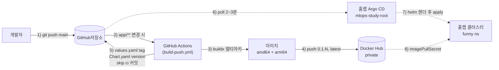
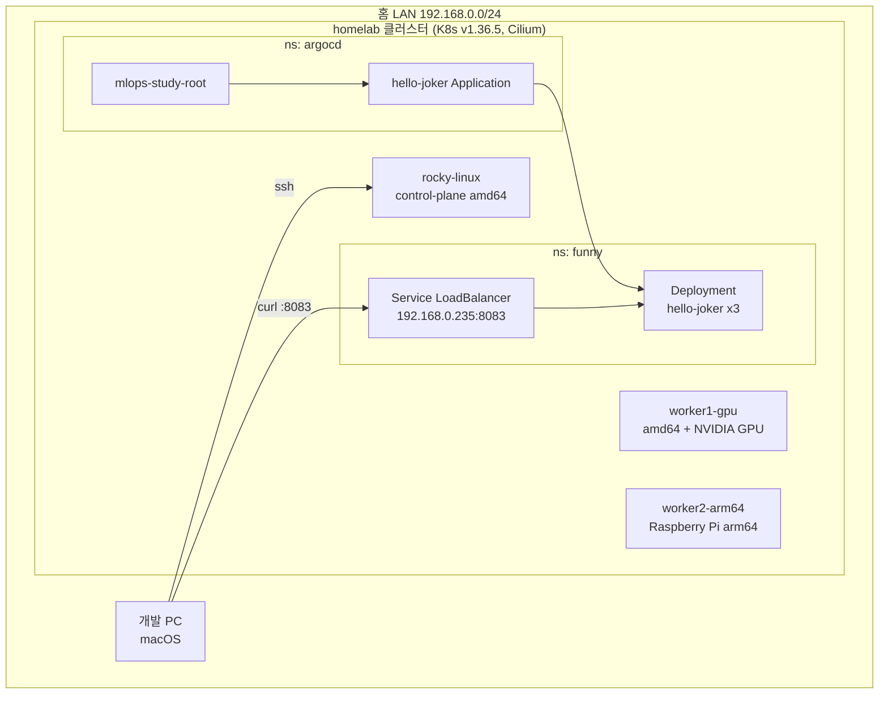
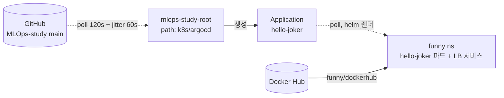
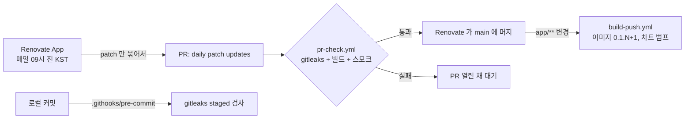

`Machine Learning Platform Engineering` 3장은 Docker, Kubernetes, CI/CD, 모니터링만 다룹니다. [앞 글](../mlpe-02-what-is-mlops/)에서 MLOps를 루프로 바라보는 관점을 제시하였고 이번에는 그 루프가 올라갈 플랫폼에 대해서 학습합니다**.** 기존에 홈랩 환경이 구축되어 있어서 별도 kind를 사용하지는 않았습니다.


## 1. 전체 흐름



1. 개발자가 `main` 브랜치에 push 한다.
2. `app/**` 이하의 파일이 바뀌면 GitHub Actions의 `build-push.yml`이 트리거된다.
3. buildx가 amd64와 arm64 이미지를 함께 빌드한다.
4. 빌드한 이미지를 private Docker Hub에 `0.1.N`과 `latest` 태그로 push 한다.
5. 같은 워크플로가 `values.yaml`의 이미지 태그와 `Chart.yaml`의 version을 올려 `[skip ci]` 커밋으로 저장소에 push 한다. 이 커밋은 `app/**` 밖이라 워크플로를 다시 트리거하지 않는다.
6. 홈랩 Argo CD가 웹훅 없이 약 2~3분마다 저장소 `main`을 polling 해 변경을 감지한다.
7. Argo CD가 Helm 차트를 렌더링해 홈랩 클러스터의 `funny` 네임스페이스에 apply 한다.
8. 파드는 `imagePullSecret`으로 Docker Hub에서 새 이미지를 pull 한다.

점선(6 ~ 8)은 클러스터 쪽에서 당겨 오는 구간이다. CI는 Git의 차트 버전까지 올리므로, Argo CD는 레지스트리를 볼 필요 없이 Git만 보면 된다.

## 2. 저장소 구조

```
.
├── app/                          파이썬 앱, Docker 빌드 컨텍스트
│   ├── main.py                   FastAPI + pyjokes
│   ├── requirements.txt          uv pip freeze 결과
│   ├── Dockerfile                python:3.10-slim, 8083
│   └── entrypoint.sh
├── k8s/
│   ├── argocd/hello-joker-app.yaml   홈랩 루트 Application이 polling 하는 하위 Application
│   ├── hello-joker/                  Helm 차트
│   ├── 05-argocd-repo-add.sh         repo 자격 증명 Secret (토큰은 프롬프트 입력)
│   └── 06-dockerhub-pull-secret.sh   Docker Hub pull secret (토큰은 프롬프트 입력)
├── .github/workflows/
│   ├── build-push.yml            빌드·푸시·차트 범프
│   └── pr-check.yml              gitleaks + 빌드 + 스모크
├── ADR.md                        챕터별 결정 기록
└── README.md                     설치 매뉴얼
```

## 3. 홈랩 클러스터

책은 로컬 단일 노드 클러스터를 쓰지만, 실습은 이미 운영 중인 온프레미스 홈랩 클러스터에서 한다.




| 항목         | 책        | 홈랩                                                                                    |
| ---------- | -------- | ------------------------------------------------------------------------------------- |
| Kubernetes | v1.29.14 | **kubeadm v1.36.5**, 노드 3대                                                            |
| 노드         | 단일 노드    | control-plane `rocky-linux`(amd64), `worker1-gpu`(amd64, GPU), `worker2-arm64`(arm64) |
| CNI        | 명시 없음    | Cilium v1.20.2 (kube-proxy replacement)                                               |
| 외부 노출      | NodePort | Cilium LB-IPAM + L2 announcement, 풀 `192.168.0.230 ~ 250`                             |
| Argo CD    | 직접 설치    | v3.5.3 (helm 설치, 홈랩 저장소에서 관리)                                                         |
| Helm       | v3       | v4.2.2                                                                                |


책과의 차이점

- **노드 아키텍처가 섞여 있다.** amd64 노드와 Raspberry Pi arm64 노드가 같이 있어 이미지를 반드시 멀티아키로 빌드해야 한다.
- **`type: LoadBalancer`가 바로 동작한다.** Cilium LB-IPAM이 LAN 대역에서 IP를 할당하므로 NodePort 매핑이 필요 없다.

### LoadBalancer IP가 LAN에서 닿는 이유

`hello-joker` Service가 `192.168.0.235:8083`으로 바로 열리는 것은 Cilium의 두 기능이  때문이다. 클라우드처럼 외부 로드밸런서가 있는 것이 아니라, 클러스터 노드가 직접 그 IP를 대신 받아 준다.

```yaml {title="CiliumLoadBalancerIPPool / CiliumL2AnnouncementPolicy (발췌)"}
# 1) LB-IPAM: LoadBalancer Service에 줄 IP 풀
spec:
  blocks:
    - start: 192.168.0.230
      stop: 192.168.0.250
---
# 2) L2 announcement: 그 IP를 LAN에 ARP로 알릴 노드와 인터페이스
spec:
  loadBalancerIPs: true
  interfaces: ["^eno1$", "^eth0$"]
  nodeSelector:
    matchExpressions:
      - key: node-role.kubernetes.io/control-plane
        operator: DoesNotExist        # worker 노드만 응답
```

1. `type: LoadBalancer` Service가 생기면 **LB-IPAM**이 `lan-pool`(`192.168.0.230 ~ 250`)에서 빈 IP 하나(`192.168.0.235`)를 골라 `EXTERNAL-IP`로 붙인다.
2. **L2 announcement**가 worker 노드 중 하나를 리더로 정하고, 그 노드가 LAN에서 "`192.168.0.235`는 내 MAC 주소"라고 ARP에 응답한다.
3. LAN의 다른 기기(개발 PC 등)는 이 ARP 응답을 보고 해당 노드로 패킷을 보낸다. 별도 라우팅 설정 없이 같은 서브넷 통신으로 끝난다.
4. 패킷을 받은 노드에서 Cilium(eBPF, kube-proxy replacement)이 `hello-joker` 파드 3개 중 하나로 넘긴다.

이 방식이 성립하려면 **풀 대역이 공유기 DHCP와 겹치지 않아야 한다.** 공유기가 같은 IP를 다른 기기에 나눠 주면 ARP 응답이 충돌해 연결이 끊긴다. 그래서 `192.168.0.230 ~ 250`은 공유기 DHCP 할당 범위에서 빼 두고 클러스터 전용으로 쓴다.

## 4. CI가 버전의 단일 진실 공급원을 쥔다

이미지 태그를 사람이 `values.yaml`에 적는 방식은 누락되기 쉽다. 또한 GitOps로 가려면 어차피 CI가 이미지를 올려야 한다.

그래서 **워크플로 하나가 이미지와 차트 버전을 동시에 올린다.**

```yaml {title=".github/workflows/build-push.yml (발췌)"}
on:
  push:
    branches: [main]
    paths:
      - "app/**"                  # 차트 범프 커밋은 이 경로 밖이라 재트리거되지 않는다
      - ".github/workflows/build-push.yml"

permissions:
  contents: write                 # 차트 버전 커밋을 푸시하려면 필요

steps:
  - name: Compute version (Chart.yaml version 의 patch +1)
    run: |
      CURRENT=$(yq '.version' "$CHART_DIR/Chart.yaml")
      VERSION=$(echo "$CURRENT" | awk -F. '{printf "%d.%d.%d", $1, $2, $3+1}')

  - name: Build and push
    uses: docker/build-push-action@v7
    with:
      platforms: linux/amd64,linux/arm64

  - name: Bump Helm chart
    run: |
      yq -i ".image.tag = \"$VERSION\"" "$CHART_DIR/values.yaml"
      yq -i ".version = \"$VERSION\" | .appVersion = \"$VERSION\"" "$CHART_DIR/Chart.yaml"

  - name: Commit and push chart update
    run: git commit -m "ci: bump hello-joker chart to $VERSION [skip ci]"
```

### 버전 계산 방식

버전은 `Chart.yaml`의 `version`을 읽어 patch를 +1 한 값이다. 이 값 하나를 이미지 태그, 차트 `version`, `appVersion`에 똑같이 쓴다. 따라서 **이미지 태그 = 차트 version = appVersion**이다.

버전의 단일 진실 공급원은 Git의 `Chart.yaml`이다. `github.run_number`는 워크플로 파일명이 바뀌면 1로 리셋되므로 쓰지 않는다. Git 기준이라 워크플로 이름이나 파일이 바뀌어도 버전은 단조 증가한다.

### 멀티아키가 필요한 이유

`platforms: linux/amd64,linux/arm64`를 지정한다. 홈랩에는 **amd64 노드와 Raspberry Pi arm64 노드가 한 클러스터에 섞여 있다.** 한쪽만 빌드하면 다른 아키텍처 노드에 스케줄된 파드가 `exec format error`로 죽는다.

## 5. Argo CD: app-of-apps와 polling

### 5.1 루트 Application이 저장소를 감시한다

홈랩 Argo CD는 홈랩 저장소가 helm으로 관리한다. 그래서 이 저장소의 Application을 직접 `kubectl apply` 하지 않고, **홈랩 저장소의 루트 Application이 이 저장소를 가리키게** 했다(app-of-apps).



1. 루트 `mlops-study-root`가 이 저장소 `main`의 `k8s/argocd` 디렉터리를 sync 한다.
2. 그 안의 `hello-joker-app.yaml`이 하위 Application으로 생긴다.
3. 하위 Application이 `k8s/hello-joker` 차트를 `funny` 네임스페이스에 배포한다.

```yaml {title="k8s/argocd/hello-joker-app.yaml"}
spec:
  source:
    repoURL: https://github.com/ken-0913/MLOps-study.git
    targetRevision: main
    path: k8s/hello-joker
    helm:
      releaseName: hello-joker
      valuesObject:
        service:
          type: LoadBalancer   # Cilium LB-IPAM 이 192.168.0.230 ~ 250 에서 IP 할당
  destination:
    namespace: funny
  syncPolicy:
    automated:
      prune: true        # Git에서 제거된 리소스 삭제
      selfHeal: true     # 클러스터 드리프트 자동 복구
    syncOptions:
      - CreateNamespace=true
```

`prune`과 `selfHeal`이 Argo CD의 성격을 보여준다. 단순 배포 도구가 아니라 **Git과 클러스터를 계속 일치시킨다.** 사람이 클러스터를 직접 고쳐도 되돌린다.

### 5.2 설계에서 정한 것들

**웹훅 대신 polling을 쓴다.** 홈랩에는 GitHub 웹훅을 받을 공개 주소가 없다. `argocd-cm`의 `timeout.reconciliation` 기본값(120s)에 jitter(60s)가 붙어, push 후 반영까지 최대 약 3분이 걸린다.

**차트 기본값은 건드리지 않는다.** 차트의 `service.type`은 `NodePort`로 두고, Application의 `helm.valuesObject`로 `LoadBalancer`를 덮어쓴다. 환경별 차이는 차트가 아니라 Application에 둔다.

**루트에는 cascade finalizer를 달지 않는다.** 루트를 지워도 하위 Application과 워크로드는 남는다. 홈랩 저장소 쪽 작업이 이 저장소의 배포를 실수로 날리지 않게 하기 위함이다.

**`k8s/argocd/`에는 Application 매니페스트만 둔다.** 이 디렉터리의 매니페스트는 전부 argocd 네임스페이스에 적용되고 prune 된다. 대신 새 Application은 이 디렉터리에 파일을 추가해 push 하는 것만으로 생긴다.

### 5.3 확인

```bash
kubectl -n argocd get applications
kubectl -n funny get svc,pods
curl -s http://192.168.0.235:8083/ | jq
```

```
NAME               SYNC STATUS   HEALTH STATUS
hello-joker        Synced        Healthy
mlops-study-root   Synced        Healthy
NAME                  TYPE           CLUSTER-IP       EXTERNAL-IP     PORT(S)
service/hello-joker   LoadBalancer   10.107.192.170   192.168.0.235   8083:32144/TCP
```

```json
{ "random_joke": "Why did the programmer quit his job? Because he didn't get arrays." }
```

## 6. 클러스터에 넣는 토큰은 최소 권한으로

저장소와 이미지가 모두 private이라 자격 증명 두 개가 필요했다. 이때 **어떤 토큰을 넣을지**가 별도 결정이 됐다.


| Secret                    | 용도                         | 토큰                                                             |
| ------------------------- | -------------------------- | -------------------------------------------------------------- |
| `argocd/repo-mlops-study` | Argo CD가 private 저장소 clone | fine-grained PAT. `MLOps-study` 저장소 하나만, `Contents: Read-only` |
| `funny/dockerhub`         | 파드가 private 이미지 pull       | Docker Hub Read-only Access Token                              |


 `gh auth token`은 쓰지 않는다. **계정 전체 쓰기 권한**이라 클러스터 Secret에 들어가면 노출 범위가 지나치게 넓다.

토큰은 아래와 같이 프롬프트로 받아 화면과 셸 기록에 남지 않게 한다. 

```bash {title="repo 자격 증명 Secret (zsh)"}
read -rs "GH_TOKEN?GitHub token: "
kubectl -n argocd create secret generic repo-mlops-study \
  --from-literal=type=git \
  --from-literal=url=https://github.com/ken-0913/MLOps-study.git \
  --from-literal=username=ken-0913 \
  --from-literal=password="${GH_TOKEN}"
kubectl -n argocd label secret repo-mlops-study argocd.argoproj.io/secret-type=repository
unset GH_TOKEN
```

pull secret이 없으면 파드가 `ImagePullBackOff`에 머문다. Secret을 만들면 별도 조치 없이 자동 복구된다.

## 7. 자동화에 자동화를 더하면 검사가 필요해진다

의존성을 손으로 올리지 않되, **깨질 위험이 낮은 patch만** 따라가게 했다.



설정의 요점은 둘이다.


| 대상              | 정책                                                              |
| --------------- | --------------------------------------------------------------- |
| 우리 이미지 태그       | **제외.** `hyeonjae0913/mlops-study`는 CI가 관리하므로 Renovate가 건드리면 충돌 |
| `pr-check.yml`  | gitleaks 전체 이력 스캔 + 이미지 빌드 + 스모크 테스트. **이 체크가 자동 머지의 게이트다**     |


로컬에도 같은 검사를 뒀다. `.githooks/pre-commit`이 staged 변경분을 gitleaks로 훑는다. 클론마다 `git config core.hooksPath .githooks` 한 번이 필요하다.

private 저장소 Free 플랜이라 GitHub 네이티브 auto-merge를 쓸 수 없어 `platformAutomerge: false`로 두고 **Renovate가 직접 머지**하게 했다.

## 1주차를 끝내며

**책의 Ch3는 네 층을 쌓는 장이다.** 패키징, 오케스트레이션, 자동화, 관측. 뒤 단계가 앞 단계를 전제하므로 순서를 건너뛸 수 없다.

직접 세워보니 **책 그대로 되는 부분이 생각보다 적었다.** 포트 하나가 probe를 전부 죽이고, 노드 아키텍처가 섞여 있고, 웹훅을 받을 주소가 없다. 그 대응이 결국 아키텍처가 됐다.

결과적으로 **GitOps 루프가 닫혔다.** 이미지 빌드, 차트 범프 커밋, 최대 3분 뒤 홈랩 배포까지 `git push` 한 번으로 이어진다.

가장 값진 결정은 **버전의 단일 진실 공급원을 Git에 둔 것**이다. 이미지 태그, 차트 version, appVersion이 한 값이라 "지금 무엇이 돌고 있는가"에 답할 수 있다. 모델·설정·데이터가 제각각 버전을 갖는 ML에서는 이 요구가 더 커진다.

남은 숙제는 Ch3의 마지막 층인 **관측**이다. 홈랩에는 kube-prometheus-stack과 Grafana가 이미 있으므로, hello-joker의 지표를 여기에 붙이는 것부터 2주차에 이어서 한다.

