## 4.1절 실습하기

책 4.1절(실험 추적과 모델 레지스트리) 노트북을 홈랩 MLflow에서 돌린 기록이다. 책은 로컬 `mlflow ui`와 Kubeflow에 딸린 MinIO를 쓰지만 여기서는 Kubernetes 위의 MLflow, Postgres, RustFS를 썼다. RustFS는 홈랩에서 이미 쓰고 있어서 골랐고 다른 이유는 없다.

### 1. 한눈에 보기

아래는 이번 절에서 실습할 파이프라인이다. 초록 칸은 Jupyter 노트북 셀로 직접 실행한 단계이고, 주황 칸은 노트북이 만든 결과를 MLflow에 기록하고 등록한 곳이다.

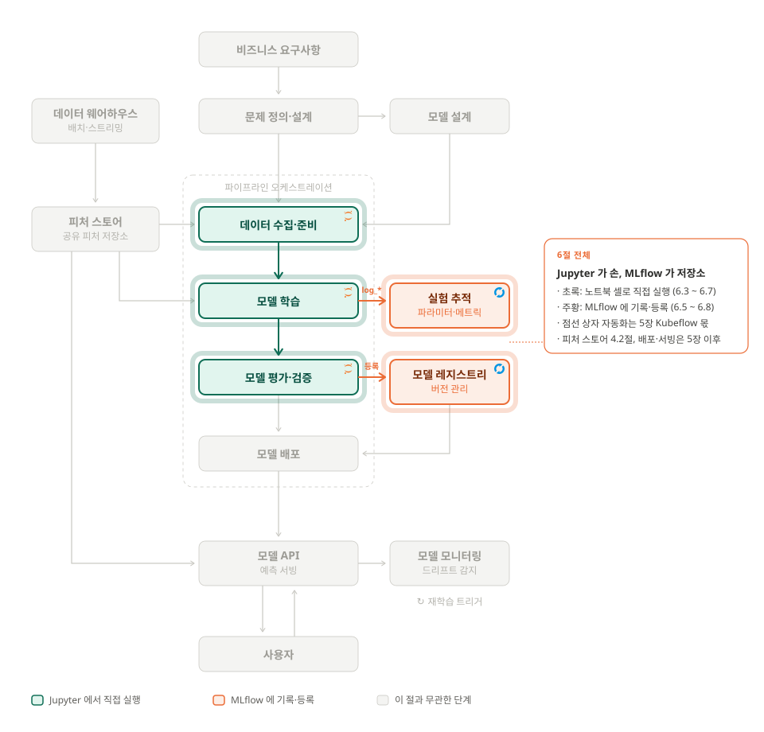

### 2. 환경설정하기

- JupyterLab 기동
  - 먼저 JupyterLab(`http://192.168.0.239:8888`)에 토큰으로 들어가 `practical-mlops/chapter-4/mlflow/data_exploration_and_model_training.ipynb`를 연다. 4.1절 코드는 이 노트북 하나(29셀)에 다 들어 있다.
  - **커널은 반드시** `chapter-4 (latest)`**로 바꾼다.** 여기서 커널은 리눅스 커널이 아니라 셀 코드를 실제로 실행하는 파이썬 프로세스다.

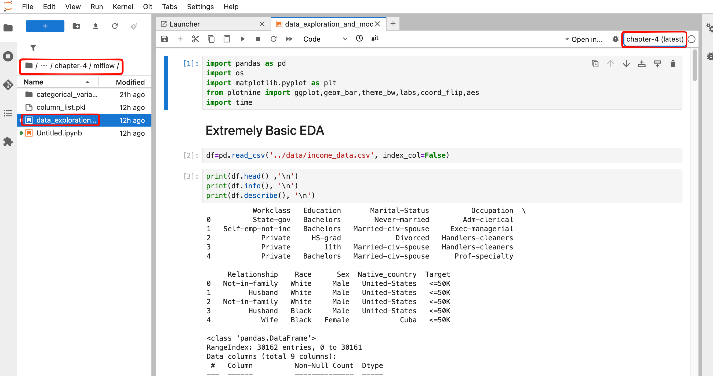

노트북은 이미지 기본 파이썬(`/opt/conda/bin/python`)인 `Python 3 (ipykernel)` 커널로 열리는데, 거기에는 plotnine, mlflow, xgboost, minio가 없다. 시작 hook이 만든 venv(`~/.venvs/chapter-4`)가 `chapter-4 (latest)` 커널이다.

노트북 탭을 앞에 둔 채 오른쪽 위 커널 이름을 클릭해 바꾼다. 같은 커널로 **콘솔**을 새로 여는 것은 노트북 커널을 바꾸는 것이 아니다.

실제로 처음에는 콘솔만 두 개 열고 노트북은 `python3`에 붙은 채였다. `import sys; print(sys.executable)`이 venv 경로를 찍으면 맞게 바뀐 것이다.

접속 정보는 Pod 환경변수로 들어가 있으므로 노트북에서 손댈 곳은 세 군데다. 


| 셀                           | 책 코드                                                                               | 홈랩에서                                                                |
| --------------------------- | ---------------------------------------------------------------------------------- | ------------------------------------------------------------------- |
| 맨 첫 셀                       | `os.environ["AWS_ACCESS_KEY_ID"] = "minio"` 등 3줄                                   | **지운다.** 이미 실행했다면 Kernel → Restart Kernel. 셀을 지워도 실행된 커널에는 값이 남는다   |
| `mlflow.set_tracking_uri` 셀 | `mlflow.set_tracking_uri("http://localhost:5000")`                                 | 환경변수 `MLFLOW_TRACKING_URI`                                          |
| `from minio import Minio` 셀 | `Minio("localhost:9000", access_key="minio", secret_key="minio123", secure=False)` | 환경변수 `MINIO_ENDPOINT`, `AWS_ACCESS_KEY_ID`, `AWS_SECRET_ACCESS_KEY` |


고친 뒤 노트북의 두 셀은 이렇다.

```python {title="tracking URI 셀"}
# setting tracking uri and experiment. If experiment name does not exist it will be created
mlflow.set_tracking_uri(os.environ["MLFLOW_TRACKING_URI"])
mlflow.set_experiment("income-classifier")
```

```python {title="MinIO 클라이언트 셀"}
from minio import Minio
minioClient = Minio(
    os.environ["MINIO_ENDPOINT"],                 # rustfs:9000
    access_key=os.environ["AWS_ACCESS_KEY_ID"],
    secret_key=os.environ["AWS_SECRET_ACCESS_KEY"],
    secure=False,
)
found = minioClient.bucket_exists("mlflow-datasets")
if not found:
    print("PLEASE CREATE BUCKET IN MINIO BEFORE PROCEEDING")
```

바로 다음 셀의 `save_df_to_minio`는 이 `minioClient`를 그대로 쓰므로 바꿀 것이 없다. RustFS 콘솔(`192.168.0.237:9001`) 로그인도 같은 Secret `rustfs-credentials`의 값이다.

### 3. EDA run

EDA(탐색적 데이터 분석)는 모델을 만들기 전에 데이터를 그래프로 그려 보며 어떤 컬럼이 소득(Target)과 관련 있는지 살펴보는 작업이고, 이 run은 그 그래프를 MLflow에 기록해 둔다.

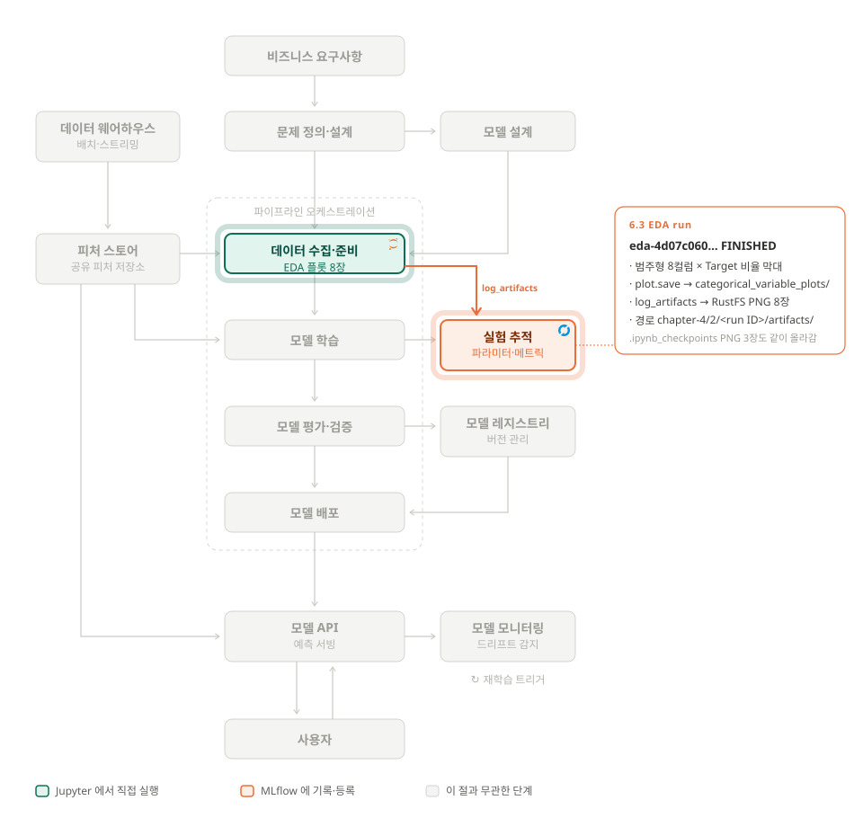

`set_experiment("income-classifier")`가 실험을 만들고, 첫 run은 범주형 8컬럼마다 "값별 &gt;50K 비율" 막대그래프를 그려 `log_artifacts`로 올린다.

```python {title="EDA run 셀 (요지, print 줄 생략)"}
with mlflow.start_run(run_name=f"eda-{uuid.uuid4()}"):           # 모델 run 과 구분하려고 eda- 접두사
    for i in df.iloc[:, :-1].select_dtypes(include="object").columns:
        plot = (ggplot(df)
                + geom_bar(aes(x=df[i], fill=df.Target), position="fill")   # 건수가 아니라 비율
                + theme_bw() + labs(title=f"Variable {i} ~ Target") + coord_flip())
        plot.save(f"categorical_variable_plots/Variable {i}")
        mlflow.log_artifacts("categorical_variable_plots")       # 디렉터리째 RustFS 로
```

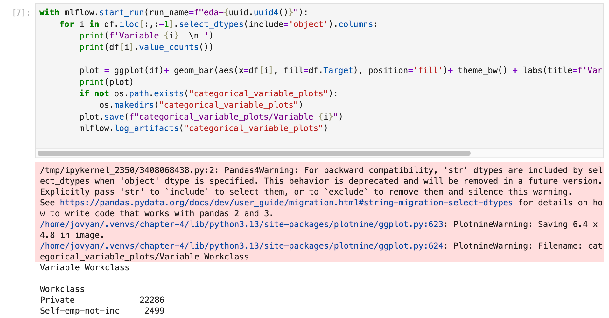

실행하면 위처럼 경고가 두 종류 찍히는데 둘 다 결과에는 영향이 없다.

- **`Pandas4Warning: 'str' dtypes are included by select_dtypes when 'object' dtype is specified`**: venv의 pandas가 3.x라 문자열 컬럼 타입이 `object`가 아니라 `str`이다(`info()` 출력의 Dtype). 지금은 호환을 위해 같이 골라 주지만 나중 버전에서는 빠진다는 예고다. `include=["object", "str"]`로 쓰면 사라진다.
- **`PlotnineWarning: Saving 6.4 x 4.8 in image.` / `Filename: …`**: `plot.save`에 크기를 주지 않아 기본값(6.4×4.8인치)으로 저장한다는 안내다. 그래프마다 두 줄씩 찍힌다.

**결과**

- run `eda-4d07c060…`(첫 실행)과 `eda-0907c429…`(재실행)이 FINISHED. Artifacts 탭과 RustFS `mlflow-artifacts/chapter-4/2/<run ID>/artifacts/`에 PNG 8장이 있다(`2`는 `income-classifier`의 실험 ID). 아래 캡처는 재실행 run이다.

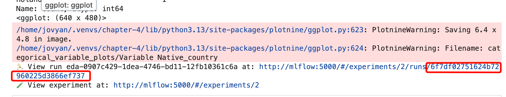

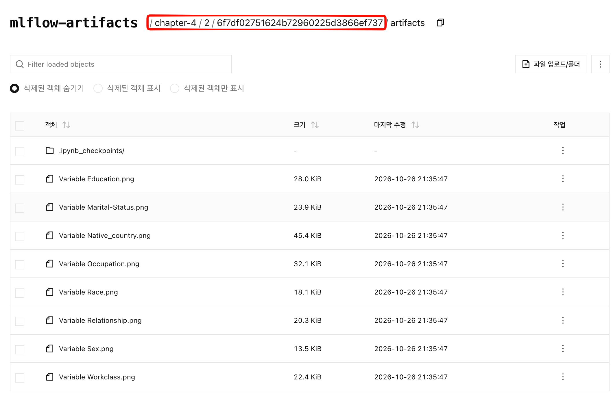

- 같은 폴더에 `.ipynb_checkpoints/` 아래 PNG 3장도 같이 올라갔다. Jupyter가 열어 본 파일의 사본을 만든 것을 `log_artifacts`가 디렉터리째 올렸기 때문이다.

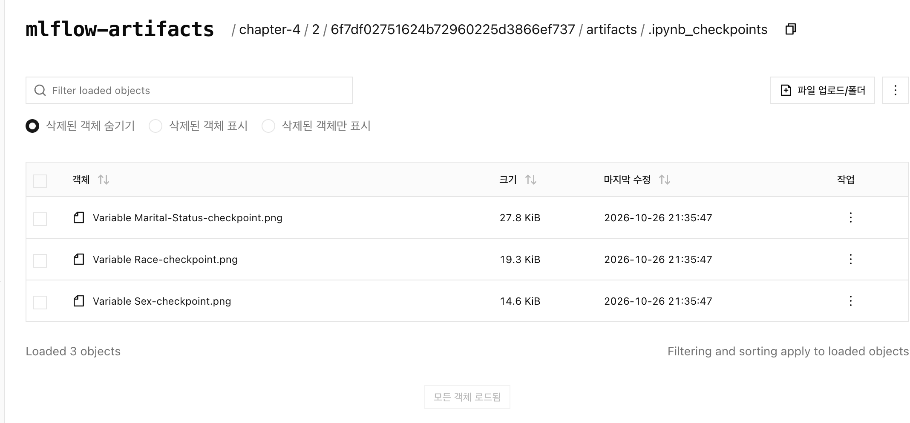

### 4. 데이터 준비

데이터 준비는 문자열이 섞인 원본 표를 모델이 학습할 수 있는 숫자 표로 바꾸고 학습용 80%, 시험용 20%로 나누는 단계이고, MLflow에는 아무것도 기록하지 않는다.

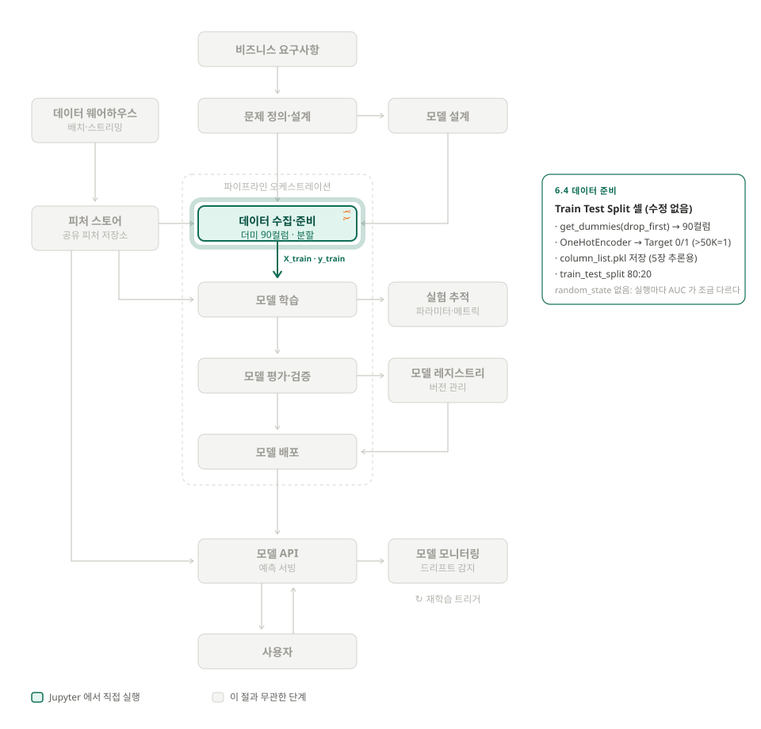

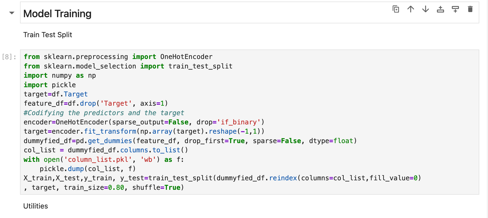

`Train Test Split` 셀은 고칠 것이 없다. 범주형 8컬럼을 `pd.get_dummies(feature_df, drop_first=True, sparse=False, dtype=float)`로 더미 90컬럼으로, Target은 `OneHotEncoder(sparse_output=False, drop='if_binary')`로 0/1(&gt;50K가 1)로 바꾸고 컬럼 이름과 순서를 `column_list.pkl`로 저장한다. 5장의 추론 컴포넌트가 새 데이터를 같은 90컬럼으로 맞출 때 이 파일을 쓴다.

책 코드에는 `random_state`가 없어서 실행할 때마다 분할이 달라지고 지표도 조금씩 변한다. 실제로 같은 결정 트리를 네 번 돌린 test AUC가 0.8218, 0.8216, 0.8187, 0.8123으로 달랐다.

### 5. 모델 run과 skops 에러

모델 run은 결정 트리와 랜덤 포레스트를 학습해 데이터셋, 지표, 파라미터, 모델을 run 하나에 기록하는 단계이고, 최신 MLflow가 모델 저장에서 skops 에러를 내 두 셀의 `log_model` 줄을 고쳐야 했다.

- **결정 트리**: "기혼인가?", "학력이 Bachelors인가?" 같은 예/아니오 질문을 이어 붙여 &gt;50K인지 가르는 모델이다. 해석하기 쉽지만 깊이 제한이 없으면 학습 데이터를 외워 과적합되기 쉽다.
- **랜덤 포레스트**: 데이터와 컬럼을 무작위로 조금씩 다르게 뽑아 결정 트리를 여러 개(기본 100개) 만들고 그 투표로 답하는 모델이다. 트리 하나의 실수가 평균으로 묻혀 결정 트리보다 안정적이다.

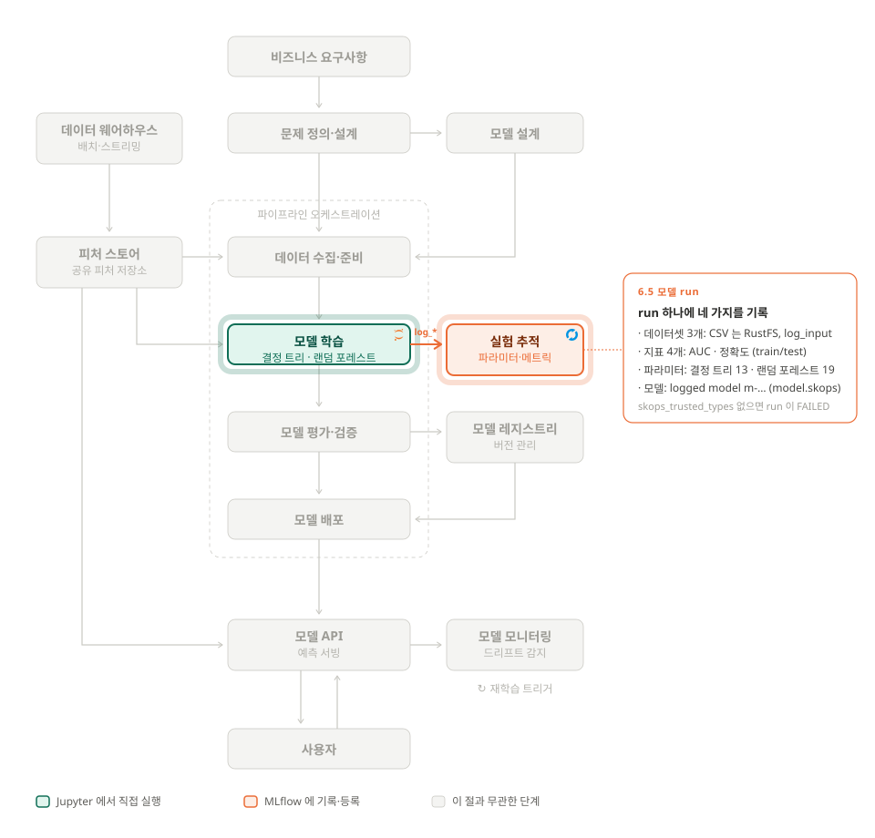

결정 트리 셀은 run 하나에 데이터셋, 지표, 모델, 파라미터를 기록한다. 데이터셋은 `save_df_to_minio`로 RustFS에 CSV를 올리고 `mlflow.data.from_pandas` + `log_input`으로 컬럼·행 수·경로 같은 메타데이터만 MLflow에 남긴다.

지금 노트북의 결정 트리 셀이다. 한글 주석은 설명을 위해 붙였고, 랜덤 포레스트 셀은 모델만 `RandomForestClassifier()`로 바뀌고 구조가 같다.

```python {title="Decision Tree Classifier 셀"}
from sklearn.tree import DecisionTreeClassifier
from sklearn.metrics import  roc_auc_score
BUCKET_NAME = "mlflow-datasets"
with mlflow.start_run() as run:
    results=pd.DataFrame(index=['Roc Auc Score test', 'Accuracy score train', 'Accuracy Score test','time to fit'])
    tree=DecisionTreeClassifier()
    run_id = run.info.run_id
    # 1) 데이터셋 CSV 3개를 RustFS(mlflow-datasets 버킷)에 직접 올린다
    feature_df_path = f"income-classifier-datasets/feature_df-{run_id}.csv"
    save_df_to_minio(feature_df,BUCKET_NAME,feature_df_path)
    train_df = pd.concat([X_train,pd.Series(y_train.ravel())],axis=1)
    train_df_path = f"income-classifier-datasets/train-{run_id}.csv"
    save_df_to_minio(train_df,BUCKET_NAME,train_df_path)    #A
    test_df = pd.concat([X_test,pd.Series(y_test.ravel())],axis=1)
    test_df_path = f"income-classifier-datasets/test-{run_id}.csv"
    save_df_to_minio(test_df,BUCKET_NAME,test_df_path)
    # 2) MLflow에는 경로와 스키마 같은 메타데이터만 남긴다 (Datasets 3개)
    training_dataset = mlflow.data.from_pandas(train_df, source=f"{BUCKET_NAME}/{train_df_path}")    #B
    test_dataset = mlflow.data.from_pandas(test_df, source=f"{BUCKET_NAME}/{test_df_path}")
    feature_dataset = mlflow.data.from_pandas(feature_df, source=f"{BUCKET_NAME}/{feature_df_path}")
    mlflow.log_input(training_dataset,context="training")    #C
    mlflow.log_input(test_dataset,context="testing")
    mlflow.log_input(feature_dataset,context="reference")
    # 3) 학습과 채점
    tree.fit(X_train, y_train.ravel())    #D
    roc_auc_score_train = roc_auc_score(y_train==1, tree.predict_proba(X_train)[:,1])    #E
    roc_auc_score_test = roc_auc_score(y_test==1, tree.predict_proba(X_test)[:,1])
    training_accuracy = tree.score(X_train, y_train)
    test_accuracy = tree.score(X_test, y_test)
    # 4) 아티팩트와 지표 4개
    mlflow.log_artifact("column_list.pkl")
    mlflow.log_metric("roc_auc_score_train",roc_auc_score_train)    #F
    print(f'Roc Auc Score train: {roc_auc_score_train}  \n')
    mlflow.log_metric("roc_auc_score_test",roc_auc_score_test)
    print(f'Roc Auc Score test: {roc_auc_score_test}  \n')
    mlflow.log_metric("training_accuracy",training_accuracy)
    print(f'Accuracy train : {training_accuracy}')
    mlflow.log_metric("test_accuracy",test_accuracy)
    print(f'Accuracy test : {test_accuracy}')
    # 5) 모델 저장. 책 코드는 skops_trusted_types 가 없어 여기서 에러가 난다
    mlflow.sklearn.log_model(tree,"income-classifier", skops_trusted_types=["sklearn.tree._tree.Tree"])
    # 6) 파라미터. 5)에서 에러가 나면 이 줄까지 오지 못한다
    mlflow.log_params(tree.get_params())    #H
```

**책 코드 그대로면 이 run은 FAILED로 끝난다.** 처음 두 번 돌린 결정 트리 run이 둘 다 그랬다.

지표 4개와 데이터셋 CSV 3개는 남았는데 파라미터는 0개, 모델 파일은 없었다. 같은 코드를 Pod 안에서 재현하면 `log_model`에서 이 에러가 난다.

```text
MlflowException: The saved sklearn model references untrusted types ...
Untrusted types found in the file: ['sklearn.tree._tree.Tree']
```

최신 MLflow(3.17)는 sklearn 모델을 pickle 대신 skops 형식으로 저장한다. 트리 모델 내부 구조(`sklearn.tree._tree.Tree`)는 노드 인덱스를 범위 검사 없이 쓰기 때문에, 조작된 파일을 불러오면 프로세스가 죽을 수 있어 "신뢰하지 않는 타입"으로 분류돼 있다.

직접 학습한 모델이므로 신뢰한다고 명시하면 된다. 결정 트리와 랜덤 포레스트 셀의 `log_model` 줄을 이렇게 바꿨다.

```python
mlflow.sklearn.log_model(tree, "income-classifier",
                         skops_trusted_types=["sklearn.tree._tree.Tree"])
```

`log_model`이 `log_params`보다 앞에 있어서 에러가 나면 파라미터까지 빠진다. 지표만 있고 파라미터가 0개인 FAILED run이 이 문제의 표시다.

**결과**: 고친 뒤 결정 트리(`burly-doe-597`)와 랜덤 포레스트(`clean-gnat-110`) run이 FINISHED. Overview에 Metrics 4개, Parameters(결정 트리 13개, 랜덤 포레스트 19개), Datasets 3개가 나온다.

MLflow 3부터 모델은 run의 Artifacts 폴더가 아니라 별도 logged model(`m-…`)로 저장된다. RustFS에서는 `chapter-4/2/models/m-…/artifacts/` 아래 `MLmodel`, `model.skops` 등이다.

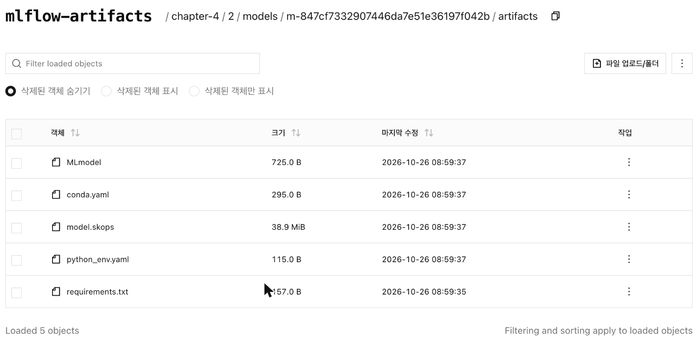

책(2.x 기준)의 "Artifacts 탭에 모델이 보인다"는 설명과 다른 부분이다. run의 Artifacts 폴더에는 `column_list.pkl`만 남는다.

### 6. XGBoost와 autolog

세 번째 모델 XGBoost를 학습한다. 이번에는 기록 코드를 직접 쓰지 않고 MLflow에 "알아서 기록해 줘"(autolog)를 맡겨 본다.

- **XGBoost**: 결정 트리를 여러 개 쓰는 점은 랜덤 포레스트와 같다. 다만 랜덤 포레스트는 트리를 따로따로 만들어 투표하고, XGBoost는 트리를 하나씩 추가하면서 앞 트리가 틀린 데이터를 다음 트리가 집중해서 고친다.
- **autolog**: `mlflow.xgboost.autolog()` 한 줄을 켜 두면 학습할 때마다 파라미터, 모델, 특성 중요도 그래프를 MLflow가 스스로 기록한다. 앞의 결정 트리 셀에서 `log_params`, `log_model`을 손으로 쓴 것과 비교된다.
- **objective**: 모델이 어떤 형태로 답을 낼지 정하는 설정이다. `binary:logistic`은 "&gt;50K일 확률 0.73"처럼 확률을, `binary:hinge`는 "1(&gt;50K)"처럼 0 또는 1만 낸다.

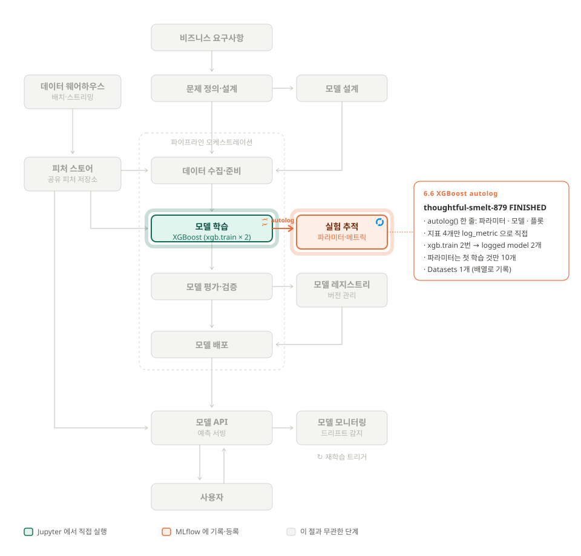

**셀이 하는 일**: 책 코드는 한 run 안에서 학습을 두 번 한다. 먼저 `binary:logistic`으로 30라운드, 이어서 `binary:hinge`로 10라운드(기본값)를 학습한다. 지표 4개(AUC, 정확도)는 두 번째 hinge 모델로 계산해 `log_metric`으로 직접 남긴다.

이 셀은 고칠 것 없이 그대로 돌아간다.

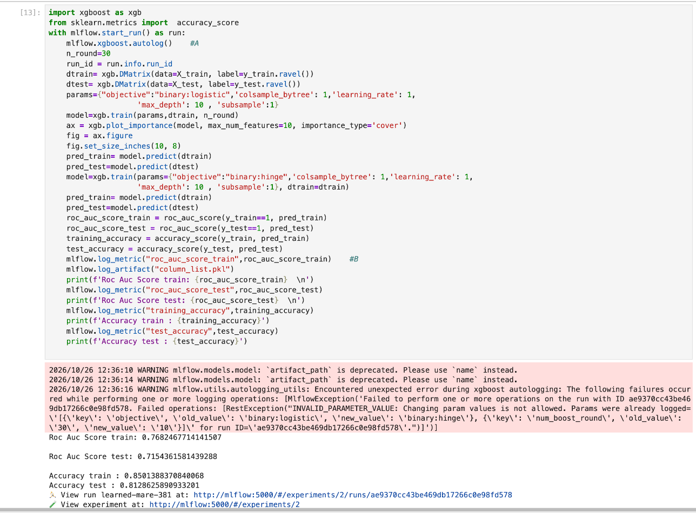

캡처는 재실행 run(`learned-mare-381`)의 출력이다. 빨간 경고가 아래 "파라미터는 첫 학습 것만 남았다"의 직접 증거로, `objective`와 `num_boost_round` 두 값을 두 번째 학습 값으로 바꾸려다 거부됐다. 셀은 에러 없이 끝나고 run도 FINISHED다.

**결과**: run `thoughtful-smelt-879`이 FINISHED로 끝났다. 다만 한 run에 학습을 두 번 넣은 탓에 기록이 조금 어긋난다.

- **모델이 두 개 남았다.** autolog는 학습할 때마다 모델을 저장하므로 logged model(`model.ubj`)이 두 개 생겼다. 화면만 봐서는 어느 쪽이 지표를 만든 hinge 모델인지 알기 어렵다.
- **파라미터는 첫 학습 것만 남았다.** MLflow는 한 run 안에서 이미 기록한 파라미터 값을 바꾸지 못한다. 두 번째 학습이 `objective`(→ `binary:hinge`)와 `num_boost_round`(→ 10)를 다시 쓰려다 막혀서 파라미터 10개는 모두 첫 학습(`binary:logistic`, 30라운드) 값이다.
- **Datasets는 1개다.** autolog가 학습 데이터 하나만 기록하기 때문이다. 결정 트리 셀처럼 학습·시험·전체 3개를 직접 남긴 것과 다르다.

정리하면 "파라미터는 logistic, 지표는 hinge"인 run이 하나 생긴 셈이다. 학습마다 run을 따로 열면(`with mlflow.start_run(run_name=f"xgboost-{objective}")`를 루프 안에) 모델, 파라미터, 지표가 짝을 맞춰 남는다. 9절에서 해 볼 거리로 남겼다.

### 7. 결과 비교

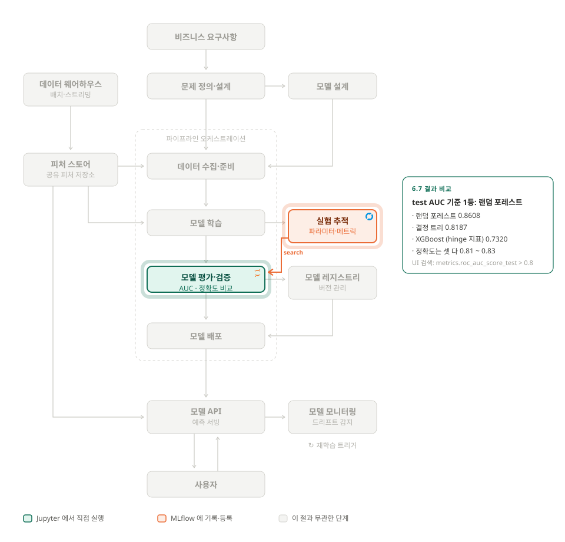


| run                  | 모델                 | test AUC   | test accuracy | train AUC |
| -------------------- | ------------------ | ---------- | ------------- | --------- |
| burly-doe-597        | 결정 트리              | 0.8187     | 0.8147        | 0.9314    |
| **clean-gnat-110**   | **랜덤 포레스트**        | **0.8608** | **0.8261**    | 0.9277    |
| thoughtful-smelt-879 | XGBoost (hinge 지표) | 0.7320     | 0.8243        | 0.7623    |


책과 같은 순서가 나왔다. 랜덤 포레스트가 AUC 1등이고 XGBoost는 hinge의 0/1 출력으로 AUC를 계산해서 낮다.

0/1을 넣으면 기준값이 사실상 하나뿐이라 ROC 곡선이 한 점으로 줄어든다. 모델이 약해서가 아니라 지표 입력의 문제다.

정확도는 셋 다 0.81 ~ 0.83이라 구분이 안 된다. 이 데이터는 &gt;50K가 25%뿐이라 전부 &lt;=50K로 찍어도 75%가 나오기 때문이다. 결정 트리는 train AUC 0.93과 test AUC 0.82의 차이가 커서 깊이 제한 없는 트리의 과적합이 보인다.

실험 화면 검색창에 `metrics.roc_auc_score_test > 0.8`을 넣고 차트 보기로 바꾸면 이 비교를 UI에서 바로 볼 수 있다.

**재실행**: 같은 노트북을 처음부터 다시 돌려(2026-10-26) run 세 개를 더 만들었다. 코드는 그대로이고 `train_test_split`에 `random_state`가 없어 분할만 달라졌다.

| run                | 모델                 | test AUC | test accuracy | train AUC |
| ------------------ | ------------------ | -------- | ------------- | --------- |
| suave-grub-205     | 결정 트리              | 0.8123   | 0.8092        | 0.9333    |
| capricious-hen-829 | 랜덤 포레스트            | 0.8512   | 0.8162        | 0.9297    |
| learned-mare-381   | XGBoost (hinge 지표) | 0.7154   | 0.8129        | 0.7682    |

순위는 첫 실행과 같지만 test AUC가 모델마다 0.006 ~ 0.017 떨어졌다. 분할 하나에서 나온 AUC는 소수점 둘째 자리부터 흔들리므로, 모델끼리 비교할 때는 `random_state`를 고정하거나 여러 번 돌린 평균을 봐야 한다.

### 8. 모델 등록

MLOps 파이프라인 전체에서 이 절이 홈랩에 직접 구현한 부분은 모델 레지스트리 하나다. 평가 단계의 결과 중 1등을 골라 등록하고 등록된 모델은 5장에서 배포 단계가 가져간다.

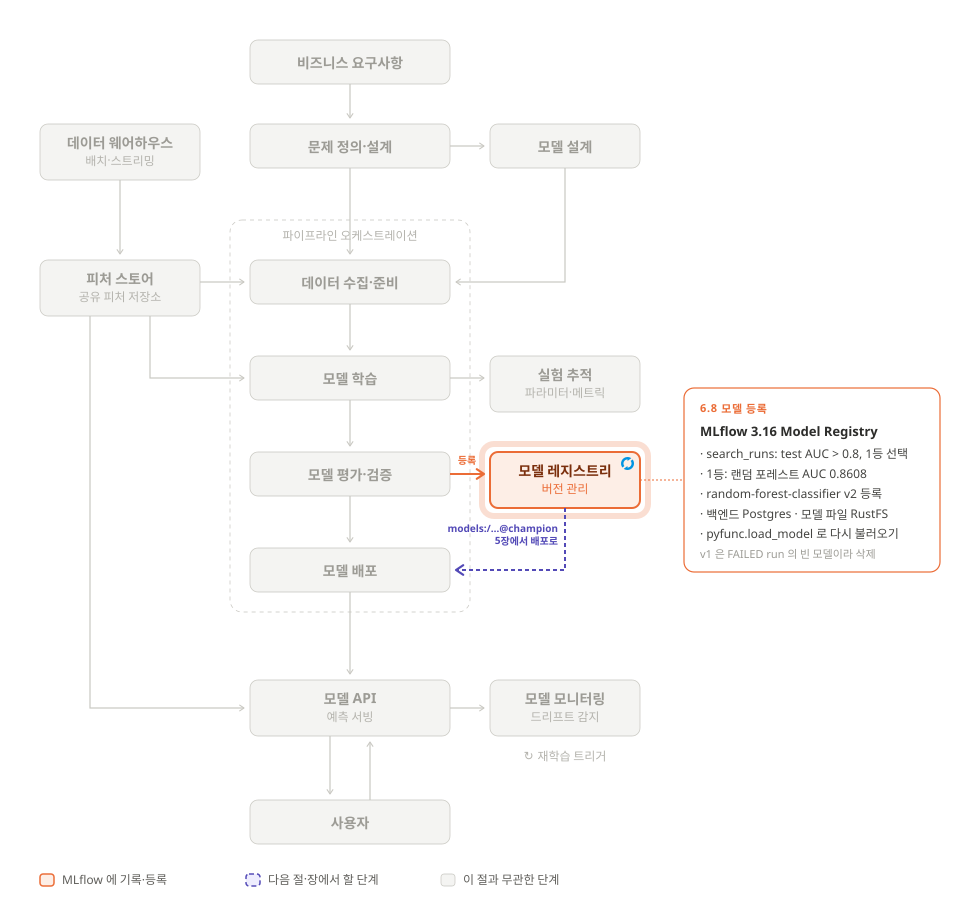

마지막 `MLFlow Client` 셀은 AUC 0.8 초과 run 중 1등을 골라 `runs:/<run_id>/income-classifier` URI로 `random-forest-classifier`라는 이름에 등록한다. 지금 상태에서는 1등이 랜덤 포레스트(sklearn, `income-classifier`라는 이름으로 `log_model`)라서 책 코드가 그대로 통한다.

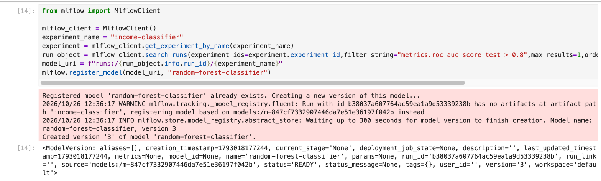

엄밀히는 경로가 맞아서 통하는 것이 아니다. MLflow 3은 모델을 run 아티팩트에 두지 않으므로 `runs:/<run_id>/income-classifier` 경로는 비어 있다. 위 WARNING처럼 그 run이 같은 이름으로 저장한 logged model(`models:/m-847cf733…`)을 찾아 대신 등록한다.

**결과**: Models 탭에 `random-forest-classifier`가 생겼는데 버전이 여러 개였다.


| 버전  | 가리키는 run                                 | 불러오기                                                 |
| --- | ---------------------------------------- | ---------------------------------------------------- |
| v1  | salty-slug-485 (skops 수정 전 FAILED 결정 트리) | 실패. `Could not find an "MLmodel" configuration file` |
| v2  | clean-gnat-110 (랜덤 포레스트)                 | 성공                                                   |
| v3  | clean-gnat-110 (재실행 후 다시 등록)               | 성공. v2와 같은 모델                                        |


v1은 결정 트리를 고치기 전에 등록 셀을 한 번 돌린 흔적이다. 그때는 AUC 0.8을 넘는 run이 FAILED 결정 트리 둘뿐이었고 `search_runs`는 상태를 거르지 않아 그중 하나를 골랐다.

레지스트리는 "이 모델 ID를 가리킨다"는 기록만 남기고 파일이 있는지는 보지 않아서 등록은 READY로 통과했다. 이름은 랜덤 포레스트인데 내용은 비어 있는 결정 트리다.

등록 조건에 run 상태를 넣으면 막을 수 있다.

```python
run_object = mlflow_client.search_runs(
    experiment_ids=experiment.experiment_id,
    filter_string="metrics.roc_auc_score_test > 0.8 and attributes.status = 'FINISHED'",
    max_results=1,
    order_by=["metrics.roc_auc_score_test DESC"])[0]
print(run_object.info.run_name, run_object.info.status)   # 등록 전에 눈으로 확인
```

v3은 재실행 뒤 등록 셀을 다시 돌린 결과다. `search_runs`는 실험 전체에서 1등을 고르므로 새 랜덤 포레스트(0.8512)가 아니라 첫 실행의 `clean-gnat-110`(0.8608)이 다시 뽑혔다. 같은 모델이 버전만 하나 늘어난 것이라, 재실행 run만 대상으로 하려면 `filter_string`에 시작 시각이나 태그 조건을 더한다.

v1은 Models → `random-forest-classifier` → Version 1에서 지운다. 책이 말하는 스테이징·프로덕션 승격은 MLflow 3에서는 버전에 alias(예: `champion`)를 붙이는 방식이다. v2에 `champion`을 붙이면 `models:/random-forest-classifier@champion`으로 부를 수 있고 5장 추론 컴포넌트가 이런 URI로 모델을 가져간다.

```python
model = mlflow.pyfunc.load_model("models:/random-forest-classifier/2")
model.predict(X_test.head(3))
```

책의 `runs:/…/income-classifier` URI는 sklearn 모델을 그 이름으로 저장했을 때만 맞는다. XGBoost autolog는 `model`이라는 이름으로 저장하므로, objective별 run을 나눠 XGBoost가 1등이 되면 이 URI로는 모델을 찾지 못한다. 그때는 1등 run의 logged model을 `mlflow.search_logged_models(filter_string=f"source_run_id = '{run_id}'")`로 찾아 `models:/<model_id>`로 등록한다.

### 9. 남은 것과 더 해 볼 것

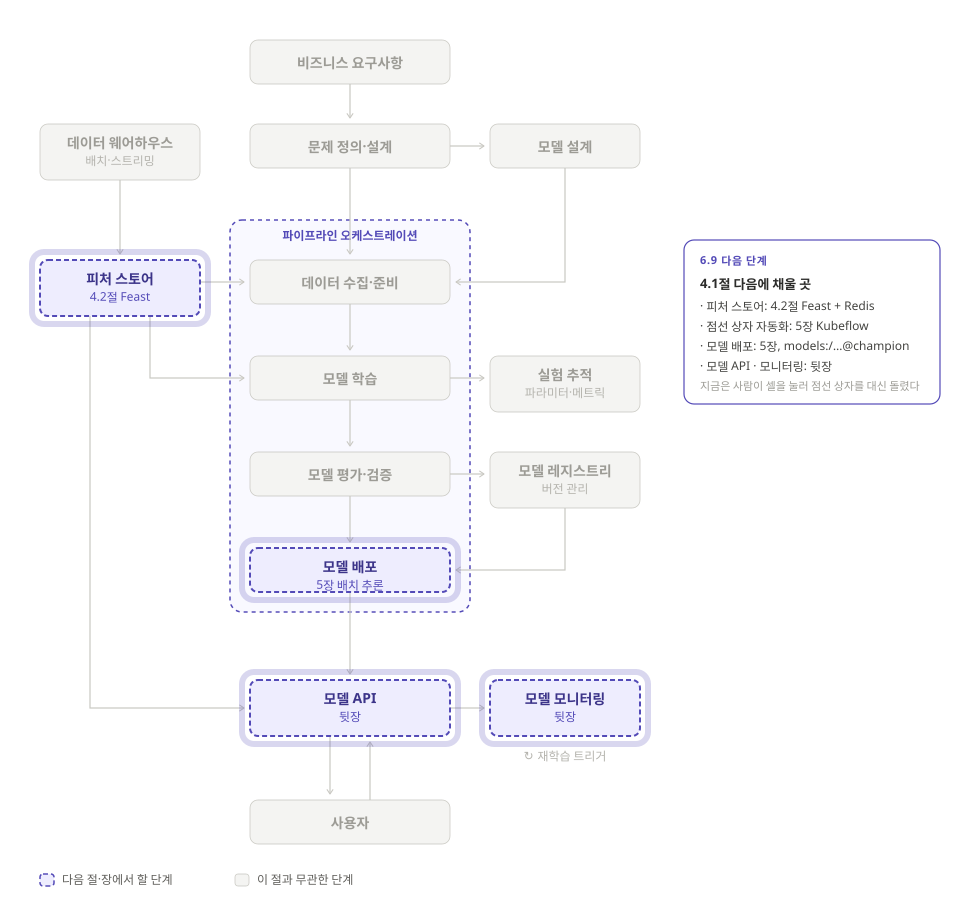

첫 실행과 재실행이 끝난 뒤 RustFS에는 이만큼 쌓였다.


| 버킷                                            | 내용                                                                                                                             |
| --------------------------------------------- | ------------------------------------------------------------------------------------------------------------------------------ |
| `mlflow-artifacts/chapter-4/2/` | 객체 74개, 83.7MB. EDA run 2개의 PNG 16장(+ 체크포인트 6장), run별 `column_list.pkl` 8개, `models/` 아래 logged model 8개(결정 트리 2개 각 445KB 안팎, 랜덤 포레스트 2개 각 40MB 안팎, XGBoost 4개 각 170 ~ 190KB) |
| `mlflow-datasets/income-classifier-datasets/` | run 6개분 CSV 18개, 87.8MB. 지운 FAILED run 두 개 몫도 남아 있다 |


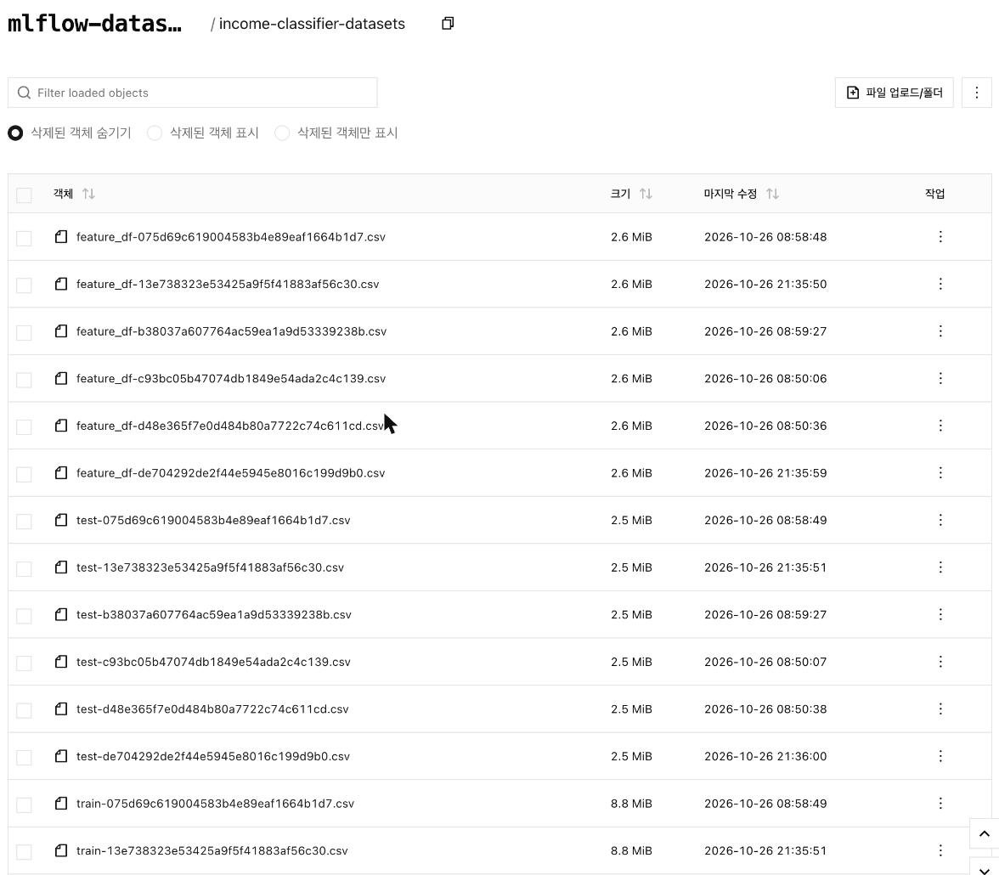

run을 지워도 RustFS의 CSV는 지워지지 않는다. 데이터셋은 `save_df_to_minio`가 MLflow 밖에서 직접 올린 파일이라 MLflow가 모르기 때문이다. run마다 15MB씩 쌓이는 이 설계가 어디까지 버틸지가 다음 고민거리다.

조건을 바꿔 run을 쌓아 보면 추적 도구의 쓸모가 더 드러난다.

- `train_test_split`에 `random_state=42`를 넣고 같은 셀을 두 번 돌려 AUC가 같은지 본다.
- 결정 트리 `max_depth`를 5, 10, 20으로 바꿔 run 3개를 만들고 Compare 화면에서 train·test AUC 차이를 본다.
- XGBoost를 objective별 run으로 나눠 logistic의 확률로 AUC를 계산한다. 랜덤 포레스트를 넘으면 등록 셀의 URI를 `models:/<model_id>`로 바꿔야 한다.
- `position="fill"`을 `"stack"`으로 바꿔 EDA run을 하나 더 만들고 Artifacts를 나란히 본다.

### 10. 노트북 전체 코드

홈랩에서 실제로 돌린 `data_exploration_and_model_training.ipynb`의 현재 코드다. 책 원본에서 첫 셀(MinIO 키 3줄)을 지웠고, tracking URI 셀과 MinIO 클라이언트 셀은 환경변수를 읽게, 결정 트리와 랜덤 포레스트 셀의 `log_model`에는 `skops_trusted_types`를 더했다. `# %%`가 셀 하나이고 `# %% [markdown]`은 노트북의 제목 셀이다.

<details class="orca-details">
<summary>전체 코드 보기 (data_exploration_and_model_training.ipynb)</summary>

```python {title="data_exploration_and_model_training.ipynb"}
# %%
import pandas as pd
import os
import matplotlib.pyplot as plt
from plotnine import ggplot,geom_bar,theme_bw,labs,coord_flip,aes
import time

# %% [markdown]
# Extremely Basic EDA

# %%
df=pd.read_csv('../data/income_data.csv', index_col=False)

# %%
print(df.head() ,'\n')
print(df.info(), '\n')
print(df.describe(), '\n')

# %%
if not os.path.exists("categorical_variable_plots"):
    os.makedirs("categorical_variable_plots")
for i in df.iloc[:,:-1].select_dtypes(include='object').columns:
    print(f'Variable {i}  \n ')
    print(df[i].value_counts())
    plot = ggplot(df)+ geom_bar(aes(x=df[i], fill=df.Target), position='fill')+ theme_bw() + labs(title=f'Variable {i} ~ Target')+ coord_flip()
    print(plot)    #A
    plot.save(f"categorical_variable_plots/Variable {i}")

# %% [markdown]
# Setting Up MLflow

# %%
import mlflow
import uuid

# %%
# setting tracking uri and experiment. If experiment name does not exist it will be created
mlflow.set_tracking_uri(os.environ["MLFLOW_TRACKING_URI"])
mlflow.set_experiment("income-classifier")

# %%
with mlflow.start_run(run_name=f"eda-{uuid.uuid4()}"):
    for i in df.iloc[:,:-1].select_dtypes(include='object').columns:
        print(f'Variable {i}  \n ')
        print(df[i].value_counts())

        plot = ggplot(df)+ geom_bar(aes(x=df[i], fill=df.Target), position='fill')+ theme_bw() + labs(title=f'Variable {i} ~ Target')+ coord_flip()
        print(plot)
        if not os.path.exists("categorical_variable_plots"):
            os.makedirs("categorical_variable_plots")
        plot.save(f"categorical_variable_plots/Variable {i}")
        mlflow.log_artifacts("categorical_variable_plots")

# %% [markdown]
# Model Training

# %% [markdown]
# Train Test Split

# %%
from sklearn.preprocessing import OneHotEncoder
from sklearn.model_selection import train_test_split
import numpy as np
import pickle
target=df.Target
feature_df=df.drop('Target', axis=1)
#Codifying the predictors and the target
encoder=OneHotEncoder(sparse_output=False, drop='if_binary')
target=encoder.fit_transform(np.array(target).reshape(-1,1))
dummyfied_df=pd.get_dummies(feature_df, drop_first=True, sparse=False, dtype=float)
col_list = dummyfied_df.columns.to_list()
with open('column_list.pkl', 'wb') as f:
    pickle.dump(col_list, f)
X_train,X_test,y_train, y_test=train_test_split(dummyfied_df.reindex(columns=col_list,fill_value=0)
, target, train_size=0.80, shuffle=True)

# %% [markdown]
# Utilities

# %%
from minio import Minio
minioClient = Minio(
    os.environ["MINIO_ENDPOINT"],                 # rustfs:9000
    access_key=os.environ["AWS_ACCESS_KEY_ID"],
    secret_key=os.environ["AWS_SECRET_ACCESS_KEY"],
    secure=False,
)
found = minioClient.bucket_exists("mlflow-datasets")
if not found:
    print("PLEASE CREATE BUCKET IN MINIO BEFORE PROCEEDING")

# %%
from io import BytesIO
def save_df_to_minio(df,bucket_name,path):
    csv_bytes = df.to_csv(index=False).encode('utf-8')
    csv_buffer = BytesIO(csv_bytes)

    minioClient.put_object(f'{bucket_name}',
                        f'{path}',
                            data=csv_buffer,
                            length=len(csv_bytes),
                            content_type='application/csv')

# %% [markdown]
# Training with MLflow

# %% [markdown]
# Decision Tree Classifier

# %%
from sklearn.tree import DecisionTreeClassifier
from sklearn.metrics import  roc_auc_score
BUCKET_NAME = "mlflow-datasets"
with mlflow.start_run() as run:
    results=pd.DataFrame(index=['Roc Auc Score test', 'Accuracy score train', 'Accuracy Score test','time to fit'])
    tree=DecisionTreeClassifier()
    run_id = run.info.run_id
    feature_df_path = f"income-classifier-datasets/feature_df-{run_id}.csv"
    save_df_to_minio(feature_df,BUCKET_NAME,feature_df_path)
    train_df = pd.concat([X_train,pd.Series(y_train.ravel())],axis=1)
    train_df_path = f"income-classifier-datasets/train-{run_id}.csv"
    save_df_to_minio(train_df,BUCKET_NAME,train_df_path)    #A
    test_df = pd.concat([X_test,pd.Series(y_test.ravel())],axis=1)
    test_df_path = f"income-classifier-datasets/test-{run_id}.csv"
    save_df_to_minio(test_df,BUCKET_NAME,test_df_path)
    training_dataset = mlflow.data.from_pandas(train_df, source=f"{BUCKET_NAME}/{train_df_path}")    #B
    test_dataset = mlflow.data.from_pandas(test_df, source=f"{BUCKET_NAME}/{test_df_path}")
    feature_dataset = mlflow.data.from_pandas(feature_df, source=f"{BUCKET_NAME}/{feature_df_path}")
    mlflow.log_input(training_dataset,context="training")    #C
    mlflow.log_input(test_dataset,context="testing")
    mlflow.log_input(feature_dataset,context="reference")
    tree.fit(X_train, y_train.ravel())    #D
    roc_auc_score_train = roc_auc_score(y_train==1, tree.predict_proba(X_train)[:,1])    #E
    roc_auc_score_test = roc_auc_score(y_test==1, tree.predict_proba(X_test)[:,1])
    training_accuracy = tree.score(X_train, y_train)
    test_accuracy = tree.score(X_test, y_test)
    mlflow.log_artifact("column_list.pkl")
    mlflow.log_metric("roc_auc_score_train",roc_auc_score_train)    #F
    print(f'Roc Auc Score train: {roc_auc_score_train}  \n')
    mlflow.log_metric("roc_auc_score_test",roc_auc_score_test)
    print(f'Roc Auc Score test: {roc_auc_score_test}  \n')
    mlflow.log_metric("training_accuracy",training_accuracy)
    print(f'Accuracy train : {training_accuracy}')
    mlflow.log_metric("test_accuracy",test_accuracy)
    print(f'Accuracy test : {test_accuracy}')
    mlflow.sklearn.log_model(tree,"income-classifier", skops_trusted_types=["sklearn.tree._tree.Tree"])
    mlflow.log_params(tree.get_params())    #H

# %% [markdown]
# RandomForest Classifier

# %%
from sklearn.ensemble import RandomForestClassifier
with mlflow.start_run() as run:
    forest=RandomForestClassifier()

    start=time.time()
    run_id = run.info.run_id
    train_df = pd.concat([X_train,pd.Series(y_train.ravel())],axis=1)
    test_df = pd.concat([X_test,pd.Series(y_test.ravel())],axis=1)
    feature_df_path = f"income-classifier-datasets/feature_df-{run_id}.csv"
    train_df_path = f"income-classifier-datasets/train-{run_id}.csv"
    save_df_to_minio(train_df,BUCKET_NAME,train_df_path)
    save_df_to_minio(feature_df,BUCKET_NAME,feature_df_path)
    test_df_path = f"income-classifier-datasets/test-{run_id}.csv"
    test_df_path = f"income-classifier-datasets/test-{run_id}.csv"
    save_df_to_minio(test_df,BUCKET_NAME,test_df_path)
    feature_dataset = mlflow.data.from_pandas(feature_df, source=f"{BUCKET_NAME}/{test_df_path}")
    training_dataset = mlflow.data.from_pandas(train_df, source=f"{BUCKET_NAME}/{train_df_path}")
    test_dataset = mlflow.data.from_pandas(test_df, source=f"{BUCKET_NAME}/{test_df_path}")
    mlflow.log_input(training_dataset,context="training")
    mlflow.log_input(test_dataset,context="testing")
    mlflow.log_input(feature_dataset,context="reference_features")
    forest.fit(X_train, y_train.ravel())
    end=time.time()

    roc_auc_score_train = roc_auc_score(y_train==1, forest.predict_proba(X_train)[:,1])
    roc_auc_score_test = roc_auc_score(y_test==1, forest.predict_proba(X_test)[:,1])
    training_accuracy = forest.score(X_train, y_train)
    test_accuracy = forest.score(X_test, y_test)
    mlflow.log_artifact("column_list.pkl")
    mlflow.log_metric("roc_auc_score_train",roc_auc_score_train)
    print(f'Roc Auc Score train: {roc_auc_score_train}  \n')
    mlflow.log_metric("roc_auc_score_test",roc_auc_score_test)
    print(f'Roc Auc Score test: {roc_auc_score_test}  \n')
    mlflow.log_metric("training_accuracy",training_accuracy)
    print(f'Accuracy train : {training_accuracy}')
    mlflow.log_metric("test_accuracy",test_accuracy)
    print(f'Accuracy test : {test_accuracy}')
    mlflow.sklearn.log_model(forest,"income-classifier", skops_trusted_types=["sklearn.tree._tree.Tree"])
    mlflow.log_params(forest.get_params())

# %% [markdown]
# XGBoost with MLflow autologging

# %%
import xgboost as xgb
from sklearn.metrics import  accuracy_score
with mlflow.start_run() as run:
    mlflow.xgboost.autolog()    #A
    n_round=30
    run_id = run.info.run_id
    dtrain= xgb.DMatrix(data=X_train, label=y_train.ravel())
    dtest= xgb.DMatrix(data=X_test, label=y_test.ravel())
    params={"objective":"binary:logistic",'colsample_bytree': 1,'learning_rate': 1,
                    'max_depth': 10 , 'subsample':1}
    model=xgb.train(params,dtrain, n_round)
    ax = xgb.plot_importance(model, max_num_features=10, importance_type='cover')
    fig = ax.figure
    fig.set_size_inches(10, 8)
    pred_train= model.predict(dtrain)
    pred_test=model.predict(dtest)
    model=xgb.train(params={"objective":"binary:hinge",'colsample_bytree': 1,'learning_rate': 1,
                    'max_depth': 10 , 'subsample':1}, dtrain=dtrain)
    pred_train= model.predict(dtrain)
    pred_test=model.predict(dtest)
    roc_auc_score_train = roc_auc_score(y_train==1, pred_train)
    roc_auc_score_test = roc_auc_score(y_test==1, pred_test)
    training_accuracy = accuracy_score(y_train, pred_train)
    test_accuracy = accuracy_score(y_test, pred_test)
    mlflow.log_metric("roc_auc_score_train",roc_auc_score_train)    #B
    mlflow.log_artifact("column_list.pkl")
    print(f'Roc Auc Score train: {roc_auc_score_train}  \n')
    mlflow.log_metric("roc_auc_score_test",roc_auc_score_test)
    print(f'Roc Auc Score test: {roc_auc_score_test}  \n')
    mlflow.log_metric("training_accuracy",training_accuracy)
    print(f'Accuracy train : {training_accuracy}')
    mlflow.log_metric("test_accuracy",test_accuracy)
    print(f'Accuracy test : {test_accuracy}')

# %% [markdown]
# MLFlow Client

# %%
from mlflow import MlflowClient

mlflow_client = MlflowClient()
experiment_name = "income-classifier"
experiment = mlflow_client.get_experiment_by_name(experiment_name)
run_object = mlflow_client.search_runs(experiment_ids=experiment.experiment_id,filter_string="metrics.roc_auc_score_test > 0.8",max_results=1,order_by=["metrics.roc_auc_score_test DESC"])[0]
model_uri = f"runs:/{run_object.info.run_id}/{experiment_name}"
mlflow.register_model(model_uri, "random-forest-classifier")
```

</details>
