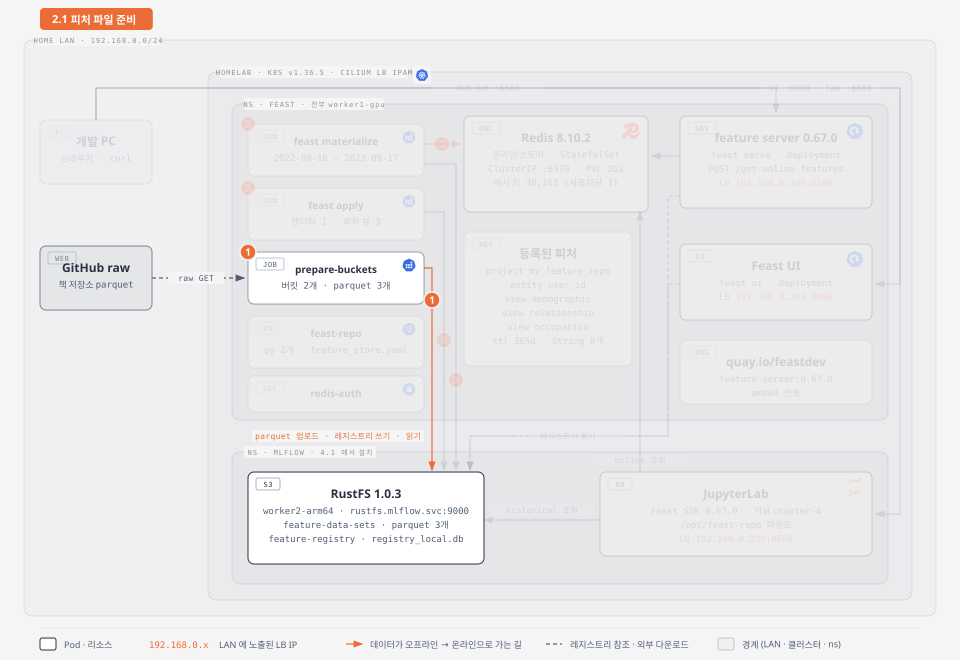
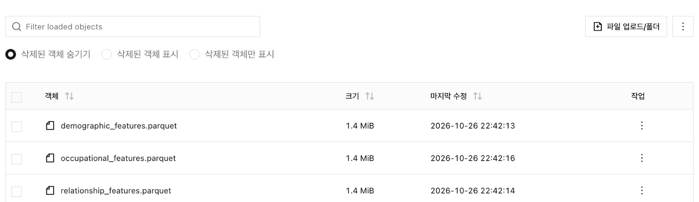
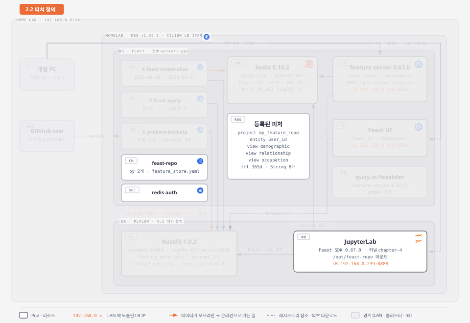
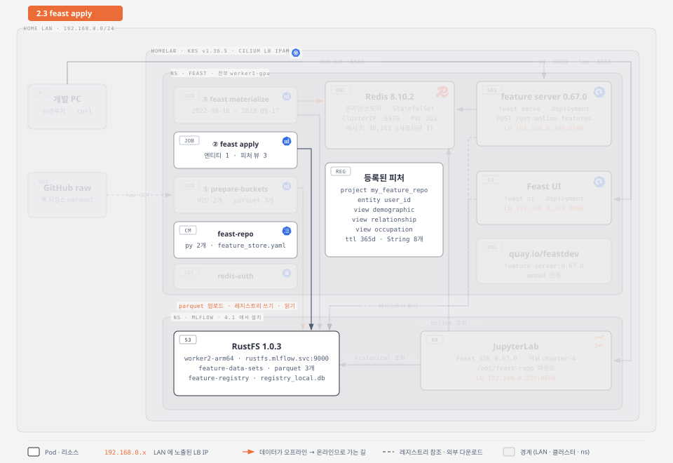
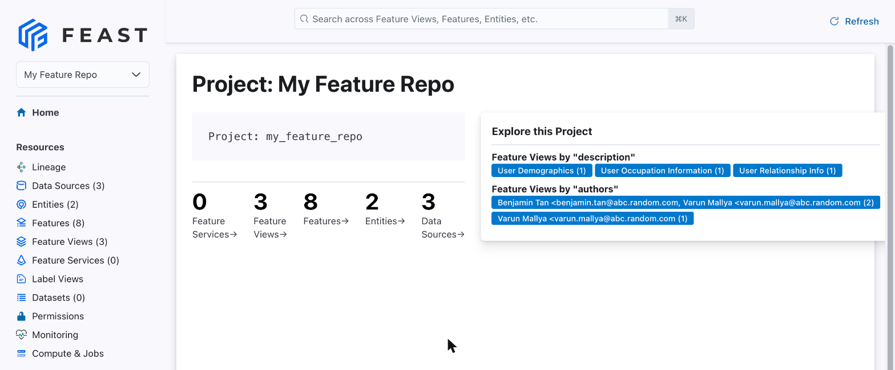
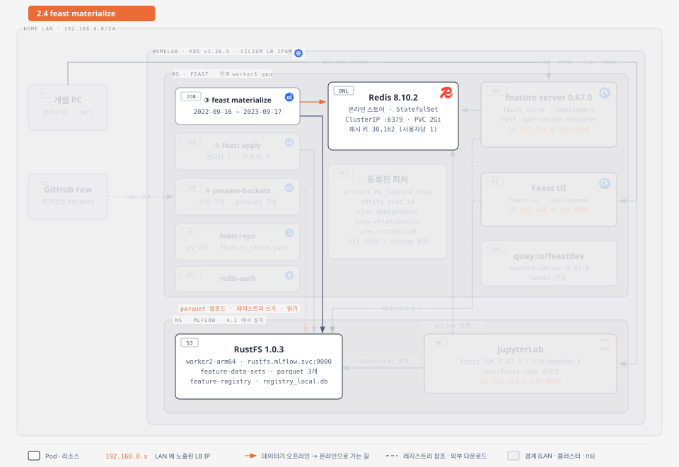
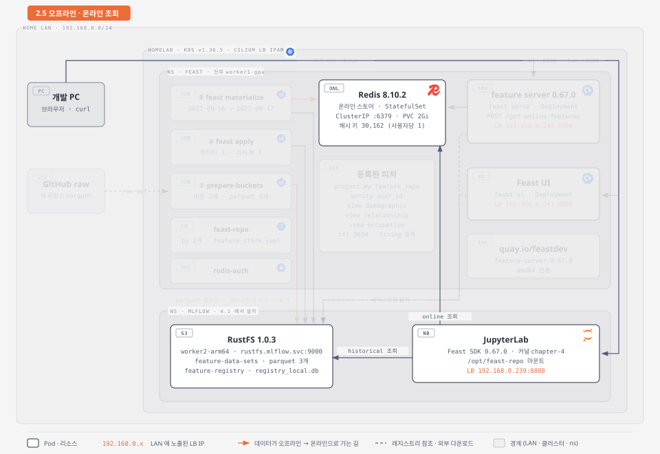
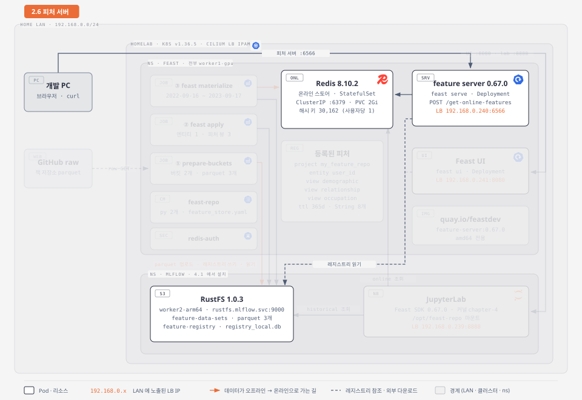
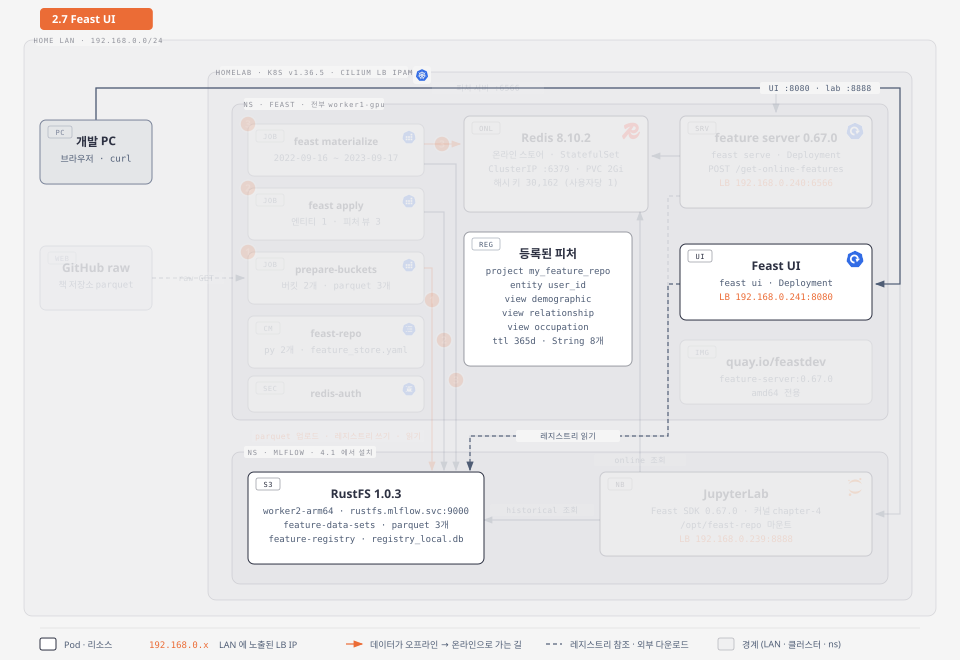
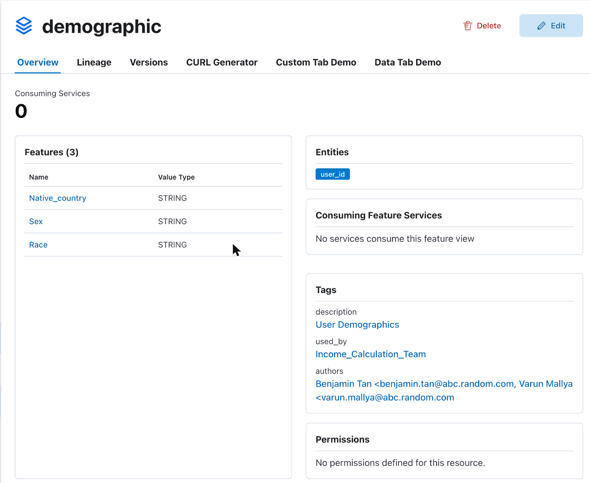

`Machine Learning Platform Engineering` 4장 2절은 피처 스토어 Feast를 다룬다. 학습과 추론이 같은 피처를 같은 시점 기준으로 꺼내 쓰게 해 주는 도구다.

이 글은 홈랩 Kubernetes 클러스터에 Feast를 올리고 4.2절 실습을 따라 한 기록이다. MLflow, RustFS, JupyterLab은 [앞 글](../mlpe-04-mlflow-install/)에서 설치한 것을 그대로 쓴다.

## 1. 구성

Feast는 별도 네임스페이스 `feast`에 올렸다. 오프라인 스토어와 레지스트리는 새로 만들지 않고 MLflow용으로 설치한 RustFS를 같이 쓴다. 매니페스트는 홈랩 저장소 `~/k8s/feast/`에 있고, 결정 배경은 ADR-046에 남겼다.

![홈랩 Kubernetes 클러스터의 feast 네임스페이스(전부 worker1-gpu)에 Redis 8.10.2 온라인 스토어, feast apply·materialize Job, feature server 0.67.0, Feast UI 를 올리고, 오프라인 스토어와 레지스트리는 mlflow 네임스페이스의 RustFS 를 같이 쓰는 구성. prepare-buckets Job 이 GitHub 에서 parquet 3개를 받아 RustFS 에 올리고, feast apply 가 엔티티와 피처 뷰 3개를 registry_local.db 에 등록하고, feast materialize 가 parquet 를 읽어 Redis 에 해시 키 30,162개를 쓴다. 피처 서버(192.168.0.240:6566)와 UI(192.168.0.241:8080)는 레지스트리를 읽고 Redis 를 조회하며, JupyterLab 의 Feast SDK 는 RustFS 에서 historical, Redis 에서 online 피처를 가져온다](homelab-feast.svg)

| 구성요소 | 버전 | 어디에 | 역할 |
| --- | --- | --- | --- |
| **Redis** | 8.10.2 | ns `feast`, PV 2Gi | 온라인 스토어. 사용자 한 명당 해시 키 하나 |
| **RustFS** (공용) | 1.0.3 | ns `mlflow` | 오프라인 스토어(버킷 `feature-data-sets`의 parquet 3개) + 레지스트리(`feature-registry/registry_local.db`) |
| **feast apply / materialize** | 0.67.0 | Job | 피처 정의 등록, parquet에서 Redis로 최신 값 복사 |
| **feature server / UI** | 0.67.0 | Deployment, LB .240 / .241 | REST로 온라인 피처 조회, 레지스트리 열람 |
| **JupyterLab** (공용) | Feast SDK 0.67.0 | ns `mlflow` | 책의 조회 스크립트 실행 |

주황 화살표가 Feast의 핵심 흐름이다. ① Job이 책 저장소의 parquet를 RustFS에 올리고, ② `feast apply`가 엔티티 `user_id`와 피처 뷰 3개(demographic, relationship, occupation)를 레지스트리에 쓴다. ③ `feast materialize`가 parquet를 읽어 사용자 30,162명의 최신 값을 Redis에 채운다.

조회는 두 갈래다. 학습용 과거 시점 피처(`get_historical_features`)는 RustFS의 parquet에서, 추론용 최신 피처(`get_online_features`)는 Redis에서 읽는다. 피처 정의 파일(`entity.py`, `features.py`, `feature_store.yaml`)은 ConfigMap `feast-repo` 하나로 Job, 피처 서버, UI, Jupyter에 같이 마운트한다.

Feast 공식 이미지(`quay.io/feastdev/feature-server:0.67.0`)는 amd64 전용이라 Feast Pod는 모두 worker1-gpu에 있다. 책의 0.40.1 대신 0.67.0을 쓰면서 달라진 점은 홈랩 저장소의 `feast/README.md`에 정리했다.

## 2. 실습

책은 Feast 명령을 로컬 PC에서 실행하고 MinIO와 Redis를 포트포워드로 연다. 홈랩에서는 모든 명령을 JupyterLab 터미널(`192.168.0.239:8888` → File → New → Terminal)에서 실행한다. 접속 정보(`AWS_*`, `FEAST_S3_ENDPOINT_URL`, `REDIS_PASSWORD`)는 Pod 환경변수로 이미 들어가 있어서 책의 `env.sh` 같은 준비가 필요 없다.

### 2.1 피처 파일 3개



책은 4.1절의 소득 데이터를 피처 범주별로 파일 3개로 나눠, 피처가 여러 테이블에 흩어진 현실 상황을 흉내 낸다. 파일마다 `user_id`와 `feature_timestamp` 열이 있고 나머지가 그 범주의 피처다.

| 파일 | 피처 뷰 | 피처 |
| --- | --- | --- |
| `demographic_features.parquet` | `demographic` | Sex, Native_country, Race |
| `relationship_features.parquet` | `relationship` | Relationship, Marital-Status |
| `occupational_features.parquet` | `occupation` | Workclass, Education, Occupation |

세 파일 모두 30,162행이고 사용자 한 명당 기록이 하나다. `feature_timestamp`는 2022-09-16 ~ 2023-09-16 사이에 흩어져 있다.

설치 때 Job `feast-prepare-buckets`가 책 저장소에서 이 파일을 받아 RustFS 버킷 `feature-data-sets`에 올려 두었다. 레지스트리용 버킷 `feature-registry`도 같은 Job이 만든다.



### 2.2 피처 정의 (4.2.1)



정의 파일 3개는 ConfigMap `feast-repo`로 Jupyter의 `/opt/feast-repo`에 마운트돼 있다. 책 코드에서 바꾼 곳은 주소와 암호뿐이다.

```python {title="entity.py (Listing 4.8)"}
from feast import Entity, ValueType

# 0.67 은 value_type 을 생략하면 DeprecationWarning 이라 명시한다
user = Entity(name="user_id", description="A user", value_type=ValueType.STRING)
```

```python {title="features.py (Listing 4.9, 4.10 요지)"}
S3_ENDPOINT = "http://rustfs.mlflow.svc:9000"        # 책: http://localhost:9000 (MinIO 포트포워드)

demo_features_parquet_file_source = FileSource(
    file_format=ParquetFormat(),
    path="s3://feature-data-sets/demographic_features.parquet",
    s3_endpoint_override=S3_ENDPOINT,
)

demo_features = FeatureView(
    name="demographic",
    entities=[user],
    schema=[
        Field(name="Native_country", dtype=String),
        Field(name="Sex", dtype=String),
        Field(name="Race", dtype=String),
    ],
    ttl=timedelta(days=365),                          # 과거 조회 때 1년 전까지만 본다
    source=demo_features_parquet_file_source,
    tags={"description": "User Demographics", "used_by": "Income_Calculation_Team"},
)
# relationship, occupation 도 같은 모양
```

```yaml {title="feature_store.yaml (Listing 4.11)"}
project: my_feature_repo
registry: s3://feature-registry/registry_local.db
provider: local
offline_store:
  type: file
online_store:
  type: redis
  connection_string: "redis.feast.svc:6379,password=${REDIS_PASSWORD}"   # 책: localhost:6379
entity_key_serialization_version: 3
```

Redis 암호는 파일에 쓰지 않는다. Feast가 `feature_store.yaml`을 읽을 때 `${REDIS_PASSWORD}`를 환경변수 값으로 바꾼다(0.67.0 `repo_config.py`의 `os.path.expandvars`). `entity_key_serialization_version: 3`을 넣어서 책 실습에서 나오던 직렬화 버전 경고도 나오지 않는다.

### 2.3 등록: feast apply



`/opt/feast-repo`는 읽기 전용이라 정의 파일을 홈 디렉터리로 복사한 뒤 실행한다.

```terminal
$ source ~/.venvs/chapter-4/bin/activate
$ mkdir ~/feast-repo && cp /opt/feast-repo/*.py /opt/feast-repo/*.yaml ~/feast-repo/ && cd ~/feast-repo
$ feast apply
No project found in the repository. Using project name my_feature_repo defined in feature_store.yaml
Applying changes for project my_feature_repo
Deploying infrastructure for relationship
Deploying infrastructure for demographic
Deploying infrastructure for occupation
$ feast feature-views list
NAME          ENTITIES     TYPE         ENABLED    STATE
demographic   {'user_id'}  FeatureView  Yes        AVAILABLE_ONLINE
occupation    {'user_id'}  FeatureView  Yes        AVAILABLE_ONLINE
relationship  {'user_id'}  FeatureView  Yes        AVAILABLE_ONLINE
```

**`cp -r /opt/feast-repo ~/feast-repo`로 통째 복사하면 `feast apply`가 죽는다.** ConfigMap 볼륨에는 `..data`와 `..2026_10_26_…` 같은 숨은 디렉터리가 있고, Feast는 하위 디렉터리의 `.py`까지 모듈로 임포트하다가 `TypeError: the 'package' argument is required to perform a relative import for '..2026_10_26_13_46_49.1163188509.entity'`를 낸다. 파일 3개만 복사하면 된다.

설치 Job이 이미 한 번 등록했기 때문에 책 출력의 `Created entity user_id`, `Created feature view …` 줄은 나오지 않는다. 처음 등록할 때만 찍히고, 다시 돌리면 바뀐 것이 없어 `Deploying infrastructure` 줄만 남는다. 레지스트리는 RustFS `feature-registry/registry_local.db`(4.7KiB) 하나다.



UI의 Entities가 2개인 것은 Feast가 엔티티 없는 피처 뷰용으로 내부에 두는 `__dummy` 엔티티까지 세기 때문이다. `feast entities list`는 `user_id` 하나만 보여 준다.

### 2.4 구체화: feast materialize



온라인 조회 전에 오프라인 스토어(RustFS parquet)의 값을 온라인 스토어(Redis)로 옮긴다. 시작·끝 시각은 책과 같고 parquet의 `feature_timestamp` 범위를 모두 덮는다.

```terminal
$ feast materialize 2022-09-16T00:00:00 2023-09-17T00:00:00
Materializing 3 feature views from 2022-09-16 00:00:00+00:00 to 2023-09-17 00:00:00+00:00 into the redis online store.
demographic:
occupation:
relationship:
$ kubectl -n feast exec redis-0 -- redis-cli DBSIZE
30162
$ kubectl -n feast exec redis-0 -- redis-cli INFO memory | grep used_memory_human
used_memory_human:12.58M
```

뷰가 3개인데 키는 90,486개가 아니라 30,162개다. Feast Redis 스토어는 사용자 한 명당 해시 키 하나에 세 뷰의 피처 값과 `_ts:<뷰 이름>` 타임스탬프 필드를 같이 넣는다. 그래서 키 수가 사용자 수와 같고, 여러 뷰를 한 번에 조회해도 사용자당 Redis 조회는 한 번이다.

Feast 공식 이미지에는 s3fs가 없어서 클러스터의 materialize Job은 시작할 때 `pip install s3fs`를 한다. Jupyter venv에는 `feast[aws]`로 이미 들어 있어 위 명령이 그대로 돈다.

### 2.5 조회: 오프라인과 온라인 (4.2.2)



책의 조회 스크립트 두 개는 `FeatureStore(repo_path=".")`라 정의 파일이 있는 `~/feast-repo`에서 실행한다.

```terminal
$ python ~/practical-mlops/chapter-4/feast_retrieval/retrieve_features.py
----- Example features -----

                                user_id           event_timestamp    Sex
0  9f2ac416-06e1-44a0-87bd-d4787c85bf66 2023-01-30 10:59:42+00:00   Male
$ python ~/practical-mlops/chapter-4/feast_retrieval/retrieve_online_features.py
----- Example features -----

                                user_id    Sex
0  74b0638a-5742-4d1a-a03f-483794d7aa7c   Male
```

오프라인 조회(Listing 4.12)는 "2023-01-30 10:59:42 시점에 이 사용자의 Sex는?"이라는 질문이다. parquet에 이 사용자의 기록은 2023-01-24 06:52:20 하나뿐이고 조회 시점보다 앞이며 TTL(365일) 안이라 그 값 Male이 나온다.

조회 시점을 2023-01-20처럼 기록보다 앞으로 당기면 아직 없던 값이라 결과가 0행으로 나온다(0.67.0 file 오프라인 스토어 실측). 시점을 거꾸로 거슬러 미래 값을 끌어오는 일(데이터 누수)을 Feast가 막아 주는 것이다.

| | 오프라인 `get_historical_features` | 온라인 `get_online_features` |
| --- | --- | --- |
| 입력 | `user_id` + `event_timestamp` 데이터프레임 | `user_id` 목록 |
| 값의 기준 | 그 시점 이전의 가장 최근 값 | 마지막 materialize 때의 최신 값 |
| 읽는 곳 | RustFS의 parquet | Redis |
| 출력의 `event_timestamp` 열 | 있음 | 없음 |
| 용도 | 학습 데이터셋, 배치 추론 | 실시간 추론 |

### 2.6 피처 서버 (4.2.3)



책은 `feast serve`를 로컬에서 띄우지만, 홈랩에는 Deployment `feast-server`가 `192.168.0.240:6566`에 떠 있다. Feast SDK가 없는 언어의 애플리케이션도 HTTP로 온라인 피처를 가져갈 수 있다. 사용자 두 명과 없는 ID 하나를 섞어 세 뷰를 한 번에 조회했다.

```bash
curl -s -X POST http://192.168.0.240:6566/get-online-features \
  -H 'Content-Type: application/json' -d '{
  "features": ["demographic:Sex", "occupation:Occupation", "relationship:Marital-Status"],
  "entities": {"user_id": ["9f2ac416-06e1-44a0-87bd-d4787c85bf66",
                           "74b0638a-5742-4d1a-a03f-483794d7aa7c",
                           "no-such-user"]}
}' | jq
```

응답은 피처마다 `values`, `statuses`, `event_timestamps` 배열을 하나씩 돌려준다. 표로 옮기면 이렇다.

| user_id | Sex | Occupation | Marital-Status | 피처 기록 시각 |
| --- | --- | --- | --- | --- |
| 9f2ac416… | Male | Adm-clerical | Never-married | 2023-01-24 06:52:20 |
| 74b0638a… | Male | Farming-fishing | Married-civ-spouse | 2023-05-12 16:58:28 |
| no-such-user | `null` | `null` | `null` | 1970-01-01 00:00:00 |

없는 사용자도 `statuses`는 `PRESENT`로 온다(0.67.0 실측). 값이 있는지는 `values`가 `null`인지, `event_timestamps`가 1970-01-01인지로 판단해야 한다. 값 앞의 공백(`" Male"`)은 원본 CSV에서 따라온 것이다.

### 2.7 Feast UI (4.2.4)



UI도 Deployment `feast-ui`로 `192.168.0.241:8080`에 떠 있어 책처럼 `feast ui -p 8889`를 따로 띄울 필요가 없다. 레지스트리를 읽어 엔티티, 피처 뷰, 데이터 소스와 태그를 보여 준다.



`features.py`의 `tags`가 화면의 Tags로 그대로 나오고, 홈 화면에서는 이 태그 값으로 피처 뷰를 걸러 볼 수 있다.

### 2.8 정리

MLflow는 모델 쪽(실험 기록, 모델 버전)을, Feast는 데이터 쪽(학습과 추론에 같은 피처를 같은 시점 기준으로)을 맡는다. 두 도구 모두 아직은 사람이 명령을 실행해야 돈다. 재학습과 `feast materialize`를 주기적으로 돌리는 일은 5장 Kubeflow Pipelines에서 자동화한다.

MLflow 설치 과정은 [Kubernetes에 MLflow 설치하기](../mlpe-04-mlflow-install/)에, 4.1절 실습은 [홈랩 MLflow로 실험 추적과 모델 레지스트리 실습하기](../mlpe-04-1-mlflow-practice/)에 있다.
