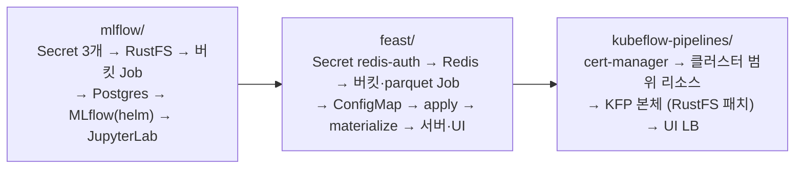

`Machine Learning Platform Engineering` 4장은 MLflow와 Feast, 5장은 둘을 잇는 Kubeflow Pipelines를 다룬다. 책은 로컬 `mlflow ui`와 로컬 `feast` 명령, Kubeflow에 딸린 MinIO로 진행하지만 로컬 인스턴스로는 팀이 같은 기록을 볼 수 없다. 그래서 4장의 도전과제가 "Kubernetes에 MLflow를 설치하라"다.

이 글은 홈랩 Kubernetes 클러스터(v1.36.5, 노드 3대)에 2주차 실습 플랫폼 전체를 올린 기록이다. 2026-10-25에 MLflow 플랫폼, 10-26에 Feast와 Kubeflow Pipelines(KFP)를 설치했고 10-28에 KFP 아티팩트 저장소를 RustFS로 통일했다.

## 1. 전체 구성

네임스페이스 셋에 나누어 올렸다. 객체 스토리지는 RustFS 하나뿐이고 MLflow 아티팩트, Feast 오프라인 스토어와 레지스트리, KFP 아티팩트가 모두 여기에 들어간다.

| 네임스페이스 | 구성요소 | 버전 | LAN 주소 | 역할 |
| --- | --- | --- | --- | --- |
| `mlflow` | **RustFS** | 1.0.3 | 192.168.0.237 (:9000 S3, :9001 콘솔) | S3 호환 객체 스토리지. 버킷 6개 |
| `mlflow` | **Postgres** | 18.6 | (내부) | MLflow 백엔드 스토어 |
| `mlflow` | **MLflow server** | 3.16.0 (community-charts 1.11.7) | 192.168.0.238:5000 | 추적 서버 + 모델 레지스트리 + UI |
| `mlflow` | **JupyterLab** | scipy-notebook python-3.13 | 192.168.0.239:8888 | 책 노트북과 Feast SDK 실행 |
| `feast` | **Redis** | 8.10.2 | (내부) | Feast 온라인 스토어 |
| `feast` | **feast apply / materialize** | 0.67.0 | Job | 피처 등록, parquet에서 Redis로 구체화 |
| `feast` | **feature server / UI** | 0.67.0 | 192.168.0.240:6566 / 192.168.0.241:8080 | REST 온라인 조회, 레지스트리 열람 |
| `kubeflow` | **Kubeflow Pipelines** | 2.17.3 standalone | 192.168.0.242 | 파이프라인 API, UI, MySQL 8.4, 메타데이터, 캐시 |
| `cert-manager` | **cert-manager** | v1.21.3 | | KFP cache-server 웹훅 인증서 |
| `argo` (기존) | **Argo Workflows** | v4.1.4 | 192.168.0.233:2746 | KFP 워크플로 실행 엔진(공유) |

![홈 LAN 안의 홈랩 Kubernetes 클러스터(v1.36.5)에 올린 2주차 실습 플랫폼 전체 구성. mlflow 네임스페이스에 JupyterLab(192.168.0.239), MLflow 3.16.0(192.168.0.238), Postgres 18, Secret 4개, RustFS 1.0.3(192.168.0.237, 버킷 6개)이 있고, feast 네임스페이스에 Feast 서버·UI(192.168.0.240, 241), apply·materialize Job, Redis 8.10.2 가, kubeflow 네임스페이스에 ml-pipeline UI·API 2.17.3(192.168.0.242), 실행 Pod, MySQL 8.4 가 있다. 기존 argo 네임스페이스의 workflow-controller v4.1.4 가 KFP Workflow 를 받아 실행 Pod 를 만들고 cert-manager 가 cache-server 인증서를 준다. 노트북은 MLflow 에 run 과 지표를, RustFS 에 아티팩트를 직접 올리고, Feast Job 은 RustFS 에 parquet 와 레지스트리를, Redis 에 키 30,162개를 쓴다. KFP 실행 Pod 는 MLflow 에서 Production 모델을 받고 RustFS 에 Dataset 과 로그를 쓴다](homelab-platform.svg)

책과 다른 점은 다섯 가지다. MinIO 대신 RustFS, SQLite 대신 Postgres, 로컬 노트북 대신 클러스터 안 JupyterLab, 로컬 `feast` 명령 대신 Job과 Deployment, 그리고 KFP는 번들 Argo를 빼고 클러스터에 있던 Argo Workflows를 같이 쓴다. S3 호환이라 책의 minio SDK와 boto3 코드가 그대로 돌고 Python 3.13에는 책의 고정 버전(mlflow 3.0.0, feast 0.40.1) 휠이 없어 최신 버전을 쓴다.

설치는 디렉터리마다 `scripts/install.sh` 하나로 하며 순서는 `mlflow` → `feast` → `kubeflow-pipelines`다. 세 스크립트 모두 멱등이라 다시 실행하면 바뀐 것만 적용되고 비밀값은 처음 한 번 무작위로 만들어 Secret에만 저장한다.



| Secret | 네임스페이스 | 쓰는 곳 |
| --- | --- | --- |
| `rustfs-credentials` | mlflow (원본), feast·kubeflow (복사) | RustFS 루트 계정, MLflow 서버, Jupyter, 버킷 Job, Feast Job·서버, KFP launcher·API·UI |
| `mlflow-postgres` | mlflow | Postgres, MLflow 서버 |
| `jupyter-token` | mlflow | JupyterLab 로그인 |
| `redis-auth` | feast (원본), mlflow (복사) | Redis, Feast Job·서버·UI, Jupyter의 Feast SDK |

Secret은 네임스페이스를 넘지 못하므로 설치 스크립트가 `rustfs-credentials`를 `feast`로, `redis-auth`를 `mlflow`로 복사한다.

## 2. MLflow 플랫폼

핵심은 **아티팩트가 MLflow 서버를 거치지 않는다**는 점이다. 노트북이 `log_model()`을 부르면 run과 지표 같은 메타데이터만 MLflow 서버(Postgres)로 가고 파일은 노트북 Pod가 RustFS에 직접 올린다. 그래서 Jupyter Pod에도 RustFS 계정과 `MLFLOW_S3_ENDPOINT_URL`이 환경변수로 들어간다.

**RustFS**는 Deployment 하나와 LoadBalancer Service다. PV가 RWO라 `Recreate` 전략을 쓰고 데이터는 worker1-gpu의 디스크 부담을 덜려고 worker2-arm64(Raspberry Pi)에 둔다. 버킷은 aws-cli 이미지의 Job이 `head-bucket`으로 확인하고 없을 때만 만든다.

| 버킷 | 만드는 곳 | 내용 |
| --- | --- | --- |
| `mlflow-artifacts` | mlflow 버킷 Job | MLflow run 아티팩트, logged model |
| `mlflow-datasets` | mlflow 버킷 Job | 4.1절 노트북이 올리는 학습·검증 CSV |
| `feature-data-sets` | feast 버킷 Job | Feast 오프라인 스토어 parquet 3개 |
| `feature-registry` | feast 버킷 Job | Feast 레지스트리 `registry_local.db` |
| `inference-datasets` | 5장 실습 때 수동 | 배치 추론 입력과 결과 parquet |
| `mlpipeline` | 5장 실습 때 수동 | KFP 단계 사이 Dataset과 로그 |

**Postgres**는 `postgres:18` 공식 이미지 단일 인스턴스다. worker2-arm64는 메모리 요청이 98%라 256Mi도 스케줄되지 않아 worker1-gpu에 둔다.

**MLflow**는 community-charts의 Helm 차트로 올린다. 공식 이미지에는 psycopg2와 boto3가 없는데 이 차트의 이미지(`burakince/mlflow`)는 둘을 포함하고 `existingSecret`도 지원한다. values에서 기본값과 다른 부분만 추리면 다음과 같다.

```yaml {title="mlflow/02-mlflow/values.yaml (요지)"}
image:
  repository: burakince/mlflow
  tag: "3.16.0"
backendStore:
  databaseMigration: true
  databaseConnectionCheck: true    # init 컨테이너 dbchecker 가 Postgres 를 기다린다
  postgres: { enabled: true, host: mlflow-postgres, port: 5432, database: mlflow }
  existingDatabaseSecret: { name: mlflow-postgres, usernameKey: username, passwordKey: password }
artifactRoot:
  proxiedArtifactStorage: false    # 책과 같이 클라이언트가 S3 에 직접 쓴다
  s3:
    enabled: true
    bucket: mlflow-artifacts
    path: chapter-4
    existingSecret: { name: rustfs-credentials, keyOfAccessKeyId: AWS_ACCESS_KEY_ID, keyOfSecretAccessKey: AWS_SECRET_ACCESS_KEY }
extraEnvVars:
  MLFLOW_S3_ENDPOINT_URL: http://rustfs:9000
service:
  type: LoadBalancer
  annotations: { lbipam.cilium.io/ips: "192.168.0.238" }
serviceMonitor:
  enabled: true                    # --expose-prometheus=/mlflow/metrics 가 붙는다
extraVolumes: [{ name: metrics, emptyDir: {} }]   # 루트 FS 가 읽기 전용이라 그 경로를 emptyDir 로
extraVolumeMounts: [{ name: metrics, mountPath: /mlflow/metrics }]
extraArgs:
  workers: "2"                     # 기본 4개면 2Gi 를 넘겨 OOMKilled
  # 3.x 보안 미들웨어. 기본 허용이 localhost 뿐이라 클러스터 안 이름과 LAN 화면 origin 을 추가한다
  allowedHosts: "localhost:*,127.0.0.1:*,mlflow:*,mlflow.mlflow.svc:*,192.168.*,10.*"
  corsAllowedOrigins: "http://192.168.0.238:5000,http://mlflow:5000"
resources:
  requests: { cpu: 100m, memory: 512Mi }
  limits: { memory: 4Gi }
```

**JupyterLab**은 `scipy-notebook` 이미지에 시작 hook 하나를 ConfigMap으로 꽂았다. hook이 chapter-4 저장소를 clone하고 venv에 최신 mlflow, xgboost, `feast[redis,aws]`를 설치해 `chapter-4` 커널로 등록하며 홈 디렉터리가 PVC라 재시작해도 남는다. xgboost 휠이 amd64용이라 worker1-gpu에만 뜨고 Service 이름이 `jupyter`라 `enableServiceLinks: false`가 필요하다.

## 3. Feast

책 4.2절은 `feast apply`, `materialize`, `serve`, `ui`를 모두 로컬 PC에서 실행하고 Redis 암호를 `feature_store.yaml`에 직접 쓴다. 홈랩에서는 오프라인 스토어와 레지스트리를 RustFS에 두고 나머지는 모두 `feast` 네임스페이스의 Job과 Deployment로 돌린다.

| 책 | 홈랩 |
| --- | --- |
| MinIO 포트포워드 | RustFS `http://rustfs.mlflow.svc:9000` |
| Redis NodePort, 암호를 yaml에 직접 | ClusterIP `redis.feast.svc:6379`, 암호는 `${REDIS_PASSWORD}` 환경변수 치환 |
| `feast apply` / `materialize`를 로컬에서 | 공식 이미지 Job |
| `feast serve` / `feast ui`를 로컬에서 | Deployment + LoadBalancer |
| parquet를 MinIO 콘솔로 수동 업로드 | Job이 GitHub raw에서 받아 업로드 |
| Feast 0.40.1 | 0.67.0 (`quay.io/feastdev/feature-server`, amd64 전용) |

**Redis**는 StatefulSet 하나다. 암호는 `--requirepass $(REDIS_PASSWORD)`로 Secret에서 받고 프로브의 `redis-cli`가 인증하도록 `REDISCLI_AUTH`도 같은 Secret에서 넣는다.

**Job과 서버**는 네 가지 모두 공식 이미지로 돈다. 피처 정의(`entity.py`, `features.py`, `feature_store.yaml`)는 ConfigMap `feast-repo`로 `feast`, `mlflow` 양쪽에 등록한다. ConfigMap 볼륨에는 `..data` 같은 심볼릭 링크 디렉터리가 있어 Feast가 그 안의 `.py`까지 임포트하다 죽으므로 시작할 때 emptyDir로 `cp -L` 한 뒤 실행한다.

```yaml {title="feast/03-registry/apply-job.yaml (요지, materialize·serve·ui 도 같은 모양)"}
containers:
  - name: feast
    image: quay.io/feastdev/feature-server:0.67.0
    workingDir: /feast-repo
    command: ["sh", "-c", "cp -L /feast-repo-src/*.py /feast-repo-src/*.yaml /feast-repo/ && feast apply"]
    envFrom:
      - secretRef: { name: rustfs-credentials }
    env:
      - { name: FEAST_S3_ENDPOINT_URL, value: http://rustfs.mlflow.svc:9000 }   # 레지스트리·parquet
      - { name: AWS_ENDPOINT_URL, value: http://rustfs.mlflow.svc:9000 }        # FileSource 검증(boto3)
      - name: REDIS_PASSWORD
        valueFrom:
          secretKeyRef: { name: redis-auth, key: redis-password }
    volumeMounts:
      - { name: repo-src, mountPath: /feast-repo-src }   # configMap feast-repo
      - { name: repo, mountPath: /feast-repo }           # emptyDir
```

| 리소스 | 명령 | 비고 |
| --- | --- | --- |
| Job `feast-apply` | `feast apply` | 엔티티와 피처 뷰 3개를 `s3://feature-registry/registry_local.db`에 등록 |
| Job `feast-materialize` | `pip install s3fs && feast materialize 2022-09-16 2023-09-17` | 공식 이미지에 s3fs가 없다 |
| Deployment `feast-server` | `feast serve -h 0.0.0.0 -p 6566` | LB 192.168.0.240 |
| Deployment `feast-ui` | `feast ui -h 0.0.0.0 -p 8080` | LB 192.168.0.241 |

`feature_store.yaml`의 연결 문자열은 `redis.feast.svc:6379,password=${REDIS_PASSWORD}`다. Feast가 설정을 읽을 때 `os.path.expandvars`로 치환하므로 암호가 git과 ConfigMap 어디에도 남지 않는다.

## 4. Kubeflow Pipelines

5장 배치 추론 파이프라인을 돌리기 위해 KFP 2.17.3을 standalone(단일 사용자) 모드로 설치했다. 멀티 유저(Kubeflow 전체 + Profile)는 필요 없다.

**번들 Argo는 뺐다.** KFP 매니페스트는 Argo CRD와 전용 workflow-controller(v4.0.6)를 같이 설치하는데 홈랩에는 다른 워크로드가 쓰는 Argo Workflows v4.1.4가 전체 네임스페이스를 감시하며 돌고 있다. 그대로 설치하면 CRD가 덮이고 두 컨트롤러가 같은 Workflow를 처리하므로 kustomize 패치로 빼고 기존 컨트롤러가 KFP 워크플로도 실행하게 했다. 대신 공유 Argo에 두 설정이 있어야 한다.

```yaml {title="argo-workflows/01-argo-workflows/values.yaml (공유 Argo)"}
controller:
  workflowDefaults:
    spec:
      nodeSelector:
        kubernetes.io/arch: amd64   # kfp-driver, launcher 이미지는 amd64 전용. Pi 에 뜨면 exec format error
executor:
  securityContext:                  # KFP 실행 Pod 는 runAsNonRoot 인데 argoexec 기본 사용자가 root
    runAsNonRoot: true
    runAsUser: 65532
```

설치는 cert-manager → 클러스터 범위 리소스(Namespace, Application·ScheduledWorkflow CRD) → KFP 본체 → UI LoadBalancer 순서다. 본체는 upstream `env/platform-agnostic`과 `env/cert-manager/base`를 가져온 뒤 여섯 가지를 패치한다.

| 항목 | upstream | 홈랩 |
| --- | --- | --- |
| Argo | workflow-controller v4.0.6 + RBAC + ConfigMap | `$patch: delete` → 공유 v4.1.4 |
| cache 인증서 | cache-deployer (legacy CSR signer, 최신 K8s에서 막힘) | cert-manager `Issuer`/`Certificate` |
| 로그 보관 | 컨트롤러 ConfigMap | 네임스페이스 ConfigMap `artifact-repositories` (공유 컨트롤러 설정을 건드리지 않는다) |
| 노드 | 제한 없음 | 모든 Deployment에 amd64 nodeAffinity |
| `$(kfp-namespace)` | 상위 오버레이가 치환 | 같은 `replacements`를 둔다. 없으면 webhook 이름이 거부된다 |
| 아티팩트 저장소 | 번들 SeaweedFS | RustFS `mlpipeline` 버킷 |

UI는 LoadBalancer 하나(192.168.0.242)로 열고 UI가 `/apis/*`를 API 서버로 프록시하므로 SDK도 같은 주소를 쓴다. 인증이 없으니 LAN 밖으로 포워딩하면 안 된다.

**아티팩트 저장소는 RustFS로 통일했다.** KFP는 번들 SeaweedFS를 단계 사이 Dataset과 로그 저장소로 쓰는데 5장 실습의 입출력은 RustFS에 있어 객체 스토리지가 둘이었다. 기본 엔드포인트가 launcher와 UI 코드에 고정돼 있어 네 곳을 각각 패치했고 키는 모두 `kubeflow` 네임스페이스에 복사한 Secret `rustfs-credentials`를 참조한다.

| 구성요소 | 바꾼 곳 | 값 |
| --- | --- | --- |
| 단계 Pod (launcher) | ConfigMap `kfp-launcher` | `defaultPipelineRoot: minio://mlpipeline/v2/artifacts`, `providers.minio.default.endpoint: rustfs.mlflow.svc:9000` |
| API 서버 | Deployment `ml-pipeline` env | `OBJECTSTORECONFIG_HOST=rustfs.mlflow.svc` |
| UI | Deployment `ml-pipeline-ui` env | `MINIO_HOST=rustfs`, `MINIO_NAMESPACE=mlflow` |
| Argo 로그 보관 | ConfigMap `artifact-repositories` | `endpoint: rustfs.mlflow.svc:9000`, `bucket: mlpipeline` |
| SeaweedFS | Deployment `seaweedfs` | `replicas: 0` (PVC는 남긴다) |

KFP를 업그레이드하면 upstream 기본값이 다시 SeaweedFS를 가리키므로 이 패치는 계속 유지해야 한다.

## 5. 겪은 문제

| 구성요소 | 증상 | 원인과 해결 |
| --- | --- | --- |
| MLflow | `Read-only file system: '/mlflow/metrics'` | serviceMonitor가 붙이는 metrics 경로를 emptyDir로 마운트 |
| MLflow | 기동 직후 OOMKilled | uvicorn 워커 4개 → `workers: "2"`, limit 4Gi |
| MLflow | 클러스터 안 API 403 `Invalid Host header` | 3.x 보안 미들웨어. `allowedHosts`에 `mlflow:*` 패턴 |
| MLflow | UI Runs 탭 "Request error" | 같은 미들웨어의 CORS. `corsAllowedOrigins`에 화면 주소 |
| MLflow | 노드 재부팅 뒤 접속 불가, 5장 파이프라인이 10분 멈춤 | Postgres보다 먼저 뜬 init 컨테이너 `dbchecker`의 재시도 간격이 약 8시간까지 늘어남. `rollout restart` |
| Postgres·Jupyter | 스케줄되지 않음 | 노드 요청량이 98~99%. 요청을 100m/512Mi로 최소화, Postgres는 worker1-gpu로 |
| Jupyter | `JUPYTER_PORT=tcp://...` 로 기동 실패 | Service 이름이 `jupyter`. `enableServiceLinks: false` |
| Feast | `feast apply`가 `TypeError: the 'package' argument is required` | ConfigMap 볼륨의 `..data` 디렉터리. emptyDir로 `cp -L` |
| Feast | `materialize`가 `Install s3fs` | 공식 이미지에 s3fs 없음. Job 시작 때 `pip install s3fs` |
| Feast | `Could not validate FileSource path` 경고 | 검증은 boto3 기본 엔드포인트를 씀. `AWS_ENDPOINT_URL`도 RustFS로 |
| KFP | 실행 Pod `runAsNonRoot and image will run as root` | 공유 Argo `executor.securityContext` |
| KFP | driver Pod `exec format error` | Pi에 배치됨. Argo `workflowDefaults` amd64 |
| KFP | 첫 설치에서 `x509: certificate signed by unknown authority` | cainjector가 CA를 넣기 전. 1분 뒤 재실행 |
| KFP | Argo CRD가 v4.0.6으로 바뀜 | `cluster-scoped-resources`를 통째로 적용. 홈랩 Argo 재설치로 복구 |

## 6. 확인

2026-10-28 기준으로 네 네임스페이스의 Pod가 모두 Running이다. KFP와 Feast는 amd64 전용 이미지라 worker1-gpu에 몰려 있고 RustFS와 cert-manager만 worker2-arm64에 있다.

```terminal
$ kubectl get svc -A | grep LoadBalancer | grep -E 'mlflow|feast|kubeflow'
feast      feast-server        LoadBalancer   192.168.0.240   6566:32451/TCP
feast      feast-ui            LoadBalancer   192.168.0.241   8080:31198/TCP
kubeflow   ml-pipeline-ui-lb   LoadBalancer   192.168.0.242   80:31424/TCP
mlflow     jupyter             LoadBalancer   192.168.0.239   8888:31668/TCP
mlflow     mlflow              LoadBalancer   192.168.0.238   5000:31250/TCP
mlflow     rustfs-lb           LoadBalancer   192.168.0.237   9000:30830/TCP,9001:32380/TCP
$ curl -s http://192.168.0.238:5000/version
3.16.0
$ curl -s http://192.168.0.240:6566/health -o /dev/null -w '%{http_code}\n'
200
$ curl -s http://192.168.0.242/apis/v2beta1/healthz
{"apiServerReady":true,"apiServerTagName":"2.17.3","apiServerMultiUser":false,"pipelineStore":"database"}
```

| 구성요소 | 확인한 것 |
| --- | --- |
| MLflow (10-25) | Jupyter의 `chapter-4` venv에서 실험 생성 → 아티팩트 업로드 → `log_model` → `register_model` → 로드·예측 통과 |
| Feast (10-26) | Job 3개 완료. 레지스트리가 RustFS에, Redis에 사용자 30,162명의 해시 키. 피처 서버가 책과 같은 값을 반환 |
| KFP (10-26) | Pod 12개 Running, `hello_pipeline.py` SUCCEEDED |
| KFP RustFS (10-28) | 5장 배치 추론 run SUCCEEDED(3분 8초). `mlpipeline` 버킷에 단계별 Dataset과 로그 |

MLflow UI, RustFS 콘솔, Feast 서버·UI, KFP UI에는 인증이 없거나 루트 계정 하나뿐이라 LAN 안에서만 쓴다. 이 환경에서 책을 따라 한 기록은 글을 나눠 두었다. 4.1절 노트북은 [홈랩 MLflow로 실험 추적과 모델 레지스트리 실습하기](../mlpe-04-1-mlflow-practice/), 4.2절 Feast는 [홈랩 Kubernetes에 Feast 피처 스토어 올리고 실습하기](../mlpe-04-mlflow-feast/), 5장 배치 추론 파이프라인은 [KFP로 소득 분류기 배치 추론 파이프라인 만들기](../mlpe-05-1-kfp-income-pipeline/)에 있다.
