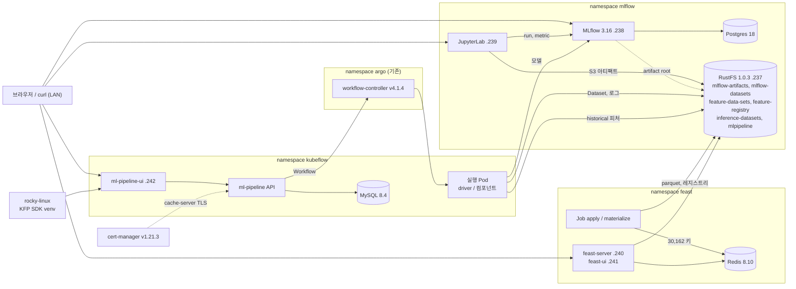
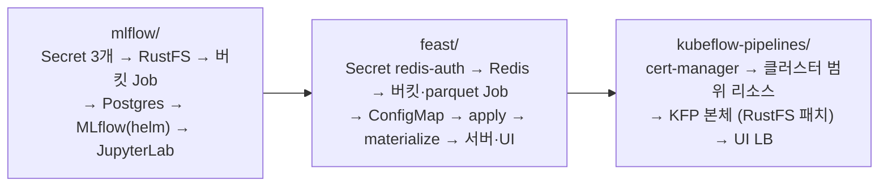
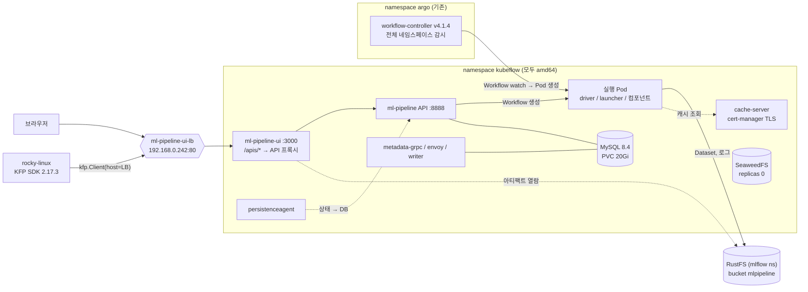

`Machine Learning Platform Engineering` 4장은 MLflow로 실험을 추적하고 Feast로 피처를 관리하며 5장은 둘을 Kubeflow Pipelines로 잇는다. 책은 로컬 `mlflow ui`(SQLite), 로컬 `feast` 명령, Kubeflow에 딸린 MinIO로 진행하는데, 로컬 인스턴스로는 팀이 같은 기록을 볼 수 없다. 그래서 4장의 도전과제가 "Kubernetes에 MLflow를 설치하라"다.

이 글은 홈랩 Kubernetes 클러스터(v1.36.5, 노드 3대)에 2주차 실습 플랫폼 전체를 올린 기록이다. 2026-10-25에 MLflow 플랫폼, 10-26에 Feast와 Kubeflow Pipelines(KFP)를 설치했고 10-28에 KFP 아티팩트 저장소를 RustFS로 통일했다. 매니페스트와 스크립트는 홈랩 저장소 `~/k8s/` 아래 `mlflow/`, `feast/`, `kubeflow-pipelines/`에 있고 결정 배경은 ADR-045, 046, 047, 051에 남겼다.

## 1. 전체 구성

네임스페이스 셋에 나누어 올렸다. 객체 스토리지는 RustFS 하나뿐이고, MLflow 아티팩트, Feast 오프라인 스토어와 레지스트리, KFP 아티팩트가 모두 여기에 들어간다.

| 네임스페이스 | 구성요소 | 버전 | 노드 | LAN 주소 | 역할 |
| --- | --- | --- | --- | --- | --- |
| `mlflow` | **RustFS** | 1.0.3 | worker2-arm64, PV 20Gi | 192.168.0.237 (:9000 S3, :9001 콘솔) | S3 호환 객체 스토리지. 버킷 6개 |
| `mlflow` | **Postgres** | 18.6 | worker1-gpu, PV 5Gi | (내부) | MLflow 백엔드 스토어 |
| `mlflow` | **MLflow server** | 3.16.0 (community-charts/mlflow 1.11.7) | worker1-gpu | 192.168.0.238:5000 | 추적 서버 + 모델 레지스트리 + UI |
| `mlflow` | **JupyterLab** | scipy-notebook python-3.13.17 | worker1-gpu, 홈 PV 20Gi | 192.168.0.239:8888 | 책 노트북과 Feast SDK 실행 |
| `feast` | **Redis** | 8.10.2 | worker1-gpu, PV 2Gi | (내부) | Feast 온라인 스토어 |
| `feast` | **feast apply / materialize** | 0.67.0 | Job | | 피처 등록, parquet에서 Redis로 구체화 |
| `feast` | **feature server / UI** | 0.67.0 | worker1-gpu | 192.168.0.240:6566 / 192.168.0.241:8080 | REST 온라인 조회, 레지스트리 열람 |
| `kubeflow` | **Kubeflow Pipelines** | 2.17.3 standalone | worker1-gpu (amd64 고정) | 192.168.0.242 | 파이프라인 API, UI, MySQL 8.4, 메타데이터, 캐시 |
| `cert-manager` | **cert-manager** | v1.21.3 | worker2-arm64 | | KFP cache-server 웹훅 인증서 |
| `argo` (기존) | **Argo Workflows** | v4.1.4 | | 192.168.0.233:2746 | KFP 워크플로 실행 엔진(공유) |



책과 다른 점은 다섯 가지다. MinIO 대신 RustFS, SQLite 대신 Postgres, 로컬 노트북 대신 클러스터 안 JupyterLab, 로컬 `feast` 명령 대신 Job과 Deployment, 그리고 KFP는 번들 Argo를 빼고 클러스터에 이미 있던 Argo Workflows를 같이 쓴다. S3 호환이면 책의 minio SDK와 boto3 코드가 그대로 돌고 Python 3.13에는 책의 고정 버전(mlflow 3.0.0, xgboost 1.7.6, feast 0.40.1) 휠이 없어 최신 버전을 쓴다.

설치는 디렉터리마다 `scripts/install.sh` 하나로 하며 순서는 `mlflow` → `feast` → `kubeflow-pipelines`다. 세 스크립트 모두 멱등이라 다시 실행하면 바뀐 것만 적용되고 비밀값은 처음 한 번 무작위로 만들어 Secret에만 저장한다. 매니페스트와 Helm values에는 `secretKeyRef`와 `existingSecret` 참조만 둔다.



| Secret | 네임스페이스 | 키 | 쓰는 곳 |
| --- | --- | --- | --- |
| `rustfs-credentials` | mlflow (원본), feast·kubeflow (복사) | `AWS_ACCESS_KEY_ID`, `AWS_SECRET_ACCESS_KEY` | RustFS 루트 계정, MLflow 서버, Jupyter, 버킷 Job, Feast Job·서버, KFP launcher·API·UI |
| `mlflow-postgres` | mlflow | `username`, `password`, `database` | Postgres, MLflow 서버 |
| `jupyter-token` | mlflow | `token` | JupyterLab 로그인 |
| `redis-auth` | feast (원본), mlflow (복사) | `redis-password` | Redis, Feast Job·서버·UI, Jupyter의 Feast SDK |

Secret은 네임스페이스를 넘지 못하므로 `feast/scripts/install.sh`가 `rustfs-credentials`를 `feast`로, `redis-auth`를 `mlflow`로 복사한다. `kubeflow` 네임스페이스의 `rustfs-credentials`는 KFP 아티팩트 저장소를 RustFS로 옮길 때(4.4절) 손으로 복사했다.

## 2. MLflow 플랫폼 (RustFS + Postgres + MLflow + JupyterLab)


핵심은 **아티팩트가 MLflow 서버를 거치지 않는다**는 점이다. 노트북이 `log_artifacts()`나 `log_model()`을 부르면 run과 지표 같은 메타데이터만 MLflow 서버(Postgres)로 가고 파일은 노트북 Pod가 RustFS에 직접 올린다. 책의 MinIO 구성과 같은 비프록시 방식이다.

그래서 Jupyter Pod에는 MLflow 주소뿐 아니라 `AWS_ACCESS_KEY_ID`, `AWS_SECRET_ACCESS_KEY`, `MLFLOW_S3_ENDPOINT_URL`이 환경변수로 들어가 있다. MLflow 서버의 `--default-artifact-root`는 run을 만들 때 artifact URI를 기록하고 UI에서 아티팩트를 읽을 때만 쓴다.


노드 배치에는 이유가 있다. RustFS 데이터는 worker1-gpu의 디스크 부담을 덜려고 worker2-arm64(Raspberry Pi)에 뒀다. Postgres도 거기 두려 했지만 worker2의 메모리 요청이 98%(keycloak 2대 3.4Gi, istiod 2Gi)라 256Mi 요청도 스케줄되지 않아 worker1-gpu로 옮겼다. Jupyter는 xgboost 휠이 amd64용이라 worker1-gpu에만 올라간다.

### 2.1 설치 스크립트

```bash {title="mlflow/scripts/install.sh (요지)"}
NS=mlflow
CHART_VERSION=${CHART_VERSION:-1.11.7}

rand() { python3 -c "import secrets;print(secrets.token_hex($1))"; }
ensure_secret() {  # name key=value ...  (이미 있으면 건드리지 않는다)
  local name=$1; shift
  if kubectl -n $NS get secret "$name" >/dev/null 2>&1; then echo "secret $name: 있음 (유지)"; return; fi
  local args=(); for kv in "$@"; do args+=(--from-literal="$kv"); done
  kubectl -n $NS create secret generic "$name" "${args[@]}" >/dev/null && echo "secret $name: 생성"
}

# 1. 네임스페이스와 Secret
kubectl get ns $NS >/dev/null 2>&1 || kubectl create ns $NS
ensure_secret rustfs-credentials "AWS_ACCESS_KEY_ID=mlflow$(rand 4)" "AWS_SECRET_ACCESS_KEY=$(rand 20)"
ensure_secret mlflow-postgres "username=mlflow" "password=$(rand 16)" "database=mlflow"
ensure_secret jupyter-token "token=$(rand 24)"

# 2. RustFS 와 버킷
kubectl apply -f 00-rustfs/rustfs.yaml
kubectl -n $NS rollout status deploy/rustfs --timeout=5m
kubectl apply -f 00-rustfs/buckets-job.yaml
kubectl -n $NS wait --for=condition=complete job/rustfs-make-buckets --timeout=5m

# 3. Postgres
kubectl apply -f 01-postgres/postgres.yaml
kubectl -n $NS rollout status deploy/mlflow-postgres --timeout=5m

# 4. MLflow (Helm)
helm repo add community-charts https://community-charts.github.io/helm-charts
helm upgrade --install mlflow community-charts/mlflow --version "$CHART_VERSION" -n $NS \
  -f 02-mlflow/values.yaml --wait --timeout 10m

# 5. JupyterLab
kubectl apply -f 03-jupyter/jupyter.yaml
kubectl -n $NS rollout status deploy/jupyter --timeout=15m
```

### 2.2 RustFS와 버킷

**RustFS**는 Deployment 하나와 Service 둘이다. PV가 RWO라 롤링 업데이트가 교착되므로 `Recreate` 전략을 쓰고 계정은 Secret에서만 읽는다. 클러스터 안에서는 `rustfs.mlflow.svc:9000`, LAN에서는 Cilium LB IPAM이 고정해 준 192.168.0.237로 접근한다.

```yaml {title="mlflow/00-rustfs/rustfs.yaml (요지)"}
apiVersion: apps/v1
kind: Deployment
metadata:
  name: rustfs
  namespace: mlflow
spec:
  replicas: 1
  strategy:
    type: Recreate   # PV 가 RWO 라 롤링은 교착된다
  template:
    spec:
      nodeSelector:
        kubernetes.io/hostname: worker2-arm64
      containers:
        - name: rustfs
          image: rustfs/rustfs:1.0.3
          env:
            - name: RUSTFS_ADDRESS
              value: ":9000"
            - name: RUSTFS_CONSOLE_ADDRESS
              value: ":9001"
            - name: RUSTFS_VOLUMES
              value: /data
            - name: RUSTFS_ACCESS_KEY
              valueFrom:
                secretKeyRef: { name: rustfs-credentials, key: AWS_ACCESS_KEY_ID }
            - name: RUSTFS_SECRET_KEY
              valueFrom:
                secretKeyRef: { name: rustfs-credentials, key: AWS_SECRET_ACCESS_KEY }
          volumeMounts:
            - name: data
              mountPath: /data
      volumes:
        - name: data
          persistentVolumeClaim:
            claimName: rustfs-data
---
apiVersion: v1
kind: Service
metadata:
  name: rustfs-lb
  namespace: mlflow
  annotations:
    lbipam.cilium.io/ips: "192.168.0.237"
spec:
  type: LoadBalancer
  selector:
    app: rustfs
  ports:
    - { name: s3, port: 9000 }
    - { name: console, port: 9001 }
```

버킷은 aws-cli 이미지로 도는 Job이 만든다. `head-bucket`으로 있는지 먼저 보고 없을 때만 만들기 때문에 install.sh를 다시 돌려도 안전하다. 같은 패턴을 Feast 버킷 Job(3.2절)도 쓴다.

```yaml {title="mlflow/00-rustfs/buckets-job.yaml (요지)"}
apiVersion: batch/v1
kind: Job
metadata:
  name: rustfs-make-buckets
  namespace: mlflow
spec:
  ttlSecondsAfterFinished: 3600
  template:
    spec:
      restartPolicy: OnFailure
      containers:
        - name: aws
          image: amazon/aws-cli:2.38.5
          envFrom:
            - secretRef:
                name: rustfs-credentials
          env:
            - { name: AWS_DEFAULT_REGION, value: us-east-1 }
            - { name: AWS_ENDPOINT_URL, value: http://rustfs:9000 }
            - { name: BUCKETS, value: "mlflow-artifacts mlflow-datasets" }
          command: ["/bin/sh", "-c"]
          args:
            - |
              set -eu
              for b in $BUCKETS; do
                aws s3api head-bucket --bucket "$b" 2>/dev/null && echo "exists: $b" \
                  || { aws s3api create-bucket --bucket "$b" && echo "created: $b"; }
              done
```

RustFS 버킷은 지금 6개다. 어느 도구가 어떤 버킷을 쓰는지 한곳에 적어 둔다.

| 버킷 | 만드는 곳 | 내용 |
| --- | --- | --- |
| `mlflow-artifacts` | mlflow 버킷 Job | MLflow run 아티팩트, logged model (`chapter-4/...`) |
| `mlflow-datasets` | mlflow 버킷 Job | 4.1절 노트북이 올리는 학습·검증 CSV |
| `feature-data-sets` | feast 버킷 Job | Feast 오프라인 스토어 parquet 3개 |
| `feature-registry` | feast 버킷 Job | Feast 레지스트리 `registry_local.db`, 5장용 `feature_store.yaml` |
| `inference-datasets` | 5장 실습 때 수동 | 배치 추론 입력 `entity_df.parquet`와 결과 `inference_result.parquet` |
| `mlpipeline` | 5장 실습 때 수동 | KFP 단계 사이 Dataset, 단계 로그, Argo 로그 보관 |

### 2.3 Postgres와 MLflow

**Postgres**는 `postgres:18` 공식 이미지 단일 인스턴스다. 데이터 디렉터리가 `/var/lib/postgresql/18/docker`이고 볼륨 마운트 지점은 `/var/lib/postgresql`이라 PV 하나를 거기에 붙인다. 계정은 Secret `mlflow-postgres`에서만 읽는다.

**MLflow**는 community-charts의 Helm 차트로 올린다. 공식 이미지에는 psycopg2와 boto3가 없어 Postgres와 S3를 쓰려면 직접 빌드해야 하는데, 이 차트의 이미지(`burakince/mlflow`)는 둘을 포함하고 `existingSecret`도 지원한다. values 파일에 비밀값이 한 줄도 들어가지 않는 이유다.

```yaml {title="mlflow/02-mlflow/values.yaml"}
image:
  repository: burakince/mlflow
  tag: "3.16.0"              # 릴리스 최신은 3.17.2 지만 이미지가 아직 없다

backendStore:
  databaseMigration: true          # init 컨테이너가 mlflow db upgrade 를 먼저 실행
  databaseConnectionCheck: true    # Postgres 가 뜰 때까지 기다리는 init 컨테이너
  postgres:
    enabled: true
    host: mlflow-postgres
    port: 5432
    database: mlflow
  existingDatabaseSecret:
    name: mlflow-postgres
    usernameKey: username
    passwordKey: password

artifactRoot:
  proxiedArtifactStorage: false    # 책과 같이 클라이언트가 S3 에 직접 쓴다
  s3:
    enabled: true
    bucket: mlflow-artifacts
    path: chapter-4
    existingSecret:
      name: rustfs-credentials
      keyOfAccessKeyId: AWS_ACCESS_KEY_ID
      keyOfSecretAccessKey: AWS_SECRET_ACCESS_KEY

extraEnvVars:
  MLFLOW_S3_ENDPOINT_URL: http://rustfs:9000
  AWS_DEFAULT_REGION: us-east-1

service:
  type: LoadBalancer
  port: 5000
  annotations:
    lbipam.cilium.io/ips: "192.168.0.238"

serviceMonitor:
  enabled: true                    # 켜면 차트가 --expose-prometheus=/mlflow/metrics 를 붙인다
  namespace: mlflow
  labels:
    release: kube-prometheus-stack

# 루트 파일시스템이 읽기 전용이라 /mlflow/metrics 를 못 만들어 기동이 실패한다. emptyDir 을 붙여 준다.
extraVolumes:
  - name: metrics
    emptyDir: {}
extraVolumeMounts:
  - name: metrics
    mountPath: /mlflow/metrics

# uvicorn 워커 4개가 각각 MLflow 를 로드해 2Gi 를 넘겨 OOMKilled 됐다. 워커 2개로 줄이고 제한을 올린다.
extraArgs:
  workers: "2"
  # MLflow 3.x 보안 미들웨어가 Host 헤더를 검사한다. 기본 허용은 localhost 와 사설 IP 패턴뿐이라
  # 클러스터 안 이름(mlflow:5000)은 403 이 났다. 포트까지 정확 일치라 ":*" 를 붙인다.
  allowedHosts: "localhost:*,127.0.0.1:*,mlflow:*,mlflow.mlflow:*,mlflow.mlflow.svc:*,mlflow.mlflow.svc.cluster.local:*,192.168.*,10.*"
  # 같은 미들웨어의 CORS 검사. 브라우저 UI 가 LAN IP 로 접속하면 POST /ajax-api 에 Origin 헤더가 붙는데
  # 기본 허용 origin 이 localhost 뿐이라 Runs 탭이 403 Request error 가 났다. 화면 origin 을 그대로 적는다.
  corsAllowedOrigins: "http://192.168.0.238:5000,http://mlflow:5000,http://mlflow.mlflow.svc:5000"
resources:
  requests:
    cpu: 100m
    memory: 512Mi   # worker1-gpu 요청량이 꽉 차 있어 요청은 최소로, 제한은 넉넉히
  limits:
    memory: 4Gi
```

이 values로 만들어진 Pod의 실제 명령은 다음과 같다. init 컨테이너 둘이 Postgres 연결 확인과 스키마 마이그레이션을 먼저 하고 본 컨테이너가 서버를 띄운다.

```terminal {title="kubectl -n mlflow get pod -l app.kubernetes.io/name=mlflow -o jsonpath=..."}
init: dbchecker            /script/dbchecker.sh
init: mlflow-db-migration  python /opt/mlflow/migrations.py
main: burakince/mlflow:3.16.0
  mlflow server --host=0.0.0.0 --port=5000
    --backend-store-uri=postgresql://
    --default-artifact-root=s3://mlflow-artifacts/chapter-4
    --expose-prometheus=/mlflow/metrics
    --allowed-hosts=localhost:*,127.0.0.1:*,mlflow:*,mlflow.mlflow:*,mlflow.mlflow.svc:*,...,192.168.*,10.*
    --workers=2
```

`dbchecker` init 컨테이너는 Postgres가 응답할 때까지 재시도 간격을 늘려 가며 기다린다. 노드 전원을 껐다 켠 뒤처럼 Postgres보다 MLflow Pod가 먼저 뜨면 이 간격이 몇 시간까지 늘어나 MLflow가 한참 비어 있을 수 있다(5절).

### 2.4 JupyterLab

**JupyterLab**은 `scipy-notebook` 이미지에 ConfigMap으로 시작 hook 하나를 꽂았다. docker-stacks의 `start.sh`가 노트북 서버를 띄우기 직전에 `/usr/local/bin/before-notebook.d/*.sh`를 실행하는데, 이 hook이 chapter-4 저장소를 clone하고 venv에 최신 mlflow, xgboost, plotnine, minio, feast를 설치해 `chapter-4` 커널로 등록한다. 홈 디렉터리가 PVC라 재시작해도 남는다.

```yaml {title="mlflow/03-jupyter/jupyter.yaml (요지)"}
apiVersion: v1
kind: ConfigMap
metadata:
  name: jupyter-hooks
  namespace: mlflow
data:
  10-chapter4.sh: |
    #!/bin/bash
    # start.sh 가 이 파일을 source 하므로 set -e/-u 나 exit 를 쓰면 노트북 서버까지 죽는다
    REPO_DIR="$HOME/practical-mlops/chapter-4"
    VENV="$HOME/.venvs/chapter-4"
    if [ ! -d "$REPO_DIR/.git" ]; then
      git clone --depth 1 https://github.com/practical-mlops/chapter-4.git "$REPO_DIR"
    fi
    if [ ! -f "$VENV/.ready" ]; then
      python -m venv --system-site-packages "$VENV" \
        && "$VENV/bin/pip" install --quiet ${CHAPTER4_PACKAGES} \
        && "$VENV/bin/python" -m ipykernel install --user --name chapter-4 --display-name "chapter-4 (latest)" \
        && touch "$VENV/.ready"
    fi
---
apiVersion: apps/v1
kind: Deployment
metadata:
  name: jupyter
  namespace: mlflow
spec:
  template:
    spec:
      nodeSelector:
        kubernetes.io/arch: amd64       # xgboost 휠. 유일한 amd64 워커는 worker1-gpu
      enableServiceLinks: false         # Service 이름이 jupyter 라 JUPYTER_PORT=tcp://... 가 주입돼 기동이 깨진다
      containers:
        - name: jupyter
          image: quay.io/jupyter/scipy-notebook:python-3.13.17
          env:
            - name: JUPYTER_TOKEN
              valueFrom:
                secretKeyRef: { name: jupyter-token, key: token }
            - { name: MLFLOW_TRACKING_URI, value: http://mlflow:5000 }
            - { name: MLFLOW_S3_ENDPOINT_URL, value: http://rustfs:9000 }
            - { name: AWS_ENDPOINT_URL, value: http://rustfs:9000 }
            - { name: AWS_DEFAULT_REGION, value: us-east-1 }
            - { name: MINIO_ENDPOINT, value: "rustfs:9000" }
            - { name: CHAPTER4_PACKAGES, value: "mlflow boto3 s3fs minio plotnine xgboost scikit-learn pandas matplotlib pyarrow ipykernel feast[redis,aws]" }
            # 4.2 Feast: feature_store.yaml 이 ${REDIS_PASSWORD} 를 치환한다. Feast 를 설치하지 않았을 때도 뜨도록 optional
            - { name: FEAST_S3_ENDPOINT_URL, value: http://rustfs:9000 }
            - { name: FEAST_REPO, value: /opt/feast-repo }
            - name: REDIS_PASSWORD
              valueFrom:
                secretKeyRef: { name: redis-auth, key: redis-password, optional: true }
          envFrom:
            - secretRef:
                name: rustfs-credentials       # AWS_ACCESS_KEY_ID / AWS_SECRET_ACCESS_KEY
          resources:
            requests: { cpu: 100m, memory: 512Mi }   # worker1-gpu 요청량이 꽉 차 있어 최소로
            limits: { memory: 8Gi }
          volumeMounts:
            - { name: home, mountPath: /home/jovyan }
            - { name: hooks, mountPath: /usr/local/bin/before-notebook.d/10-chapter4.sh, subPath: 10-chapter4.sh }
            - { name: feast-repo, mountPath: /opt/feast-repo, readOnly: true }
      volumes:
        - name: feast-repo
          configMap: { name: feast-repo, optional: true }
```

`CHAPTER4_PACKAGES`에 `feast[redis,aws]`가 들어 있어 Feast SDK도 같은 커널에서 쓴다. `feast[redis,aws]`가 pandas<3을 요구해 venv의 pandas는 3.1.0에서 2.3.3으로 내려갔는데, 4.1절 코드에는 영향이 없다.

## 3. Feast (Redis + Job + 피처 서버·UI)

![홈랩 Kubernetes 클러스터의 feast 네임스페이스(전부 worker1-gpu)에 Redis 8.10.2 온라인 스토어, feast apply·materialize Job, feature server 0.67.0, Feast UI 를 올리고, 오프라인 스토어와 레지스트리는 mlflow 네임스페이스의 RustFS 를 같이 쓰는 구성. prepare-buckets Job 이 GitHub 에서 parquet 3개를 받아 RustFS 에 올리고, feast apply 가 엔티티와 피처 뷰 3개를 registry_local.db 에 등록하고, feast materialize 가 parquet 를 읽어 Redis 에 해시 키 30,162개를 쓴다. 피처 서버(192.168.0.240:6566)와 UI(192.168.0.241:8080)는 레지스트리를 읽고 Redis 를 조회하며, JupyterLab 의 Feast SDK 는 RustFS 에서 historical, Redis 에서 online 피처를 가져온다](homelab-feast.svg)

책 4.2절은 MinIO를 오프라인 스토어와 레지스트리 저장소로, NodePort Redis를 온라인 스토어로 두고 `feast apply`, `materialize`, `serve`, `ui`를 모두 로컬 PC에서 실행한다. Redis 암호는 `feature_store.yaml`에 직접 쓴다. 홈랩에서는 오프라인 스토어와 레지스트리를 2절의 RustFS에 두고 나머지는 모두 `feast` 네임스페이스의 Job과 Deployment로 돌린다.

| 책 | 홈랩 |
| --- | --- |
| MinIO `localhost:9000` 포트포워드 | RustFS `http://rustfs.mlflow.svc:9000` (`features.py`의 `S3_ENDPOINT`) |
| Redis NodePort 30006, 암호를 yaml에 직접 | ClusterIP `redis.feast.svc:6379`, 암호는 `${REDIS_PASSWORD}` 환경변수 치환 |
| `feast apply` / `materialize`를 로컬 PC에서 | 공식 이미지 Job (`03-registry/`) |
| `feast serve` / `feast ui`를 로컬 PC에서 | Deployment + LoadBalancer (`04-feature-server/`) |
| parquet를 MinIO 콘솔로 수동 업로드 | Job이 GitHub raw에서 받아 업로드 (멱등) |
| Feast 0.40.1 | 0.67.0 (`quay.io/feastdev/feature-server:0.67.0`, amd64 전용) |

### 3.1 설치 스크립트

2절의 MLflow 플랫폼(RustFS, Secret `rustfs-credentials`, Jupyter)이 먼저 있어야 한다. Job은 spec이 불변이라 다시 실행할 때는 지우고 만든다.

```bash {title="feast/scripts/install.sh (요지)"}
NS=feast
SRC_NS=mlflow
kubectl create namespace "$NS" --dry-run=client -o yaml | kubectl apply -f -

# 1) Redis 암호 (없을 때만 생성)
if ! kubectl -n "$NS" get secret redis-auth >/dev/null 2>&1; then
  kubectl -n "$NS" create secret generic redis-auth \
    --from-literal=redis-password="$(python3 -c 'import secrets;print(secrets.token_hex(20))')"
fi

# 2) RustFS 계정을 mlflow 네임스페이스에서 복사 (Secret 은 네임스페이스를 넘지 못한다)
AK=$(kubectl -n "$SRC_NS" get secret rustfs-credentials -o jsonpath='{.data.AWS_ACCESS_KEY_ID}' | base64 -d)
SK=$(kubectl -n "$SRC_NS" get secret rustfs-credentials -o jsonpath='{.data.AWS_SECRET_ACCESS_KEY}' | base64 -d)
kubectl -n "$NS" create secret generic rustfs-credentials \
  --from-literal=AWS_ACCESS_KEY_ID="$AK" --from-literal=AWS_SECRET_ACCESS_KEY="$SK" \
  --dry-run=client -o yaml | kubectl apply -f -

# 3) Redis
kubectl apply -f 00-redis/redis.yaml
kubectl -n "$NS" rollout status statefulset/redis --timeout=5m

# 4) 버킷 + parquet 업로드
kubectl -n "$NS" delete job feast-prepare-buckets --ignore-not-found
kubectl apply -f 01-buckets/buckets-job.yaml
kubectl -n "$NS" wait --for=condition=complete job/feast-prepare-buckets --timeout=5m

# 5) 피처 저장소 정의 -> ConfigMap (feast 와 Jupyter 가 있는 mlflow 양쪽)
for ns in "$NS" "$SRC_NS"; do
  kubectl -n "$ns" create configmap feast-repo --from-file=02-feature-repo/ --dry-run=client -o yaml | kubectl apply -f -
done

# 6) feast apply, feast materialize
kubectl -n "$NS" delete job feast-apply feast-materialize --ignore-not-found
kubectl apply -f 03-registry/apply-job.yaml
kubectl -n "$NS" wait --for=condition=complete job/feast-apply --timeout=10m
kubectl apply -f 03-registry/materialize-job.yaml
kubectl -n "$NS" wait --for=condition=complete job/feast-materialize --timeout=15m

# 7) 피처 서버 + UI
kubectl apply -f 04-feature-server/feature-server.yaml

# 8) Jupyter 에서 SDK 를 쓰도록 Redis 암호를 mlflow 네임스페이스에 복사하고 재기동
PW=$(kubectl -n "$NS" get secret redis-auth -o jsonpath='{.data.redis-password}' | base64 -d)
kubectl -n "$SRC_NS" create secret generic redis-auth --from-literal=redis-password="$PW" \
  --dry-run=client -o yaml | kubectl apply -f -
kubectl -n "$SRC_NS" rollout restart deployment/jupyter
```

### 3.2 Redis와 버킷 Job

Redis는 StatefulSet 하나다. 암호는 `--requirepass $(REDIS_PASSWORD)`로 Secret에서 받고 프로브의 `redis-cli`가 인자 없이 인증하도록 `REDISCLI_AUTH`도 같은 Secret에서 넣는다. LAN에는 열지 않는다.

```yaml {title="feast/00-redis/redis.yaml (요지)"}
apiVersion: apps/v1
kind: StatefulSet
metadata:
  name: redis
  namespace: feast
spec:
  serviceName: redis
  replicas: 1
  template:
    spec:
      nodeSelector:
        kubernetes.io/hostname: worker1-gpu
      containers:
        - name: redis
          image: redis:8.10.2
          args: ["redis-server", "--requirepass", "$(REDIS_PASSWORD)", "--appendonly", "yes"]
          env:
            - name: REDIS_PASSWORD
              valueFrom:
                secretKeyRef: { name: redis-auth, key: redis-password }
            - name: REDISCLI_AUTH               # 프로브의 redis-cli 가 읽는다
              valueFrom:
                secretKeyRef: { name: redis-auth, key: redis-password }
          readinessProbe:
            exec: { command: ["redis-cli", "ping"] }
          resources:
            requests: { cpu: 50m, memory: 64Mi }
            limits: { memory: 512Mi }           # 4장 데이터(30,162명 x 뷰 3개)는 약 12MB 다
  volumeClaimTemplates:
    - metadata: { name: data }
      spec:
        accessModes: ["ReadWriteOnce"]
        storageClassName: local-path
        resources: { requests: { storage: 2Gi } }
```

버킷 Job은 2.2절과 같은 aws-cli 이미지로 버킷 둘(`feature-data-sets`, `feature-registry`)을 만들고 책 저장소의 parquet 3개를 GitHub raw에서 받아 올린다. `head-object`로 이미 있는 파일은 건너뛴다.

```yaml {title="feast/01-buckets/buckets-job.yaml (요지)"}
env:
  - { name: AWS_ENDPOINT_URL, value: http://rustfs.mlflow.svc:9000 }
  - { name: RAW_BASE, value: https://raw.githubusercontent.com/practical-mlops/chapter-4/main/feast/feature_data }
args:
  - |
    set -e
    for b in feature-data-sets feature-registry; do
      aws s3api head-bucket --bucket "$b" 2>/dev/null || aws s3api create-bucket --bucket "$b"
    done
    for f in demographic_features relationship_features occupational_features; do
      aws s3api head-object --bucket feature-data-sets --key "$f.parquet" >/dev/null 2>&1 && continue
      curl -sfL -o "/tmp/$f.parquet" "$RAW_BASE/$f.parquet"
      aws s3 cp "/tmp/$f.parquet" "s3://feature-data-sets/$f.parquet"
    done
```

### 3.3 feast apply, materialize, serve, ui

네 가지 모두 공식 이미지 `quay.io/feastdev/feature-server:0.67.0`으로 돈다. 피처 정의(`entity.py`, `features.py`, `feature_store.yaml`)는 git의 `02-feature-repo/`가 원본이고 ConfigMap `feast-repo`로 `feast`, `mlflow` 양쪽에 등록한다.

ConfigMap을 작업 디렉터리로 바로 쓰면 안 된다. ConfigMap 볼륨에는 `..data`와 `..<타임스탬프>` 심볼릭 링크 디렉터리가 있는데, Feast가 하위 디렉터리의 `.py`까지 모듈로 임포트하다 `TypeError: the 'package' argument is required`로 죽는다. 그래서 `/feast-repo-src`에 마운트하고 시작할 때 emptyDir `/feast-repo`로 `cp -L` 한 뒤 실행한다.

```yaml {title="feast/03-registry/apply-job.yaml (요지, materialize·serve·ui 도 같은 모양)"}
spec:
  template:
    spec:
      nodeSelector:
        kubernetes.io/arch: amd64            # 공식 이미지는 amd64 전용
      containers:
        - name: feast
          image: quay.io/feastdev/feature-server:0.67.0
          workingDir: /feast-repo
          command: ["sh", "-c", "cp -L /feast-repo-src/*.py /feast-repo-src/*.yaml /feast-repo/ && feast apply"]
          envFrom:
            - secretRef: { name: rustfs-credentials }
          env:
            - { name: FEAST_S3_ENDPOINT_URL, value: http://rustfs.mlflow.svc:9000 }   # 레지스트리/parquet (pyarrow, s3fs)
            - { name: AWS_ENDPOINT_URL, value: http://rustfs.mlflow.svc:9000 }        # FileSource 경로 검증(boto3). 없으면 AWS 로 가서 경고
            - { name: AWS_DEFAULT_REGION, value: us-east-1 }
            - name: REDIS_PASSWORD
              valueFrom:
                secretKeyRef: { name: redis-auth, key: redis-password }
          volumeMounts:
            - { name: repo-src, mountPath: /feast-repo-src }
            - { name: repo, mountPath: /feast-repo }
      volumes:
        - name: repo-src
          configMap: { name: feast-repo }
        - name: repo
          emptyDir: {}
```

| 리소스 | 명령 | 비고 |
| --- | --- | --- |
| Job `feast-apply` | `feast apply` | 엔티티 `user_id`와 피처 뷰 3개를 `s3://feature-registry/registry_local.db`에 등록 |
| Job `feast-materialize` | `pip install s3fs && feast materialize 2022-09-16T00:00:00 2023-09-17T00:00:00` | 공식 이미지(`feast[minimal]`)에 s3fs가 없어 시작할 때 설치한다 |
| Deployment `feast-server` | `feast serve -h 0.0.0.0 -p 6566 --no-access-log` | LB 192.168.0.240 |
| Deployment `feast-ui` | `feast ui -h 0.0.0.0 -p 8080` | LB 192.168.0.241 |

`feature_store.yaml`의 온라인 스토어 연결 문자열은 `redis.feast.svc:6379,password=${REDIS_PASSWORD}`다. Feast가 설정 파일을 읽을 때 `os.path.expandvars`로 환경변수를 치환하는 것을 0.67.0 소스에서 확인했고 덕분에 암호가 git과 ConfigMap 어디에도 남지 않는다.

## 4. Kubeflow Pipelines 2.17.3

5장 배치 추론 파이프라인을 돌리기 위해 KFP 2.17.3을 standalone(단일 사용자) 모드로 `kubeflow` 네임스페이스에 설치했다. 5장 실습은 파이프라인을 올리고 실험과 실행을 만드는 흐름이라 멀티 유저(Kubeflow 전체 + Profile)는 필요 없다.



### 4.1 번들 Argo를 빼는 이유

KFP 매니페스트는 Argo CRD와 `kubeflow` 네임스페이스 전용 workflow-controller(2.17.3은 v4.0.6)를 같이 설치한다. 그런데 홈랩에는 다른 워크로드(rag, bench)가 쓰는 Argo Workflows v4.1.4가 전체 네임스페이스를 감시하며 돌고 있고 Workflow CRD는 클러스터에 하나뿐이다. 그대로 설치하면 CRD가 v4.0.6으로 덮이고 두 컨트롤러가 같은 Workflow를 동시에 처리한다.

그래서 번들 Argo를 kustomize 패치로 통째로 빼고 기존 컨트롤러가 KFP 워크플로도 실행하게 했다. 2.17.3이 v4를 번들하므로 v4.1.4와 같은 메이저다. 대신 공유 Argo에 두 설정이 있어야 하는데, 2026-10-04에 2.16.1을 처음 올릴 때 실제로 실패를 겪고 넣은 것이다.

```yaml {title="argo-workflows/01-argo-workflows/values.yaml (홈랩 저장소, 공유 Argo)"}
controller:
  workflowDefaults:
    spec:
      nodeSelector:
        kubernetes.io/arch: amd64   # kfp-driver, launcher 이미지는 amd64 전용. Pi 에 뜨면 exec format error
executor:
  securityContext:                  # KFP 실행 Pod 는 runAsNonRoot 인데 argoexec 기본 사용자가 root 라 init 이 못 뜬다
    runAsNonRoot: true
    runAsUser: 65532
    allowPrivilegeEscalation: false
    capabilities:
      drop: ["ALL"]
    seccompProfile:
      type: RuntimeDefault
```

둘 다 클러스터의 **모든** Argo 워크플로에 적용된다. executor 설정은 init과 wait 컨테이너에만 적용되고 사용자 컨테이너의 실행 사용자는 바뀌지 않으며 nodeSelector는 기본값이라 템플릿에 직접 지정한 값이 우선한다.

### 4.2 설치 스크립트

```bash {title="kubeflow-pipelines/scripts/install.sh (요지)"}
NAMESPACE=kubeflow
kubectl get crd workflows.argoproj.io >/dev/null 2>&1 || { echo "Argo Workflow CRD 없음"; exit 1; }

# 1/4 cert-manager v1.21.3 (cache-server 웹훅 인증서. cache-deployer 는 최신 K8s 에서 막힌 legacy CSR signer 를 쓴다)
kubectl apply -k 00-cert-manager/
kubectl -n cert-manager rollout status deploy/cert-manager-webhook --timeout=5m

# 2/4 클러스터 범위 리소스: Namespace, Application·ScheduledWorkflow CRD (Argo CRD 는 제외)
kubectl apply -k 01-cluster-scoped/
kubectl wait --for=condition=Established crd/applications.app.k8s.io crd/scheduledworkflows.kubeflow.org --timeout=60s

# 3/4 KFP 본체 (번들 Argo·cache-deployer 제외, amd64 고정, 아티팩트 저장소 RustFS)
kubectl apply -k 02-pipelines/
kubectl -n "${NAMESPACE}" wait --for=condition=Available deploy --all --timeout=15m

# 4/4 UI LoadBalancer
kubectl apply -f 03-access/ml-pipeline-ui-lb.yaml
```

`00-cert-manager`와 `01-cluster-scoped`는 upstream 매니페스트를 URL로 가리키는 kustomization 하나씩이다. `01-cluster-scoped`는 `cluster-scoped-resources` 전체 대신 `namespace.yaml`, `application/cluster-scoped`, `pipeline/cluster-scoped` 셋만 고르고 `third-party/argo`와 `cache-deployer/cluster-scoped`는 뺀다.

```yaml {title="kubeflow-pipelines/01-cluster-scoped/kustomization.yaml"}
apiVersion: kustomize.config.k8s.io/v1beta1
kind: Kustomization
namespace: kubeflow
resources:
  - https://raw.githubusercontent.com/kubeflow/pipelines/2.17.3/manifests/kustomize/cluster-scoped-resources/namespace.yaml
  - https://github.com/kubeflow/pipelines/manifests/kustomize/third-party/application/cluster-scoped?ref=2.17.3
  - https://github.com/kubeflow/pipelines/manifests/kustomize/base/pipeline/cluster-scoped?ref=2.17.3
```

### 4.3 KFP 본체 패치

`02-pipelines/kustomization.yaml`은 upstream의 `env/platform-agnostic`과 `env/cert-manager/base`를 가져온 뒤 여섯 가지를 패치한다.

| 항목 | upstream | 홈랩 |
| --- | --- | --- |
| Argo | workflow-controller v4.0.6 + RBAC + ConfigMap + PriorityClass | `$patch: delete`로 삭제 → 공유 v4.1.4 |
| cache 인증서 | cache-deployer (CSR API) | cache-deployer 삭제, cert-manager `Issuer`/`Certificate`, cache-server에 `--tls_cert_filename` 인자 |
| 로그 보관 | 컨트롤러 ConfigMap `artifactRepository` | 네임스페이스 ConfigMap `artifact-repositories` (공유 컨트롤러 설정을 건드리지 않는다) |
| 노드 | 제한 없음 | 모든 Deployment에 `kubernetes.io/arch=amd64` nodeAffinity (`ml_metadata_store_server`, `kfp-metadata-writer`가 amd64 전용) |
| `$(kfp-namespace)` | 상위 오버레이의 `replacements`가 치환 | `env/cert-manager/base`만 쓰므로 같은 `replacements`를 02에 둔다. 없으면 `webhooks[0].name: Invalid value`로 거부된다 |
| 아티팩트 저장소 | 번들 SeaweedFS | RustFS `mlpipeline` 버킷 (4.4절) |

```yaml {title="kubeflow-pipelines/02-pipelines/kustomization.yaml (요지)"}
resources:
  - https://github.com/kubeflow/pipelines/manifests/kustomize/env/platform-agnostic?ref=2.17.3
  - https://github.com/kubeflow/pipelines/manifests/kustomize/env/cert-manager/base?ref=2.17.3
  - artifact-repositories.yaml

patches:
  # 1. 번들 Argo 제거 (workflow-controller Deployment, ConfigMap, PriorityClass, SA, Role, RoleBinding 도 같은 모양)
  - patch: |
      $patch: delete
      apiVersion: apps/v1
      kind: Deployment
      metadata:
        name: workflow-controller
  # 2. cache-deployer 제거, cache-server 는 cert-manager 인증서 사용
  - target: { kind: Deployment, name: cache-server }
    patch: |
      - op: add
        path: /spec/template/spec/containers/0/args/-
        value: --tls_cert_filename=tls.crt
      - op: add
        path: /spec/template/spec/containers/0/args/-
        value: --tls_key_filename=tls.key
  # 4. amd64 노드 고정
  - target: { kind: Deployment }
    patch: |
      - op: add
        path: /spec/template/spec/affinity
        value:
          nodeAffinity:
            requiredDuringSchedulingIgnoredDuringExecution:
              nodeSelectorTerms:
                - matchExpressions:
                    - { key: kubernetes.io/arch, operator: In, values: ["amd64"] }
```

UI는 LoadBalancer 하나로 연다. UI가 `/apis/*`를 API 서버로 프록시하므로 SDK도 같은 주소(`kfp.Client(host="http://192.168.0.242")`)를 쓴다. 원문 가이드의 NodePort 둘(30080, 30088) 대신이고 인증이 없으니 LAN 밖으로 포워딩하면 안 된다.

```yaml {title="kubeflow-pipelines/03-access/ml-pipeline-ui-lb.yaml"}
apiVersion: v1
kind: Service
metadata:
  name: ml-pipeline-ui-lb
  namespace: kubeflow
  annotations:
    lbipam.cilium.io/ips: "192.168.0.242"   # .235 는 hello-joker 가 쓰는 중이라 고정
spec:
  type: LoadBalancer
  selector:
    app: ml-pipeline-ui
    application-crd-id: kubeflow-pipelines
  ports:
    - { name: http, port: 80, targetPort: 3000 }
```

### 4.4 아티팩트 저장소를 RustFS로 통일

KFP 2.17.3은 번들 SeaweedFS(`seaweedfs.kubeflow:9000`)를 단계 사이 Dataset과 로그 저장소로 쓴다. 5장 실습의 입출력 파일은 RustFS에 있어, 책(MinIO 하나)과 달리 객체 스토리지가 둘이었다. 2026-10-28에 RustFS에 `mlpipeline` 버킷을 만들고 KFP가 그쪽을 쓰도록 바꿨다.

기본 엔드포인트가 launcher(`backend/src/v2/config/env.go`)와 UI(`frontend/server/configs.ts`) 코드에 고정돼 있어 Service 이름만 바꾸는 방법은 못 쓴다. 단계 Pod, API 서버, UI, Argo 로그 보관 네 곳을 각각 패치했고, 키는 네 곳 모두 `kubeflow` 네임스페이스의 Secret `rustfs-credentials`를 참조한다. 이 Secret은 `mlflow` 네임스페이스의 것을 손으로 복사했다.

| 구성요소 | 바꾼 곳 | 값 |
| --- | --- | --- |
| 단계 Pod (launcher) | ConfigMap `kfp-launcher` | `defaultPipelineRoot: minio://mlpipeline/v2/artifacts`, `providers.minio.default.endpoint: rustfs.mlflow.svc:9000` |
| API 서버 | Deployment `ml-pipeline` env | `OBJECTSTORECONFIG_HOST=rustfs.mlflow.svc`, 키는 secretKeyRef |
| UI | Deployment `ml-pipeline-ui` env | `MINIO_HOST=rustfs`, `MINIO_NAMESPACE=mlflow`, 키는 secretKeyRef |
| Argo 로그 보관 | ConfigMap `artifact-repositories` | `endpoint: rustfs.mlflow.svc:9000`, `bucket: mlpipeline` |
| SeaweedFS | Deployment `seaweedfs` | `replicas: 0` (PVC는 남겨 이전 아티팩트 보존) |

```yaml {title="kubeflow-pipelines/02-pipelines/kustomization.yaml (6. 아티팩트 저장소 패치)"}
  - patch: |
      apiVersion: v1
      kind: ConfigMap
      metadata:
        name: kfp-launcher
      data:
        defaultPipelineRoot: "minio://mlpipeline/v2/artifacts"
        providers: |
          minio:
            default:
              endpoint: rustfs.mlflow.svc:9000      # 번들 기본값은 seaweedfs.kubeflow:9000
              region: us-east-1
              disableSSL: true
              forcePathStyle: true
              credentials:
                fromEnv: false
                secretRef:
                  secretName: rustfs-credentials
                  accessKeyKey: AWS_ACCESS_KEY_ID
                  secretKeyKey: AWS_SECRET_ACCESS_KEY
  - patch: |
      apiVersion: apps/v1
      kind: Deployment
      metadata:
        name: ml-pipeline
      spec:
        template:
          spec:
            containers:
              - name: ml-pipeline-api-server
                env:
                  - { name: OBJECTSTORECONFIG_HOST, value: rustfs.mlflow.svc }
                  - name: OBJECTSTORECONFIG_ACCESSKEY
                    valueFrom:
                      secretKeyRef: { name: rustfs-credentials, key: AWS_ACCESS_KEY_ID }
                  - name: OBJECTSTORECONFIG_SECRETACCESSKEY
                    valueFrom:
                      secretKeyRef: { name: rustfs-credentials, key: AWS_SECRET_ACCESS_KEY }
  - patch: |
      apiVersion: apps/v1
      kind: Deployment
      metadata:
        name: ml-pipeline-ui
      spec:
        template:
          spec:
            containers:
              - name: ml-pipeline-ui
                env:
                  - { name: MINIO_HOST, value: rustfs }
                  - { name: MINIO_NAMESPACE, value: mlflow, valueFrom: null }
                  - name: MINIO_ACCESS_KEY
                    valueFrom:
                      secretKeyRef: { name: rustfs-credentials, key: AWS_ACCESS_KEY_ID }
                  - name: MINIO_SECRET_KEY
                    valueFrom:
                      secretKeyRef: { name: rustfs-credentials, key: AWS_SECRET_ACCESS_KEY }
  - target: { kind: Deployment, name: seaweedfs }
    patch: |
      - op: replace
        path: /spec/replicas
        value: 0
```

```yaml {title="kubeflow-pipelines/02-pipelines/artifact-repositories.yaml"}
apiVersion: v1
kind: ConfigMap
metadata:
  name: artifact-repositories
  namespace: kubeflow
  annotations:
    workflows.argoproj.io/default-artifact-repository: default-v1
data:
  default-v1: |
    archiveLogs: true
    s3:
      endpoint: "rustfs.mlflow.svc:9000"
      bucket: "mlpipeline"
      keyFormat: "private-artifacts/{{workflow.namespace}}/{{workflow.name}}/{{workflow.creationTimestamp.Y}}/{{workflow.creationTimestamp.m}}/{{workflow.creationTimestamp.d}}/{{pod.name}}"
      insecure: true
      accessKeySecret:
        name: rustfs-credentials
        key: AWS_ACCESS_KEY_ID
      secretKeySecret:
        name: rustfs-credentials
        key: AWS_SECRET_ACCESS_KEY
```

KFP를 업그레이드하면 upstream 기본값이 다시 SeaweedFS를 가리키므로 이 패치는 계속 유지해야 한다. 반대로 RustFS가 내려가면 파이프라인도 멈춘다.

## 5. 겪은 문제

| 구성요소 | 증상 | 원인 | 해결 |
| --- | --- | --- | --- |
| MLflow | Pod가 `OSError: Read-only file system: '/mlflow/metrics'`로 죽음 | `serviceMonitor.enabled`를 켜면 차트가 `--expose-prometheus=/mlflow/metrics`를 붙이는데 루트 파일시스템이 읽기 전용 | `extraVolumes`로 emptyDir을 그 경로에 마운트 |
| MLflow | 기동 8초 만에 OOMKilled(exit 137) | uvicorn 워커 기본 4개가 각각 MLflow를 로드해 2Gi 초과 | `extraArgs.workers: "2"`(문자열이어야 차트 스키마 통과), limit 4Gi |
| MLflow | 클러스터 안에서 API가 403 `Invalid Host header - possible DNS rebinding attack detected` | 3.x 보안 미들웨어의 기본 허용 호스트가 localhost와 사설 IP 패턴뿐. 비교는 포트 포함 정확 일치 | `extraArgs.allowedHosts`에 `mlflow:*,mlflow.mlflow.svc:*` 패턴 |
| MLflow | UI의 Runs 탭만 "Request error" | 같은 미들웨어의 CORS 검사. `POST /ajax-api/2.0/mlflow/runs/search`의 `Origin`이 기본 허용(localhost)에 없음 | `extraArgs.corsAllowedOrigins`에 화면 주소 `http://192.168.0.238:5000` |
| MLflow | `helm --wait` 도중 values를 고쳐 다시 올리면 `another operation is in progress` | 기다리던 helm을 끊어 릴리스가 failed로 남음 | `helm uninstall` 뒤 다시 설치 |
| MLflow | worker1-gpu 전원을 껐다 켠 뒤 MLflow에 접속이 안 되고 5장 파이프라인의 model-inference 단계가 10분 가까이 멈춤 | Postgres보다 먼저 뜬 MLflow Pod의 init 컨테이너 `dbchecker`가 재시도 간격을 약 8시간까지 늘린 채 대기. Service에 엔드포인트가 없었다 | `kubectl -n mlflow rollout restart deploy/mlflow` |
| Postgres | worker2-arm64에 스케줄되지 않음 | 노드 메모리 요청이 98%라 256Mi 요청도 못 들어감 | worker1-gpu로 이동 |
| Jupyter | worker1-gpu에 스케줄되지 않음 | 유일한 amd64 워커인데 CPU 요청 98%, 메모리 요청 99%. 실사용은 21G/31G라 여유가 있지만 스케줄은 요청 기준 | Jupyter 요청 100m/512Mi, MLflow 요청 512Mi, MLflow `strategy: Recreate` |
| Jupyter | hook에서 `JUPYTER_DOCKER_STACKS_QUIET: unbound variable` | docker-stacks의 start.sh가 hook을 `source`하므로 hook의 `set -u`가 부모 스크립트에 적용 | hook에서 `set -e/-u`와 `exit`를 쓰지 않음 |
| Jupyter | `ValueError: invalid literal for int(): 'tcp://10.97.194.103:8888'` | Service 이름이 `jupyter`라 `JUPYTER_PORT=tcp://<ClusterIP>:8888`이 주입되고 start-notebook.py가 포트 번호로 읽음 | `enableServiceLinks: false` |
| Feast | `feast apply`가 `TypeError: the 'package' argument is required to perform a relative import for '..2026_10_26_….entity'` | ConfigMap 볼륨의 `..data`, `..<타임스탬프>` 디렉터리 안 `.py`까지 모듈로 임포트 | ConfigMap은 `/feast-repo-src`에 두고 시작할 때 emptyDir로 복사 |
| Feast | `feast materialize`가 `Install s3fs to access S3` | 공식 이미지(`feast[minimal]`)에 s3fs가 없어 `s3://` parquet를 못 읽음 | materialize Job만 시작할 때 `pip install s3fs` |
| Feast | `feast apply` 경고 `Could not validate FileSource path ... Bucket not found` | FileSource 검증은 `FEAST_S3_ENDPOINT_URL`이 아니라 boto3 기본 엔드포인트(AWS)를 씀 | `AWS_ENDPOINT_URL`도 RustFS로 지정 |
| Feast | Docker Hub `feastdev/feature-server`에 0.67.0이 없음 | Docker Hub는 0.46.0에서 멈춤 | `quay.io/feastdev/feature-server:0.67.0` (amd64 전용) |
| KFP | 실행 Pod `CreateContainerConfigError: container has runAsNonRoot and image will run as root` | 공유 Argo executor에 securityContext 없음 | Argo values의 `executor.securityContext` (4.1절). 이미 만든 run은 지우고 다시 제출 |
| KFP | driver Pod `exec format error` | Pi(arm64)에 배치됨. `kfp-driver`는 amd64 전용 | Argo values의 `workflowDefaults` amd64 |
| KFP | 첫 `install.sh`에서 `x509: certificate signed by unknown authority` | cert-manager cainjector가 웹훅에 CA를 넣기 전에 Issuer를 만듦 | 1분 뒤 `install.sh` 재실행(멱등) |
| KFP | `webhooks[0].name: Invalid value: "cache-server.$(kfp-namespace).svc"` | `env/cert-manager/base`만 쓰면 변수가 치환되지 않음 | `02-pipelines`에 `replacements` |
| KFP | `metadata-grpc` CrashLoopBackOff(첫 기동) | MySQL보다 먼저 뜸 | 몇 분 뒤 자동 정상화(실측 6회 재시작) |
| KFP | Argo CRD가 v4.0.6으로 바뀜 | 공식 `cluster-scoped-resources`를 통째로 적용 | 홈랩 `argo-workflows/` 재설치로 복구, `01-cluster-scoped`만 사용 |

## 6. 확인

2026-10-28 기준으로 네 네임스페이스의 Pod가 모두 Running이다. KFP와 Feast는 amd64 전용 이미지라 worker1-gpu에 몰려 있고 RustFS와 cert-manager만 worker2-arm64에 있다.

```terminal
$ kubectl -n mlflow get pods -o wide
NAME                               READY   STATUS    NODE
jupyter-5455bf946d-svghn           1/1     Running   worker1-gpu
mlflow-7c4566b8b7-8vtzz            1/1     Running   worker1-gpu
mlflow-postgres-64f54d5574-8wtqx   1/1     Running   worker1-gpu
rustfs-7856589f8b-lpgwv            1/1     Running   worker2-arm64
$ kubectl -n feast get pods -o wide
NAME                             READY   STATUS    NODE
feast-server-7d9d495c8d-tppd7    1/1     Running   worker1-gpu
feast-ui-7b7cc5fbd9-8xg8t        1/1     Running   worker1-gpu
redis-0                          1/1     Running   worker1-gpu
$ kubectl -n kubeflow get pods -o wide
NAME                                               READY   STATUS    NODE
cache-server-646b4fd698-9l7g2                      1/1     Running   worker1-gpu
metadata-envoy-deployment-69b647b84-jbjl9          1/1     Running   worker1-gpu
metadata-grpc-deployment-795586f5bc-j5jrg          1/1     Running   worker1-gpu
metadata-writer-694f574c6-drppk                    1/1     Running   worker1-gpu
ml-pipeline-67dd685487-pvb5b                       1/1     Running   worker1-gpu
ml-pipeline-persistenceagent-669f9b4bb4-6wslk      1/1     Running   worker1-gpu
ml-pipeline-scheduledworkflow-6fb7b9bf4c-dfvdb     1/1     Running   worker1-gpu
ml-pipeline-ui-74b86b69dc-zz9rp                    1/1     Running   worker1-gpu
ml-pipeline-viewer-crd-7dd9c887d-ngf8r             1/1     Running   worker1-gpu
ml-pipeline-visualizationserver-6759fc758c-rv5js   1/1     Running   worker1-gpu
mysql-84fd775bcd-b9ksd                             1/1     Running   worker1-gpu
$ kubectl get deploy -n kubeflow seaweedfs
NAME        READY   UP-TO-DATE   AVAILABLE
seaweedfs   0/0     0            0
$ kubectl get svc -A | grep LoadBalancer | grep -E 'mlflow|feast|kubeflow'
feast      feast-server        LoadBalancer   192.168.0.240   6566:32451/TCP
feast      feast-ui            LoadBalancer   192.168.0.241   8080:31198/TCP
kubeflow   ml-pipeline-ui-lb   LoadBalancer   192.168.0.242   80:31424/TCP
mlflow     jupyter             LoadBalancer   192.168.0.239   8888:31668/TCP
mlflow     mlflow              LoadBalancer   192.168.0.238   5000:31250/TCP
mlflow     rustfs-lb           LoadBalancer   192.168.0.237   9000:30830/TCP,9001:32380/TCP
$ curl -s http://192.168.0.238:5000/health; echo; curl -s http://192.168.0.238:5000/version
OK
3.16.0
$ curl -s http://192.168.0.240:6566/health -o /dev/null -w '%{http_code}\n'
200
$ curl -s http://192.168.0.242/apis/v2beta1/healthz
{"apiServerReady":true,"apiServerTagName":"2.17.3","apiServerMultiUser":false,"pipelineStore":"database"}
```

| 구성요소 | 설치 때 확인한 것 |
| --- | --- |
| MLflow (10-25) | Jupyter Pod의 `chapter-4` venv에서 실험 생성 → 아티팩트·데이터셋 업로드 → `log_model` → `register_model` → 로드·예측까지 통과. 허용한 Host 헤더는 200, 엉뚱한 호스트는 403 |
| Feast (10-26) | Job 3개 완료. 레지스트리 `registry_local.db`가 RustFS에, Redis에 사용자 30,162명의 해시 키(12.6MB). 피처 서버가 사용자 2명의 피처를 책과 같게 반환 |
| KFP (10-26) | Pod 12개 Running, `hello_pipeline.py` SUCCEEDED(75초, 단계 간 값 전달 확인) |
| KFP RustFS (10-28) | 5장 배치 추론 run `52f896e8` SUCCEEDED(3분 8초). `mlpipeline` 버킷에 단계별 `data_output`과 로그가 생기고 UI가 parquet를 돌려준다 |

Jupyter 토큰은 화면에 출력되니 필요할 때만 꺼낸다. MLflow UI, RustFS 콘솔, Feast 서버·UI, KFP UI에는 인증이 없거나 루트 계정 하나뿐이라 LAN 안에서만 쓴다.

```bash
kubectl -n mlflow get secret jupyter-token -o jsonpath='{.data.token}' | base64 -d; echo
```

이 환경에서 책을 따라 한 기록은 글을 나눠 두었다. 4.1절 노트북은 [홈랩 MLflow로 실험 추적과 모델 레지스트리 실습하기](../mlpe-04-1-mlflow-practice/), 4.2절 Feast는 [홈랩 Kubernetes에 Feast 피처 스토어 올리고 실습하기](../mlpe-04-mlflow-feast/), 5장 배치 추론 파이프라인은 [KFP로 소득 분류기 배치 추론 파이프라인 만들기](../mlpe-05-1-kfp-income-pipeline/)에 있다.
