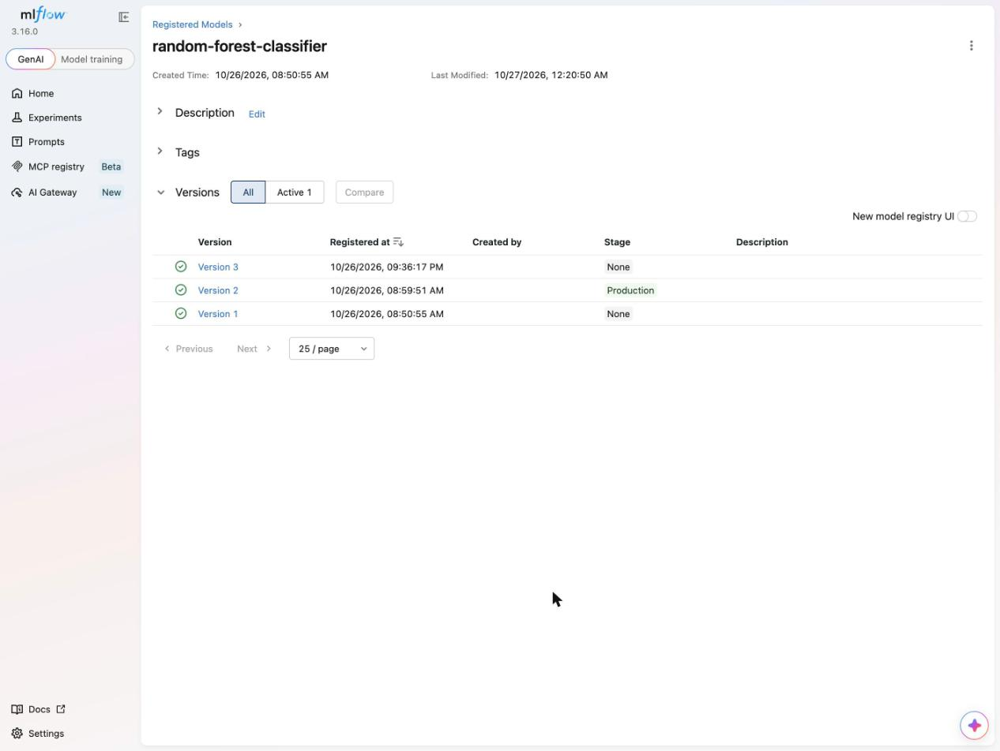
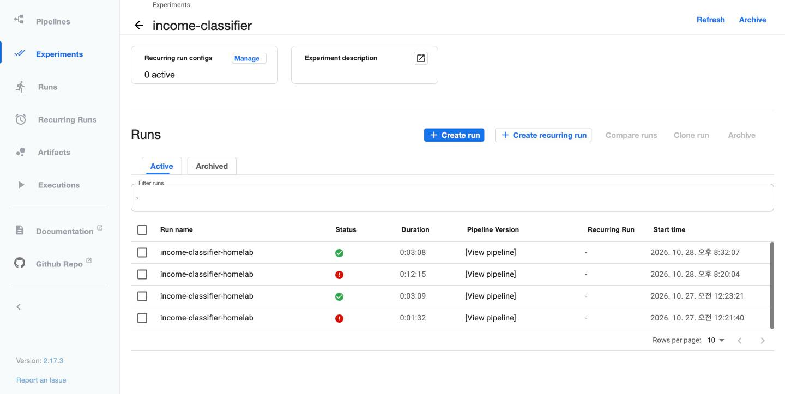
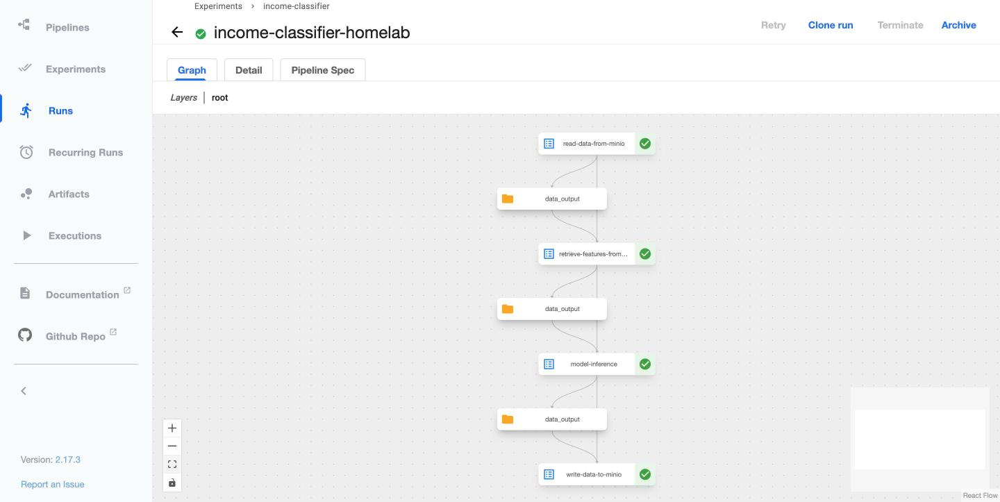
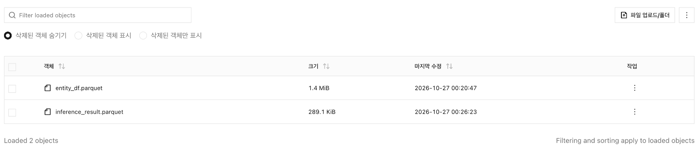

4장에서 실험과 모델은 MLflow로, 피처는 Feast로 관리하게 됐다. 하지만 둘을 이어 붙이는 일은 여전히 사람 몫이다. 5장에서는 이 연결을 **Kubeflow Pipelines**(KFP)로 자동화해, 데이터를 읽는 단계부터 추론 결과를 저장하는 단계까지 한 번에 도는 배치 추론 파이프라인을 만든다.

예제 코드는 [practical-mlops/chapter-5](https://github.com/practical-mlops/chapter-5)에 있다.


## 1. 오케스트레이터가 할 일

추론 파이프라인의 생김새는 대개 비슷하다. 객체 스토어나 데이터 웨어하우스에서 데이터를 가져와 전처리하고, 모델을 불러와 추론한 뒤 결과를 DB나 저장소에 쓴다. 이 흐름은 정해진 주기로 반복해서 돌아야 하고, 실행할 때마다 날짜나 피처 테이블 이름 같은 **런타임 파라미터**를 받을 수 있어야 한다.

KFP는 이 흐름을 코드로 정의할 수 있는 Python SDK(`kfp`)를 제공한다. 파이프라인은 **컴포넌트**(단계)를 이어 붙여 만들고, 각 컴포넌트는 **Kubernetes Pod 하나**에서 따로 격리되어 실행된다.

## 2. 만들 파이프라인

4장에서 만든 소득 분류기 모델과 Feast 피처를 써서 사용자 전체를 한 번에 추론한다.


| 단계 | 하는 일 | 입력 | 출력 |
| --- | --- | --- | --- |
| read_data | MinIO에서 엔티티 목록(`user_id`, `event_timestamp`) parquet를 받는다 | 버킷, 파일 이름 | Dataset |
| retrieve_features | `feature_store.yaml`을 MinIO에서 받아 `get_historical_features`로 피처를 붙인다 | 앞 단계 Dataset, 피처 목록 | Dataset |
| run_inference | MLflow 레지스트리에서 모델을 찾아 확률을 예측한다 | 앞 단계 Dataset, 모델 이름·종류·stage | Dataset |
| write_data | 결과를 MinIO 버킷에 parquet로 올린다 | 앞 단계 Dataset | (MinIO 파일) |

단계와 단계 사이의 중간 데이터(Dataset)는 모두 KFP 아티팩트 저장소에 쌓이고, 다음 단계는 거기서 데이터를 읽어 간다(책 그림 5.2). 책에서는 KFP에 딸린 MinIO 하나가 이 아티팩트와 파이프라인의 입출력 파일을 함께 맡는다.

홈랩 구성은 아래 그림과 같다. 책의 MinIO 자리에는 4장에서 설치한 RustFS가 들어간다. KFP 2.17.3은 아티팩트 저장소로 SeaweedFS를 함께 설치하지만, 홈랩에서는 설정을 바꿔 단계 사이 Dataset과 로그도 RustFS의 `mlpipeline` 버킷에 둔다(8.1절).

![홈랩 KFP 배치 추론 파이프라인 실행 구성. 브라우저나 SDK 로 192.168.0.242 의 KFP 2.17.3(ns kubeflow)에 실행을 만들면 공유 Argo 가 kubeflow 네임스페이스에 Pod 4개(read-data, retrieve-features, model-inference, write-data)를 차례로 띄운다. 각 Pod 는 python:3.13-slim 에 패키지를 설치하고 ConfigMap ch5-src 로 마운트한 책 코드를 실행하며, RustFS 키는 Secret rustfs-credentials 에서 환경변수로 받는다. 단계 사이 Dataset 과 로그는 ConfigMap kfp-launcher 설정에 따라 RustFS 의 mlpipeline 버킷에 저장된다. read-data 는 RustFS 의 entity_df.parquet 를, retrieve-features 는 4.2절 Feast 레지스트리와 parquet 를 읽고, model-inference 는 mlflow 네임스페이스의 MLflow 에서 Production 단계 random-forest-classifier v2 를 받아 예측하며, write-data 는 inference_result.parquet 를 RustFS 에 쓴다](kfp-cluster.svg)

MLflow, RustFS, Feast 레지스트리는 4장에서 이미 클러스터 내부 주소로 구성해 두었다. 덕분에 Pod에서 `mlflow.mlflow.svc:5000`, `rustfs.mlflow.svc:9000`으로 바로 접근할 수 있고, 책처럼 Feast 레지스트리를 새로 만들 필요도 없었다.

## 3. 컴포넌트를 만드는 세 단계

컴포넌트 하나는 **Python 코드 → Docker 이미지 → `component.yaml`** 순서로 만든다. 데이터 읽기 컴포넌트를 예로 세 단계를 차례로 살펴본다.

이 절의 작업은 모두 **개발 PC**에서 한다. 5장 코드는 4장과 달리 노트북이 아니라 `practical-mlops/chapter-5` 저장소의 일반 Python 파일이고, 이미지도 개발 PC에서 빌드해 레지스트리에 올려 둔다. KFP Pod는 그 이미지를 받아 실행만 하며, Pod 안에서 빌드하지 않는다. 홈랩에서는 rocky-linux(control-plane)가 개발 PC 역할을 맡았고, 이미지 빌드는 8.2절처럼 런타임 설치와 ConfigMap 마운트로 대신했다.

### 3.1 Python 코드

`src/read_data/read_data.py`는 특별할 것 없는 Python 스크립트다. MinIO 클라이언트로 parquet 파일을 내려받아 DataFrame으로 읽은 뒤, 다음 단계가 이어받을 수 있도록 `data_output_path`에 다시 저장한다.

```python {title="Listing 5.1 read_data.py (요지)"}
def get_data(minio_host, access_key, secret_key, bucket_name, file_name, data_output_path):
    client = Minio(endpoint=minio_host, access_key=access_key, secret_key=secret_key, secure=False)
    local_temp_file = os.path.join("/tmp", file_name)
    client.fget_object(bucket_name, file_name, local_temp_file)   # MinIO 에서 parquet 다운로드
    df = pd.read_parquet(local_temp_file)

    Path(data_output_path).parent.mkdir(parents=True, exist_ok=True)
    df.to_parquet(data_output_path)                                # 다음 컴포넌트가 읽을 자리
```

인자는 `argparse`로 받으며(Listing 5.2), `--minio_host`, `--access_key`, `--secret_key`, `--bucket_name`, `--file_name`, `--data_output_path` 여섯 개가 있다.

### 3.2 Docker 이미지

컴포넌트는 Pod 안에서 실행되므로 코드를 컨테이너 이미지로 묶어 레지스트리(책은 Docker Hub)에 올려 두어야 한다. Dockerfile은 저장소 루트에 하나만 두고, 저장소 전체를 `/app`으로 복사한다.

```dockerfile {title="Listing 5.3 Dockerfile"}
FROM python:3.10-slim-buster     # buster 는 EOL 이라 지금은 apt-get update 가 실패한다 (bookworm 으로 교체)
WORKDIR /app
RUN apt-get update && \
    apt-get install --no-install-recommends -y build-essential \
    && apt-get clean && rm -rf /tmp/* /var/tmp/*
COPY requirements.txt /app/requirements.txt
RUN pip3 install --upgrade pip
RUN pip3 install --no-cache-dir -r requirements.txt
ENV PYTHONPATH "/app"
COPY . /app
```

```bash
docker build . -t <docker_id>/read-minio-data:latest
docker push <docker_id>/read-minio-data:latest
```

책에서는 컴포넌트마다 이미지 이름을 따로 붙인다. 하지만 Dockerfile이 저장소 전체를 복사하므로 **네 이미지의 내용은 모두 같다**. 한 번만 빌드하고 태그를 네 개 붙여도 충분하다.

### 3.3 component.yaml

마지막으로 KFP가 읽어 들일 컴포넌트 명세를 작성한다. 여기에는 입력과 출력의 타입, 실행할 이미지와 명령이 들어간다.

```yaml {title="Listing 5.4 components/read_data/component.yaml (요지)"}
name: Read Data From MinIO
description: Fetches data from MinIO and outputs as a Dataset.
inputs:
- {name: minio_host, type: String}
- {name: access_key, type: String}
- {name: secret_key, type: String}
- {name: bucket_name, type: String}
- {name: file_name, type: String}
outputs:
- {name: data_output, type: Dataset}        # Dataset 이라 KFP 가 출력 아티팩트로 관리한다
implementation:
  container:
    image: 'varunmallya/read-minio-data:latest'
    command:
    - python3
    - /app/src/read_data/read_data.py
    - --minio_host
    - {inputValue: minio_host}              # 값 그대로 전달
    # ... access_key, secret_key, bucket_name, file_name 도 같은 모양
    - --data_output_path
    - {outputPath: data_output}             # KFP 가 정해 주는 출력 파일 경로
```

`inputValue`는 문자열 값을 그대로 전달하고, `inputPath`/`outputPath` 자리에는 KFP가 아티팩트 파일 경로를 채워 넣는다. 컴포넌트끼리 데이터를 주고받게 해 주는 것이 바로 `inputPath`와 `outputPath`다.

```text {title="저장소 구조"}
├── Dockerfile
├── requirements.txt
├── components/<컴포넌트>/component.yaml
└── src/<컴포넌트>/<컴포넌트>.py
```

## 4. 나머지 세 컴포넌트

### 4.1 피처 조회 (retrieve_features)

MinIO에서 `feature_store.yaml`을 내려받아 `FeatureStore`를 만들고, `get_historical_features`로 앞 단계에서 넘어온 엔티티 DataFrame에 피처를 붙인다.

```python {title="Listing 5.5 retrieve_features.py (요지)"}
store = init_feature_store(minio_host, access_key, secret_key, bucket_name, file_name)
feature_list = feature_list.split(",")                  # "demographic:Sex,..." 쉼표 문자열
entity_df = pd.read_parquet(entity_df)                  # 앞 컴포넌트의 출력 (inputPath)
feature_df = store.get_historical_features(entity_df=entity_df, features=feature_list).to_df()
Path(data_output).parent.mkdir(parents=True, exist_ok=True)
feature_df.to_parquet(data_output)
```

**4장의 레지스트리는 Pod 안에서 그대로 쓸 수 없다.** 4장에서 로컬로 `feast apply`를 실행하면 데이터 소스의 `s3_endpoint_override`가 `localhost:9000`으로 저장되는데, Pod 안에서 `localhost`는 Pod 자기 자신을 가리킨다. 그래서 책은 엔드포인트를 클러스터 내부 주소(`minio-service.kubeflow.svc.cluster.local:9000`)로 바꾼 뒤, **클러스터 안에서 Job으로 `feast apply`를 다시 실행**해 별도의 레지스트리를 만든다.

`component.yaml`에서는 `entity_df`를 `inputs`의 Dataset으로, `data_output`을 `outputs`의 Dataset으로 선언하고, 명령에서 각각 `inputPath`와 `outputPath`로 넘긴다(Listing 5.6).

### 4.2 추론 (run_inference)

MLflow 레지스트리에서 지정한 stage에 있는 모델 버전을 찾는다. 이어서 그 run에 저장된 `column_list.pkl`로 입력 컬럼을 학습 때와 똑같이 맞춘 뒤 확률을 예측한다.

```python {title="Listing 5.7 run_inference.py (요지)"}
for model in mlflow_client.search_model_versions(f"name='{model_name}'"):
    if model.current_stage == model_stage:              # 예: Production
        model_run_id = model.run_id
        break

mlflow.artifacts.download_artifacts(f"runs:/{model_run_id}/column_list.pkl", dst_path="column_list")
input_data_df = pd.read_parquet(input_data).drop(columns=["user_id", "event_timestamp"])
input_data_df = pd.get_dummies(input_data_df, drop_first=True, sparse=False, dtype=float)
input_data_df = input_data_df.reindex(columns=col_list, fill_value=0)   # 4.1절에서 저장한 90컬럼 순서

if model_type == "sklearn":
    model = mlflow.sklearn.load_model(model_uri=f"models:/{model_name}/{model_stage}")
# xgboost, tensorflow 분기 생략

input_data_df["Predicted_Income_Class"] = [x[1] for x in model.predict_proba(input_data_df)]
input_data_df.to_parquet(data_output)
```

코드에서 눈여겨볼 점이 세 가지 있다.

- **sklearn 모델이어야 한다.** `mlflow.xgboost.load_model`이 돌려주는 `xgb.train` Booster에는 `predict_proba`가 없다. 책이 AUC 1등 모델 대신 랜덤 포레스트를 `random-forest-classifier`로 등록한 것도 이 때문으로 보인다.
- **stage로 모델을 찾는다.** `current_stage == "Production"`인 버전이 있어야 하는데, MLflow 3에서 stage는 deprecated 상태이고 alias 사용이 권장된다. 또 등록한 버전에 `run_id`가 채워져 있어야 `column_list.pkl`도 내려받을 수 있다.
- **`get_dummies(drop_first=True)`를 배치 데이터에 다시 적용한다.** `drop_first`는 해당 배치 안에서 알파벳순으로 첫 번째 범주를 버리므로, 배치에 빠진 범주가 있으면 학습 때와 다른 컬럼이 제거되어 오류 없이 틀린 예측이 나올 수 있다. 전체 30,162행을 넣으면 모든 범주가 포함되어 있어 이 문제가 드러나지 않는다.

### 4.3 데이터 쓰기 (write_data)

앞 단계의 결과를 읽어 MinIO 버킷에 올린다(Listing 5.9, 5.10). 컴포넌트가 버킷을 만들어 주지는 않으므로, 버킷은 미리 만들어 두어야 한다.

```python {title="Listing 5.9 write_data.py (요지)"}
client = Minio(endpoint=minio_host, access_key=access_key, secret_key=secret_key, secure=False)
pd.read_parquet(input_data_path).to_parquet(file_name, index=False)
client.fput_object(bucket_name, file_name, file_name)
```

## 5. 컴포넌트 설계 원칙

| 원칙 | 뜻 | 이 예제에서 |
| --- | --- | --- |
| 모듈성 | 컴포넌트 하나는 기능 하나 | 추론과 쓰기를 분리 |
| 입출력 명시 | 필요한 데이터와 만들어 내는 아티팩트를 밝힌다 | 모든 입출력을 `component.yaml`에 선언 |
| 파라미터화 | 코드를 고치지 않고 동작을 바꿀 수 있게 한다 | `mlflow_host`, `bucket_name`, `minio_host`를 하드코딩하지 않음 |
| 문서화 | 기능과 사용법을 적는다 | `description` 필드 |

잘 나눈 컴포넌트는 여러 파이프라인에서 **재사용**할 수 있고, 팀원끼리 나눠 맡아 **협업**하기 좋으며, 하나씩 따로 **테스트**하기도 쉽다. 테스트만 놓고 보면, `src/*.py`는 argparse 스크립트이므로 이미지를 만들거나 Kubernetes에 올리기 전에 로컬에서 먼저 돌려 볼 수 있다.

## 6. 파이프라인으로 잇기

컴포넌트 정의를 불러온 뒤 `@dsl.pipeline` 함수 안에서 태스크를 만든다. 이 함수의 인자는 실행할 때마다 바꿀 수 있는 **파이프라인 파라미터**가 된다.

```python {title="Listing 5.11 inference_pipeline.py (요지)"}
import kfp
from kfp import dsl, compiler

fetch_data_op = kfp.components.load_component_from_file("components/read_data/component.yaml")
retrieve_features_op = kfp.components.load_component_from_file("components/retrieve_features/component.yaml")
run_inference_op = kfp.components.load_component_from_file("components/run_inference/component.yaml")
write_data_op = kfp.components.load_component_from_file("components/write_data/component.yaml")

@dsl.pipeline(name="income-classifier-pipeline",
              description="A Kubeflow pipeline to classify income categories using KFP v2")
def income_classifier_pipeline(minio_host: str, access_key: str, secret_key: str,
                               entity_df_bucket: str, entity_df_filename: str,
                               feature_store_bucket_name: str, feature_store_config_file_name: str,
                               feature_list: str, model_name: str, model_type: str, model_stage: str,
                               mlflow_host: str, output_bucket: str, output_file_name: str):
    fetch_data_task = fetch_data_op(minio_host=minio_host, access_key=access_key, secret_key=secret_key,
                                    bucket_name=entity_df_bucket, file_name=entity_df_filename)
    retrieve_features_task = retrieve_features_op(
        ..., entity_df=fetch_data_task.outputs["data_output"], feature_list=feature_list)
    run_inference_task = run_inference_op(
        ..., input_data=retrieve_features_task.outputs["data_output"])
    write_data_task = write_data_op(
        ..., input_data=run_inference_task.outputs["data_output"])

compiler.Compiler().compile(income_classifier_pipeline, "income_classifier_pipeline.yaml")
```

태스크를 잇는 방법은 간단하다. `task.outputs["data_output"]`을 다음 태스크의 입력으로 넘기면 된다. KFP는 이 참조를 보고 실행 순서(DAG)를 정하므로, `retrieve_features_task`는 `fetch_data_task`가 끝난 뒤에 실행된다.

## 7. KFP UI에서 실행

컴파일한 `income_classifier_pipeline.yaml`을 KFP UI에 올려 실행한다.

1. Kubeflow 대시보드 → **Pipelines** → **Upload pipeline**에서 YAML을 올리면 파이프라인 그래프가 나타난다(책 그림 5.5).
2. **Experiment**를 만든다. Experiment는 여러 실행(run)을 묶어 비교하는 단위이며, UI에서 실행을 만들 때는 반드시 지정해야 한다.
3. **Create run**에서 파이프라인 파라미터를 채우고 **Start**를 누른다.

| 파라미터 | 책 (Kubeflow + MinIO) | 홈랩 |
| --- | --- | --- |
| `minio_host` | `minio-service.kubeflow:9000` | `rustfs.mlflow.svc:9000` |
| `access_key` / `secret_key` | KFP의 MinIO Secret 값 | 파라미터에서 뺌. Secret `rustfs-credentials`를 env로 주입 |
| `entity_df_bucket` / `entity_df_filename` | `inference-datasets` / `entity_df.parquet` | 같음 |
| `feature_store_bucket_name` / `feature_store_config_file_name` | `feature-registry` / `feature_store.yaml` | 같음 (4.2절 레지스트리 재사용) |
| `feature_list` | 피처 8개 쉼표 문자열 | 같음 |
| `model_name` / `model_type` / `model_stage` | `random-forest-classifier` / `sklearn` / `Production` | 같음 |
| `mlflow_host` | `http://<MLflow 주소>:5000` (Pod 기준, `localhost`는 안 된다) | `http://mlflow.mlflow.svc:5000` |
| `output_bucket` / `output_file_name` | `inference-datasets` / `inference_result.parquet` | 같음 |

**책 예제에서는 `access_key`와 `secret_key`가 일반 문자열 파라미터여서 실행 이력(UI와 DB)에 평문으로 남는다.** 홈랩에서는 이 둘을 파라미터에서 빼고, Secret을 Pod 환경변수로 주입했다(8.2절).

실행이 성공하면 `inference-datasets` 버킷에 예측 결과 parquet가 생긴다. KFP는 이런 **배치 추론**에 잘 맞는 도구이며, 실시간 추론과 서빙은 6장에서 다룰 BentoML이 맡는다.

## 8. 홈랩에서 돌려 본 기록

홈랩의 KFP 2.17.3 standalone(`192.168.0.242`)에서 책의 파이프라인을 처음부터 끝까지 실행했다(2026-10-27). 컴포넌트 코드(`src/*.py`)는 책 저장소의 것을 한 줄도 고치지 않았고, 연결 방식과 실행 환경만 홈랩에 맞게 바꿨다.

다음 날(2026-10-28) KFP 아티팩트 저장소를 SeaweedFS에서 RustFS로 옮기고 다시 실행했다. 아래 실행 기록과 결과는 다시 실행한 run 기준이다.

### 8.1 준비

4장에서 만들어 둔 환경을 그대로 쓰기 때문에 준비할 것은 네 가지뿐이다.

| 준비 | 한 일 |
| --- | --- |
| 모델 stage | `random-forest-classifier` v2(4.1절 1등 랜덤 포레스트 `clean-gnat-110`)를 **Production**으로 전환. 파이프라인이 stage로 모델을 찾기 때문이다 |
| 입력 데이터 | RustFS에 `inference-datasets` 버킷을 만들고 책 4장 저장소의 `entity_df.parquet`(30,162행, `user_id`·`event_timestamp`)를 올림 |
| Feast 설정 | `feature-registry` 버킷에 `feature_store.yaml`을 올림. 레지스트리(`registry_local.db`)와 parquet는 4.2절 것을 그대로 가리킨다 |
| 아티팩트 저장소 | RustFS에 `mlpipeline` 버킷을 만들고, KFP가 번들 SeaweedFS 대신 이 버킷을 쓰도록 설정을 바꿈. SeaweedFS는 replicas 0으로 내렸다 |

KFP 2.17.3은 SeaweedFS 주소(`seaweedfs.kubeflow:9000`)를 launcher와 UI 코드의 기본값으로 쓴다. 그래서 한 곳만 바꿔서는 안 되고, 단계 Pod(`kfp-launcher` ConfigMap), API 서버(`OBJECTSTORECONFIG_HOST`), UI(`MINIO_HOST`·`MINIO_NAMESPACE`), Argo 로그 보관(`artifact-repositories` ConfigMap) 네 곳을 모두 RustFS로 바꿨다. 키는 네 곳 모두 Secret `rustfs-credentials`를 참조한다.

```yaml {title="kfp-launcher ConfigMap (홈랩 kustomize 패치 요지)"}
data:
  defaultPipelineRoot: "minio://mlpipeline/v2/artifacts"
  providers: |
    minio:
      default:
        endpoint: rustfs.mlflow.svc:9000      # 번들 기본값은 seaweedfs.kubeflow:9000
        region: us-east-1
        disableSSL: true
        forcePathStyle: true
        credentials:
          fromEnv: false
          secretRef:
            secretName: rustfs-credentials    # 키는 Secret 으로만 참조
            accessKeyKey: AWS_ACCESS_KEY_ID
            secretKeyKey: AWS_SECRET_ACCESS_KEY
```

```python {title="MLflow stage 전환 (MLflow 3 에서 deprecated 지만 동작한다)"}
MlflowClient().transition_model_version_stage("random-forest-classifier", "2", stage="Production")
```



MLflow 3.16 UI는 기본값인 New model registry UI에서 Stage 열을 숨기고 Aliases만 보여 준다. 오른쪽 위 토글을 끄면 Stage 열이 나타나고, Version 2만 **Production**인 것을 확인할 수 있다. Version 3은 같은 run(`b38037a6`)을 다시 등록한 것이고 stage는 None이다.

`feature_store.yaml`에는 Redis 암호를 넣지 않았다. 이 파이프라인은 과거 피처(`get_historical_features`)만 조회하므로 온라인 스토어에는 접속하지 않기 때문이다.

### 8.2 홈랩판 컴포넌트

책과 달라진 점은 세 가지다.

- **이미지**: 홈랩에는 이미지 레지스트리가 없어서 책처럼 이미지를 빌드하지 않았다. 대신 `python:3.13-slim` 이미지로 Pod를 띄우고, 시작할 때 필요한 패키지를 `pip install`한다. 패키지 버전은 4장 Jupyter venv와 맞췄다(feast 0.67.0, mlflow 3.17.2, scikit-learn 1.9.1, skops 0.16.0).
- **코드**: 책의 `src/*.py` 네 개를 ConfigMap `ch5-src`로 만들어 `/src`에 마운트한다.
- **비밀값**: `access_key`/`secret_key`를 파이프라인 파라미터에서 뺐다. 대신 Secret `rustfs-credentials`를 환경변수로 주입하고, 컴포넌트 명령에서 그 값을 책 코드의 인자로 넘긴다. 이렇게 하면 실행 이력에 키가 남지 않는다.

```yaml {title="components/run_inference.yaml (홈랩판)"}
name: Model Inference
inputs:
- {name: minio_host, type: String}
- {name: model_name, type: String}
- {name: model_type, type: String}
- {name: model_stage, type: String}
- {name: mlflow_host, type: String}
- {name: input_data, type: Dataset}
outputs:
- {name: data_output, type: Dataset}
implementation:
  container:
    image: python:3.13-slim
    command:
    - sh
    - -c
    - |
      cd /tmp && pip install --no-cache-dir -q --root-user-action=ignore \
        mlflow==3.17.2 scikit-learn==1.9.1 skops==0.16.0 numpy==2.5.4 scipy==1.18.1 pandas==2.3.3 pyarrow==25.0.0 boto3 \
        >/tmp/pip.log 2>&1 || { tail -20 /tmp/pip.log; exit 1; }
      exec python /src/run_inference.py "$@" --access_key "$AWS_ACCESS_KEY_ID" --secret_key "$AWS_SECRET_ACCESS_KEY"
    - sh
    - --minio_host
    - {inputValue: minio_host}
    # ... model_name, model_type, model_stage, mlflow_host 도 같은 모양
    - --input_data
    - {inputPath: input_data}
    - --data_output
    - {outputPath: data_output}
```

`pip install` 출력은 파일로 돌리고 실패했을 때만 마지막 20줄을 보여 준다. 그래야 KFP UI의 단계 로그에 책 코드의 출력만 남는다.

Secret과 ConfigMap은 `kfp-kubernetes`를 써서 태스크마다 붙인다. 태스크를 잇는 방식(`task.outputs["data_output"]`)은 책과 같다.

```python {title="inference_pipeline.py (홈랩판 요지)"}
from kfp import kubernetes

def homelab(task):
    kubernetes.use_secret_as_env(task, secret_name="rustfs-credentials",
                                 secret_key_to_env={"AWS_ACCESS_KEY_ID": "AWS_ACCESS_KEY_ID",
                                                    "AWS_SECRET_ACCESS_KEY": "AWS_SECRET_ACCESS_KEY"})
    kubernetes.use_config_map_as_volume(task, config_map_name="ch5-src", mount_path="/src")
    task.set_caching_options(False)
    return task

@dsl.pipeline(name="income-classifier-pipeline")
def income_classifier_pipeline(minio_host: str = "rustfs.mlflow.svc:9000",
                               mlflow_host: str = "http://mlflow.mlflow.svc:5000", ...):
    fetch = homelab(read_op(minio_host=minio_host, bucket_name=entity_df_bucket, file_name=entity_df_filename))
    feats = homelab(features_op(..., entity_df=fetch.outputs["data_output"], feature_list=feature_list))
    infer = homelab(infer_op(..., input_data=feats.outputs["data_output"]))
    homelab(write_op(..., input_data=infer.outputs["data_output"]))
```

```terminal {title="rocky-linux (KFP SDK 2.17.3 venv)"}
$ KFP_HOST=http://192.168.0.242 ~/.venvs/kfp/bin/python inference_pipeline.py
compiled income_classifier_pipeline.yaml
Experiment details: http://192.168.0.242/#/experiments/details/59dbf6ca-…
Run details: http://192.168.0.242/#/runs/details/52f896e8-…
run_id 52f896e8-c3b4-4d7a-b456-0e1845aeeed3
```

홈랩에서는 UI에 YAML을 올리지 않고 SDK의 `create_run_from_pipeline_package`로 바로 실행했다. 그래서 KFP UI의 Pipelines 메뉴에는 이 파이프라인이 없고, 실행 기록은 Experiments의 `income-classifier` 아래에만 쌓인다. 7절처럼 UI에서 돌리려면 컴파일된 `income_classifier_pipeline.yaml`을 Upload pipeline으로 올리면 된다.

### 8.3 결과

첫 실행은 피처 조회 단계에서 실패했다. `feast[aws]`만 설치한 탓에 `FeastModuleImportError: Could not import module 'feast.infra.online_stores.redis'`가 발생했다. 온라인 스토어에 접속하지 않더라도 `feature_store.yaml`에 `type: redis`가 있으면 Feast가 설정을 검증하면서 해당 모듈을 불러오기 때문에, 책처럼 `feast[redis]` extra를 함께 설치해야 한다.

`feast[aws,redis]`로 바꿔 다시 실행하자 네 단계가 모두 성공했다(3분 9초).

아티팩트 저장소를 RustFS로 옮긴 뒤의 첫 실행(2026-10-28 20:20)은 model-inference 단계에서 멈췄다. 앞 두 단계는 정상으로 끝났지만 model-inference Pod는 10분 가까이 아무 로그도 내지 않았고, MLflow 서버 로그에도 그 Pod의 요청이 없었다. 원인은 MLflow Pod 쪽이었다. 전날 worker1-gpu 전원을 껐다 켠 뒤 Postgres보다 먼저 뜬 MLflow Pod의 init 컨테이너 `dbchecker`가 재시도 간격을 약 8시간까지 늘린 채 대기하고 있어, MLflow Service에 엔드포인트가 없었다. MLflow Deployment를 `kubectl rollout restart`로 재기동하자 그 직후 모델 버전 조회 요청이 MLflow 로그에 찍히며 단계가 끝났다. 이 run은 Terminate로 종료했고, UI에는 12분 15초 실패로 남아 있다.



바로 다시 실행한 run은 네 단계가 모두 성공했고, RustFS `mlpipeline` 버킷에 단계별 `data_output`과 로그가 생겼다. 아래 시간과 화면은 이 실행 기준이다.



| 단계 | 걸린 시간 | 비고 |
| --- | --- | --- |
| read-data | 16초 | RustFS에서 `entity_df.parquet` 다운로드 |
| retrieve-features | 35초 | 대부분이 `pip install feast` 시간 |
| model-inference | 43초 | MLflow에서 Production 모델과 `column_list.pkl`을 받아 예측 |
| write-data | 16초 | 결과 업로드 |
| **전체** | **3분 8초** | 단계마다 driver Pod 기동 시간 포함 |

그래프에서 단계를 클릭하면 입력 파라미터와 아티팩트가 보인다. 파라미터 목록에 `access_key`와 `secret_key`가 없고, `input_data`는 RustFS `mlpipeline` 버킷의 `minio://` 주소를 가리킨다.


Logs 탭은 UI가 `MINIO_HOST` 설정대로 RustFS에서 `executor-logs`를 읽어 보여 준다. retrieve-features 단계의 로그에는 책 코드가 출력한 엔티티 DataFrame과 피처 8개가 붙은 결과가 그대로 남아 있다.


`mlpipeline` 버킷에는 run ID 아래 단계별 디렉터리가 생기고, 각 디렉터리에 `data_output`과 `executor-logs-0`이 들어간다. write-data는 출력 Dataset이 없으므로 로그만 남는다.

| 단계 | `data_output` 크기 | 내용 |
| --- | --- | --- |
| read-data-from-minio | 1,408,944 B | 엔티티 2컬럼 30,162행 |
| retrieve-features-from-feast | 1,513,367 B | 피처 8개를 붙인 10컬럼 |
| model-inference | 296,524 B | 더미 90컬럼 + 예측 확률 |
| write-data-to-minio | (없음) | `inference_result.parquet`를 `inference-datasets`에 업로드 |



결과 파일을 Jupyter에서 열어 확인했다.

| 확인 | 결과 |
| --- | --- |
| 크기 | 30,162행 × 91컬럼 (더미 90컬럼 + `Predicted_Income_Class`) |
| 결측치 | 0 |
| 예측 확률 | 최소 0.0, 평균 0.249, 최대 1.0 |
| 고소득(≥ 0.5) 비율 | 22.2% (데이터의 실제 >50K 비율 24.9%) |
| 같은 모델로 직접 예측한 값과 차이 | 최대 0.0 |

### 8.4 책 그대로 돌리면 걸리는 점

홈랩에서는 위와 같은 방법으로 피해 갔지만, 책 저장소를 그대로 쓰면 다음 지점에서 막힌다.

| 문제 | 원인 | 홈랩에서는 |
| --- | --- | --- |
| 이미지 빌드 실패 | `python:3.10-slim-buster`의 apt 저장소가 EOL로 내려감 | 빌드하지 않고 `python:3.13-slim` + 런타임 설치 |
| 이미지 버전 | 책 이미지는 feast 0.40.1, mlflow 3.0.0 | 4장과 같은 feast 0.67.0, mlflow 3.17.2로 설치 |
| 모델을 못 찾음 | stage(Production)로 모델을 찾지만 4장에서 stage를 지정하지 않았다 | v2를 Production으로 전환 |
| Feast 레지스트리 주소 | 책 4장 레지스트리는 `localhost`를 가리킨다 | 4.2절에서 이미 클러스터 안 주소로 등록 |
| 비밀값 노출 | 키가 파이프라인 파라미터라 실행 이력에 평문 저장 | Secret을 env로 주입 |
| KFP SDK 버전 | 저장소 YAML은 `kfp==2.9.0`으로 컴파일 | SDK 2.17.3으로 다시 컴파일 |

## 9. 정리

- **오케스트레이션**은 여러 단계로 된 파이프라인을 실행하면서 단계마다 필요한 데이터와 컴퓨팅 자원을 갖춰 주는 일이다. Kubeflow는 이 기능을 KFP로 제공한다.
- **컴포넌트**는 재사용하고 조합할 수 있는 작업 단위이며, Python 코드, Docker 이미지, `component.yaml` 세 가지로 이루어진다.
- 컴포넌트를 독립적이고 범용적으로 만들어야 재사용과 테스트가 쉬워진다. 큰 워크플로는 작은 컴포넌트로 쪼갠다.
- 파이프라인은 태스크의 출력을 다음 태스크의 입력으로 넘겨 DAG를 구성하고, YAML로 컴파일한 뒤 KFP UI나 API로 실행한다.
- 홈랩에서는 4장의 MLflow·Feast·RustFS를 그대로 활용하고 모델 stage, 이미지(런타임 설치), 비밀값 전달 방식만 바꿔, 3분 8초 만에 30,162명을 추론했다. KFP 아티팩트 저장소도 RustFS로 통일해 저장소는 하나만 쓴다.
