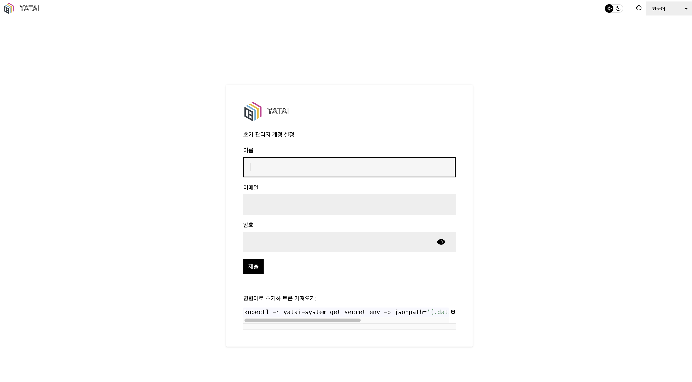
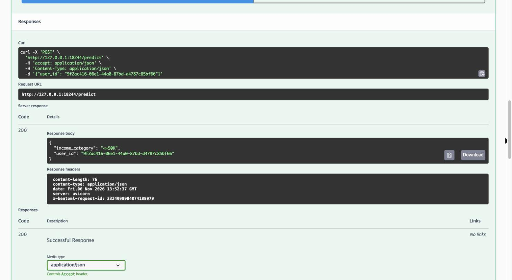

`Machine Learning Platform Engineering` 6장은 **배포**와 **모니터링**을 다룬다. 5장에서 소득 분류기를 배치 파이프라인으로 돌렸다면 6장은 같은 모델을 **BentoML**로 API 서비스로 만들고 **Evidently**로 데이터 드리프트를 추적한다.

## 1. 한눈에 보기

MLOps 파이프라인 그림에서 6.1절은 **모델 배포**와 **모델 API부분**이다. 모델은 4.1절 MLflow 레지스트리에서 피처는 4.2절 Feast 온라인 스토어(Redis)에서 가져오고 모델 모니터링은 6.2절에서 다룬다.

![MLOps 파이프라인 그림에서 6.1절이 채우는 자리. 모델 배포(Bento 빌드 · Yatai 배포)와 모델 API(BentoML /predict)가 분홍으로 강조돼 있다. 4.1절 MLflow 모델 레지스트리에서 Production 모델을 import_model 로 가져와 모델 배포로, yatai-deployment 가 모델 API 로 이어지고, 4.2절 Feast 피처 스토어에서 Redis 의 online 피처가 모델 API 로 들어간다. 사용자는 /predict 로 요청하고 응답을 받는다. 모델 모니터링은 6.2절 Evidently 로 점선 표시돼 있다. 오른쪽 카드는 MLflow 모델을 BentoML 로컬 스토어로, Feast 온라인 피처와 러너 예측, bentofile_homelab 으로 만든 Bento 와 모델 38.9MB, Yatai 가 kaniko 로 빌드해 Docker Hub 를 거쳐 띄우는 API·러너 Pod 를 정리하고, 5장 배치 추론과 같은 모델을 실시간으로 쓴다고 적는다](bento-pipeline-overview.svg)

## 2. BentoML이란?

3장에서 hello-joker 앱을 FastAPI 엔드포인트로 배포할 때는 Dockerfile을 쓰고 Kubernetes 매니페스트를 여러 개 만들고 모니터링 코드를 넣고, CI/CD까지 직접 구성했다. 이 일은 시간이 오래 걸리며 팀의 모든 데이터 과학자가 할 수 있는 일도 아니다. BentoML은 모델 서빙에 필요한 것을 **Bento** 하나로 묶어 이 과정을 줄여 준다.

Bento는 머신러닝 애플리케이션을 담는 파일 아카이브다. 음식 대신 모델, 서빙 코드, 의존성, 환경 변수를 담은 도시락이라고 보면 된다. Bento를 쿠버네티스에 컨테이너로 올리고 확장·모니터링하는 일은 **Yatai**가 맡는다.

| 구성요소                    | 하는 일                                               |
| ----------------------- | -------------------------------------------------- |
| **Bento**               | 모델을 API로 부를 수 있게 감싼 소스 묶음. tar 아카이브이고 아직 컨테이너가 아니다 |
| **Yatai**               | 모델과 Bento를 객체 스토리지에 저장하는 레지스트리이자 대시보드              |
| **yatai-image-builder** | Bento를 컨테이너 이미지로 빌드한다                              |
| **yatai-deployment**    | 빌드된 이미지를 Swagger UI가 붙은 서비스로 배포한다                  |

MLflow는 실험 기록과 "어떤 버전이 승인됐나"의 기준이다. Bento는 승인된 버전을 코드와 함께 고정한 배포 단위이고 Yatai는 Bento를 이미지로 만들어 배포하는 도구다.

BentoML 팀은 관리형 플랫폼 **BentoCloud**도 운영한다. 같은 Bento를 올리면 빌드, 배포, 스케일링을 대신 해 주는 서비스이고, 6장 실습은 쓰지 않는다.


| 구분       | BentoML (오픈소스)                       | BentoCloud (관리형)              |
| -------- | ------------------------------------ | ----------------------------- |
| 하는 일     | 서비스 코드 작성, Bento 패키징, 로컬 서빙, 컨테이너 빌드 | Bento를 받아 빌드·배포·스케일링·모니터링을 운영 |
| 인프라      | Docker, 쿠버네티스를 직접 준비                 | 플랫폼이 제공                       |
| 쿠버네티스 배포 | Yatai를 직접 설치·운영 (6장 방식)              | 클러스터 운영이 필요 없다                |
| 비용       | 무료                                   | 상용                            |


## 3. 홈랩 실습 환경

실습은 1·2주차 홈랩 Kubernetes(v1.36.5, 노드 3대) 위에서 했다(2026-11-06). 2주차에 올린 MLflow 3.16, RustFS, Postgres 18, Feast 0.67(Redis), KFP 2.17.3을 그대로 쓰고, BentoML과 Yatai만 더 올렸다.


| 구성요소                                         | 버전                 | 홈랩에서                                                                           |
| -------------------------------------------- | ------------------ | ------------------------------------------------------------------------------ |
| BentoML                                      | 1.1.10             | rocky-linux `~/mlpe-ch6/chapter-6`의 Python 3.12 venv                           |
| Yatai, yatai-image-builder, yatai-deployment | 1.1.13 (차트 1.1.13) | ns `yatai-system`, `yatai-image-builder`, `yatai-deployment`. 2023-10이 마지막 릴리스 |
| Yatai 메타데이터·파일                               |                    | 기존 `mlflow-postgres`의 DB `yatai`, RustFS `yatai` 버킷                            |
| 이미지 레지스트리                                    |                    | Docker Hub `hyeonjae0913/yatai-bentos`                                         |
| cert-manager                                 | v1.21.3            | KFP가 쓰던 것을 재사용                                                                 |
| 접속                                           |                    | LB IP. Yatai `192.168.0.243`, 소득 분류기 `192.168.0.244`                           |


모델이 scikit-learn 1.9.1, numpy 2.5.4로 저장돼 있어 Python 3.12 venv를 쓴다. Yatai 이미지는 amd64 전용이라 모두 amd64 워커(worker1-gpu)에 고정한다.

```text {title="~/mlpe-ch6/chapter-6/requirements_homelab.txt"}
bentoml==1.1.10
mlflow==3.17.2
scikit-learn==1.9.1
skops==0.16.0
numpy==2.5.4
scipy==1.18.1
feast[redis,aws]==0.67.0
minio
python-dotenv
setuptools<81
```

```terminal {title="rocky-linux: Python 3.12 venv"}
$ cd ~/mlpe-ch6 && git clone --depth 1 https://github.com/practical-mlops/chapter-6.git && cd chapter-6
$ uv venv .venv --python 3.12 && uv pip install --python .venv/bin/python -r requirements_homelab.txt
$ .venv/bin/python -W ignore -c "import sys, bentoml, mlflow, sklearn, feast, numpy; print(sys.version.split()[0], bentoml.__version__, mlflow.__version__, sklearn.__version__, feast.__version__, numpy.__version__)"
3.12.12 1.1.10 3.17.2 1.9.1 0.67.0 2.5.4
```

## 4. Bento 빌드하기 (6.1.1)

Bento를 만드는 순서는 책과 같다.

1. MLflow의 모델을 **BentoML 로컬 스토어**에 등록한다.
2. API 엔드포인트를 정의하는 **서비스**와 추론을 맡는 **러너**를 초기화한다.
3. 요구사항과 환경 변수를 담은 `bentofile.yaml`을 쓴다.
4. `bentoml build`로 빌드하고 Yatai에 푸시한다.

### 4.1 모델 등록

BentoML은 MLflow와 통합돼 있어 `bentoml.mlflow.import_model` 한 줄로 레지스트리의 모델을 가져온다. RustFS 키는 Kubernetes Secret에서 꺼내 환경변수로 넘긴다.

```python {title="bentoml/scripts/download_model_homelab.py (Listing 6.1 홈랩판)"}
import os
import mlflow
import bentoml

mlflow.set_tracking_uri(os.environ.get("MLFLOW_TRACKING_URI", "http://192.168.0.238:5000"))
os.environ.setdefault("MLFLOW_S3_ENDPOINT_URL", "http://192.168.0.237:9000")   # RustFS LB
os.environ.setdefault("AWS_ENDPOINT_URL", os.environ["MLFLOW_S3_ENDPOINT_URL"])
model_name, model_stage = "random-forest-classifier", "Production"
m = bentoml.mlflow.import_model(model_name, model_uri=f"models:/{model_name}/{model_stage}")
print("imported", m.tag)
```

```terminal
$ export AWS_ACCESS_KEY_ID=$(kubectl -n mlflow get secret rustfs-credentials -o jsonpath='{.data.AWS_ACCESS_KEY_ID}' | base64 -d)
$ export AWS_SECRET_ACCESS_KEY=$(kubectl -n mlflow get secret rustfs-credentials -o jsonpath='{.data.AWS_SECRET_ACCESS_KEY}' | base64 -d)
$ ../.venv/bin/python -W ignore scripts/download_model_homelab.py
imported random-forest-classifier:5j5xhfwz3ohqrbch
$ ../.venv/bin/bentoml models list
 Tag                             Module          Size       Creation Time
 random-forest-classifier:5j5x…  bentoml.mlflow  38.90 MiB  2026-11-06 07:16:38
```

Module 열의 `bentoml.mlflow`가 이 모델의 출처가 MLflow라는 뜻이다.

### 4.2 서비스와 러너

**서비스**는 서빙 로직을 정의한다. 여기서는 Feast에서 피처를 가져온 뒤 모델로 추론하는 것이 서빙 로직이고, `service.py`에 쓴다. **러너**는 별도 파이썬 워커 프로세스에서 돌며 따로 확장할 수 있는 연산 단위로, 이 서비스에서는 모델 예측을 맡는다.

```python {title="Listing 6.2 / 6.3 service.py (요지)"}
income_clf_runner = bentoml.mlflow.get("random-forest-classifier:latest").to_runner()
svc = bentoml.Service("income_classifier_service", runners=[income_clf_runner])

@svc.on_startup
async def initialise(context: bentoml.Context):
    config = load_config(ENV_FILE_NAME)
    # MLflow 에서 Production run 을 찾아 학습 때의 더미 컬럼 목록(column_list.pkl)을 받는다
    # MinIO(홈랩은 RustFS)와 Redis 정보로 Feast 피처 스토어를 연다
    context.state["store"] = feature_store.init_feature_store()
    context.state["col_list"] = col_list

@svc.api(input=full_input_spec, output=JSON(), route="/predict")
def predict(inputs: IncomeClassifierUsers, ctx: bentoml.Context) -> Dict[str, Any]:
    feature_df = ctx.state["store"].get_online_features(
        features=ctx.state["feature_list"], entity_rows=[inputs.dict()]).to_df()   # Feast 온라인 피처
    feature_df.drop(columns=["user_id"], inplace=True)
    input_df = InputMapper(feature_df, ctx.state["col_list"]).generate_pandas_dataframe()
    output_mapper = OutputMapper(income_clf_runner.predict.run(input_df)[0])
    return {"income_category": output_mapper.map_prediction(), "user_id": inputs.user_id}
```
### 4.3 bentofile\_homelab.yaml

이미지에는 비밀값 없이 `ENV_NAME=homelab`만 넣고, `base_image`로 Python 3.12를 지정한다.

```yaml {title="bentoml/bento/bentofile_homelab.yaml"}
service: "service:svc"
labels:
  owner: ml-engineering-team
  env: homelab
include:
  - "service.py"
  - "homelab.env"                # 클러스터 안 주소만 담는다. 비밀값 없음
  - "src/*.py"
  - "requirements_homelab.txt"
python:
  requirements_txt: requirements_homelab.txt
docker:
  base_image: python:3.12-slim
  env:
    - ENV_NAME=homelab
```

```text {title="bentoml/homelab.env"}
MINIO_HOST=rustfs.mlflow.svc:9000
FEATURE_REGISTRY_BUCKET_NAME=feature-registry
FEATURE_REGSITRY_FILE_NAME=feature_store.yaml
MLFLOW_HOST=http://mlflow.mlflow.svc:5000
MLFLOW_MODEL_NAME=random-forest-classifier
MLFLOW_MODEL_STAGE=Production
FEAST_S3_ENDPOINT_URL=http://rustfs.mlflow.svc:9000
FEAST_REDIS_HOST=redis.feast.svc
REFERENCE_DATASET_NAME=reference_features
EVIDENTLY_WORKSPACE_URL=http://evidently-ui.evidently.svc:8000
EVIDENTLY_PROJECT_ID=
EVIDENTLY_REPORT_WINDOW_SIZE=100
```

### 4.4 홈랩판 서비스 코드

요청 한 행을 더미 컬럼으로 바꿀 때는 학습 때의 컬럼 목록으로 reindex한다.

```python {title="bentoml/src/data_mapper.py"}
    def generate_pandas_dataframe(self):
        dummyfied_input_data = pd.get_dummies(self.data, sparse=False, dtype=float)
        transformed_input_data = dummyfied_input_data.reindex(columns=self.column_list, fill_value=0)
        return transformed_input_data
```

Feast 설정 파일은 API 서버 워커마다 임시 디렉터리에 받는다. 비밀값은 `homelab.env`에 두지 않고, 환경변수나 ServiceAccount 토큰으로 읽은 Secret(`K8S_SECRET_NAME`)에서 받는다.

```python {title="bentoml/src/constants.py (홈랩판)"}
def _read_k8s_secret(name):
    """Pod 의 ServiceAccount 토큰으로 같은 네임스페이스의 Secret 하나를 읽는다."""
    sa = "/var/run/secrets/kubernetes.io/serviceaccount"
    token, ns = open(f"{sa}/token").read().strip(), open(f"{sa}/namespace").read().strip()
    ctx = ssl.create_default_context(cafile=f"{sa}/ca.crt")
    req = urllib.request.Request(f"https://kubernetes.default.svc/api/v1/namespaces/{ns}/secrets/{name}",
                                 headers={"Authorization": f"Bearer {token}"})
    data = json.load(urllib.request.urlopen(req, context=ctx, timeout=10))["data"]
    return {k: base64.b64decode(v).decode() for k, v in data.items()}


def load_config(path):
    config = dict(dotenv_values(path))
    for k, v in os.environ.items():                       # 같은 이름 환경변수가 .env 값을 덮어쓴다
        if k in config or k in SECRET_KEYS:
            config[k] = v
    if os.environ.get("K8S_SECRET_NAME"):                 # 클러스터: Secret 에서 비밀값
        sec = _read_k8s_secret(os.environ["K8S_SECRET_NAME"])
        config["MINIO_ACCESS_KEY"] = sec["AWS_ACCESS_KEY_ID"]
        config["MINIO_SECRET_KEY"] = sec["AWS_SECRET_ACCESS_KEY"]
        config["FEAST_REDIS_PASSWORD"] = sec["redis-password"]
    if config.get("MINIO_ACCESS_KEY"):                    # MLflow 아티팩트(boto3)용
        os.environ["AWS_ACCESS_KEY_ID"] = config["MINIO_ACCESS_KEY"]
        os.environ["AWS_SECRET_ACCESS_KEY"] = config["MINIO_SECRET_KEY"]
    return config
```

## 5. 빌드와 로컬 실행 (6.1.2)

```terminal
$ ../.venv/bin/bentoml build -f bento/bentofile_homelab.yaml
Successfully built Bento(tag="income_classifier_service:rpvs4lgz4oiyjbch").
```

### 5.1 컨테이너 이미지

로컬 시험용 이미지는 BentoML 내부 `build` 함수를 부르는 스크립트로 만든다. 클러스터에 올릴 이미지는 7절에서 kaniko가 만든다.

```python {title="build_bento_image.py"}
import sys
from bentoml._internal.container import build

bento_tag, image_tag = sys.argv[1], sys.argv[2]
build(bento_tag, backend="docker", tag=(image_tag,))
print("BUILD_FINISHED")
```

```terminal
$ ../.venv/bin/python -W ignore build_bento_image.py $T $T
#13 naming to docker.io/library/income_classifier_service:jzlztlgz3ww4pbch done
BUILD_FINISHED
$ docker images | grep income_classifier
income_classifier_service:jzlztlgz3ww4pbch 1.66GB
```

### 5.2 로컬 컨테이너로 확인

rocky-linux에서 호스트 네트워크로 띄우고, 비밀값과 홈랩 LB 주소는 `-e`로만 넘긴다. 포트는 `BENTOML_PORT=3010`으로 연다.

```bash {title="rocky-linux: 로컬 시험"}
MINIO_ACCESS_KEY=$(kubectl -n mlflow get secret rustfs-credentials -o jsonpath='{.data.AWS_ACCESS_KEY_ID}' | base64 -d)
MINIO_SECRET_KEY=$(kubectl -n mlflow get secret rustfs-credentials -o jsonpath='{.data.AWS_SECRET_ACCESS_KEY}' | base64 -d)
FEAST_REDIS_PASSWORD=$(kubectl -n feast get secret redis-auth -o jsonpath='{.data.redis-password}' | base64 -d)
REDIS_IP=$(kubectl -n feast get svc redis -o jsonpath='{.spec.clusterIP}')
docker run -d --name income-clf --network host -e BENTOML_PORT=3010 \
  -e MINIO_HOST=192.168.0.237:9000 -e FEAST_S3_ENDPOINT_URL=http://192.168.0.237:9000 \
  -e MLFLOW_HOST=http://192.168.0.238:5000 -e FEAST_REDIS_HOST=$REDIS_IP \
  -e MINIO_ACCESS_KEY=$MINIO_ACCESS_KEY -e MINIO_SECRET_KEY=$MINIO_SECRET_KEY -e FEAST_REDIS_PASSWORD=$FEAST_REDIS_PASSWORD \
  -e MLFLOW_S3_ENDPOINT_URL=http://192.168.0.237:9000 $T
```

```terminal
$ curl -s -X POST localhost:3010/predict -H "Content-Type: application/json" -d '{"user_id":"9f2ac416-06e1-44a0-87bd-d4787c85bf66"}'
{"income_category":"<=50K","user_id":"9f2ac416-06e1-44a0-87bd-d4787c85bf66"}
$ # mock_request_data.csv 의 100명
     77 <=50K
     23 >50k
$ docker image inspect $T --format '{{range .Config.Env}}{{println .}}{{end}}' | grep -v -E '^(PATH|LANG|GPG|PYTHON)'
LC_ALL=C.UTF-8
ENV_NAME=homelab
BENTO_PATH=/home/bentoml/bento
BENTOML_HOME=/home/bentoml/
```

## 6. Yatai 설치와 Bento 푸시

Yatai는 메타데이터를 Postgres에, 모델과 Bento 파일을 S3 호환 스토리지에 둔다. 홈랩에서는 2주차의 `mlflow-postgres`에 DB를, RustFS에 버킷을 하나씩 더했다. 설치 파일은 `~/k8s/bentoml/`에 있다.

```text {title="~/k8s/bentoml"}
├── 01-yatai/              values.yaml, yatai-lb.yaml (LB .243)
├── 02-image-builder/      values.yaml (Docker Hub)
├── 03-deployment/         values.yaml
├── 04-income-classifier/  bentorequest.yaml, bentodeployment.yaml, serviceaccount.yaml, income-classifier-lb.yaml
├── 05-income-classifier-drift/   (6.2절)
├── README.md
└── scripts/install.sh     STAGES="yatai namespaces image-builder deployment bento"
```

```bash {title="scripts/install.sh (yatai 단계 요지)"}
copy_secret mlflow rustfs-credentials yatai-system                 # RustFS 키는 복사해서 참조
kubectl -n yatai-system get secret yatai-postgresql >/dev/null 2>&1 || \
  kubectl -n yatai-system create secret generic yatai-postgresql --from-literal=password="$(rand)"
PW=$(kubectl -n yatai-system get secret yatai-postgresql -o jsonpath='{.data.password}' | base64 -d)

# 비밀번호는 kubectl 인자가 아니라 stdin 첫 줄로 넘긴다
kubectl -n mlflow exec -i deploy/mlflow-postgres -- sh -c 'read -r PW; psql -v ON_ERROR_STOP=1 -q -U "$POSTGRES_USER" -d "$POSTGRES_DB" -v pw="$PW" -f -' <<SQL
$PW
SELECT 'CREATE ROLE yatai LOGIN' WHERE NOT EXISTS (SELECT FROM pg_roles WHERE rolname = 'yatai') \gexec
ALTER ROLE yatai WITH LOGIN PASSWORD :'pw';
SELECT 'CREATE DATABASE yatai OWNER yatai' WHERE NOT EXISTS (SELECT FROM pg_database WHERE datname = 'yatai') \gexec
SQL

# RustFS 버킷 yatai (없을 때만)
kubectl -n mlflow exec deploy/mlflow -c mlflow -- python -c "..."

helm upgrade --install yatai yatai --repo https://bentoml.github.io/helm-charts --version 1.1.13 \
  -n yatai-system -f 01-yatai/values.yaml --wait --timeout 10m
kubectl apply -f 01-yatai/yatai-lb.yaml
```

```yaml {title="01-yatai/values.yaml"}
service: {type: ClusterIP, port: 80}       # LAN 접속은 yatai-lb.yaml (192.168.0.243)
ingress: {enabled: false}
postgresql:
  host: mlflow-postgres.mlflow.svc
  port: 5432
  user: yatai
  database: yatai
  sslmode: disable
  passwordExistingSecretName: yatai-postgresql
  passwordExistingSecretKey: password
s3:
  endpoint: rustfs.mlflow.svc:9000
  region: us-east-1
  bucketName: yatai
  secure: false
  accessKeyExistingSecretName: rustfs-credentials
  accessKeyExistingSecretKey: AWS_ACCESS_KEY_ID
  secretKeyExistingSecretName: rustfs-credentials
  secretKeyExistingSecretKey: AWS_SECRET_ACCESS_KEY
transmissionStrategy: proxy
doNotTrack: true
nodeSelector: {kubernetes.io/arch: amd64}            # 이미지가 amd64 전용
resources:
  requests: {cpu: 100m, memory: 256Mi}
  limits: {memory: 1Gi}
```

```terminal
$ STAGES=yatai ./scripts/install.sh
secret yatai-system/rustfs-credentials: mlflow 에서 복사
secret yatai-system/yatai-postgresql: 생성
postgres: role/db yatai 준비
bucket yatai: 생성
deployment "yatai" successfully rolled out
$ kubectl -n yatai-system logs deploy/yatai | grep -E "migrate|listening"
INFO[0000] [DONE] migrate up
INFO[0000] listening on 0.0.0.0:7777
$ curl -s http://192.168.0.243/api/v1/info
{"is_saas":false,"saas_domain_suffix":""}
```

### 6.1 관리자 계정과 API 토큰

처음 접속할 때는 초기화 토큰으로 관리자 계정을 만든다. 토큰은 Secret에 들어 있고 화면에 출력되니 주의한다.

```bash
kubectl -n yatai-system get secret yatai-env -o jsonpath='{.data.YATAI_INITIALIZATION_TOKEN}' | base64 -d; echo
```



`http://192.168.0.243/setup?token=<초기화 토큰>`에서 계정을 만든 뒤, API Tokens 메뉴에서 **API** 권한 토큰(`bentoml-push`)을 발급한다. 초기화 토큰과 API 토큰은 다른 값이다.

```bash {title="rocky-linux: 토큰을 셸 기록에 남기지 않고 로그인"}
read -rs TOK && ~/mlpe-ch6/chapter-6/.venv/bin/bentoml yatai login --api-token "$TOK" --endpoint http://192.168.0.243; unset TOK
```

```terminal
$ ../.venv/bin/bentoml push income_classifier_service:jzlztlgz3ww4pbch
│ Successfully pushed model "random-forest-classifier:5j5xhfwz3ohqrbch"        │
│ Successfully pushed bento "income_classifier_service:jzlztlgz3ww4pbch"       │
$ # Yatai DB 와 RustFS 확인
random-forest-classifier|5j5xhfwz3ohqrbch|success
income_classifier_service|jzlztlgz3ww4pbch|success
yatai/models/default/random-forest-classifier/5j5xhfwz3ohqrbch.tar.gz 40806400
yatai/bentos/default/income_classifier_service/jzlztlgz3ww4pbch.tar.gz 61440
```

메타데이터는 Postgres에, 파일은 RustFS에 설정한 대로 들어갔다.

## 7. Yatai로 배포하기 (6.1.3)

Yatai만으로는 배포가 되지 않는다. Bento를 이미지로 만드는 **yatai-image-builder**와 그 이미지를 띄우는 **yatai-deployment**를 1.1.13으로 맞춰 따로 설치한다. 웹훅 인증서는 KFP가 쓰는 cert-manager v1.21.3이 발급한다.

### 7.1 레지스트리는 Docker Hub

kaniko는 Docker 데몬 없이 빌드하므로 결과를 레지스트리로 push해야 하고, 노드의 containerd는 그 레지스트리에서 이미지를 받는다. 홈랩은 1주차와 5장처럼 Docker Hub를 쓴다.

Docker Hub의 Read &amp; Write 토큰은 직접 Secret 두 개로 넣었다. 하나는 image-builder가 읽는 비밀번호이고, 다른 하나는 kaniko push와 Pod pull에 쓰는 docker 설정이다.

```bash {title="Docker Hub 토큰 Secret (직접)"}
read -rs TOK && \
kubectl -n yatai-image-builder create secret generic dockerhub-push --from-literal=password="$TOK" && \
kubectl -n yatai create secret docker-registry dockerhub-push \
  --docker-server=https://index.docker.io/v1/ --docker-username=hyeonjae0913 --docker-password="$TOK"; \
unset TOK
```

```yaml {title="02-image-builder/values.yaml"}
service: {type: ClusterIP, port: 80}
dockerRegistry:
  server: docker.io/hyeonjae0913      # 이미지: docker.io/hyeonjae0913/yatai-bentos:yatai.<bento>.<version>
  inClusterServer: docker.io/hyeonjae0913
  username: hyeonjae0913
  passwordExistingSecretName: dockerhub-push
  passwordExistingSecretKey: password
  secure: true
  bentoRepositoryName: yatai-bentos
bentoImageBuildEngine: kaniko
nodeSelector: {kubernetes.io/arch: amd64}
resources:
  requests: {cpu: 50m, memory: 128Mi}
  limits: {memory: 512Mi}
```

```yaml {title="03-deployment/values.yaml"}
service: {type: ClusterIP, port: 80}
layers:
  network:
    ingressClass: nginx
    domainSuffix: yatai.local
    automaticDomainSuffixGeneration: false
bentoDeploymentNamespaces: ["yatai"]
nodeSelector: {kubernetes.io/arch: amd64}
resources:
  requests: {cpu: 50m, memory: 128Mi}
  limits: {memory: 512Mi}
```

### 7.2 설치 순서

image-builder를 먼저 설치한다. yatai-deployment가 Yatai에 등록할 때 쓰는 `yatai-common-env` Secret을 image-builder 차트가 만든다.

### 7.3 BentoRequest: 이미지 빌드

배포는 Yatai UI 대신 매니페스트로 만든다. BentoRequest가 빌더의 nodeSelector, 리소스, 레지스트리 계정을 받는다.

```yaml {title="04-income-classifier/bentorequest.yaml"}
apiVersion: resources.yatai.ai/v1alpha1
kind: BentoRequest
metadata:
  name: income-classifier-service-rpvs4lgz4oiyjbch
  namespace: yatai
spec:
  bentoTag: income_classifier_service:rpvs4lgz4oiyjbch
  image: docker.io/hyeonjae0913/yatai-bentos:yatai.income_classifier_service.rpvs4lgz4oiyjbch
  dockerConfigJsonSecretName: dockerhub-push
  imageBuilderExtraPodSpec:
    nodeSelector: {kubernetes.io/arch: amd64}
  imageBuilderContainerResources:
    requests: {cpu: 500m, memory: 1Gi}
    limits: {cpu: "2", memory: 6Gi}
```

```terminal
$ kubectl apply -f 04-income-classifier/bentorequest.yaml
$ kubectl -n yatai get bentorequest income-classifier-service-rpvs4lgz4oiyjbch -o jsonpath='{range .status.conditions[*]}{.type}={.status} {.message}{"\n"}{end}'
ImageBuilding=False Image builder pod yatai-bento-image-builder-dbmt48kfkans738eia1g status is Succeeded
ImageExists=True docker.io/hyeonjae0913/yatai-bentos:yatai.income_classifier_service.rpvs4lgz4oiyjbch
BentoAvailable=True Bento is generated
```

kaniko 빌드는 worker1-gpu에서 3분 37초 걸렸고, 이미지는 Docker Hub에 올라갔다.

### 7.4 BentoDeployment: 서비스 배포

비밀값은 env에 넣지 않는다. ServiceAccount에 Secret 하나만 `get`할 권한을 주고, 서비스가 그 Secret을 직접 읽는다(4.4절).

```yaml {title="04-income-classifier/serviceaccount.yaml"}
apiVersion: v1
kind: ServiceAccount
metadata: {name: income-classifier, namespace: yatai}
---
apiVersion: rbac.authorization.k8s.io/v1
kind: Role
metadata: {name: income-classifier-secret-reader, namespace: yatai}
rules:
  - apiGroups: [""]
    resources: ["secrets"]
    resourceNames: ["income-classifier-env"]     # rustfs-credentials + redis-auth 를 합친 Secret
    verbs: ["get"]
---
apiVersion: rbac.authorization.k8s.io/v1
kind: RoleBinding
metadata: {name: income-classifier-secret-reader, namespace: yatai}
roleRef: {apiGroup: rbac.authorization.k8s.io, kind: Role, name: income-classifier-secret-reader}
subjects:
  - {kind: ServiceAccount, name: income-classifier, namespace: yatai}
```

```yaml {title="04-income-classifier/bentodeployment.yaml"}
apiVersion: serving.yatai.ai/v2alpha1
kind: BentoDeployment
metadata:
  name: income-classifier-service
  namespace: yatai
spec:
  bento: income-classifier-service-rpvs4lgz4oiyjbch     # BentoRequest 가 만든 Bento 객체
  ingress: {enabled: false}
  autoscaling: {minReplicas: 1, maxReplicas: 1}         # worker1-gpu 여유가 작아 고정
  resources:
    requests: {cpu: 100m, memory: 512Mi}
    limits: {memory: 2Gi}
  envs:
    - {name: ENV_NAME, value: homelab}
    - {name: BENTOML_CONFIG_OPTIONS, value: "api_server.workers=2"}   # 기본은 노드 CPU 수(12)만큼
    - {name: MLFLOW_S3_ENDPOINT_URL, value: "http://rustfs.mlflow.svc:9000"}
    - {name: K8S_SECRET_NAME, value: income-classifier-env}
  extraPodSpec:
    nodeSelector: {kubernetes.io/arch: amd64}
    serviceAccountName: income-classifier
  runners:
    - name: random-forest-classifier
      autoscaling: {minReplicas: 1, maxReplicas: 1}
      resources:
        requests: {cpu: 100m, memory: 512Mi}
        limits: {memory: 2Gi}
      envs:
        - {name: ENV_NAME, value: homelab}
      extraPodSpec:
        nodeSelector: {kubernetes.io/arch: amd64}
```

Yatai가 만드는 Service는 ClusterIP이고 IngressClass도 없어서, API 서버 Pod를 고르는 LoadBalancer Service와 Prometheus용 ServiceMonitor를 따로 둔다.

```yaml {title="04-income-classifier/income-classifier-lb.yaml"}
apiVersion: v1
kind: Service
metadata:
  name: income-classifier-lb
  namespace: yatai
  annotations: {lbipam.cilium.io/ips: "192.168.0.244"}
spec:
  type: LoadBalancer
  selector:
    yatai.ai/bento-deployment: income-classifier-service
    yatai.ai/bento-deployment-component-type: api-server
  ports:
    - {name: http, port: 80, targetPort: 3000}
---
apiVersion: monitoring.coreos.com/v1
kind: ServiceMonitor
metadata: {name: income-classifier-service, namespace: yatai}
spec:
  selector:
    matchLabels:
      yatai.ai/bento-deployment: income-classifier-service
      yatai.ai/bento-deployment-component-type: api-server
  endpoints:
    - {port: http, path: /metrics, interval: 30s}
```

### 7.5 배포 결과

```terminal
$ kubectl -n yatai get pod -o wide
income-classifier-service-ff555bb4d-ltwd5             3/3   Running   worker1-gpu
income-classifier-service-runner-0-5db767bddb-j6jx5   2/2   Running   worker1-gpu
$ kubectl -n yatai get deploy income-classifier-service -o json | jq '[.spec.template.spec.containers[] | select(.name=="main") | .env[].name]'
["ENV_NAME", "K8S_SECRET_NAME", "MLFLOW_S3_ENDPOINT_URL", ...]          # 키와 암호는 명세에 없다
$ curl -s -X POST http://192.168.0.244/predict -H "Content-Type: application/json" -d '{"user_id":"9f2ac416-06e1-44a0-87bd-d4787c85bf66"}'
{"income_category":"<=50K","user_id":"9f2ac416-06e1-44a0-87bd-d4787c85bf66"}
$ # mock_request_data.csv 의 100명을 LB 로
     77 <=50K
     23 >50k
$ curl -s http://192.168.0.244/metrics | grep '^bentoml_api_server_request_total{endpoint="/predict"'
bentoml_api_server_request_total{endpoint="/predict",http_response_code="200",service_name="income_classifier_service",service_version="rpvs4lgz4oiyjbch"} 101.0
$ # Prometheus targets
[('income-classifier-service', 'serviceMonitor/yatai/income-classifier-service/0', 'up', '')]
```


| Pod          | 컨테이너                                    | 하는 일                            |
| ------------ | --------------------------------------- | ------------------------------- |
| API 서버 (3/3) | main, metrics-transformer, proxy(Envoy) | 요청을 받고 Feast 피처를 읽어 러너에 예측을 맡긴다 |
| 러너 (2/2)     | main, metrics-transformer               | 모델을 들고 추론한다. API 서버와 따로 확장된다    |


클러스터 배포의 예측 결과는 로컬 컨테이너와 같다(100명 중 `>50K` 23명). 브라우저로 `http://192.168.0.244`를 열면 BentoML이 만든 Swagger 문서에서 같은 요청을 보낼 수 있다.



## 8. 정리


| 단계       | 명령 또는 객체                                        | 홈랩 결과                                               |
| -------- | ----------------------------------------------- | --------------------------------------------------- |
| 모델 가져오기  | `download_model_homelab.py`                     | `random-forest-classifier:5j5xhfwz3ohqrbch` 38.9MiB |
| Bento 빌드 | `bentoml build -f bento/bentofile_homelab.yaml` | 비밀값 없는 Bento, Python 3.12 베이스                       |
| 로컬 확인    | `build_bento_image.py` + `docker run`           | 1.66GB 이미지, 100명 중 `>50K` 23명                       |
| 원격 저장    | `bentoml push`                                  | Yatai(Postgres·RustFS)에 모델 40.8MB, Bento 61KB       |
| 이미지 빌드   | `BentoRequest` → kaniko                         | 3분 37초, Docker Hub `hyeonjae0913/yatai-bentos`      |
| 서빙       | `BentoDeployment` + LB + ServiceMonitor         | `192.168.0.244/predict`, Prometheus up              |


`bentofile.yaml` 하나로 Dockerfile과 Deployment 매니페스트를 대신 만들 수 있다.

모델이 API로 서비스되기 시작하면 다음 걱정은 "들어오는 데이터가 학습 때와 같은가"다. [6.2절 글](../mlpe-06-2-evidently-drift/)에서 Evidently로 이 데이터 드리프트를 배치 파이프라인과 API 양쪽에서 추적한다.