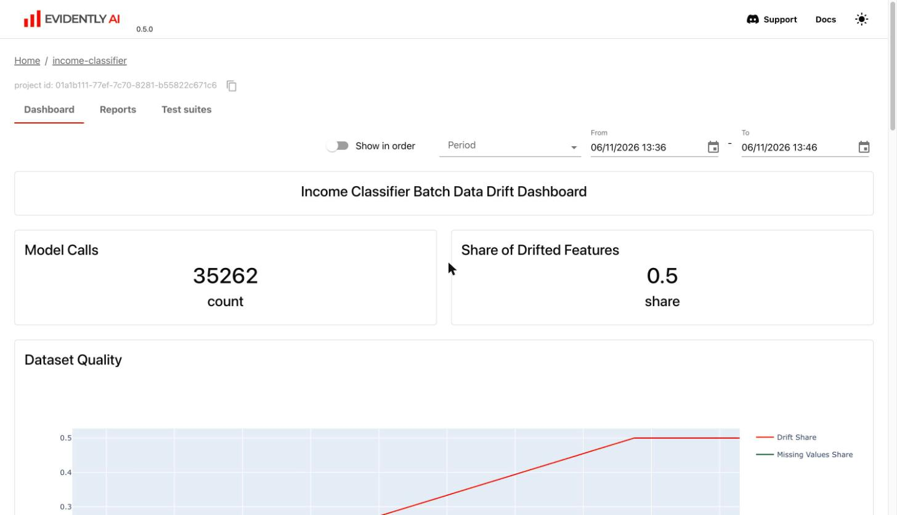
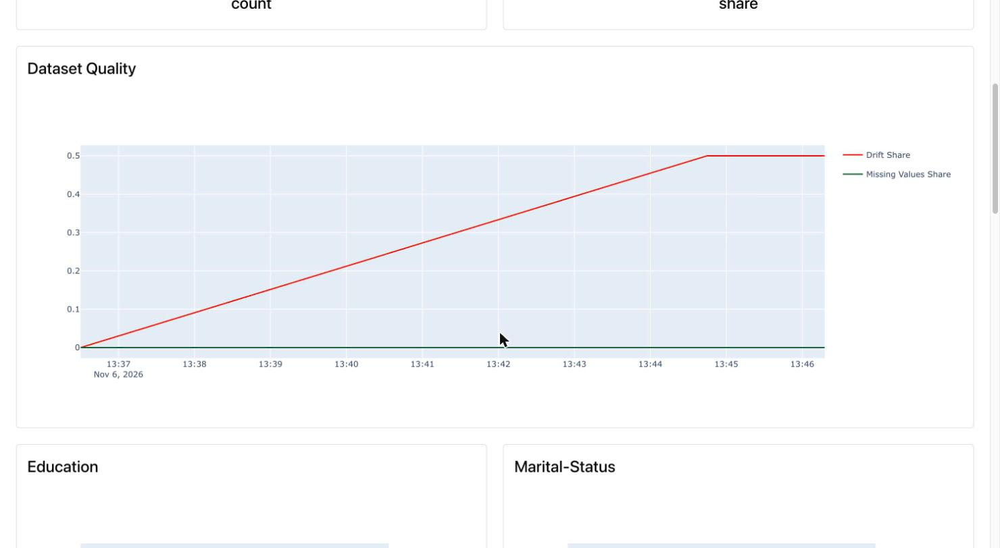
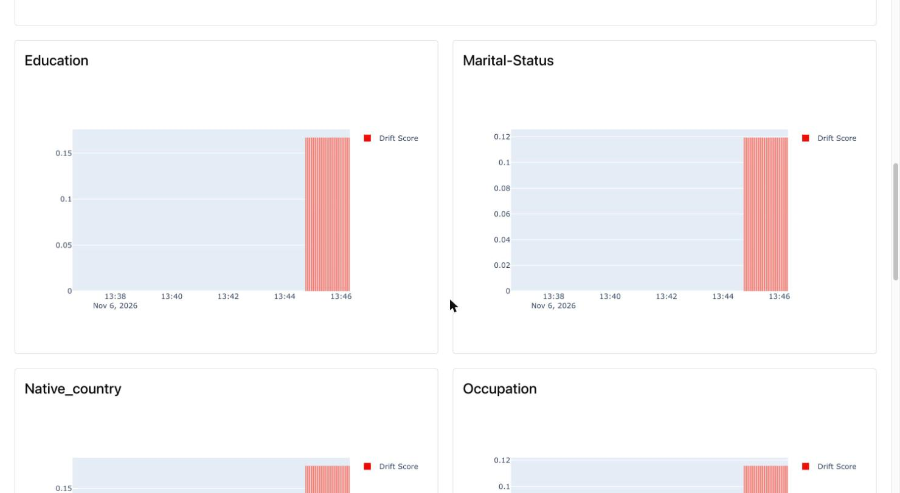

[6.1절](../mlpe-06-1-bentoml-yatai/)까지 소득 분류기를 배치 파이프라인과 API 두 가지로 배포했다. 배포한 모델은 처음에는 잘 맞다가, 몇 달 뒤 들어오는 데이터가 학습 때와 달라지면서 조용히 성능이 떨어질 수 있다. 6.2절은 이 **데이터 드리프트**를 **Evidently**로 탐지하고 대시보드로 추적한다. 이 글은 홈랩 Kubernetes에 Evidently UI를 올리고, 배치(KFP)와 실시간(BentoML) 두 경로에서 실제로 리포트를 쌓은 기록이다(2026-11-06).

## 1. 한눈에 보기

6.2절이 채우는 자리는 그림 아래쪽의 **모델 모니터링**이다. 드리프트를 보는 경로는 두 가지로, 5장 KFP 배치 추론 파이프라인에 넣은 `detect_drift` 단계와 6.1절 BentoML API의 마이크로배치 윈도다. 둘 다 4.1절 MLflow 모델 run에 남긴 학습 피처를 기준(reference)으로 삼아 리포트를 Evidently UI에 쌓는다.


## 2. 데이터 드리프트

데이터 드리프트는 학습에 쓴 데이터의 통계적 성질이 시간이 지나며 바뀌어 모델의 성능이 떨어지는 현상이다. 대부분의 모델은 입력과 출력의 관계가 일정하고, 입력 분포도 크게 변하지 않는다는 가정 위에서 학습된다. 현실에서는 시간이 충분히 지나면 이 가정이 깨지므로 운영 중에 드리프트를 찾아 조치해야 한다.

| 유형 | 무엇이 바뀌나 | 예 |
| --- | --- | --- |
| 레이블 드리프트 (label drift) | 정답(목표 변수)의 정의 | 제조 공정에서 "불량"으로 보는 기준이 달라진다 |
| 사전 확률 이동 (prior probability shift) | 클래스별 비율 | 사기 탐지에서 양성·음성 비율이 달라진다 |
| 공변량 이동 (covariate shift) | 입력 피처의 분포 | 고객의 연령, 지역, 행동 분포가 2018년과 2021년에 다르다 |
| 급격한 드리프트 (sudden drift) | 짧은 시간에 큰 변화 | 팬데믹이나 큰 시장 사건으로 행동이 갑자기 바뀐다 |

Evidently는 과거 데이터와 지금 들어오는 데이터에 통계 검정을 돌려 분포가 유의미하게 바뀌었는지 판단한다. 데이터 형태에 맞는 검정을 자동으로 고르고, 원하는 검정을 직접 지정하거나 만들어 쓸 수도 있다.

| 검정 | 대상 | 판정 방식 |
| --- | --- | --- |
| 콜모고로프-스미르노프(KS) 검정 | 수치형 | 두 데이터셋의 누적분포함수(CDF)를 비교한다. p-value가 임곗값(예: 0.05)보다 작으면 드리프트 |
| 카이제곱 검정 | 범주형 | 범주별 분포가 바뀌었는지 본다. p-value 기반 |
| 바서슈타인 거리 (Earth Mover's distance) | 수치형 | 기준 분포와 현재 분포의 거리. 클수록 많이 달라졌고, 임곗값(기본 0.1)을 넘으면 드리프트 |

p-value 기반 검정은 **값이 작을수록** 드리프트이고, 거리 기반 검정은 **값이 클수록** 드리프트다. 같은 "drift score" 열에 두 종류가 섞여 나오므로 어떤 검정이 쓰였는지 같이 봐야 한다.

## 3. 리포트와 메트릭 (6.2.1)

Evidently에 넣는 데이터는 두 벌이다. **reference**는 모델이 학습할 때의 정상 데이터이고, **current**는 지금 예측하려고 들어온 데이터다. 둘만 있으면 드리프트 리포트를 만들 수 있다.

| 용어 | 뜻 |
| --- | --- |
| Report | 검사 항목을 담는 바구니. 항목 하나하나가 메트릭이다 |
| Metric | 건강검진의 검사 항목. `DatasetMissingValuesMetric()`처럼 값 하나를 내는 것도, `DatasetSummaryMetric()`처럼 여러 통계를 한꺼번에 내는 것도 있다 |
| 수준 | 데이터셋 전체를 보는 메트릭과 컬럼 하나를 보는 메트릭 |
| Preset | 메트릭을 용도별로 묶은 종합검진 패키지. `DataDriftPreset`, `DataQualityPreset`, `RegressionPreset` |

메트릭마다 렌더링 방식이 있다. `RegressionQualityMetric`은 회귀 모델의 평균 오차(ME), 평균 절대 오차(MAE), 평균 절대 백분율 오차(MAPE)를 숫자로 보여 준다. 컬럼 수준 드리프트 메트릭은 reference와 current의 분포를 나란히 그린다.

```python {title="Listing 6.5 DataDriftPreset 으로 드리프트 리포트 만들기"}
from evidently.report import Report
from evidently.metric_preset import DataDriftPreset

report = Report(metrics=[DataDriftPreset()])
report.run(reference_data=reference_data, current_data=current_data)
report.save_html("drift_report.html")
```

`DataDriftPreset` 리포트는 컬럼마다 한 행이다. 각 행에 reference 분포와 current 분포, 쓰인 검정(Stat Test), 그 점수(Drift Score)가 나온다.

### 3.1 드리프트 판정은 두 단계다

1. **컬럼 판정**: 컬럼마다 검정 점수를 임곗값과 비교한다. 바서슈타인 거리라면 0.1을 넘을 때 그 컬럼을 드리프트로 본다.
2. **데이터셋 판정**: 드리프트 컬럼의 비율이 데이터셋 임곗값(기본 0.5) 이상이면 데이터셋 전체를 드리프트로 본다.

책 그림 6.16의 리포트 머리 부분은 이렇게 읽는다.

| 항목 | 값 | 뜻 |
| --- | --- | --- |
| Dataset Drift | detected | 데이터셋 전체에 드리프트 |
| Drift detection threshold | 0.5 | 드리프트 컬럼 비율이 이 값 이상이면 데이터셋 드리프트 |
| Columns | 8 | 검사한 컬럼 수 |
| Drifted Columns | 6 | 드리프트로 판정된 컬럼 수 |
| Share of Drifted Columns | 0.75 | 6 ÷ 8 |
| Missing values (Current / Reference) | 0 (0.0%) | 두 데이터 모두 결측 없음 |

컬럼 임곗값 0.1과 데이터셋 임곗값 0.5는 서로 다른 값이다. 앞의 것은 "이 컬럼이 바뀌었나", 뒤의 것은 "바뀐 컬럼이 충분히 많은가"를 정한다.

## 4. Evidently UI와 대시보드

리포트 하나는 한 시점의 상태만 보여 준다. 시간에 따른 변화를 보려면 여러 시점의 리포트를 쌓아 비교해야 하고, Evidently는 이를 위한 웹 대시보드(`evidently ui`, 포트 8000)를 준다.

**워크스페이스**는 모든 스냅숏을 담는 디렉터리이고, **프로젝트**는 그 아래에서 로그를 나누는 하위 디렉터리다. 리포트를 하나 올릴 때마다 스냅숏 JSON이 하나씩 쌓인다.

```text
workspace
├── project_1
│   ├── snapshot_1.json
│   └── snapshot_2.json
└── project_2
    ├── snapshot_1.json
    └── snapshot_2.json
```

### 4.1 홈랩에 Evidently UI 올리기

공용 가이드는 `python:3.10-slim-bookworm`에 build-essential을 깔아 이미지를 만들고 `kind load`로 노드에 넣는다. 홈랩은 kind가 아니라서, 5장 컴포넌트 이미지처럼 MLOPs-study 저장소의 GitHub Actions가 빌드해 Docker Hub에 올리게 했다. 패키지가 전부 휠이라 컴파일러는 필요 없다.

```text {title="k8s/evidently/ui/requirements.txt"}
evidently==0.5.0
pandas==2.3.3        # 고정하지 않으면 Evidently 0.5.0 과 함께 pandas 3.x 가 잡힌다
litestar==2.12.1
sniffio
```

```text {title="k8s/evidently/ui/Dockerfile"}
FROM python:3.12-slim
WORKDIR /app
COPY requirements.txt .
RUN pip install --no-cache-dir --root-user-action=ignore -r requirements.txt
EXPOSE 8000
ENTRYPOINT ["evidently", "ui"]
```

```yaml {title=".github/workflows/evidently-images.yml (요지)"}
on:
  push:
    branches: [main]
    paths: ["k8s/evidently/ui/**", "k8s/kubeflow-pipelines/06-income-classifier-drift/{Dockerfile,requirements.txt,src/**}"]
jobs:
  build-push-bump:
    steps:
      - uses: docker/build-push-action@v7          # evidently-ui
        with: {context: k8s/evidently/ui, platforms: linux/amd64, push: true,
               tags: "${{ secrets.DOCKERHUB_USERNAME }}/evidently-ui:${{ steps.ver.outputs.tag }}"}
      - uses: docker/build-push-action@v7          # detect-drift (5.2절)
        with: {context: k8s/kubeflow-pipelines/06-income-classifier-drift, platforms: linux/amd64, push: true,
               tags: "${{ secrets.DOCKERHUB_USERNAME }}/detect-drift:${{ steps.ver.outputs.tag }}"}
      - run: |                                     # 매니페스트 태그를 커밋 SHA 로 바꾸는 봇 커밋
          yq -i '(select(.kind == "Deployment") | .spec.template.spec.containers[0].image) = "<owner>/evidently-ui:<sha>"' k8s/evidently/evidently-ui.yaml
          yq -i '.implementation.container.image = "<owner>/detect-drift:<sha>"' .../components/detect_drift/component.yaml
```

```yaml {title="k8s/evidently/evidently-ui.yaml (요지)"}
apiVersion: apps/v1
kind: Deployment
metadata: {name: evidently-ui, namespace: evidently}
spec:
  replicas: 1
  strategy: {type: Recreate}                       # PVC 가 RWO
  template:
    spec:
      nodeSelector: {kubernetes.io/arch: amd64}
      containers:
        - name: evidently-ui
          image: hyeonjae0913/evidently-ui:dd6b564  # 봇이 갱신
          args: ["--host", "0.0.0.0", "--port", "8000", "--workspace", "/app/workspace"]
          resources:
            requests: {cpu: 50m, memory: 256Mi}
            limits: {memory: 1Gi}
          volumeMounts: [{name: workspace, mountPath: /app/workspace}]
      volumes:
        - name: workspace
          persistentVolumeClaim: {claimName: evidently-workspace}   # local-path 1Gi
---
apiVersion: v1
kind: Service
metadata:
  name: evidently-ui
  namespace: evidently
  annotations: {lbipam.cilium.io/ips: "192.168.0.245"}   # 클러스터 안: evidently-ui.evidently.svc:8000
spec:
  type: LoadBalancer
  selector: {app: evidently-ui}
  ports:
    - {name: http, port: 8000, targetPort: http}
    - {name: http-80, port: 80, targetPort: http}
```

```terminal
$ kubectl apply -f ~/k8s/evidently/evidently-ui.yaml
deployment "evidently-ui" successfully rolled out
$ kubectl -n evidently get pod,svc -o wide
pod/evidently-ui-868d5d6749-tlm8h   1/1   Running   worker1-gpu
service/evidently-ui   LoadBalancer   10.111.87.247   192.168.0.245
$ curl -s -o /dev/null -w '%{http_code}\n' http://192.168.0.245/
200
```

### 4.2 프로젝트와 패널 만들기

`RemoteWorkspace`가 UI의 클라이언트 역할을 한다. 여기에 `income-classifier` 프로젝트를 만든다.

```python {title="Listing 6.6 원격 워크스페이스와 프로젝트"}
from evidently.ui.workspace import RemoteWorkspace

ws = RemoteWorkspace("http://192.168.0.245")
project = ws.create_project(
    name="income-classifier",
    description="Used to classify users into multiple income bands",
)
```

대시보드는 **패널**로 채운다. 패널은 리포트의 메트릭 값을 대시보드에 그리는 시각화 요소다. 숫자 하나를 크게 보여 주는 `DashboardPanelCounter`와, 값을 선·막대·산점도·히스토그램으로 그리는 `DashboardPanelPlot`이 있다.

```python {title="Listing 6.7 제목 패널, Listing 6.8 드리프트 컬럼 비율 패널"}
DashboardPanelCounter(
    filter=ReportFilter(metadata_values={}, tag_values=[]),   # 어떤 스냅숏을 쓸지. 비우면 전부
    agg=CounterAgg.NONE,                                      # 숫자를 계산하지 않는다
    title="Income Classifier Batch Data Drift Dashboard",
)
DashboardPanelCounter(
    title="Share of Drifted Features",
    filter=ReportFilter(metadata_values={}, tag_values=[]),
    value=PanelValue(
        metric_id="DatasetDriftMetric",           # 어느 메트릭의 결과에서
        field_path="share_of_drifted_columns",    # 어느 필드를 꺼낼지
        legend="share",
    ),
    text="share",
    agg=CounterAgg.LAST,      # 스냅숏이 여러 개 쌓여도 가장 최근 값 하나
    size=1,                   # 1 은 절반 너비, 2 는 전체 너비
)
```

`PanelValue`는 값을 꺼낼 주소다. `metric_id`의 메트릭이 실제 리포트에 들어 있어야 패널에 값이 나온다.

저자의 `build_evidently_dashboard.py`는 제목, 호출 수, 드리프트 컬럼 비율, 데이터 품질 선 그래프, 범주형 컬럼 8개의 드리프트 점수 막대 그래프를 추가하고 `project.save()`로 저장한다. 홈랩판은 UI 주소만 환경변수로 받게 바꿨다. 패널이 계속 추가되므로 한 번만 실행한다.

```terminal {title="rocky-linux: Evidently 전용 venv (BentoML venv 와 의존성이 섞이지 않게)"}
$ uv venv ~/.venvs/evidently --python 3.12
$ uv pip install --python ~/.venvs/evidently/bin/python evidently==0.5.0 pandas==2.3.3 litestar==2.12.1 sniffio mlflow-skinny==3.17.2 minio pyarrow boto3
$ EVIDENTLY_WORKSPACE_URL=http://192.168.0.245 ~/.venvs/evidently/bin/python build_evidently_dashboard.py
$ ~/.venvs/evidently/bin/python -c "..."      # list_projects()
income-classifier 01a1b111-77ef-7c70-8281-b55822c671c6 panels 12
```

프로젝트 ID는 환경마다 다르다. 이 값은 6.1절 드리프트 Bento의 `EVIDENTLY_PROJECT_ID`에 넣는다.

## 5. KFP 파이프라인의 드리프트 컴포넌트 (6.2.2)

배치 경로에서는 5장 추론 파이프라인에 `detect_drift` 컴포넌트를 하나 끼운다. 위치는 피처 조회와 추론 사이다. 피처를 받아 학습 때의 데이터와 비교하고, 리포트를 Evidently 프로젝트에 올린다.

![드리프트 탐지 KFP 파이프라인 income-classifier-pipeline-with-drift 의 홈랩판. ① fetch_data 가 RustFS 의 entity_df 를 읽고 ② retrieve_features 가 Feast historical 피처를 붙인다. 피처 parquet 는 ③ detect_drift 와 ④ run_inference 두 곳으로 간다(data_output). detect_drift 는 MLflow 3.16 의 Production run 에서 reference_features 태그의 데이터셋 위치를 찾고, RustFS 에서 reference CSV 30,162행을 받아 Evidently 0.5 Report 를 만든 뒤 Evidently UI(LB 192.168.0.245)의 income-classifier 프로젝트에 add_report 로 스냅숏을 올린다(드리프트 0/8, 33초). run_inference 는 detect_drift 와 점선 .after() 로 순서만 묶여 있어 드리프트가 나도 실행되고, ⑤ write_data 가 결과 parquet 를 업로드한다. 멈추려면 dsl.If 분기가 필요하다](drift-pipeline.svg)

### 5.1 detect_drift가 하는 일

reference 데이터는 MLflow에서 찾는다. 4.1절에서 모델 run에 `log_input`으로 학습·테스트·피처 데이터셋의 위치를 남겨 두었기 때문이다. 홈랩 Production run(`b38037a6`)에도 `mlflow.data.context=reference_features` 태그가 붙은 데이터셋이 있어, 책의 파라미터를 그대로 쓸 수 있었다.

```python {title="Listing 6.9 detect_drift (요지, 저자 코드 그대로)"}
def detect_drift(model_name, model_stage, mlflow_host, minio_host, access_key, secret_key,
                 reference_dataset_name, feature_dataset_path,
                 evidently_workspace_url, evidently_ui_project_name):
    # 1) Production 모델의 run 에서 reference 데이터셋 위치를 찾는다
    for dataset_input in mlflow.get_run(model_run_id).inputs.dataset_inputs:
        for tag in dataset_input.tags:
            if tag.value == reference_dataset_name:
                dataset_source = json.loads(dataset_input.dataset.source)["uri"]
    # 2) MinIO(홈랩은 RustFS)에서 reference 를, 앞 단계 출력에서 current 를 읽는다
    reference_df = pd.read_csv(file_path)
    feature_df = pd.read_parquet(feature_dataset_path).drop(columns=["user_id"], errors="ignore")
    # 3) 대시보드 패널이 읽는 메트릭과 같은 것으로 리포트를 만든다
    report = Report(metrics=[DatasetDriftMetric(), DatasetMissingValuesMetric(),
                             ColumnDriftMetric(column_name="Education"), ColumnSummaryMetric(column_name="Education"),
                             ...])   # Marital-Status, Native_country, Occupation, Race, Relationship, Sex, Workclass
    report.run(reference_data=reference_df, current_data=feature_df)
    # 4) 프로젝트에 스냅숏으로 올린다
    evidently_workspace.add_report(get_evidently_project(evidently_workspace, evidently_ui_project_name).id, report)
```

| 데이터 | 홈랩에서 | 크기 |
| --- | --- | --- |
| reference | RustFS `mlflow-datasets/income-classifier-datasets/feature_df-c93bc05b….csv` | 30,162행 × 8컬럼 (범주형) |
| current | `retrieve-features` 단계 출력 parquet | 30,162행 × 9컬럼 (8컬럼 + `event_timestamp`) |

current에는 저자 코드가 빼지 않는 `event_timestamp`가 남는다. Evidently는 reference에 없는 컬럼을 비교에서 빼고 8컬럼만 검사했다. 컬럼이 모두 범주형이라, 책 그림의 바서슈타인 거리 대신 **Jensen-Shannon 거리**가 자동으로 골라졌고 임곗값은 같은 0.1이다.

### 5.2 detect_drift 이미지는 5장과 따로

5장 홈랩 컴포넌트 이미지는 모델을 읽으려고 numpy 2.5.4를 쓴다. 그런데 Evidently 0.5.0은 numpy 2.0대까지만 허용해 같은 이미지에 둘 수 없었다. `detect_drift`는 모델을 읽지 않으므로, 드리프트에 필요한 패키지만 담은 이미지를 따로 만들고 저자 `detect_drift.py`는 고치지 않았다.

```text {title="06-income-classifier-drift/requirements.txt"}
evidently==0.5.0
pandas==2.3.3
pyarrow
mlflow-skinny==3.17.2      # 서버(3.16)와 통신만 한다. 모델 로드용 의존성은 필요 없다
minio
boto3
```

```yaml {title="06-income-classifier-drift/components/detect_drift/component.yaml"}
name: detect_drift
inputs:
  - {name: model_name, type: String}
  - {name: model_stage, type: String}
  - {name: mlflow_host, type: String}
  - {name: minio_host, type: String}
  - {name: reference_dataset_name, type: String}
  - {name: feature_dataset_path, type: Artifact}
  - {name: evidently_workspace_url, type: String}
  - {name: evidently_ui_project_name, type: String}
implementation:
  container:
    image: hyeonjae0913/detect-drift:dd6b564
    command:
      - sh
      - -c
      # 책은 access_key/secret_key 를 파이프라인 파라미터로 받는다. 5장 홈랩판처럼 Secret env 를 인자로 넘긴다
      - exec python3 /app/src/detect_drift/detect_drift.py "$@" --access_key "$AWS_ACCESS_KEY_ID" --secret_key "$AWS_SECRET_ACCESS_KEY"
      - sh
      - --model_name
      - {inputValue: model_name}
      # ... model_stage, mlflow_host, minio_host, reference_dataset_name
      - --feature_dataset_path
      - {inputPath: feature_dataset_path}
      # ... evidently_workspace_url, evidently_ui_project_name
```

### 5.3 파이프라인

파이프라인은 5장 홈랩판 컴포넌트 4개(`../05-income-classifier/components/`)를 그대로 불러오고 `detect_drift`만 더한다. 기본 파라미터에 홈랩 주소를 넣어 두어 인자 없이 실행되고, 캐시는 전 단계 끈다.

```python {title="06-income-classifier-drift/inference_pipeline.py (요지)"}
@dsl.pipeline(name="income-classifier-pipeline-with-drift")
def income_classifier_pipeline_with_drift(
    minio_host: str = "rustfs.mlflow.svc:9000",
    mlflow_host: str = "http://mlflow.mlflow.svc:5000",
    reference_dataset_name: str = "reference_features",
    evidently_workspace_url: str = "http://evidently-ui.evidently.svc:8000",   # Pod 안에서 쓰이므로 클러스터 주소
    evidently_ui_project_name: str = "income-classifier",
    output_file_name: str = "inference_result_with_drift.parquet", ...):
    fetch = homelab(read_op(...))
    feats = homelab(features_op(..., entity_df=fetch.outputs["data_output"]))
    drift = homelab(drift_op(..., feature_dataset_path=feats.outputs["data_output"]))
    infer = homelab(infer_op(..., input_data=feats.outputs["data_output"])).after(drift)
    homelab(write_op(..., input_data=infer.outputs["data_output"]))

def homelab(task):        # Secret rustfs-credentials 를 env 로, 캐시 끔 (5장과 같다)
    kubernetes.use_secret_as_env(task, secret_name="rustfs-credentials",
                                 secret_key_to_env={"AWS_ACCESS_KEY_ID": "AWS_ACCESS_KEY_ID",
                                                    "AWS_SECRET_ACCESS_KEY": "AWS_SECRET_ACCESS_KEY"})
    task.set_caching_options(False)
    return task
```

캐시를 꺼야 같은 입력으로 다시 돌려도 `detect_drift`가 건너뛰어지지 않고 리포트가 새로 쌓인다. 저자 코드는 `fetch_data`만 캐시를 끈다.

### 5.4 실행 결과

```terminal
$ cd 06-income-classifier-drift && KFP_HOST=http://192.168.0.242 RUN_NAME=income-classifier-drift-homelab-1 ~/.venvs/kfp/bin/python inference_pipeline.py
compiled income_classifier_pipeline_with_drift.yaml
run_id 8d6eef0d-13c3-401f-9487-321e9fdb1f38
$ grep -h "image:" income_classifier_pipeline_with_drift.yaml | sort | uniq -c
      1         image: hyeonjae0913/detect-drift:dd6b564
      1         image: hyeonjae0913/read-minio-data:31bd38a
      1         image: hyeonjae0913/retrieve-feast-features:31bd38a
      1         image: hyeonjae0913/run-inference:31bd38a
      1         image: hyeonjae0913/write-minio-data:31bd38a
```

| 단계 | 상태 | 시간 |
| --- | --- | --- |
| read-data-from-minio | SUCCEEDED | 10초 |
| retrieve-features-from-feast | SUCCEEDED | 20초 |
| detect-drift | SUCCEEDED | 33초 |
| model-inference | SUCCEEDED | 20초 |
| write-data-to-minio | SUCCEEDED | 10초 |
| **전체** | **SUCCEEDED** | **2분 34초** |


```terminal {title="detect-drift 단계 로그와 결과"}
report written
project retreived
uploadFile(localFilePath="/minio/mlpipeline/v2/artifacts/income-classifier-pipeline-with-drift/8d6eef0d-.../detect-drift/...
$ # RustFS inference-datasets
inference_result.parquet 296080
inference_result_with_drift.parquet 296080
```

| 리포트 (배치) | 값 |
| --- | --- |
| 비교 행 수 | reference 30,162 / current 30,162 |
| 드리프트 컬럼 | **0 / 8** (share 0.0, dataset drift False) |
| 컬럼별 점수 (Jensen-Shannon) | 8컬럼 모두 0.0000 |

현재 피처는 학습 때와 같은 사용자 30,162명이라 분포가 완전히 같다. 책 그림 6.20처럼 "드리프트된 피처 비율"이 0으로 나오고, 결과 parquet도 5장과 같은 296,080B다.

### 5.5 드리프트가 나도 추론은 멈추지 않는다

책 본문은 "드리프트가 탐지되면 파이프라인 실행을 중단한다"고 쓰지만, 저자 코드는 그렇게 동작하지 않는다. `run_inference`는 `.after(drift)`로 순서만 묶여 있어서, `detect_drift`가 **성공으로 끝나기만 하면** 드리프트 여부와 상관없이 추론이 돈다. 정말 멈추려면 `detect_drift`가 드리프트 여부를 출력으로 내고, 파이프라인이 `dsl.If`(또는 `dsl.Condition`)로 분기해야 한다.

## 6. API로 배포한 모델의 드리프트 (6.2.3)

사기 탐지나 추천처럼 실시간 판단이 중요한 서비스는 드리프트도 실시간에 가깝게 봐야 한다. 그렇다고 `/predict` 요청마다 검정을 돌리면 안 된다. 통계 검정은 분포끼리 비교하는 것인데, 요청 하나는 분포가 아니기 때문이다.

그래서 최근 요청을 N개 모은 **마이크로배치**를 reference와 비교한다. 최근 N개만 싣는 컨베이어 벨트를 떠올리면 된다. 새 요청이 올라오면 가장 오래된 것이 떨어지고, 벨트가 가득 찬 뒤부터 요청마다 그 내용물로 검사한다.

```python {title="Listing 6.10 MonitoringService (요지)"}
class MonitoringService:
    def iterate(self, new_rows: pandas.DataFrame):
        self.current = pandas.concat([self.current, new_rows], ignore_index=True)   # 새 요청을 윈도 뒤에
        current_size = self.current.shape[0]
        if current_size > self.window_size:                                         # 최근 N 개만 남긴다
            self.current = self.current.iloc[-self.window_size:].reset_index(drop=True)
        if current_size < self.window_size:                                         # 아직 덜 찼으면 기다린다
            logger.info(f"Not enough data for measurement: {current_size} of {self.window_size}. Waiting more data")
            return
        logger.info("Running report")
        self.report.run(reference_data=self.reference, current_data=self.current)
        self.workspace.add_report(project_id=self.project_id, report=self.report)
```

서비스 시작 함수에서는 KFP 컴포넌트와 같은 방법으로 MLflow에서 reference 데이터셋을 찾아 내려받고, 프로젝트 ID와 윈도 크기(`EVIDENTLY_REPORT_WINDOW_SIZE`)로 `MonitoringService`를 만든다(Listing 6.11). `predict` 함수는 피처를 조회한 직후 `ctx.state["monitoring_service"].iterate(feature_df)`를 한 줄 더 부른다.

### 6.1 드리프트 Bento: numpy를 Evidently에 맞춘다

드리프트 변형 서비스(`service_with_drift_detection.py`)는 BentoML 1.1.10과 Evidently 0.5.0을 한 이미지에 담는다. 5.2절과 같은 이유로 numpy 2.5.4를 고정할 수 없어서, 이 변형만 numpy를 Evidently에 맞췄다(2.0.2). numpy 2.5.4로 저장된 skops 모델도 numpy 2.0.2에서 로드되고 예측됐다. 6.1절의 홈랩 수정(환경변수 덮어쓰기, Secret 읽기, 워커별 임시 디렉터리)은 이 파일에도 들어 있다.

```text {title="bentoml/requirements_homelab_drift.txt"}
bentoml==1.1.10
mlflow==3.17.2
scikit-learn==1.9.1
skops==0.16.0
scipy==1.18.1
feast[redis,aws]==0.67.0
evidently==0.5.0          # numpy 2.0 대까지. numpy 는 고정하지 않는다 (2.0.2 로 풀린다)
pandas==2.3.3
litestar==2.12.1
sniffio
minio
python-dotenv
setuptools<81
```

```yaml {title="bentoml/bento/bentofile_homelab_drift.yaml"}
service: "service_with_drift_detection:svc"
labels: {owner: ml-engineering-team, env: homelab, variant: drift}
include:
  - "service_with_drift_detection.py"
  - "homelab.env"
  - "src/*.py"
  - "data_drift.py"
  - "evidently_reports.py"
  - "requirements_homelab_drift.txt"
python:
  requirements_txt: requirements_homelab_drift.txt
docker:
  base_image: python:3.12-slim
  env:
    - ENV_NAME=homelab
```

```terminal
$ ~/.venvs/bento-drift/bin/python -c "import numpy, evidently, bentoml; bentoml.mlflow.load_model('random-forest-classifier:latest')"
numpy 2.0.2 sklearn 1.9.1 evidently 0.5.0
model load ok PyFuncModel
$ ~/.venvs/bento-drift/bin/bentoml build -f bento/bentofile_homelab_drift.yaml
income_classifier_service:l2mj57gz42lndbch
$ ~/.venvs/bento-drift/bin/bentoml push income_classifier_service:l2mj57gz42lndbch
│ Successfully pushed bento "income_classifier_service:l2mj57gz42lndbch"       │
```

공용 가이드는 이 변형을 `docker run`으로 띄웠지만, 홈랩에서는 6.1절과 같이 BentoRequest와 BentoDeployment로 Yatai에 배포했다. 윈도(`self.current`)는 워커와 Pod의 메모리에 있다. 워커나 복제본이 여럿이면 각자 따로 쌓여 리포트가 늦게 생기므로 둘 다 1로 고정한다.

```yaml {title="bentoml/05-income-classifier-drift/bentodeployment.yaml (요지)"}
apiVersion: serving.yatai.ai/v2alpha1
kind: BentoDeployment
metadata: {name: income-classifier-drift, namespace: yatai}
spec:
  bento: income-classifier-drift-l2mj57gz42lndbch
  ingress: {enabled: false}
  autoscaling: {minReplicas: 1, maxReplicas: 1}      # 복제본마다 윈도가 따로 쌓인다
  envs:
    - {name: ENV_NAME, value: homelab}
    - {name: BENTOML_CONFIG_OPTIONS, value: "api_server.workers=1"}   # 워커마다 윈도가 따로 쌓인다
    - {name: MLFLOW_S3_ENDPOINT_URL, value: "http://rustfs.mlflow.svc:9000"}
    - {name: K8S_SECRET_NAME, value: income-classifier-env}
    - {name: EVIDENTLY_PROJECT_ID, value: "01a1b111-77ef-7c70-8281-b55822c671c6"}
  extraPodSpec:
    nodeSelector: {kubernetes.io/arch: amd64}
    serviceAccountName: income-classifier
  runners:
    - name: random-forest-classifier
      autoscaling: {minReplicas: 1, maxReplicas: 1}
# + LB Service income-classifier-drift-lb (192.168.0.246)
```

kaniko 빌드는 4분 30초 안에 끝났다. 첫 빌드 때와 달리 control-plane은 부하 0.6 안팎, API 서버 응답 10ms대로 정상이었다.

### 6.2 요청 150건을 보냈다

저자 저장소의 `mock_request_data.csv`에는 사용자 100명이 있다. 100명을 보낸 뒤 앞의 50명을 한 번 더 보내 150건을 만들었다.

```terminal
$ (전체 100명; 앞 50명) | while read u; do curl -s -X POST http://192.168.0.246/predict -H "Content-Type: application/json" -d "{\"user_id\":\"$u\"}"; done
    118 <=50K
     32 >50k
$ kubectl -n yatai logs $P -c main | grep -c "Not enough data"
99
$ kubectl -n yatai logs $P -c main | grep -c "Running report"
51
$ curl -s http://192.168.0.245/api/projects/01a1b111-77ef-7c70-8281-b55822c671c6/reports | jq length
52
```

책 설명대로 1 ~ 99번째 요청은 "데이터가 모자라다"며 기다렸고, 100번째부터 요청마다 리포트가 하나씩 생겼다. 150건에서 51건이고, 배치 1건과 합쳐 프로젝트에 리포트 52건이 쌓였다.

### 6.3 학습 사용자인데 드리프트가 절반 컬럼에서 나온다

Evidently UI에서 스냅숏을 내려받아 보면, 윈도 100의 리포트는 8컬럼 중 4개를 드리프트로 판정했다. 드리프트 컬럼 비율이 데이터셋 임곗값 0.5에 걸려 **데이터셋 드리프트가 True**가 됐다.

| 컬럼 | Jensen-Shannon 거리 | 판정 (임곗값 0.1) |
| --- | --- | --- |
| Native_country | 0.176 | 드리프트 |
| Education | 0.167 | 드리프트 |
| Marital-Status | 0.119 | 드리프트 |
| Occupation | 0.116 | 드리프트 |
| Relationship | 0.069 | |
| Race | 0.065 | |
| Workclass | 0.053 | |
| Sex | 0.042 | |

| 비교 | 배치 (KFP) | 실시간 윈도 100 | 책 (실시간 윈도 50) |
| --- | --- | --- | --- |
| current 행 수 | 30,162 | 100 | 50 |
| 드리프트 컬럼 비율 | 0.0 | **0.5** | 0.875 |







보낸 요청은 모두 학습 데이터에 있는 사용자다. 모델이나 데이터가 변한 것이 아니라 **표본 100개가 30,162명 분포를 대표하기에 작아서** 생긴 거짓 경보다. 범주가 41개인 Native_country나 16개인 Education처럼 범주가 많은 컬럼일수록, 100명 안에서 우연히 빠지거나 몰린 범주가 거리를 키운다.

마지막 51개 리포트의 값이 모두 같은 것은 윈도가 계속 같은 100명(51 ~ 100번 + 1 ~ 50번)이기 때문이다.

책은 윈도 50에서 0.875였고, 홈랩은 윈도 100에서 0.5였다. 윈도를 두 배로 늘리자 거짓 경보가 줄었지만 여전히 데이터셋 임곗값에 걸린다. 대응은 셋이다.

- **윈도를 키운다**: 200, 500처럼 늘린다. 대신 드리프트를 알아채기까지의 시간이 늘어난다.
- **임곗값을 조정한다**: 컬럼 임곗값이나 데이터셋 임곗값(0.5)을 올려 작은 흔들림에 반응하지 않게 한다.
- **연속 초과일 때만 알린다**: 스냅숏 한 번이 아니라 여러 번 연달아 넘을 때 알림을 보낸다. 책이 다루는 방법은 아니고 일반적인 운영 방식이다.

## 7. 드리프트를 찾은 다음

탐지는 첫 단계일 뿐이고, 드리프트가 서비스에 주는 영향에 대응해야 한다.

| 단계 | 하는 일 |
| --- | --- |
| 조사 | 드리프트의 유형과 심각도를 파악한다. 예측 정확도나 공정성에 실제로 영향이 있는지 추가 검정과 분석으로 확인한다 |
| 업스트림 수정 | 원인이 데이터 파이프라인의 변경이면 그 파이프라인을 고치고 전처리·정제를 보강한다 |
| 재학습 | 성능 영향이 크면 최신 데이터로 모델을 다시 학습한다 |
| 피처 재선택 | 피처 중요도가 바뀐 것이면 피처를 추가·제거·수정한다 |

## 8. 겪은 문제

| 증상 | 원인 | 해결 |
| --- | --- | --- |
| Evidently 0.5.0과 pandas 3.x가 같이 잡힘 | evidently 0.5.0이 pandas 상한을 두지 않음 | `pandas==2.3.3` 고정 |
| 5장 이미지에 Evidently를 넣을 수 없음 | 5장 이미지는 numpy 2.5.4, Evidently 0.5.0은 numpy 2.0대까지 | `detect_drift`는 별도 이미지(mlflow-skinny), 드리프트 Bento는 numpy를 Evidently에 맞춤 |
| 공용 가이드의 `kind load` | 홈랩은 kind가 아님 | GitHub Actions로 Docker Hub에 올리고 태그를 봇 커밋으로 갱신 |
| current에 `event_timestamp`가 남음 | 저자 코드는 `user_id`만 뺌 | reference에 없는 컬럼은 Evidently가 비교에서 뺀다. 그대로 둠 |
| 대시보드 스크립트를 두 번 돌리면 패널이 두 벌 | `add_panel`이 매번 추가 | 한 번만 실행 |

## 9. 정리

| 경로 | 구성 | 홈랩 결과 |
| --- | --- | --- |
| UI | Evidently UI 0.5.0, ns `evidently`, LB `192.168.0.245` | 프로젝트 `income-classifier`, 패널 12개, 리포트 52건 |
| 배치 | KFP `income-classifier-pipeline-with-drift` (5장 컴포넌트 4개 + `detect_drift`) | run SUCCEEDED 2분 34초, 드리프트 0/8 |
| 실시간 | Yatai BentoDeployment `income-classifier-drift`, 윈도 100, LB `192.168.0.246` | 요청 150건에 리포트 51건, 드리프트 4/8 (share 0.5, 거짓 경보) |

- 배포한 모델은 입력 분포가 학습 때와 달라지면 성능이 떨어진다. 드리프트 모니터링은 이를 일찍 알아채 비싼 실수를 막는다.
- Evidently는 reference와 current 두 데이터만으로 컬럼별 검정을 돌리고, 컬럼 판정과 데이터셋 판정 두 단계로 드리프트를 정한다. 범주형 컬럼에는 Jensen-Shannon 거리가 쓰였다.
- 배치 경로는 KFP 파이프라인에 `detect_drift` 단계를 넣어 실행마다 리포트를 쌓는다. 드리프트가 나도 추론을 멈추게 하려면 분기를 따로 넣어야 한다.
- 실시간 경로는 윈도가 작으면 같은 학습 데이터로도 거짓 경보가 난다. 홈랩에서 윈도 100으로도 절반 컬럼이 드리프트로 나왔으니, 윈도 크기와 임곗값을 함께 정해야 한다.

매니페스트와 이미지 빌드 설정은 MLOPs-study 저장소의 `k8s/evidently/`, `k8s/kubeflow-pipelines/06-income-classifier-drift/`, `k8s/bentoml/05-income-classifier-drift/`에 있다.
