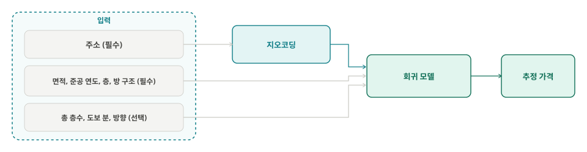
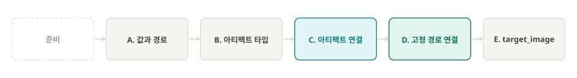
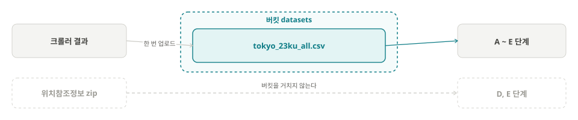
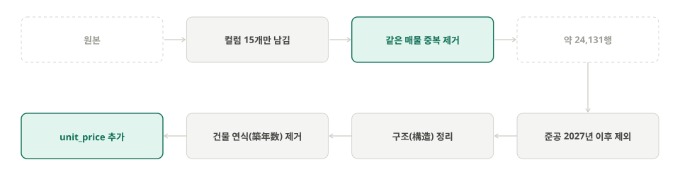
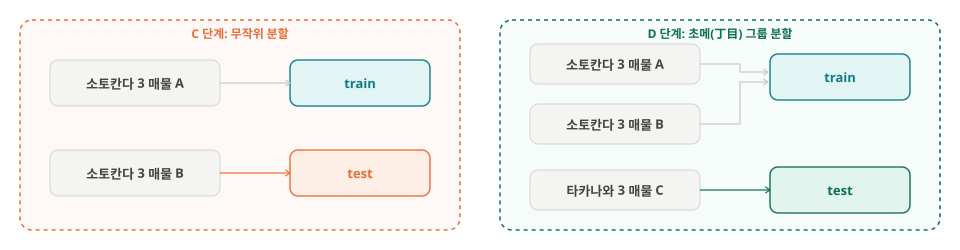
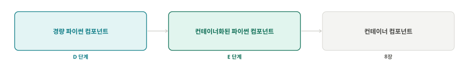
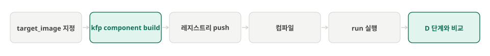

`Machine Learning Platform Engineering`의 7.2 ~ 7.3절 데이터 준비 파이프라인을 실제 **도쿄 23구 중고 맨션 매물 데이터**로 학습한 과정이다.

## 1. 한눈에 보기

### 1.1 배경: 호가가 적정한지 모른다

도쿄에서 중고 맨션 매물을 보면 가격표는 있지만, 그 가격이 **주변 시세에 비해 비싼지 싼지**는 알기 어렵다. 같은 역 근처라도 준공 연도(築年)와 면적, 층에 따라 가격이 몇 배씩 달라지고, 한 매물이 중개사마다 다른 가격으로 올라오기도 한다. 그래서 매물을 보는 사람은 결국 비슷한 조건의 매물을 여럿 찾아 머릿속으로 비교하게 된다.

이 비교를 모델이 대신하게 하는 것이 목표이다. **주소와 매물 조건**을 넣으면 **추정 가격과 80% 구간**을 돌려주고, 실제 호가가 그 구간의 어디에 있는지를 보여 준다.

### 1.2 풀려는 문제

**살고 싶은 주소와 원하는 맨션 조건**(면적, 준공 연도, 층, 방 구조(間取り))을 넣으면, 지금 그 자리에 매물이 올라와 있지 않아도 **그 조건이면 호가가 대략 얼마 선인지**를 알려 준다. 학습 데이터가 매도 호가이므로 실제 성약 가격은 아니고, 호가 수준의 추정값이다.



- **문제 유형**: 지도학습 회귀. 수집한 매물마다 주소·조건과 함께 가격이 적혀 있어 정답이 있는 **지도학습**이고, 맞힐 값이 가격이라는 연속값이라 **회귀**이다
- **타깃**: 가격이 아니라 **m²당 단가**. 위치가 결정하는 것은 단가에 가깝고, 가격은 단가에 면적을 곱하면 된다
- **위치가 가장 큰 변수**: 면적이나 준공 연도(築年)를 보지 않고 어느 구(区)인지만 알아도 단가 차이의 절반을 맞힐 수 있고, 동 이름(町名)까지 알면 3분의 2를 맞힐 수 있다.


| 아는 것       | 찍는 방법                                                        | 틀리는 정도   |
| ---------- | ------------------------------------------------------------ | -------- |
| 없음         | 모든 매물을 전체 중앙값 142만엔/m²로 찍는다                                  | 100 (기준) |
| 어느 구(区)인지  | 그 구의 중앙값으로 찍는다 (미나토구(港区) 267, 세타가야구(世田谷区) 127, 아다치구(足立区) 70) | 48       |
| 어느 동(町名)인지 | 그 동의 중앙값으로 찍는다 (미타(三田) 391, 코난(港南) 195, 타카나와(高輪) 272)        | 33       |


### 1.3 데이터 현황

- **원본**: SUUMO 의 도쿄 23구 중고 맨션 목록. 2026-11-13 에 한 번 수집한 스냅샷
- **robots.txt 준수**: 수집 경로(`/ms/chuko/tokyo/` 아래 목록과 상세 페이지)는 `User-agent: *` 의 `Disallow` 목록에 없음 (2026-11-14 확인)
- **요청 간격**: 워커 2개, 요청마다 1.0 ~ 1.5초 대기. 초당 약 1.5회 이하
- **용도와 공개 범위**: 개인 학습 목적. 글에는 집계 통계만 싣는다. 아래 구조 설명용 한 건은 물건명, ID, URL 을 가렸다


#### 매물 한 건의 구조

한 행이 매물 하나이고 38열이다. 크롤러가 SUUMO 화면의 글자를 그대로 둔 **원문 열**과, 거기서 숫자만 뽑은 **파싱 열**이 짝을 이룬다. 모델에 들어가는 것은 파싱 열이다. 아래는 세타가야구(世田谷区)의 2LDK 매물 한 건이다.


| 원문 열                                                     | 값                            | 파싱 열                                              | 이 파이프라인에서의 쓰임                           |
| -------------------------------------------------------- | ---------------------------- | ------------------------------------------------- | --------------------------------------- |
| 가격(`価格`)                                                 | 7980万円                       | 가격\_만엔(`価格_万円`) = 7980                            | **타깃**. 면적으로 나눠 m²당 단가로 바꾼다             |
| 전용 면적(`専有面積`)                                            | 60.04m2（壁芯）                  | `専有面積_m2` = 60.04                                 | 필수 입력                                   |
| 방 구조(`間取り`)                                              | 2LDK                         | 그대로                                               | 필수 입력                                   |
| 준공 시기(`完成時期（築年月）`)                                       | 1985年2月                      | 준공 연도(`築年`) = 1985, 건물 연식(`築年数`) = 41             | 준공 연도는 필수 입력. 건물 연식은 수집 연도에 따라 변하므로 버린다 |
| 소재 층/구조·층수(`所在階/構造・階建`)                                  | 4階/RC5階建                     | 소재 층(`所在階_階`) = 4, 구조(`構造`) = RC, 총 층수(`総階数`) = 5 | 소재 층은 필수, 총 층수와 구조는 선택 입력               |
| 주소(`住所`)                                                 | 東京都世田谷区新町２                   | 없음                                                | 지오코딩 입력. 초메(丁目)까지만 적혀 있다                |
| 교통(`交通`)                                                 | 東急田園都市線「桜新町」歩9分, 「駒沢大学」歩13分  | 가장 가까운 역(`最寄駅`) = 桜新町, 최단 도보 분(`最短徒歩分`) = 9       | 선택 입력                                   |
| 방향(`向き`)                                                 | 東                            | 동(東). 남, 남동, 북서 같은 8방위                            | 선택 입력                                   |
| 물건명(`物件名`)                                               | (가림)                         | 없음                                                | 중복 제거 키. 모델에는 넣지 않는다                    |
| 총 호수(`総戸数`), 관리비(`管理費`), 수선적립금(`修繕積立金`), 캐치카피(`キャッチコピー`) | 19戸, 1万8850円／月, 2万3010円／月, … | 일부만                                               | 쓰지 않는다. 사용자가 입력할 수 없거나 호가 정보가 섞여 있다     |
| 물건 ID(`物件ID`), URL, 갱신 일시(`更新日時`)                        | (가림)                         | 없음                                                | 수집 관리용                                  |


이 매물의 단가는 7980 / 60.04 = 약 133만엔/m² 로, 세타가야구 중앙값 127만엔과 비슷한 수준이다.

#### 집계


| 항목                 | 값                                                                                                   |
| ------------------ | --------------------------------------------------------------------------------------------------- |
| 규모                 | 32,593행, 38열, CSV 20MB                                                                              |
| 타깃 가격\_만엔(`価格_万円`) | 결측 0, 650 \~ 216,800만엔, 중앙값 8,298                                                                   |
| 필수 피처의 빈 값         | 없음. 면적(面積), 준공 연도(築年), 구(区), 방 구조(間取り), 가장 가까운 역(最寄駅) 다섯 컬럼은 32,593건 모두 채워져 있다                      |
| 구(区)별 단가 차이        | m²당 중앙값이 가장 비싼 구는 미나토구(港区) 266.6만엔, 가장 싼 구는 아다치구(足立区) 70.1만엔. 약 3.8배 차이                             |
| 중복 매물              | 물건명, 주소, 가격, 면적, 층이 모두 같은 매물이 8,462건(26.0%). 같은 집을 여러 중개사가 따로 올린 것으로, 그대로 두면 학습과 평가에 같은 집이 양쪽에 들어간다 |
| 주소의 자세한 정도         | 번지(番地)까지 적힌 매물은 19%뿐이다. 75%는 초메(丁目, 동 아래 블록 번호)까지, 6%는 동 이름(町名)까지만 적혀 있어, 위치는 초메 단위로 다룬다            |


주의할 점은 두 가지이다. 같은 매물이 여러 번 올라온 **중복이 26%** 이고, 주소 해상도는 대부분 **초메(丁目)까지**이다. 앞의 것은 정제 단계에서, 뒤의 것은 지오코딩과 분할 단계에서 다룬다.

### 1.4 진행 단계

준비 하나와 본 단계 다섯 개로 나눈다. 책의 절 순서를 그대로 따르되, 예제 데이터만 매물 데이터로 바꾼다. 7.1절 Kubeflow 노트북은 [3주차 글](../mlpe-07-1-notebooks-data-passing/)에서 다뤘으므로 여기서는 7.2절부터 시작한다.




| 단계  | 데이터            | 하는 일                                                                                                        |
| --- | -------------- | ----------------------------------------------------------------------------------------------------------- |
| A   | 구 하나의 매물 CSV   | 컴포넌트 사이에 데이터를 넘기는 두 방법을 해 본다. 매물 건수 같은 작은 값은 반환값으로, CSV 같은 큰 데이터는 파일 경로로 넘긴다                                |
| B   | 매물 요약과 기준선     | KFP 가 결과물을 저장하는 종류(데이터셋, 모델, 지표, 리포트 등) 8가지를 하나씩 만들어 UI 에서 어떻게 보이는지 확인한다                                    |
| C   | 통합 CSV         | 다운로드 → 분할 → 확인 세 컴포넌트를, 앞의 출력 파일을 뒤가 받는 방식으로 잇는다. 웹 화면에서 올려 실행한다                                            |
| D   | 통합 CSV와 좌표 데이터 | 본 파이프라인. CSV 를 Parquet 으로 바꾸고, 주소에 좌표를 붙이고, 초메(丁目) 단위로 나눠 S3 호환 버킷의 정해진 폴더에 올린 뒤 검사한다. Python 코드로 등록하고 실행한다 |
| E   | D 단계와 같음       | D 와 같은 파이프라인을, 실행할 때마다 패키지를 설치하는 대신 미리 만든 컨테이너 이미지로 돌린다. 시작 시간과 결과를 비교한다                                    |


## 2. 준비: 데이터 적재

매물 수집이 끝났다면 데이터 파일을 S3 호환 버킷에 적재한다. 홈랩에서는 AWS S3 대신 같은 방식으로 쓰는 저장소를 클러스터 안에 두었다. 매물 정보는 버킷에 올리고, 매물 정보에 없는 좌표 데이터는 국토교통성(国土交通省)이 공개 URL 로 제공하므로 파이프라인이 그 URL 에서 직접 내려받는다.



아래의 과정을 진행한다.

1. 버킷 `datasets` 를 만든다. 이미 있으면 그대로 쓴다.
2. 통합 CSV `tokyo_23ku_all.csv` 를 `suumo/raw/2026-11-13/` 아래에 올린다.
3. 실험 `ch07-suumo` 를 만든다.

## 3. A 단계: 값과 경로 전달 (7.2.1 ~ 7.2.2)

컴포넌트 세 개로 통합 CSV 에서 구 하나의 매물을 꺼내고, 건수를 세고, 결과 문자열을 만든다.

![A 단계: 값과 경로 전달. export_ward(ward: str) 가 Output[Artifact] 디렉터리 경로로 CSV 를 넘기고, count_rows 가 int 값을 반환하고, output_result 가 str 값을 반환해 Rows: 3565 같은 결과가 나온다.](lab-a-flow.svg)


| 순서  | 컴포넌트                     | 하는 일                                                                                         | 다음으로 넘기는 것                                                      |
| --- | ------------------------ | -------------------------------------------------------------------------------------------- | --------------------------------------------------------------- |
| 1   | `export_ward(ward="港区")` | Pod 하나가 떠서 S3 호환 버킷에서 `tokyo_23ku_all.csv` 를 읽고, 구(区)가 미나토구(港区)인 행만 골라 `listings.csv` 로 저장한다 | **파일**. KFP 가 이 파일을 `mlpipeline` 버킷에 올리고, 다음 컴포넌트에는 그 경로만 알려 준다 |
| 2   | `count_rows(csv_dir)`    | 새 Pod 가 뜬다. KFP 가 앞의 파일을 내려받아 경로를 넘겨 주고, 컴포넌트는 그 파일의 행 수를 센다                                 | **값**. 정수 `3565` 를 반환하면 KFP 가 숫자 자체를 넘긴다                        |
| 3   | `output_result(count)`   | 또 새 Pod. `3565` 를 받아 `"Rows: 3565"` 문자열을 만든다                                                 | 끝                                                               |


확인할 것은 세 가지이다.

- `count_rows` 의 Input Artifacts 에 앞 컴포넌트의 출력 URI 가 보인다.
- 아티팩트는 `outputs["output_csv"]` 로, 반환값은 `.output` 으로 꺼낸다.
- KFP 는 경로만 넘겨 주므로 출력 디렉터리는 컴포넌트가 직접 만든다.

## 4. B 단계: 아티팩트 타입 8종 (7.2.3)

KFP 는 컴포넌트가 만든 결과물을 데이터셋, 모델, 지표, 리포트 같은 종류(아티팩트 타입)로 나눠 저장하고, 종류마다 UI 에서 다르게 보여 준다. 컴포넌트 세 개로 통합 CSV 에서 여덟 종류를 모두 만들어 본다.


| 순서  | 컴포넌트                | 하는 일                                                      | 만드는 결과물 (타입)                                                                                                                                                  |
| --- | ------------------- | --------------------------------------------------------- | ------------------------------------------------------------------------------------------------------------------------------------------------------------- |
| 1   | `prepare_dataset`   | 통합 CSV 를 읽어 중복을 빼고 정리한 매물 표를 저장한다. 행 수와 컬럼 목록을 메타데이터로 붙인다 | 정리한 매물 표 (`Dataset`)<br>분할 비율과 컬럼 목록 파일 (`Artifact`)                                                                                                          |
| 2   | `fit_baseline`      | 구(区)별 중앙 단가 표를 만든다. "이 구면 m²당 얼마" 로 찍는 가장 단순한 예측기다        | 기준선 모델 (`Model`)                                                                                                                                              |
| 3   | `evaluate_baseline` | 기준선으로 가격을 찍어 보고 얼마나 틀리는지 잰다                               | 오차 수치 MAE, MAPE (`Metrics`)<br>가격대 혼동 행렬 (`ClassificationMetrics`)<br>구별 가격대 지표 (`SlicedClassificationMetrics`)<br>오차 분포 그래프 (`HTML`)<br>데이터 설명서 (`Markdown`) |


결과물 중 기준선 모델과 그 오차는 8장에서 학습한 모델이 "구별 중앙값으로 찍는 것보다 얼마나 나은지" 비교하는 기준이 된다. 혼동 행렬 두 개는 회귀 문제에는 필요 없지만, 그 타입이 UI 에서 어떻게 보이는지 확인하려고 가격을 4구간으로 나눠 만든다.

확인할 것은 두 가지이다.

- UI 의 Visualization 탭에서 타입마다 보이는 방식(표, 그래프, 문서)이 다르다.
- `Metrics` 계열은 파일 없이 MLMD 에만 남는다. S3 호환 버킷에 해당 파일이 없는 것으로 확인한다.

## 5. C 단계: 아티팩트로 잇는 파이프라인 (7.3.1)

통합 CSV 를 받아 train / validation / test 로 나누고, 검증 분할의 내용을 확인한다. 세 컴포넌트는 앞의 출력 파일을 뒤가 받는 방식(`Output[Dataset]`)으로 이어진다.

### 5.1 파이프라인 만들기

![C 단계: suumo-artifact-passing. download_dataset 이 Output[Dataset] 으로 CSV 를 넘기고, split_dataset(random_state=42)이 train_dataset, validation_dataset, test_dataset 세 개를 낸다. validation_dataset 만 output_file_contents 로 가서 파일 트리와 행 수를 로그로 남긴다. train 과 test 는 이후 학습과 평가에서 쓴다.](lab-c-pipeline.svg)


| 순서  | 컴포넌트                   | 하는 일                                                                   | 다음으로 넘기는 것                                                                          |
| --- | ---------------------- | ---------------------------------------------------------------------- | ----------------------------------------------------------------------------------- |
| 1   | `download_dataset`     | S3 호환 버킷에서 통합 CSV 를 내려받아 저장한다                                          | **파일**. 매물 CSV 의 경로                                                                 |
| 2   | `split_dataset`        | 행 단위로 75 / 15 / 10 무작위 분할한다(`train_test_split` 두 번, `random_state=42`) | **파일 세 개**. train, validation, test CSV 의 경로. **값**. train 과 test 에 함께 들어간 초메(丁目) 수 |
| 3   | `output_file_contents` | 검증 분할의 파일 목록, 행 수, 구(区)별 건수를 로그로 남긴다                                   | -                                                                                   |


컴포넌트는 처음부터 쓰지 않고, 평범한 스크립트에서 시작해 한 단계씩 옮긴다. 첫 컴포넌트인 `download_dataset` 을 예로 든다.

**1. 스크립트.** 

터미널에서 그냥 돌려 보는 코드다. S3 호환 버킷에서 CSV 를 내려받는다. 접속 키는 Secret 에서 env 로 주입되므로 코드에 적지 않는다.

```python
import boto3

s3 = boto3.client("s3", endpoint_url="http://rustfs.mlflow.svc:9000")
s3.download_file("datasets", "suumo/raw/2026-11-13/tokyo_23ku_all.csv", "listings.csv")
```

**2. 함수.**

 같은 코드를 함수 안으로 옮긴다. import 도 함수 안에 둔다. KFP 는 이 함수 본문만 잘라서 Pod 로 보내므로, 파일 맨 위의 import 는 따라가지 않는다.

```python
def download_dataset(output_path: str):
    import boto3

    s3 = boto3.client("s3", endpoint_url="http://rustfs.mlflow.svc:9000")
    s3.download_file("datasets", "suumo/raw/2026-11-13/tokyo_23ku_all.csv", output_path)
```

**3. 컴포넌트.**

 `@dsl.component` 를 붙이고, 출력 위치는 KFP 가 정해 주는 `Output[Dataset]` 으로 바꾼다. 이제 이 함수는 Pod 하나로 실행되고, `boto3` 는 Pod 가 뜰 때 설치된다.

```python
from kfp import dsl
from kfp.dsl import Dataset, Output


@dsl.component(base_image="python:3.11", packages_to_install=["boto3"])
def download_dataset(output_dataset: Output[Dataset]):
    import boto3

    s3 = boto3.client("s3", endpoint_url="http://rustfs.mlflow.svc:9000")
    s3.download_file("datasets", "suumo/raw/2026-11-13/tokyo_23ku_all.csv", output_dataset.path)
```

**4. 컴포넌트 하나짜리 파이프라인.** 

컴포넌트가 준비되면 이것 하나만 넣은 파이프라인을 먼저 컴파일한다.

```python
from kfp import compiler


@dsl.pipeline(name="suumo-download-only")
def pipeline():
    download_dataset()


compiler.Compiler().compile(pipeline, "download_only.yaml")
```

홈랩과 같은 SDK 2.17.3 으로 컴파일하면 59줄짜리 YAML 이 나온다. 컴포넌트가 Pod 에서 어떻게 실행되는지는 `deploymentSpec` 에 다 들어 있다(일부 줄임).

```yaml {title="download_only.yaml"}
deploymentSpec:
  executors:
    exec-download-dataset:
      container:
        command:
        - sh
        - -c
        - "... python3 -m pip install --quiet --no-warn-script-location 'boto3' && \
           python3 -m pip install --quiet --no-warn-script-location 'kfp==2.17.3' ..."
        - sh
        - -ec
        - 'program_path=$(mktemp -d)
          printf "%s" "$0" > "$program_path/ephemeral_component.py"
          _KFP_RUNTIME=true python3 -m kfp.dsl.executor_main ...'
        - "\nimport kfp\nfrom kfp import dsl\nfrom kfp.dsl import *\nfrom typing import *\n\n
           def download_dataset(output_dataset: Output[Dataset]):\n    import boto3\n ..."
        image: python:3.11
```

- `image: python:3.11` 위에서 Pod 가 뜬다.
- 첫 번째 명령이 `packages_to_install` 의 `boto3` 와 `kfp` 를 **실행할 때마다** 설치한다.
- 함수 본문이 **문자열로 통째로** 들어가 있고, Pod 는 이것을 임시 파일 `ephemeral_component.py` 로 써서 실행한다. 맨 앞에 붙는 import 는 `kfp` 관련뿐이라, `boto3` 를 함수 안에서 import 해야 하는 이유가 여기서 보인다.

**5. 전체 파이프라인.**

 분할과 확인 컴포넌트를 붙인다. 앞 컴포넌트의 출력을 뒤 컴포넌트의 입력으로 넘기면 KFP 가 실행 순서를 알아서 정한다.

```python
@dsl.pipeline(name="suumo-artifact-passing")
def pipeline(random_state: int = 42):
    download_op = download_dataset()
    split_op = split_dataset(
        random_state=random_state,
        input_dataset=download_op.outputs["output_dataset"],
    )
    output_file_contents(dataset=split_op.outputs["validation_dataset"])
```

`split_dataset` 이 분할하면서 **train 과 test 에 함께 들어간 초메(丁目) 수**를 세어 반환한다. 이 숫자가 D 단계에서 분할 방식을 바꾸는 근거가 된다. 분할된 파일은 경로로, 이 숫자는 값으로 넘어간다.

```python
@dsl.component(base_image="python:3.11", packages_to_install=["pandas", "scikit-learn"])
def split_dataset(
    random_state: int,
    input_dataset: Input[Dataset],
    train_dataset: Output[Dataset],
    validation_dataset: Output[Dataset],
    test_dataset: Output[Dataset],
) -> int:
    ...
    # 주소에서 번지를 떼어 초메(丁目)까지를 키로 쓴다
    key = lambda df: set(df["住所"].str.replace(r"-.*$", "", regex=True))
    overlap = len(key(train) & key(test))
    print(f"train 과 test 에 함께 들어간 초메: {overlap}")
    return overlap
```

키는 매물 하나를 가리키는 ID 가 아니라 같은 초메(丁目)의 매물을 한 묶음으로 보는 그룹 키이다. 미리 재 보니 키는 2,694종이고 키 하나에 매물이 중앙값 6건 있다. 무작위로 나누면 test 매물의 97.9% 가 같은 초메의 이웃 매물을 train 에서 이미 본 상태로 평가받는다.

### 5.2 UI 로 올리고 실행하기

이 단계는 웹 UI 로 실행한다. Upload pipeline 으로 YAML 을 올리고, Experiment 를 고르고, Run 을 만든다.

- 파이프라인 함수의 인자 `random_state=42` 가 Run 생성 화면에 채워져 있는지 확인한다.
- 그래프에서 컴포넌트 사이의 연결선이 데이터 의존성과 일치하는지 본다.
- 실행 중 로그 탭에서 컴포넌트가 출력한 진행 상황을 본다.

## 6. D 단계: 고정 경로로 잇는 파이프라인 (7.3.2)

본 파이프라인 구조 

- 매물 CSV 와 좌표 데이터를 Parquet으로 변경 및 정제
- 주소에 좌표를 추가
- 초메(丁目) 단위로 나누어서 S3 호환 버킷에 적재
- 다시 S3 호환 버킷에서 읽어서 검사

### 6.1 파이프라인

컴포넌트는 아홉 종류이고, `csv_to_parquet` 과 `put_to_minio` 는 입력만 바꿔 두 번 쓴다.


| 순서  | 컴포넌트                | 하는 일                                                                                                     |
| --- | ------------------- | -------------------------------------------------------------------------------------------------------- |
| 1   | `importer`          | S3 호환 버킷의 통합 CSV 를 입력으로 등록한다                                                                             |
| 2   | `csv_to_parquet`    | 매물 CSV 를 Parquet 으로 바꾼다                                                                                  |
| 3   | `download_geo`      | 위치참조정보(位置参照情報) zip 을 공개 URL 에서 내려받는다                                                                     |
| 4   | `unzip_data`        | zip 에서 좌표 CSV 하나를 꺼낸다                                                                                    |
| 5   | `csv_to_parquet-2`  | 좌표 CSV 를 Parquet 으로 바꾼다. Shift\_JIS 라 `encoding` 인자를 준다                                                  |
| 6   | `put_to_minio` (u1) | 좌표 Parquet 을 고정 경로에 올린다                                                                                  |
| 7   | `clean_dedup`       | 중복과 이상값을 걸러낸다                                                                                            |
| 8   | `geocode`           | 주소에 위도, 경도, 초메(丁目) 키를 붙인다                                                                                |
| 9   | `split_dataset`     | 초메(丁目) 단위로 train / validation / test 를 나눈다                                                               |
| 10  | `put_to_minio` (u2) | 세 분할을 고정 경로에 올린다. 접속 키는 Secret 에서 받는다                                                                    |
| 11  | `qa_data`           | 버킷에 올라간 파일을 다시 읽어 8장에서 쓸 수 있는지 7가지를 검사한다. 하나라도 틀리면 파이프라인을 실패시키고, 결과는 검사표(`Markdown`)와 숫자(`Metrics`)로 남긴다 |
| 12  | `eda_report`        | train 분할로 구(区)별 단가 분포를 `HTML` 로 낸다                                                                       |


모든 태스크에 `set_caching_options(False)` 를 두어 매번 새로 실행한다. `qa_data` 는 아티팩트를 입력으로 받지 않고 고정 경로에서 읽으므로 KFP 가 순서를 알 수 없다. 그래서 `.after(u2)` 로 순서를 직접 지정한다.

### 6.2 Parquet 변환

표 데이터는 CSV 대신 Parquet 으로 저장한다. 열 단위로 저장해 필요한 열만 읽을 수 있고, 압축되어 파일이 작고, 열 타입이 함께 저장된다. 변환 전후의 파일 크기와 읽기 시간을 재서 비교한다. 엔진은 `pyarrow` 하나로 고정하고 `index=False` 로 쓴다.

### 6.3 정제와 중복 제거



38열 중 남기는 것은 15열이다.


| 역할        | 컬럼                                                                 | 쓰임                                     |
| --------- | ------------------------------------------------------------------ | -------------------------------------- |
| **타깃**    | 가격\_만엔(`価格_万円`)                                                    | 맞힐 값. 면적으로 나눠 m²당 단가로 바꾼다              |
| **필수 입력** | 전용 면적(`専有面積_m2`), 방 구조(`間取り`), 준공 연도(`築年`), 소재 층(`所在階_階`)          | 사용자가 꼭 넣는 조건                           |
| **위치**    | 주소(`住所`), 구(`区名`)                                                  | 주소는 지오코딩으로 좌표가 되고, 구는 좌표를 못 찾았을 때와 분석용 |
| **선택 입력** | 총 층수(`総階数`), 구조(`構造`), 가장 가까운 역(`最寄駅`), 최단 도보 분(`最短徒歩分`), 방향(`向き`) | 사용자가 몰라도 되는 조건. 비어 있어도 학습한다            |
| **보조**    | 준공 월(`築月`)                                                         | 준공 연도와 함께 건물 나이를 월 단위로 계산할 때           |
| **관리용**   | 물건 ID(`物件ID`), 물건명(`物件名`)                                          | 모델에는 넣지 않는다. ID 는 행 추적, 물건명은 중복 제거 키   |


버리는 23열은 숫자로 바꾼 파싱 열이 따로 있는 원문 열(`価格`, `専有面積` 등), 사용자가 모르는 값(관리비, 수선적립금, 총 호수), 수집 관리용 열(URL, 갱신 일시)이다.

건물 연식(`築年数`)는 수집 연도에 따라 달라지는 파생값이므로 버리고 준공 연도(`築年`)만 둔다. 층, 구조, 방향이 빈 행은 지우지 않는다. 서빙 때도 선택 입력이므로 결측 그대로 학습시킨다.

### 6.4 주소 정규화와 지오코딩

좌표 데이터의 동과 초메 이름(町丁目名)은 소토칸다 3초메(`外神田三丁目`)처럼 한자 숫자를 쓰고, 매물 주소는 소토칸다 3(`外神田３`)처럼 전각 숫자를 쓴다. 그래서 양쪽 표기를 맞춘 뒤 조인한다.

매물 주소에 적용하는 정규화는 세 가지이다.


| 규칙          | 하는 일                                                                    | 예                      |
| ----------- | ----------------------------------------------------------------------- | ---------------------- |
| NFKC 정규화    | 유니코드 표준 정규화로, 모양만 다른 같은 글자를 하나로 맞춘다. 전각 숫자와 영문은 반각으로, 반각 가타카나는 전각으로 바뀐다 | `外神田３` → `外神田3`        |
| `ヶ` 를 `ケ` 로 | 작은 `ヶ` 와 큰 `ケ` 를 섞어 쓰는 지명을 한쪽으로 맞춘다. 좌표 데이터 쪽에도 같은 규칙을 적용한다             | `千駄ヶ谷` → `千駄ケ谷`        |
| 구분자 통일      | 번지 사이의 `‐`, `ー`, `−`, `.` 와 `7番13号` 같은 표기를 `-` 하나로 맞춘다                  | `明石町7番13号` → `明石町7-13` |


정규화한 주소를 구(区), 동(町名), 초메 번호로 나누고, 초메 번호는 한자 숫자로 바꿔(`3` → `三丁目`) 좌표 데이터와 조인한다.


정규화 규칙 세 가지를 적용하면 32,593건 중 32,592건이 매칭된다. `ヶ` 표기 통일이 없으면 시부야구(渋谷区)의 센다가야(千駄ヶ谷), 토미가야(富ヶ谷), 하타가야(幡ヶ谷) 253건이 빠진다.

동(町名)까지도 맞지 않으면 구(区) 좌표로 대신하지 않고 버린다. 구 하나가 넓어 엉뚱한 이웃과 묶이기 때문이다. 이렇게 버려지는 행은 1건이다. 동까지만 맞은 6.8% 는 버리지 않고 동의 좌표를 쓰되, `geo_level` 컬럼에 초메인지 동인지 남겨 둔다.

### 6.5 초메(丁目) 그룹 분할

C 단계의 무작위 분할은 같은 초메(丁目)의 이웃 매물을 train 과 test 에 함께 넣는다. 처음 보는 주소에 대한 성능을 재려면 초메(丁目) 단위로 묶어서 나눠야 한다.



`chome_key` 를 그룹으로 `GroupShuffleSplit` 을 두 번 적용한다. 출력은 **폴더 하나에 Parquet 세 개**를 담는다. 그룹 단위로 나누면 행 비율이 정확히 떨어지지 않으므로 QA 기준에 ±2%p 여유를 둔다.

### 6.6 업로드와 QA

**업로드 (`put_to_minio`)**

- 앞 단계가 만든 파일을 S3 호환 버킷의 고정 경로(`datasets/suumo/prepared/2026-11-13/`)에 올린다.
- 두 번 쓴다. u1 은 좌표 파일 하나를, u2 는 train / val / test 세 파일이 든 폴더를 올린다.
- 입력이 폴더이면 안의 파일을 모두 올리고, 파일 하나이면 `upload_file_name` 으로 정한 이름으로 올린다.
- 이름을 따로 받는 이유는 KFP 가 아티팩트 파일 이름을 `output_path` 같은 값으로 자동으로 붙이기 때문이다.


**검사 (`qa_data`)**

- 업로드가 끝난 뒤 고정 경로에서 파일 네 개를 다시 읽는다. 8장이 읽을 바로 그 파일이다.
- 일곱 가지를 검사한다. 파일 존재, 분할 간 초메(丁目) 중복 0, 분할 간 매물 중복 0, 비율 75 / 15 / 10 ±2%p, 좌표 결측 0, 단가 범위, 23개 구(区)가 모든 분할에 있는지.
- 하나라도 틀리면 태스크가 실패해 파이프라인 전체가 실패로 표시된다.
- 결과는 검사표(`Markdown`)와 행 수, 매칭률 같은 숫자(`Metrics`)로 남긴다.

**탐색 리포트 (`eda_report`)**

- train 분할만 읽는다. validation, test 를 보고 판단을 바꾸면 평가가 낙관적이 되기 때문이다.
- 구(区)별 단가 분포와 준공 연도(築年)에 따른 단가 변화를 그래프로 그려 `HTML` 로 남긴다.
- 검사와 달리 통과·실패가 없는 참고용 결과물이다.

### 6.7 SDK 로 등록하고 실행하기

이 단계는 UI 대신 Python SDK 로 올린다. 홈랩 KFP 2.17.3 에서 `upload_pipeline(..., pipeline_name=...)` 으로 등록하고, 등록된 버전으로 run 을 만든다.

- 등록한 파이프라인이 Pipelines 메뉴에 보이는지 확인한다.
- `create_run_from_pipeline_package` 로 만든 일회성 run 은 Pipelines 메뉴에 남지 않는 것과 비교한다.
- 3주차에 띄운 Kubeflow 노트북에서 `kfp.Client()` 를 인자 없이 불러 같은 작업을 해 본다.

## 7. E 단계: 컨테이너화된 파이썬 컴포넌트 (7.3.2)

D 와 똑같은 파이프라인을 실행 방식만 바꿔 한 번 더 돌리고, 무엇이 달라지는지 비교한다. D 는 Pod 가 뜰 때마다 패키지를 pip 로 설치하고, E 는 패키지와 코드를 미리 넣어 둔 이미지로 실행한다.



**경량과 컨테이너화의 차이**

한 줄로 줄이면 패키지와 코드를 Pod 가 뜰 때 가져오느냐, 미리 넣어 둔 이미지로 가져오느냐의 차이다. 코드는 `target_image` 한 줄만 다르다.

```python
# 경량 파이썬 컴포넌트
@dsl.component(base_image="python:3.11", packages_to_install=["pandas", "pyarrow"])
def clean_dedup(...):
    ...

# 컨테이너화된 파이썬 컴포넌트: target_image 한 줄이 늘어난다
@dsl.component(base_image="python:3.11", packages_to_install=["pandas", "pyarrow"],
               target_image="레지스트리/suumo-prep:1.0.0")
def clean_dedup(...):
    ...
```

Pod 가 뜰 때 일어나는 일은 이렇게 다르다.

| | 경량 | 컨테이너화 |
| --- | --- | --- |
| Pod 이미지 | 깨끗한 `python:3.11` | 미리 빌드한 `suumo-prep:1.0.0` |
| 패키지 | Pod 가 뜰 때마다 pip 로 설치 | 이미지에 이미 들어 있음 |
| 함수 코드 | YAML 에 문자열로 들어 있다가 Pod 에서 파일로 써서 실행 | 이미지 안에 파일로 들어 있음 |
| 함수 밖 파일 import | 안 된다. 함수 본문만 옮겨지므로 | 된다. 프로젝트 폴더가 통째로 이미지에 들어가므로 |

비유하면 경량은 요리할 때마다 장 보러 가는 것이고, 컨테이너화는 재료를 다 채운 냉장고를 들고 가는 것이다.

| | 경량 | 컨테이너화 |
| --- | --- | --- |
| 준비 | 없다. 코드만 고쳐서 바로 컴파일 | 이미지를 빌드하고 레지스트리에 올려야 한다(도커 필요) |
| 실행할 때 | 매번 pip 설치 시간이 든다. 인터넷이나 PyPI 가 막히면 실패 | 바로 시작한다 |
| 코드 고칠 때 | 다시 컴파일만 하면 반영 | 이미지를 다시 빌드하고 태그도 올려야 반영 |
| 맞는 경우 | 패키지가 가볍고 자주 고치는 실험 단계 | 패키지가 무겁거나(torch 등) 여러 컴포넌트가 코드를 공유할 때 |

이 글의 패키지(pandas, pyarrow)는 가벼워서 경량으로 충분하다. E 단계는 이 방식도 실제로 돌려 보고 무엇이 달라지는지 재는 비교 실험이다. 8장에서 torch 나 LightGBM 처럼 무거운 패키지를 쓰게 되면 컨테이너화의 이점이 커진다.

**하는 일**



- D 단계 컴포넌트 코드에 `target_image="레지스트리/suumo-prep:1.0.0"` 를 한 줄씩 붙인다.
- `kfp component build` 로 패키지(pandas, pyarrow, boto3 등)와 컴포넌트 코드가 미리 설치된 이미지 하나를 만든다.
- 이 이미지를 클러스터가 받을 수 있는 레지스트리에 올린다.
- 파이프라인을 다시 컴파일해 실행한다. 이제 각 Pod 는 `python:3.11` 대신 이 이미지로 뜬다.

**D 단계와 비교할 것**

- **컴파일된 YAML**: D 의 YAML 에 있던 pip 설치 명령과 함수 본문 문자열(5.1)이 사라졌는지 본다. 사라졌다면 코드가 YAML 이 아니라 이미지 안에 있다는 뜻이다.
- **컴포넌트별 실행 시간**: pip 설치가 없어진 만큼 Pod 하나당 얼마나 빨라지는지 KFP UI 의 시간으로 비교한다.
- **결과 파일(Parquet)**: 이미지 하나에 모든 컴포넌트의 패키지가 함께 들어가므로, 라이브러리 조합이 달라져 결과 파일 모양이 바뀌지 않는지 D 의 결과와 비교한다.
- **이미지 크기와 태그**: 이미지가 몇 GB 인지 본다. 코드를 고친 뒤 태그(`1.0.0`)를 그대로 두면 노드가 예전 이미지를 계속 쓰므로, 태그를 올려야 반영되는 것을 확인한다.

**모듈 분리**

- D 처럼 이미지 없이 돌리면 함수 본문만 Pod 로 옮겨지므로(5.1), 함수 밖의 다른 파일을 import 할 수 없다. 주소 정규화 코드를 `geocode` 와 `qa_data` 양쪽에 복사해 넣어야 한다.
- E 처럼 이미지를 빌드하면 프로젝트 폴더가 이미지에 들어가므로, 정규화 함수를 `address.py` 하나로 빼고 두 컴포넌트가 `from address import normalize` 로 같은 코드를 공유할 수 있다.
- 이것이 이미지 방식의 실질적인 이점이라 직접 바꿔 본다.

## 8. 체크리스트

**준비**

- [ ] 버킷 `datasets`, 실험 `ch07-suumo` 생성
- [ ] 통합 CSV 를 `suumo/raw/2026-11-13/` 에 업로드
- [ ] 위치참조정보(位置参照情報) 이용 약관의 출처 표기 조건 확인

**A 단계 (7.2.1 ~ 7.2.2)**

- [ ] 컴포넌트 3개 작성 후 실행
- [ ] `count_rows` 의 Input Artifacts 에서 앞 컴포넌트의 출력 URI 확인
- [ ] 아티팩트는 `outputs[...]`, 반환값은 `.output` 으로 꺼내는 것 확인

**B 단계 (7.2.3)**

- [ ] 타입 8종을 내는 파이프라인 실행
- [ ] 타입별 UI 렌더링 확인, `Metrics` 계열이 버킷에 파일로 남지 않는 것 확인
- [ ] 기준선의 MAE, MAPE 기록 (8장 비교 기준)

**C 단계 (7.3.1)**

- [ ] 스크립트 → 함수 → 컴포넌트 → 단일 파이프라인 순서로 작성
- [ ] 컴파일된 YAML 에서 함수 본문과 `pip install` 위치 확인
- [ ] UI 로 업로드하고 Experiment 를 골라 실행
- [ ] `split_dataset` 이 반환한 초메(丁目) 중복 수 확인 (예상: test 매물의 약 98%)

**D 단계 (7.3.2)**

- [ ] 정제 후 약 24,131행, 지오코딩 매칭 32,592건 확인
- [ ] 초메(丁目) 그룹 분할: 75 / 15 / 10 (±2%p), 초메(丁目) 중복 0
- [ ] CSV 와 Parquet 의 크기, 읽기 시간 비교
- [ ] `qa_data` 검사 7개 통과, `Markdown`, `Metrics`, `HTML` 확인
- [ ] `datasets/suumo/prepared/2026-11-13/` 에 Parquet 4개 확인
- [ ] SDK 로 등록하고 등록된 버전으로 실행, 일회성 run 과 Pipelines 메뉴 비교
- [ ] 노트북에서 `kfp.Client()` 로 같은 작업

**E 단계 (7.3.2)**

- [ ] `kfp component build` 로 이미지 빌드, 레지스트리에 올리기
- [ ] D 단계와 YAML, 실행 시간, Parquet 비교
- [ ] 이미지 크기 확인, 코드 수정 후 태그를 올려야 반영되는 것 확인
- [ ] 주소 정규화 함수를 모듈로 분리해 두 컴포넌트에서 공유
