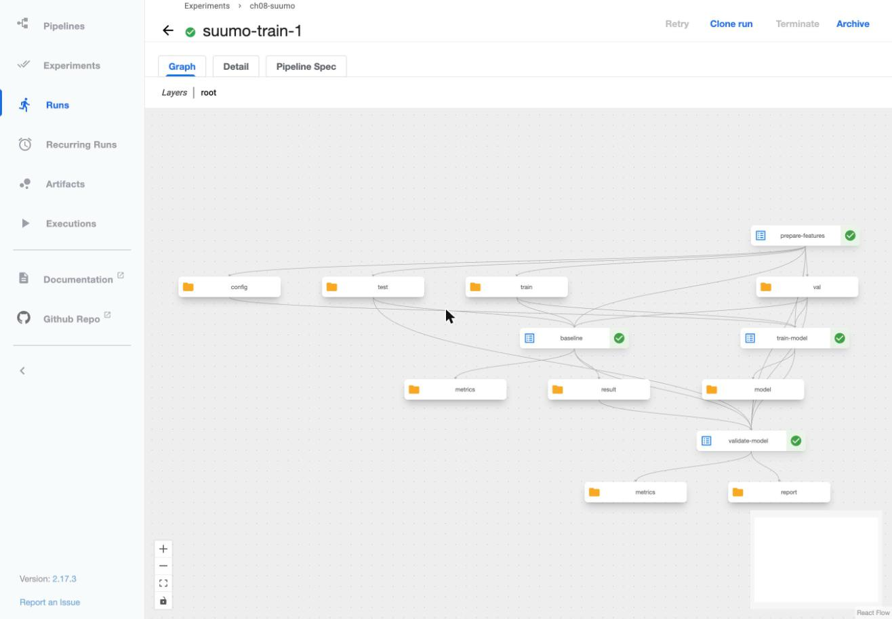
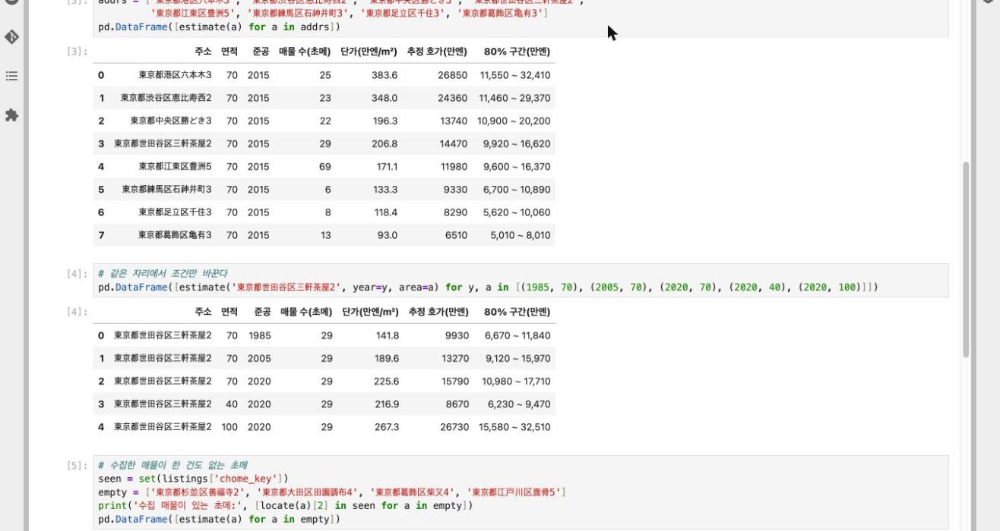
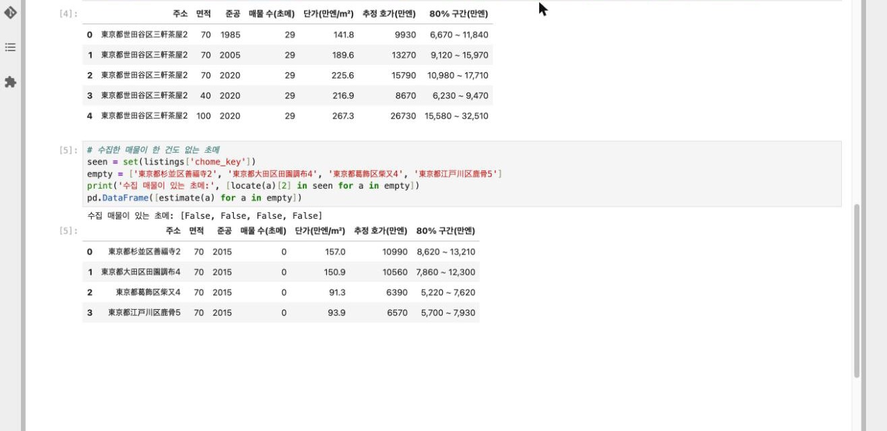

7장에서는 데이터를 가져와 정제하고, 좌표를 붙여 train / val / test 로 나누는 작업까지 끝냈다. 8장에서는 이 데이터로 m²당 단가 회귀 모델을 학습하고 검증한다.

## 1. 한눈에 보기

### 1.1 사용 데이터

7장에서 만들어 둔 파일 네 개를 그대로 읽는다. 위치는 `s3://datasets/suumo/prepared/2026-11-13/` 이다.

| 파일 | 매물 수 | 어디에 쓰나 |
| --- | ---: | --- |
| `train.parquet` | 17,803 | 모델이 공부하는 데이터 |
| `val.parquet` | 3,878 | 공부를 언제 멈출지 정하는 데이터 |
| `test.parquet` | 2,435 | 마지막에 한 번만 보는 시험 데이터 |
| `chome.parquet` | 5,390 | 주소를 좌표로 바꾸는 표 (초메(丁目)별 위도, 경도) |

세 데이터는 초메(丁目) 단위로 나뉘어 있어, 같은 초메의 매물이 두 곳에 함께 들어가지 않는다. 그래서 시험 점수는 **모델이 한 번도 보지 못한 동네**에서 얼마나 맞히는지를 뜻한다. "매물이 없는 자리의 호가를 알려 준다" 는 목표와 같은 상황이다.

> **핸즈온ML 보강**: [테스트 세트 만들기](../../hands-on-machine/hands-on-ml-02-2-split-to-launch/#test-set) · [데이터 스누핑 편향](../../hands-on-machine/hands-on-ml-02-2-split-to-launch/#data-snooping) · [해시 기반 분할](../../hands-on-machine/hands-on-ml-02-2-split-to-launch/#hash-split)

### 1.2 만들 모델

- **맞힐 값**
  -  m²당 단가(만엔)이다. 가격은 단가에 면적을 곱해 구한다.
- **넣는 값**
  -  위치(위도, 경도)와 매물 조건(면적, 준공 연도, 층, 역까지 도보 분, 방 구조, 건물 구조, 방향) 10개이다.
- **모델**
  -  표 형태 데이터에 강한 LightGBM 을 쓴다.
- **내놓는 값**
  -  추정 단가 하나와, 실제 단가가 80% 확률로 들어가는 구간이다. 그래서 모델을 세 개(추정값, 구간 아래, 구간 위) 학습한다.

잘 만들어졌는지는 두 가지로 판단한다.

| 기준 | 뜻 |
| --- | --- |
| 오차가 기준선보다 작다 | 모델 없이 "그 동네 중앙 단가" 로 찍는 것보다 잘 맞혀야 한다 |
| 구간 적중률이 75 ~ 85% | 80% 구간이라고 했으면 실제로 열 번 중 여덟 번쯤 맞아야 한다 |

오차는 MAPE 로 잰다. 실제 단가에서 평균 몇 % 벗어났는지를 뜻하고, 작을수록 좋다.

> **핸즈온ML 보강**: [RMSE와 MAE](../../hands-on-machine/hands-on-ml-02-2-split-to-launch/#rmse-mae) · [문제 정의와 가정 검사](../../hands-on-machine/hands-on-ml-02-2-split-to-launch/#problem-framing)

### 1.3 진행 단계


- **A. 기준선**
  -  모델 없이 동네 중앙 단가로 찍으면 얼마나 틀리는지 먼저 잰다. 모델이 넘어야 할 선이다.
- **B. 학습 컴포넌트**
  -  어떤 값을 넣을지 정하고, 학습 코드를 작성해 노트북에서 시험한다.
- **C. 컨테이너 컴포넌트**
  -  학습 코드를 이미지에 넣어 파이프라인에서 돌릴 수 있게 한다.
- **D. 검증 컴포넌트**
  -  시험 데이터로 채점하고 기준선과 비교한다.
- **E. 파이프라인과 실행**
  -  위 단계를 하나로 이어 KFP 에서 실행한다.
- **F. 모델 확인**
  -  저장된 모델을 다시 불러 주소 몇 개로 호가를 예측해 본다.

코드는 `k8s/kubeflow-pipelines/08-suumo/` 에 있다. 파이프라인은 `suumo_train.py`, 학습 이미지는 `train-image/` 이다.

## 2. 기준선

모델 없이 찍는 방법 세 가지를 먼저 잰다. train 에서 중앙 단가를 구해 두고, val 과 test 의 매물에 그 값을 그대로 답으로 낸다.

| 방법 | 찍는 값 |
| --- | --- |
| 전체 중앙값 | train 전체의 중앙 단가 하나 |
| 구 중앙값 | 그 매물이 속한 구(区)의 중앙 단가 |
| 동 중앙값 | 그 매물이 속한 동(町名)의 중앙 단가. 동이 train 에 없으면 구 중앙값 |

초메(丁目) 중앙값은 쓸 수 없다. 분할이 초메 단위라서 val 과 test 의 초메는 train 에 하나도 없기 때문이다. 동까지 올리면 val 매물의 92.2%, test 매물의 89.1% 가 train 에 있는 동에 속한다.

```python {title="suumo_train.py (baseline 부분)"}
town = lambda d: d["chome_key"].str.replace(r"\d+$", "", regex=True)   # 초메 번호를 뗀 구+동
by_ward = tr.groupby("区名")["unit_price"].median()
by_town = tr.groupby(town(tr))["unit_price"].median()
preds = {
    "global": np.full(len(d), tr["unit_price"].median()),
    "ward": d["区名"].map(by_ward).values,
    "town": town(d).map(by_town).fillna(d["区名"].map(by_ward)).values,   # 동이 train 에 없으면 구 중앙값
}
```

| 방법 | val MAE | val MAPE | test MAE | test MAPE |
| --- | ---: | ---: | ---: | ---: |
| 전체 중앙값 | 80.7 | 49.5% | 68.2 | 46.1% |
| 구 중앙값 | 58.1 | 33.6% | 52.0 | 34.3% |
| 동 중앙값 | 57.1 | 32.9% | 49.4 | **32.5%** |

MAE 의 단위는 만엔/m² 이다. 가장 나은 기준선은 동 중앙값이고, 모델이 넘어야 할 선은 **test MAPE 32.5%** 이다.

> **핸즈온ML 보강**: [훈련 세트에서 먼저 재 보기](../../hands-on-machine/hands-on-ml-02-2-split-to-launch/#model-selection) · [k-폴드 교차 검증](../../hands-on-machine/hands-on-ml-02-2-split-to-launch/#cross-validation)

## 3. 학습 컴포넌트

### 3.1 피처 설정

`prepare_features` 컴포넌트가 버킷의 Parquet 세 개에서 쓸 컬럼만 골라 `Dataset` 으로 넘기고, 어떤 컬럼을 어떻게 쓸지를 `features.yaml` 로 남긴다. 학습 스크립트는 이 파일만 읽으므로, 피처를 바꿀 때 학습 코드는 고치지 않는다.

```yaml {title="features.yaml (내용)"}
target: unit_price
numeric: [lat, lon, 専有面積_m2, 築年, 所在階_階, 総階数, 最短徒歩分]
categorical: [間取り, 構造, 向き]
keys: [物件ID, 区名, chome_key]
quantiles: [0.1, 0.9]
```

| 구분 | 피처 | 뜻 |
| --- | --- | --- |
| 수치 | `lat`, `lon` | 초메(丁目) 대표점의 위도, 경도 |
| 수치 | `専有面積_m2` | 전용 면적(専有面積) |
| 수치 | `築年` | 준공 연도(築年) |
| 수치 | `所在階_階`, `総階数` | 소재 층(所在階), 건물 총 층수(総階数) |
| 수치 | `最短徒歩分` | 가장 가까운 역까지 도보 분(徒歩分) |
| 범주 | `間取り`, `構造`, `向き` | 방 구조(間取り), 건물 구조(構造), 방향(向き) |

`keys` 는 학습에 넣지 않고 기준선과 리포트에서만 쓴다. 결측은 그대로 둔다. LightGBM 이 결측을 직접 다루기 때문이다.

> **핸즈온ML 보강**: [결측치 처리(SimpleImputer)](../../hands-on-machine/hands-on-ml-02-2-split-to-launch/#imputer) · [범주형 특성 인코딩](../../hands-on-machine/hands-on-ml-02-2-split-to-launch/#categorical)

구(区)와 가까운 역(最寄駅)을 범주로 넣을지는 노트북에서 비교해 정했다.

| 피처 구성 | val MAPE | test MAPE |
| --- | ---: | ---: |
| 수치 7개 | 15.46% | 13.34% |
| 수치 7개 + 방 구조, 구조, 방향 | **15.55%** | **13.44%** |
| 위에 구(区) 추가 | 15.66% | 13.79% |
| 위에 구(区), 가까운 역(最寄駅) 추가 | 16.15% | 12.90% |

네 구성의 차이는 1%p 안쪽이다. 구와 역은 좌표가 이미 담고 있는 정보라 더해도 나아지지 않았다. 그래서 주소와 매물 조건만 있으면 추론할 수 있는 두 번째 구성을 쓴다.

> **핸즈온ML 보강**: [범주형 특성 인코딩](../../hands-on-machine/hands-on-ml-02-2-split-to-launch/#categorical) · [특성 조합](../../hands-on-machine/hands-on-ml-02-2-split-to-launch/#feature-combo) · [데이터 스누핑 편향](../../hands-on-machine/hands-on-ml-02-2-split-to-launch/#data-snooping)

### 3.2 학습 스크립트

학습 코드는 컴포넌트 함수가 아니라 독립 스크립트 `train.py` 로 둔다. 인자로 경로만 받으므로 노트북, 로컬, 파이프라인 어디서나 같은 명령으로 돈다.

```python {title="train-image/train.py (핵심 부분)"}
y_tr, y_va = np.log(tr[target]), np.log(va[target])     # 단가는 오른쪽 꼬리가 길어 log 로 학습한다

base = dict(learning_rate=a.learning_rate, num_leaves=a.num_leaves, min_data_in_leaf=20, feature_fraction=0.8,
            bagging_fraction=0.8, bagging_freq=1, lambda_l2=1.0, verbose=-1, seed=42)
objectives = {"p50": {"objective": "regression"},
              "p10": {"objective": "quantile", "alpha": cfg["quantiles"][0]},
              "p90": {"objective": "quantile", "alpha": cfg["quantiles"][1]}}
for name, obj in objectives.items():
    d_tr = lgb.Dataset(x_tr, y_tr)
    m = lgb.train({**base, **obj}, d_tr, a.num_boost_round, valid_sets=[lgb.Dataset(x_va, y_va, reference=d_tr)],
                  callbacks=[lgb.early_stopping(a.early_stopping_rounds, verbose=False)])
    m.save_model(os.path.join(a.model_dir, QUANTILE_FILES[name]), num_iteration=m.best_iteration)
```

- **모델 세 개**: `p50` 이 추정값을 내고, `p10` 과 `p90` 이 80% 구간의 아래와 위를 낸다.
- **조기 종료**: val 손실이 100회 동안 나아지지 않으면 멈추고, 가장 좋았던 회차까지만 저장한다.
- **범주 처리**: 범주 목록은 train 에서 만들어 `meta.json` 에 함께 저장한다. 예측할 때 처음 보는 값은 결측으로 처리한다.

모델을 읽고 예측하는 코드는 `suumo_model.py` 로 따로 두었다. 학습 스크립트, 검증 컴포넌트, 노트북이 이 파일 하나를 함께 쓴다.

> **핸즈온ML 보강**: [타깃 변환(로그와 역변환)](../../hands-on-machine/hands-on-ml-02-2-split-to-launch/#transforms) · [사용자 정의 변환기와 파이프라인](../../hands-on-machine/hands-on-ml-02-2-split-to-launch/#custom-transformer)

### 3.3 구간 보정

분위 모델이 낸 구간은 val 에서 실제 단가의 69.9% 만 담았다. 80% 구간이라고 부르기에는 좁다. 그래서 val 에서 구간을 벗어난 정도를 재고, 80% 가 들어오도록 양쪽을 같은 폭만큼 넓힌다.

```python {title="train-image/train.py (구간 보정)"}
miss = np.maximum(pred["p10"] - y_va, y_va - pred["p90"])       # 구간 밖이면 양수, 안이면 음수
offset = float(np.quantile(miss, min(1.0, level * (1 + 1 / len(miss)))))   # level = 0.8
```

보정값은 log 단위로 0.0513 이다. 구간의 아래와 위를 각각 약 5.3% 씩 넓히는 셈이고, 이 값도 `meta.json` 에 저장한다.

| | 보정 전 | 보정 후 |
| --- | ---: | ---: |
| val 적중률 | 69.9% | 80.0% |
| test 적중률 | | 81.0% |

보정값은 val 로 구했으므로 val 적중률이 80% 인 것은 당연하다. 보지 않은 test 에서도 81.0% 가 나온 것이 확인할 숫자이다.

> **핸즈온ML 보강**: [테스트 세트로 평가(신뢰 구간)](../../hands-on-machine/hands-on-ml-02-2-split-to-launch/#test-evaluation) · [데이터 스누핑 편향](../../hands-on-machine/hands-on-ml-02-2-split-to-launch/#data-snooping)

## 4. 컨테이너 컴포넌트

LightGBM 은 시스템 라이브러리 `libgomp1` 이 있어야 import 된다. 이 라이브러리는 pip 가 아니라 apt 로 설치하는 것이라, `packages_to_install` 로는 넣을 수 없다. 그래서 학습은 필요한 것을 모두 넣은 이미지를 만들고, 그 이미지와 실행 명령을 직접 지정하는 **컨테이너 컴포넌트**로 돌린다.

```dockerfile
FROM python:3.11-slim

RUN apt-get update && apt-get install -y --no-install-recommends libgomp1 && rm -rf /var/lib/apt/lists/*
RUN pip install --no-cache-dir lightgbm==4.7.0 pandas==3.1.1 pyarrow==26.0.1 pyyaml==6.0.3

WORKDIR /app
COPY suumo_model.py train.py /app/
```

컴포넌트는 함수 본문 대신 `ContainerSpec` 을 돌려준다. 입력과 출력 아티팩트는 `.path` 로 경로만 넘긴다.

```python {title="suumo_train.py (train_model)"}
@dsl.container_component
def train_model(train: Input[Dataset], val: Input[Dataset], config: Input[Artifact], num_boost_round: int,
                learning_rate: float, num_leaves: int, model: Output[Model]):
    return dsl.ContainerSpec(
        image=TRAIN_IMAGE,
        command=["python", "/app/train.py"],
        args=["--train", train.path, "--val", val.path, "--config", config.path, "--model-dir", model.path,
              "--num-boost-round", num_boost_round, "--learning-rate", learning_rate, "--num-leaves", num_leaves],
    )
```

컴파일된 YAML 에서 이 컴포넌트는 명령과 자리표시자만 남는다. 실행할 때 KFP 가 자리표시자를 실제 경로와 값으로 바꾼다.

```yaml {title="suumo_train.yaml (exec-train-model 발췌)"}
exec-train-model:
  container:
    args:
    - --train
    - '{{$.inputs.artifacts[''train''].path}}'
    - --model-dir
    - '{{$.outputs.artifacts[''model''].path}}'
    - --learning-rate
    - '{{$.inputs.parameters[''learning_rate'']}}'
    command:
    - python
    - /app/train.py
    image: docker.io/hyeonjae0913/suumo-train:1.0.0
```

7장에서 쓴 두 방식과 비교하면 이렇다.

| | 경량 파이썬 컴포넌트 | 컨테이너화된 파이썬 컴포넌트 | 컨테이너 컴포넌트 |
| --- | --- | --- | --- |
| 실행하는 것 | YAML 에 든 함수 본문 | 이미지 안의 함수 | 이미지 안의 아무 명령 |
| 이미지에 `kfp` | 실행할 때 설치 | 빌드할 때 설치 | 필요 없다 |
| 시스템 라이브러리 | 기본 이미지에 있는 것만 | Dockerfile 을 고치면 가능 | 자유롭게 넣는다 |
| 아티팩트 메타데이터 | `log_metric` 등으로 기록 | 같다 | 파일만 쓴다. 지표는 다음 컴포넌트가 기록한다 |

학습 이미지는 amd64 서버에서 빌드해 Docker Hub 에 올렸다.

```terminal {title="학습 이미지 빌드와 push"}
$ docker build -t hyeonjae0913/suumo-train:1.0.0 train-image
$ docker run --rm hyeonjae0913/suumo-train:1.0.0 python -c "import lightgbm, pandas, pyarrow; print(lightgbm.__version__, pandas.__version__, pyarrow.__version__)"
4.7.0 3.1.1 26.0.1
$ docker push docker.io/hyeonjae0913/suumo-train:1.0.0
```

| 이미지 | 크기 (압축 해제) | 레지스트리에서 받는 크기 |
| --- | ---: | ---: |
| `python:3.11-slim` | 186MB | |
| `suumo-train:1.0.0` | 868MB | 204MB |

> **핸즈온ML 보강**: [재현 가능하게 남기기](../../hands-on-machine/hands-on-ml-02-2-split-to-launch/#reproducibility)

## 5. 검증 컴포넌트

검증은 지표를 `Metrics` 로 기록해야 하므로 파이썬 컴포넌트로 만든다. `base_image` 를 학습 이미지로 두면 학습 때와 같은 LightGBM 으로 모델을 읽고, 이미지 안의 `suumo_model.py` 도 그대로 가져다 쓴다.

```python {title="suumo_train.py (validate_model 핵심 부분)"}
@dsl.component(base_image=TRAIN_IMAGE)
def validate_model(model: Input[Model], val: Input[Dataset], test: Input[Dataset], baseline_result: Input[Artifact],
                   metrics: Output[Metrics], report: Output[Markdown]):
    sys.path.insert(0, "/app")                 # 학습 이미지 안의 공용 코드
    from suumo_model import SuumoModel

    m = SuumoModel(model.path)
    ...
    checks = [
        ("test MAPE 가 동 중앙값 기준선보다 낮다", f"< {best_base:.1%}", f"{score['test']['mape']:.1%}", score["test"]["mape"] < best_base),
        ("test 80% 구간 적중률", "75% ~ 85%", f"{score['test']['coverage']:.1%}", 0.75 <= score["test"]["coverage"] <= 0.85),
    ]
    ...
    assert passed, "검증 실패: " + ", ".join(n for n, _, _, ok in checks if not ok)
```

- **입력**: 학습 컴포넌트의 `Model`, val·test `Dataset`, 기준선 컴포넌트의 결과 파일
- **지표**: val 과 test 각각의 MAE, MAPE, 구간 적중률, 구간 폭. 그리고 기준선 대비 개선율
- **리포트**: 검사표, 기준선과 모델 비교표, test 에서 구별 MAPE 를 `Markdown` 으로 남긴다
- **통과 기준**: 두 검사 중 하나라도 어긋나면 `assert` 로 실패시켜 run 이 빨갛게 끝난다

> **핸즈온ML 보강**: [테스트 세트로 평가](../../hands-on-machine/hands-on-ml-02-2-split-to-launch/#test-evaluation) · [최상의 모델 분석](../../hands-on-machine/hands-on-ml-02-2-split-to-launch/#error-analysis)

## 6. 파이프라인과 실행

컴포넌트 네 개를 잇는다. `prepare_features` 의 출력이 학습과 기준선으로 갈라지고, 둘의 결과가 `validate_model` 에서 만난다.

```python {title="suumo_train.py (pipeline)"}
@dsl.pipeline(name="suumo-train", description="8장: 7장이 준비한 데이터로 m²당 단가 회귀 모델을 학습하고 검증한다")
def pipeline(num_boost_round: int = 5000, learning_rate: float = 0.05, num_leaves: int = 63,
             bucket: str = RAW_BUCKET, prefix: str = f"suumo/prepared/{SNAPSHOT}"):
    feats = with_s3(prepare_features(bucket=bucket, prefix=prefix, endpoint=S3_ENDPOINT))
    base = amd64(baseline(train=feats.outputs["train"], val=feats.outputs["val"], test=feats.outputs["test"]))
    trained = amd64(train_model(train=feats.outputs["train"], val=feats.outputs["val"], config=feats.outputs["config"],
                                num_boost_round=num_boost_round, learning_rate=learning_rate, num_leaves=num_leaves))
    checked = amd64(validate_model(model=trained.outputs["model"], val=feats.outputs["val"], test=feats.outputs["test"],
                                   baseline_result=base.outputs["result"]))
```

하이퍼파라미터 세 개는 파이프라인 인자로 두었다. 값을 바꿔 다시 돌릴 때 코드를 고치지 않고 run 을 만들 때 넣는다.

> **핸즈온ML 보강**: [그리드 서치와 랜덤 서치](../../hands-on-machine/hands-on-ml-02-2-split-to-launch/#grid-search)

```terminal {title="개발 PC: 컴파일, 등록, 실행"}
$ python suumo_train.py
$ KFP_HOST=http://192.168.0.242 KFP_EXPERIMENT=ch08-suumo python ../07-suumo/run_registered.py suumo_train.yaml suumo-train suumo-train-1
run_id=950963a5-e9ae-4136-8362-cde980549e2a FINAL=SUCCEEDED took=101s
```



| 컴포넌트 | 시간 | 결과 |
| --- | --- | --- |
| `prepare_features` | 20초 | train 17,803행, val 3,878행, test 2,435행, 컬럼 14개 |
| `baseline` | 21초 | test MAPE: 전체 46.1%, 구 34.3%, 동 32.5% |
| `train_model` | 31초 | `p50` 449회, `p10` 86회, `p90` 388회에서 조기 종료 |
| `validate_model` | 10초 | 검사 2개 **모두 PASS** |

run 전체는 101초가 걸렸다. `train_model` 의 31초 가운데 13초는 노드가 학습 이미지를 처음 받는 시간이고, 학습 자체는 모델 세 개를 합쳐 2초 안쪽이다.

```terminal {title="train_model 로그"}
[ch08] train=17803 val=3878 features=10 lightgbm=4.7.0
[ch08] p50 best_iteration=449 0.7s
[ch08] p10 best_iteration=86 0.3s
[ch08] p90 best_iteration=388 0.9s
[ch08] val MAE=28.75 MAPE=15.55% coverage_raw=0.699 interval_offset=0.0513
[ch08] saved ['meta.json', 'p10.txt', 'p50.txt', 'p90.txt']
```

**검증 결과**

| 방법 | val MAE | val MAPE | test MAE | test MAPE |
| --- | ---: | ---: | ---: | ---: |
| 동 중앙값 (기준선) | 57.1 | 32.9% | 49.4 | 32.5% |
| **LightGBM** | **28.7** | **15.5%** | **22.7** | **13.4%** |

본 적 없는 초메의 매물에서 단가를 평균 13.4% 오차로 맞힌다. 기준선의 오차 32.5% 를 58.7% 줄였다.


지표는 `Metrics` 로 남아 run 마다 숫자로 비교할 수 있다.


구별로 보면 오차가 고르지 않다.

| test 에서 MAPE 가 낮은 구 | MAPE | 매물 수 | MAPE 가 높은 구 | MAPE | 매물 수 |
| --- | ---: | ---: | --- | ---: | ---: |
| 아라카와구(荒川区) | 9.8% | 42 | 세타가야구(世田谷区) | 16.1% | 191 |
| 에도가와구(江戸川区) | 10.3% | 39 | 스미다구(墨田区) | 16.2% | 70 |
| 도시마구(豊島区) | 10.8% | 105 | 아다치구(足立区) | 19.1% | 87 |

> **핸즈온ML 보강**: [서브셋별 오차 분석](../../hands-on-machine/hands-on-ml-02-2-split-to-launch/#error-analysis) · [계층적 샘플링](../../hands-on-machine/hands-on-ml-02-2-split-to-launch/#stratified)

**모델이 본 것**

`p50` 모델의 피처 중요도(gain 비율)이다.

| 피처 | 비율 |
| --- | ---: |
| 준공 연도(築年) | 35.5% |
| 위도, 경도 | 46.0% (27.6% + 18.4%) |
| 총 층수(総階数) | 7.1% |
| 전용 면적(専有面積) | 5.5% |
| 도보 분(徒歩分) | 3.4% |
| 소재 층(所在階) | 1.1% |
| 방 구조, 건물 구조, 방향 | 1.4% |

위치와 준공 연도가 80% 이상을 차지한다. 7장에서 본 "위치가 가장 큰 변수" 와 같은 결과이다.

> **핸즈온ML 보강**: [특성 중요도](../../hands-on-machine/hands-on-ml-02-2-split-to-launch/#error-analysis) · [지리적 산점도](../../hands-on-machine/hands-on-ml-02-2-split-to-launch/#geo-scatter) · [군집 유사도 변환기(ClusterSimilarity)](../../hands-on-machine/hands-on-ml-02-2-split-to-launch/#custom-transformer)

**모델 아티팩트**

`train_model` 의 `Model` 아티팩트는 폴더 하나이고, 안에 파일 네 개가 있다.

| 파일 | 크기 | 내용 |
| --- | ---: | --- |
| `p50.txt` | 2.58MB | 추정값 모델 |
| `p10.txt` | 0.49MB | 구간 아래쪽 모델 |
| `p90.txt` | 2.21MB | 구간 위쪽 모델 |
| `meta.json` | 2KB | 피처 목록, 범주 목록, 구간 보정값, 학습 기록 |

## 7. 모델 확인

지표가 통과해도 모델이 실제로 쓸 만한 답을 내는지는 따로 본다. 노트북에서 run 이 남긴 `Model` 아티팩트를 버킷에서 내려받아, 주소와 조건을 넣고 추정 호가를 뽑았다.

```python {title="notebooks/model_check.ipynb (핵심 부분)"}
model = SuumoModel("model_from_run")          # run 950963a5 의 train-model 아티팩트
locate = make_locator(rd("chome"))            # 7장의 address.py

def estimate(addr, area=70, year=2015, floor=5, floors=10, walk=7, layout="3LDK", structure="RC", facing="南"):
    lat, lon, key, level = locate(addr)
    row = pd.DataFrame([{"lat": lat, "lon": lon, "専有面積_m2": area, "築年": year, "所在階_階": floor, "総階数": floors,
                         "最短徒歩分": walk, "間取り": layout, "構造": structure, "向き": facing}])
    return model.predict(row).iloc[0]
```

주소를 좌표로 바꾸는 코드는 7장의 `address.py`, 모델을 읽는 코드는 학습 이미지의 `suumo_model.py` 와 같은 파일이다.

> **핸즈온ML 보강**: [모델 저장과 서빙](../../hands-on-machine/hands-on-ml-02-2-split-to-launch/#model-serving) · [모니터링과 재학습](../../hands-on-machine/hands-on-ml-02-2-split-to-launch/#monitoring)

**같은 조건, 다른 동네**

조건은 전용 면적 70m², 2015년 준공, 10층 건물의 5층, 역까지 도보 7분, 3LDK, RC 구조, 남향(南)으로 고정했다.

| 주소 | 단가 (만엔/m²) | 추정 호가 (만엔) | 80% 구간 (만엔) |
| --- | ---: | ---: | --- |
| 미나토구 롯폰기(港区六本木) 3초메 | 383.6 | 26,850 | 11,550 ~ 32,410 |
| 시부야구 에비스니시(渋谷区恵比寿西) 2초메 | 348.0 | 24,360 | 11,460 ~ 29,370 |
| 세타가야구 산겐자야(世田谷区三軒茶屋) 2초메 | 206.8 | 14,470 | 9,920 ~ 16,620 |
| 주오구 가치도키(中央区勝どき) 3초메 | 196.3 | 13,740 | 10,900 ~ 20,200 |
| 고토구 도요스(江東区豊洲) 5초메 | 171.1 | 11,980 | 9,600 ~ 16,370 |
| 네리마구 샤쿠지이마치(練馬区石神井町) 3초메 | 133.3 | 9,330 | 6,700 ~ 10,890 |
| 아다치구 센주(足立区千住) 3초메 | 118.4 | 8,290 | 5,620 ~ 10,060 |
| 가쓰시카구 가메아리(葛飾区亀有) 3초메 | 93.0 | 6,510 | 5,010 ~ 8,010 |

도심에서 외곽으로 갈수록 단가가 내려가고, 가장 비싼 곳과 싼 곳의 차이는 약 4배이다.

**같은 동네, 다른 조건**

세타가야구 산겐자야(世田谷区三軒茶屋) 2초메에서 준공 연도와 면적만 바꿨다.

| 준공 | 면적 | 단가 (만엔/m²) | 추정 호가 (만엔) | 80% 구간 (만엔) |
| --- | ---: | ---: | ---: | --- |
| 1985년 | 70m² | 141.8 | 9,930 | 6,670 ~ 11,840 |
| 2005년 | 70m² | 189.6 | 13,270 | 9,120 ~ 15,970 |
| 2020년 | 70m² | 225.6 | 15,790 | 10,980 ~ 17,710 |
| 2020년 | 40m² | 216.9 | 8,670 | 6,230 ~ 9,470 |
| 2020년 | 100m² | 267.3 | 26,730 | 15,580 ~ 32,510 |

새 건물일수록 단가가 오르고, 넓은 집은 단가도 더 높게 나온다.



**매물이 없는 초메**

수집한 매물이 한 건도 없는 초메 네 곳에도 같은 조건을 넣었다. 처음 세운 목표인 "지금 매물이 없는 자리의 호가" 에 해당하는 경우이다.

| 주소 | 수집 매물 | 단가 (만엔/m²) | 추정 호가 (만엔) | 80% 구간 (만엔) |
| --- | ---: | ---: | ---: | --- |
| 스기나미구 젠푸쿠지(杉並区善福寺) 2초메 | 0 | 157.0 | 10,990 | 8,620 ~ 13,210 |
| 오타구 덴엔초후(大田区田園調布) 4초메 | 0 | 150.9 | 10,560 | 7,860 ~ 12,300 |
| 가쓰시카구 시바마타(葛飾区柴又) 4초메 | 0 | 91.3 | 6,390 | 5,220 ~ 7,620 |
| 에도가와구 시시보네(江戸川区鹿骨) 5초메 | 0 | 93.9 | 6,570 | 5,700 ~ 7,930 |


