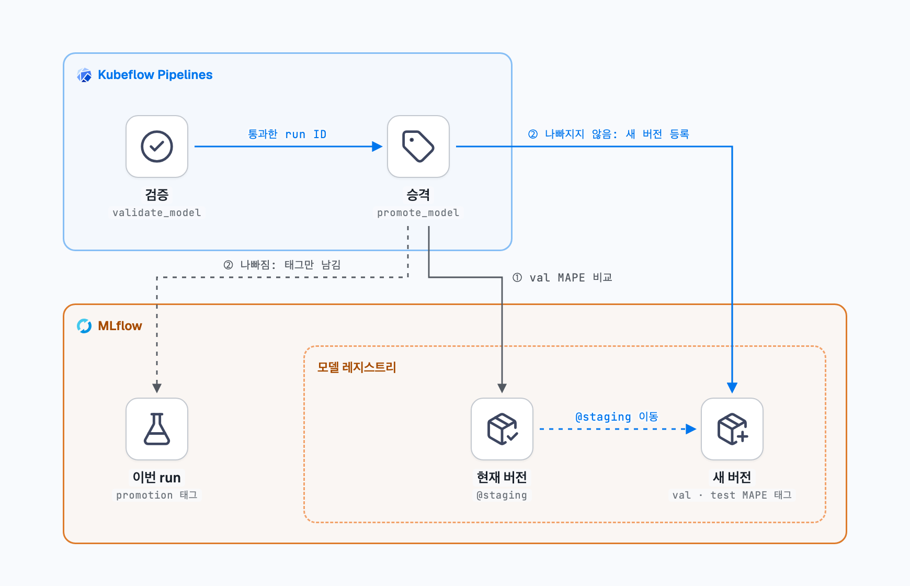
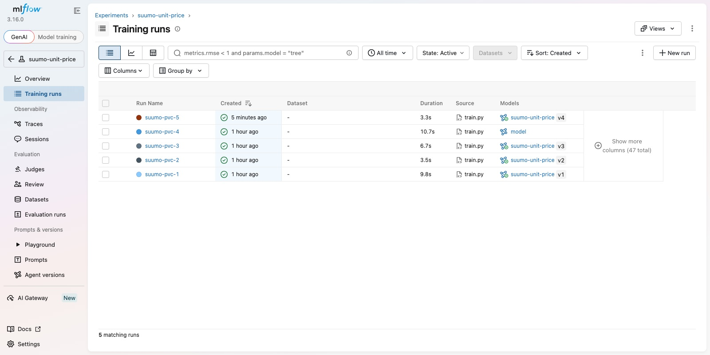

[8장](../mlpe-08-1-suumo-training/)에서는 m²당 단가 회귀 모델을 학습하고 검증하는 파이프라인을 만들었다. 9장에서는 모델은 그대로 두고, 같은 파이프라인에 데이터 공유(PVC), 학습 과정 시각화(TensorBoard), 실험 추적과 모델 버전 관리(MLflow)를 진행한다.

## 1. 한눈에 보기

![9장 전체 흐름. 위쪽 Kubeflow Pipelines 묶음 안에서 데이터 받기(fetch_dataset), 학습 전 QA(qa_data), 학습(train_model), 검증(validate_model), 승격(promote_model)이 파란 화살표로 이어지고, 기준선(baseline)은 QA 에서 갈라져 검증으로 들어간다. 왼쪽 S3 호환 버킷의 train, val, test 가 데이터 받기로 들어간다. 아래 왼쪽 PVC 묶음에는 dataset 과 tensorboard 폴더가 있다. 데이터 받기가 dataset 에 한 번 저장하고 학습이 그것을 읽으며, 학습은 회차별 손실을 tensorboard 폴더에 쓰고 TensorBoard 가 그 폴더를 읽는다. 아래 오른쪽 MLflow 묶음에는 run 과 모델 레지스트리가 있다. 학습은 run 에 파라미터, 지표, 모델을 기록하고, 검증은 run 에서 모델을 읽고 지표를 더하며, 승격은 비교 후 모델 레지스트리의 staging 에 등록한다.](ch9-overview-stack.png)

- **A. PVC 로 데이터 공유**
  - 버킷의 학습 데이터를 공유 디스크(PVC)에 한 번만 내려받는다. 학습, 검증 같은 뒤 단계는 버킷에서 다시 받지 않고 그 디스크의 파일을 읽는다.
- **B. 학습 전 QA**
  - 학습을 시작하기 전에 데이터가 기대한 모양인지 검사한다. 필요한 컬럼이 다 있는지, 단가에 빈 값이나 0 이하가 없는지, train 과 test 에 같은 동네가 섞이지 않았는지를 본다. 하나라도 어긋나면 학습을 시작하지 않는다.
- **C. TensorBoard**
  - 8장에서 쓴 LightGBM 은 작은 결정 트리를 하나씩 더해 가며 오차를 줄이는 모델이고, 트리 하나를 더하는 것을 한 회차라고 한다. 회차마다 오차(손실)를 공유 디스크에 적어 두고, TensorBoard 화면에서 오차가 내려가는 곡선을 본다. 몇 회차부터 더 나아지지 않는지가 그래프로 보인다.
- **D. MLflow 실험 추적**
  - 학습을 한 번 돌릴 때마다 어떤 설정(하이퍼파라미터)으로 돌렸는지, 점수(지표)가 얼마였는지, 만들어진 모델 파일까지 MLflow 에 기록 한 건(run)으로 남긴다. 검증 단계에는 모델 파일 대신 그 기록의 번호(run ID)만 넘긴다. 검증은 번호로 MLflow 에서 모델을 찾아 읽는다.
- **E. 모델 레지스트리와 승격**
  - 모델 레지스트리는 "지금 쓰는 모델" 을 이름과 버전으로 관리하는 곳이다. 현재 쓰는 버전에는 `staging` 이라는 이름표가 붙어 있다. 새 모델이 검증을 통과하면 그 버전과 점수를 비교해, 나빠지지 않았을 때만 새 버전으로 등록하고 이름표를 옮긴다.
- **F. 파이프라인과 실행**
  - 위 단계를 파이프라인 하나로 이어 KFP 에서 실행한다. 학습 설정을 바꿔 가며 네 번 돌리고, MLflow 에 쌓인 기록 네 건을 표로 놓고 어느 설정이 가장 나은지 비교한다. 다섯 번째는 처음부터 학습하지 않고 가장 나은 모델에서 이어 학습한다.
- **G. 레지스트리의 모델 확인**
  - 노트북에서 `staging` 이름표가 붙은 모델을 불러 주소 몇 개의 호가를 예측해 본다. 이어서 그 모델이 어느 실행에서, 어떤 데이터와 설정으로 만들어졌는지를 기록을 따라 거꾸로 찾아본다. 확인이 끝나면 운영용이라는 뜻의 `prod` 이름표를 붙인다.

## 2. PVC 로 데이터 공유

8장의 `prepare_features` 는 버킷에서 Parquet 세 개를 받아 `Dataset` 아티팩트로 내보냈다. 아티팩트는 다시 버킷에 올라가고, 기준선, 학습, 검증 컴포넌트가 각각 내려받는다. 데이터가 커질수록 같은 파일을 올리고 받는 시간이 run 마다 반복된다.

### 2.1 PVC 만들기

Kubernetes 기능은 `kfp-kubernetes` 패키지가 제공한다. 8장에서 Secret 과 노드 선택에 쓴 것과 같은 패키지이다.

```python {title="suumo_train_pvc.py (PVC 생성)"}
from kfp import kubernetes

pvc = kubernetes.CreatePVC(pvc_name_suffix="-suumo-train", access_modes=["ReadWriteOnce"], size="1Gi",
                           storage_class_name="local-path")
name = pvc.outputs["name"]
```

- **`pvc_name_suffix`**: 이름을 고정하지 않고 뒤에 붙일 말만 준다. run 마다 고유한 ID 가 앞에 붙은 `<ID>-suumo-train` 이라는 PVC 가 새로 생겨 run 끼리 겹치지 않는다.
- **`access_modes`**: `ReadWriteOnce` 는 노드 하나에서만 읽고 쓸 수 있다. 태스크를 모두 같은 노드에 올리므로 이것으로 충분하다.
- **`storage_class_name`**: 클러스터마다 다르다. 여기서는 노드의 로컬 디스크를 쓰는 `local-path` 이다.

### 2.2 볼륨 붙이기

태스크에 PVC 를 붙이는 일은 `mount_pvc` 가 한다. 태스크마다 반복되므로 함수 하나로 묶었다.

```python {title="common.py"}
MOUNT_PATH = "/data"

def with_volume(task, pvc_name):
    kubernetes.mount_pvc(task, pvc_name=pvc_name, mount_path=MOUNT_PATH)
    return amd64(task)
```

데이터를 받는 컴포넌트는 출력 아티팩트가 없다. 버킷에서 받은 Parquet 을 `/data/dataset/` 에 쓰고 끝난다.

```python {title="suumo_train_pvc.py (fetch_dataset 핵심 부분)"}
@dsl.component(base_image="python:3.11", packages_to_install=["boto3", "pandas", "pyarrow", "pyyaml"])
def fetch_dataset(bucket: str, prefix: str, endpoint: str) -> int:
    os.makedirs("/data/dataset", exist_ok=True)
    s3 = boto3.client("s3", endpoint_url=endpoint)
    for name in ("train", "val", "test"):
        body = s3.get_object(Bucket=bucket, Key=f"{prefix}/{name}.parquet")["Body"].read()
        df = pd.read_parquet(io.BytesIO(body))[cols]
        df.to_parquet(f"/data/dataset/{name}.parquet", index=False)
    with open("/data/dataset/features.yaml", "w", encoding="utf-8") as f:
        yaml.safe_dump(cfg, f, allow_unicode=True, sort_keys=False)
```

run 이 끝난 뒤 PVC 안은 이렇게 된다.

| 경로 | 쓰는 컴포넌트 | 읽는 컴포넌트 |
| --- | --- | --- |
| `/data/dataset/{train,val,test}.parquet`, `features.yaml` | `fetch_dataset` | `qa_data`, `baseline`, `train_model`, `validate_model` |
| `/data/baseline.json` | `baseline` | `validate_model` |
| `/data/tensorboard/<run 이름>/{p50,p10,p90}/` | `train_model` | TensorBoard |
| `/data/model/` | `train_model` | (MLflow 에 올리기 전 임시 보관) |

버킷 접속 키가 필요한 컴포넌트는 `fetch_dataset` 하나로 줄었다. 뒤 컴포넌트의 함수 시그니처에서도 `Input[Dataset]` 인자가 모두 사라졌다.

### 2.3 실행 순서 정하기

아티팩트로 이을 때는 앞 컴포넌트의 출력을 뒤 컴포넌트가 입력으로 받으므로 KFP 가 순서를 알았다. PVC 로 바꾸면 컴포넌트 사이에 오가는 값이 없어, 그대로 두면 모두 동시에 시작한다. 순서는 `.after()` 로 직접 적는다.

```python {title="suumo_train_pvc.py (순서)"}
fetched = with_s3(with_volume(fetch_dataset(bucket=bucket, prefix=prefix, endpoint=S3_ENDPOINT), name))
checked = with_volume(qa_data(), name).after(fetched)
base = with_volume(baseline(), name).after(checked)
trained = with_mlflow(with_volume(train_model(...), name)).after(checked)
validated = with_mlflow(with_volume(validate_model(run_id=trained.outputs["run_id"]), name)).after(base)
```

`validate_model` 은 `train_model` 의 `run_id` 를 입력으로 받으므로 학습 뒤에 도는 것은 KFP 가 안다. 기준선 결과는 PVC 의 파일로 읽으므로 `.after(base)` 를 따로 붙였다.

### 2.4 PVC 지우기

run 마다 PVC 가 하나씩 생기므로 끝나면 지운다. TensorBoard 로 볼 run 만 남길 수 있게 파이프라인 인자 `keep_volume` 을 두었다.

```python {title="suumo_train_pvc.py (정리)"}
with dsl.If(keep_volume == False, name="cleanup"):
    kubernetes.DeletePVC(pvc_name=name).after(promoted)
```

### 2.5 아티팩트와 PVC 중 무엇을 쓸까

| | 아티팩트 (버킷) | PVC |
| --- | --- | --- |
| 데이터를 받는 횟수 | 컴포넌트마다 | run 에 한 번 |
| 시작 시간 | 바로 시작한다 | 처음에 전체를 복사해야 한다 |
| 읽는 속도 | 네트워크에 달렸다 | 로컬 디스크 속도 |
| 디스크 | 따로 필요 없다 | run 마다 볼륨이 필요하고 지워야 한다 |
| 실행 순서 | KFP 가 추론한다 | `.after()` 로 적는다 |
| 계보 | 아티팩트마다 URI 와 메타데이터가 남는다 | 경로 약속만 있다. KFP UI 에 데이터가 보이지 않는다 |
| 태스크 배치 | 어느 노드든 된다 | `ReadWriteOnce` 면 같은 노드에 모여야 한다 |

이미지 수만 장처럼 파일이 많고 큰 데이터는 PVC 가 낫다. 이번 데이터는 Parquet 세 개를 합쳐 766KB 이므로 속도 이득은 없고, 방식을 익히는 것이 목적이다.

## 3. 학습 전 QA

7장의 데이터 준비 파이프라인도 끝에서 QA 를 했다. 책은 학습 직전에 같은 가정을 다시 확인하라고 한다. 그래야 데이터 준비 파이프라인과 학습 파이프라인을 따로 고치고 따로 돌릴 수 있다.

```python {title="suumo_train_pvc.py (qa_data 핵심 부분)"}
checks = [
    ("필요한 컬럼이 모두 있다", all(set(need) <= set(x.columns) for x in d.values())),
    ("수치 피처와 타깃이 숫자 타입이다", all(is_numeric_dtype(every[c]) for c in cfg["numeric"] + [cfg["target"]])),
    ("타깃에 결측이 없고 0 보다 크다", bool(every[cfg["target"]].notna().all() and (every[cfg["target"]] > 0).all())),
    ("좌표가 도쿄 23구 범위 안이다", bool(every["lat"].between(35.5, 35.9).all() and every["lon"].between(139.5, 140.0).all())),
    ("세 데이터의 초메가 겹치지 않는다", not (chome["train"] & chome["val"] or chome["train"] & chome["test"] or chome["val"] & chome["test"])),
    ("train 이 10,000행 이상이다", len(d["train"]) >= 10000),
]
assert all(ok for _, ok in checks), "QA 실패: " + ", ".join(n for n, ok in checks if not ok)
```

| 검사 | 지키려는 가정 |
| --- | --- |
| 컬럼, 타입 | 학습 스크립트가 읽는 스키마가 그대로이다 |
| 타깃 | log 로 바꿔 학습하므로 0 이하가 있으면 안 된다 |
| 좌표 범위 | 지오코딩이 23구 밖의 점을 붙이지 않았다 |
| 초메(丁目)가 겹치지 않음 | test 점수가 "본 적 없는 동네" 의 점수라는 전제 |
| 행 수 | 수집이 중간에 끊긴 스냅샷이 아니다 |

하나라도 어긋나면 학습과 기준선은 시작하지 않는다. 검사는 운영하면서 발견한 문제를 하나씩 더해 가는 목록으로 둔다.

> **핸즈온ML 보강**: [데이터 스누핑 편향](../../hands-on-machine/hands-on-ml-02-2-split-to-launch/#data-snooping) · [테스트 세트 만들기](../../hands-on-machine/hands-on-ml-02-2-split-to-launch/#test-set)

## 4. TensorBoard

### 4.1 회차별 손실 남기기

8장의 학습 로그에는 조기 종료한 회차만 남았다. 손실이 어떤 모양으로 내려갔는지는 볼 수 없었다. LightGBM 은 회차가 끝날 때마다 콜백을 부르므로, 거기서 평가 결과를 TensorBoard 로그로 쓴다.

```python {title="src/train.py (TensorBoard 콜백)"}
from tensorboardX import SummaryWriter

def tensorboard_callback(writer):
    def _callback(env):
        for data_name, metric, value, _ in env.evaluation_result_list:
            writer.add_scalar(f"{metric}/{data_name}", value, env.iteration + 1)
    _callback.order = 15
    return _callback

writer = SummaryWriter(os.path.join(a.tb_dir, a.run_name, name))     # 모델마다 폴더 하나
m = lgb.train({**base, **obj}, d_tr, a.num_boost_round,
              valid_sets=[d_tr, lgb.Dataset(x_va, y_va, reference=d_tr)], valid_names=["train", "val"],
              callbacks=[lgb.early_stopping(a.early_stopping_rounds, verbose=False),
                         lgb.record_evaluation(history), tensorboard_callback(writer)])
```

- **`tensorboardX`**: TensorFlow 나 PyTorch 없이 TensorBoard 로그 파일만 쓰는 작은 패키지이다.
- **`valid_sets`**: 8장에서는 val 만 넣었다. train 도 넣어야 두 곡선을 겹쳐 볼 수 있다. 조기 종료는 여전히 val 손실만 본다.
- **폴더 구성**: `/data/tensorboard/<run 이름>/<모델>/` 이다. TensorBoard 는 하위 폴더 하나를 run 하나로 보여 주므로 `p50`, `p10`, `p90` 세 곡선이 한 그래프에 겹친다.

로그는 `/data/tensorboard` 에 쓴다. 아티팩트 경로에 쓰면 컴포넌트가 끝난 뒤에야 버킷에 올라가지만, PVC 에 쓰면 학습 도중에도 TensorBoard 가 읽을 수 있다.

### 4.2 TensorBoard 띄우기

책은 Kubeflow 대시보드의 TensorBoards 메뉴에서 PVC 를 골라 띄운다. 그 메뉴가 하는 일은 PVC 를 붙인 TensorBoard Deployment 를 하나 만드는 것이다. 여기서는 같은 Deployment 를 매니페스트로 직접 올렸다.

```yaml {title="tensorboard.yaml (발췌)"}
containers:
  - name: tensorboard
    image: python:3.11-slim
    command: ["sh", "-c"]
    args: ["pip install --quiet --no-cache-dir tensorboard==2.21.0 && exec tensorboard --logdir /data/tensorboard --bind_all --port 6006"]
    volumeMounts:
      - {name: data, mountPath: /data, readOnly: true}
volumes:
  - name: data
    persistentVolumeClaim: {claimName: PVC_NAME, readOnly: true}
```

PVC 이름은 run 의 `createpvc` 태스크 출력 `name` 에서 확인한다. `keep_volume=true` 로 돌린 run 이어야 PVC 가 남아 있다.

```terminal {title="TensorBoard 배포"}
$ kubectl -n kubeflow get pvc | grep suumo-train
8f850723-6acd-4598-b78c-7373a4755f71-suumo-train   Bound   pvc-ffedf448-6e50-4f79-af6c-c9b8eec1726c   1Gi   RWO   local-path
$ sed "s/PVC_NAME/8f850723-6acd-4598-b78c-7373a4755f71-suumo-train/" tensorboard.yaml | kubectl apply -f -
deployment.apps/suumo-tensorboard created
service/suumo-tensorboard created
$ kubectl -n kubeflow get svc suumo-tensorboard
NAME                TYPE           CLUSTER-IP    EXTERNAL-IP     PORT(S)        AGE
suumo-tensorboard   LoadBalancer   10.99.95.47   192.168.0.247   80:32294/TCP   14s
```

### 4.3 곡선 읽기


같은 값을 숫자로 옮기면 이렇다. `p50` 은 추정값 모델이고 손실은 log 단가의 제곱 오차이다.

| 회차 | `p50` train 손실 | `p50` val 손실 |
| ---: | ---: | ---: |
| 1 | 0.2855 | 0.3152 |
| 10 | 0.1502 | 0.1748 |
| 50 | 0.0320 | 0.0528 |
| 100 | 0.0211 | 0.0422 |
| 200 | 0.0155 | 0.0396 |
| 300 | 0.0125 | 0.0392 |
| **449** | 0.0097 | **0.0388** |
| 549 | 0.0083 | 0.0390 |

- **val 손실은 100회 안에 거의 다 내려간다.** 100회에서 0.0422 이고, 가장 낮은 449회에서 0.0388 이다. 뒤의 349회가 줄인 양은 8% 이다.
- **train 손실은 끝까지 내려간다.** 449회 이후에도 train 은 줄지만 val 은 0.0390 으로 다시 오른다. 조기 종료가 449회를 고른 이유가 곡선에 그대로 보인다.
- **두 곡선의 간격이 벌어진다.** 100회에서 2배이던 차이가 449회에서 4배가 된다. 모델이 train 을 외우는 쪽으로 가고 있다는 뜻이다.

구간 모델 둘은 끝나는 지점이 다르다.

| 모델 | 기록된 회차 | val 손실이 가장 낮은 회차 | 그때 val 손실 |
| --- | ---: | ---: | ---: |
| `p10` (구간 아래) | 186 | 86 | 0.0449 |
| `p90` (구간 위) | 488 | 388 | 0.0375 |

`p10` 은 86회에서 멈추고 `p90` 은 388회까지 간다. 싼 쪽 경계는 빨리 배우고 비싼 쪽 경계는 더 오래 걸린다는 것을 8장에서는 로그의 숫자 두 개로만 알았다.

학습 자체는 세 모델을 합쳐 7초 안쪽이라 도중에 지켜볼 일은 없다. 몇 시간씩 도는 학습이라면 같은 화면이 학습 중에 갱신되므로, 발산하는 run 을 끝까지 기다리지 않고 멈출 수 있다.

## 5. MLflow 실험 추적

### 5.1 학습에서 기록하기

4장에서 설치한 MLflow 추적 서버를 그대로 쓴다. 학습 스크립트가 run 하나를 열고 그 안에 모두 적는다.

```python {title="src/train.py (MLflow 기록 핵심 부분)"}
mlflow.set_experiment(a.experiment)                       # suumo-unit-price
with mlflow.start_run(run_name=a.run_name) as run:
    mlflow.log_params({**base, "num_boost_round": a.num_boost_round, "early_stopping_rounds": a.early_stopping_rounds,
                       "features": ",".join(numeric + categorical), "train_rows": len(tr), "val_rows": len(va)})
    mlflow.set_tags({"kfp_run_id": a.kfp_run_id, "dataset": a.dataset_uri, "lightgbm": lgb.__version__})
    ...
    curves += [Metric(f"{name}_{split}_{metric}", float(v), now, step)
               for split, by_metric in history.items() for metric, values in by_metric.items()
               for step, v in enumerate(values, 1)]
    for i in range(0, len(curves), 1000):
        client.log_batch(run.info.run_id, metrics=curves[i:i + 1000])
    mlflow.log_metrics({"val_mae": val_mae, "val_mape": val_mape, "val_coverage_raw": raw_cov, "interval_offset": offset, ...})
```

| 기록하는 것 | 내용 | 나중에 답할 수 있는 질문 |
| --- | --- | --- |
| 파라미터 14개 | 학습률, 잎 수, 정규화 값, 피처 목록, 행 수 | 그때 설정이 무엇이었나 |
| 태그 | KFP run ID, 데이터 경로(`s3://datasets/suumo/prepared/2026-11-13`), LightGBM 버전 | 어느 파이프라인 run 이, 어느 데이터로 만들었나 |
| 회차별 지표 2,446개 | 세 모델의 train, val 손실 | 곡선이 어떻게 생겼나 |
| 최종 지표 | val MAE, MAPE, 보정 전 적중률, 보정값, 조기 종료 회차 | 어느 run 이 가장 나은가 |
| 아티팩트 | 피처 중요도, 모델 | 그 모델을 다시 쓸 수 있나 |

run 이름과 KFP run ID 는 파이프라인이 자리표시자로 넣어 준다.

```python {title="suumo_train_pvc.py (자리표시자)"}
train_model(..., run_name=dsl.PIPELINE_JOB_NAME_PLACEHOLDER, kfp_run_id=dsl.PIPELINE_JOB_ID_PLACEHOLDER,
            dataset_uri=f"s3://{RAW_BUCKET}/suumo/prepared/{SNAPSHOT}")
```

MLflow run 의 `kfp_run_id` 태그로 KFP run 을 찾고, KFP 의 검증 리포트에 적힌 MLflow run ID 로 반대 방향도 찾는다.

> **핸즈온ML 보강**: [재현 가능하게 남기기](../../hands-on-machine/hands-on-ml-02-2-split-to-launch/#reproducibility) · [그리드 서치와 랜덤 서치](../../hands-on-machine/hands-on-ml-02-2-split-to-launch/#grid-search)

### 5.2 모델 파일은 버킷에 직접 올린다

책은 MLflow 에 아티팩트를 올리는 방법 두 가지를 설명한다.

| | 직접 올리기 | 추적 서버가 대신 받기 (proxied) |
| --- | --- | --- |
| 학습 Pod 가 접속하는 곳 | 추적 서버와 버킷 | 추적 서버만 |
| 학습 Pod 에 필요한 것 | 버킷 접속 키와 엔드포인트 | 없다 |
| 큰 파일 | 버킷으로 바로 간다 | 추적 서버 하나를 거쳐 병목이 된다 |

4장에서 추적 서버를 `--default-artifact-root=s3://mlflow-artifacts/...` 로 띄웠으므로 직접 올리는 방식이다. 학습, 검증, 승격 태스크에 env 세 개와 버킷 접속 키를 넣는다.

```python {title="common.py"}
def with_mlflow(task):
    task.set_env_variable("MLFLOW_TRACKING_URI", MLFLOW_URI)        # http://mlflow.mlflow.svc:5000
    task.set_env_variable("MLFLOW_S3_ENDPOINT_URL", S3_ENDPOINT)    # http://rustfs.mlflow.svc:9000
    task.set_env_variable("AWS_DEFAULT_REGION", "us-east-1")
    return with_s3(task)                                            # Secret 의 접속 키를 env 로
```

### 5.3 모델을 pyfunc 로 묶기

8장의 모델은 LightGBM 파일 세 개와 `meta.json` 이었다. 읽으려면 `suumo_model.py` 의 `SuumoModel` 클래스가 있어야 했다. MLflow 의 pyfunc 는 이 묶음을 `predict` 하나만 있는 모델로 감싼다.

```python {title="src/suumo_pyfunc.py"}
from mlflow.models import set_model
from mlflow.pyfunc import PythonModel


class SuumoPyfunc(PythonModel):
    def load_context(self, context):
        from suumo_model import SuumoModel      # code_paths 로 함께 저장한 8장의 공용 코드

        self.model = SuumoModel(context.artifacts["model_dir"])

    def predict(self, context, model_input, params=None):
        return self.model.predict(model_input)   # unit_price, low, high (만엔/m²)


set_model(SuumoPyfunc())
```

```python {title="src/train.py (모델 기록)"}
signature = ModelSignature(
    inputs=Schema([ColSpec("double", c, required=False) for c in numeric]
                  + [ColSpec("string", c, required=False) for c in categorical]),
    outputs=Schema([ColSpec("double", c) for c in ("unit_price", "low", "high")]))
mlflow.pyfunc.log_model(name="model", python_model=os.path.join(HERE, "suumo_pyfunc.py"),
                        artifacts={"model_dir": a.model_dir}, code_paths=[os.path.join(HERE, "suumo_model.py")],
                        signature=signature, input_example=example, pip_requirements=[...])
```

- **`python_model` 에 파일 경로**: 클래스를 pickle 로 굽지 않고 `suumo_pyfunc.py` 파일을 모델 안에 그대로 넣는다. 읽는 쪽의 Python 버전이 달라도 된다.
- **`artifacts`**: 모델 파일 세 개와 `meta.json` 이 든 폴더이다.
- **`code_paths`**: `suumo_model.py` 를 모델 안에 함께 넣는다. 읽는 쪽에 이 파일이 없어도 된다.
- **서명**: 입력 10개의 이름과 타입, 출력 3개를 적는다. 수치 피처는 모두 `double`, 범주는 `string` 이고, LightGBM 이 결측을 다루므로 전부 선택 입력이다.

MLflow 에 올라간 모델 폴더는 이렇게 생겼다.

| 파일 | 내용 |
| --- | --- |
| `MLmodel` | 모델 종류(pyfunc), 서명, 만든 run |
| `suumo_pyfunc.py` | 위의 래퍼 |
| `code/suumo_model.py` | 8장의 공용 코드 |
| `artifacts/model/` | `p50.txt`, `p10.txt`, `p90.txt`, `meta.json` |
| `requirements.txt`, `conda.yaml`, `python_env.yaml` | 필요한 패키지와 버전 |
| `input_example.json` | 입력 예 3행 |

### 5.4 학습 컴포넌트

학습 컴포넌트는 8장처럼 컨테이너 컴포넌트이다. 데이터 입력 세 개와 `Model` 출력이 사라지고, MLflow run ID 를 돌려주는 출력 하나가 생겼다.

```python {title="suumo_train_pvc.py (train_model)"}
@dsl.container_component
def train_model(num_boost_round: int, learning_rate: float, num_leaves: int, run_name: str, kfp_run_id: str,
                dataset_uri: str, warm_start_run_id: str, run_id: dsl.OutputPath(str)):
    return dsl.ContainerSpec(
        image=TRAIN_IMAGE,
        command=["bash", "-c"],
        args=[TRAIN_SCRIPT, num_boost_round, learning_rate, num_leaves, run_name, kfp_run_id, dataset_uri, run_id,
              warm_start_run_id],
    )
```

이미지는 8장의 `suumo-train:1.0.0` 을 그대로 쓴다. 바뀐 `train.py` 와 새 `suumo_pyfunc.py`, 추가 패키지는 책의 Listing 9.7 처럼 실행 명령 안에서 넣는다.

```python {title="suumo_train_pvc.py (TRAIN_SCRIPT)"}
def _write(name: str) -> str:
    return f"cat > /app/{name} <<'PYEOF'\n{(SRC / name).read_text(encoding='utf-8')}PYEOF\n"

TRAIN_SCRIPT = (
    "set -e\n"
    f"pip install --quiet --no-cache-dir --root-user-action=ignore {' '.join(MLFLOW_PACKAGES)} tensorboardX\n"
    + _write("suumo_pyfunc.py") + _write("train.py") +
    f'python /app/train.py --data-dir {MOUNT_PATH}/dataset --model-dir {MOUNT_PATH}/model --tb-dir {MOUNT_PATH}/tensorboard '
    '--num-boost-round "$0" --learning-rate "$1" --num-leaves "$2" --run-name "$3" --kfp-run-id "$4" '
    '--dataset-uri "$5" --run-id-out "$6" --warm-start-run-id "$7"\n'
)
```

컴파일할 때 `src/` 의 두 파일이 YAML 에 그대로 들어가고, 실행할 때 `/app` 에 쓰인다. 코드를 고칠 때마다 이미지를 다시 굽지 않아도 되지만 실행마다 `pip install` 이 돈다. 스크립트가 자리를 잡으면 이미지 `1.1.0` 으로 굽는 것이 맞다.

### 5.5 검증에서 run ID 로 모델 읽기

검증 컴포넌트는 run ID 문자열 하나만 받는다. 모델을 MLflow 에서 읽고, 채점한 결과를 같은 run 에 더한다.

```python {title="suumo_train_pvc.py (validate_model 핵심 부분)"}
@dsl.component(base_image=TRAIN_IMAGE, packages_to_install=MLFLOW_PACKAGES)
def validate_model(run_id: str, metrics: Output[Metrics], report: Output[Markdown]):
    m = mlflow.pyfunc.load_model(f"runs:/{run_id}/model")        # 모델 클래스도, 파일 구성도 몰라도 된다
    numeric = [c.name for c in m.metadata.get_input_schema() if str(c.type) == "DataType.double"]
    client = mlflow.MlflowClient()
    for name in ("val", "test"):
        d = pd.read_parquet(f"/data/dataset/{name}.parquet")
        p = m.predict(d.astype({c: "float64" for c in numeric}))  # 서명이 double 이라 정수 컬럼(築年)을 맞춘다
        ...
        for k, v in score[name].items():
            metrics.log_metric(f"{name}_{k}", round(v, 4))        # KFP
            client.log_metric(run_id, f"{name}_{k}", v)          # MLflow. 끝난 run 에도 지표를 더 적을 수 있다
    ...
    client.set_tag(run_id, "validation", "passed" if passed else "failed")
```

- **8장과 다른 점**: `sys.path.insert(0, "/app")` 와 `from suumo_model import SuumoModel` 이 사라졌다. 모델이 자기 코드를 들고 다닌다.
- **타입 맞추기**: 서명이 `double` 이므로 정수로 저장된 준공 연도(`築年`) 컬럼은 실수로 바꿔 넣는다. 타입이 다르면 MLflow 가 예측 전에 막는다.
- **끝난 run 에 지표 더하기**: 학습이 끝나 run 이 닫힌 뒤에도 run ID 만 알면 지표와 태그를 더 적을 수 있다. 학습과 검증을 다른 컴포넌트로 나눠도 기록은 run 하나에 모인다.

통과 기준은 8장과 같다. test MAPE 가 동 중앙값 기준선보다 낮고, test 80% 구간 적중률이 75 ~ 85% 안이어야 한다.

## 6. 모델 레지스트리와 승격

run 은 실험할 때마다 쌓인다. 그 가운데 "지금 쓰는 모델" 이 어느 것인지는 run 목록이 알려 주지 않는다. 모델 레지스트리는 고른 모델에 이름과 버전을 붙이고, 그중 하나에 **별칭**(alias)을 건다.



```python {title="suumo_train_pvc.py (promote_model 핵심 부분)"}
@dsl.component(base_image="python:3.11", packages_to_install=MLFLOW_PACKAGES)
def promote_model(run_id: str, registered_model_name: str, alias: str, mape_tolerance: float) -> str:
    client = mlflow.MlflowClient()
    new = client.get_run(run_id).data.metrics
    current = None
    try:
        current = client.get_model_version_by_alias(registered_model_name, alias)
    except MlflowException:
        print(f"[ch09] {registered_model_name}@{alias} 가 아직 없다. 이번 run 을 바로 올린다")
    if current is not None:
        old = client.get_run(current.run_id).data.metrics
        diff = new["val_mape"] - old["val_mape"]
        if diff > mape_tolerance:
            client.set_tag(run_id, "promotion", f"rejected (val_mape {diff:+.4f} vs v{current.version})")
            return f"kept {alias} v{current.version}"
    version = mlflow.register_model(f"runs:/{run_id}/model", registered_model_name).version
    client.set_registered_model_alias(registered_model_name, alias, version)
    return f"promoted {alias} v{version}"
```

- **비교 대상**: 절대 기준(기준선, 적중률)은 검증 컴포넌트가 이미 봤다. 승격은 "지금 `staging` 보다 나빠지지 않았는가" 라는 상대 기준이다.
- **val MAPE 로 비교**: test 로 여러 run 가운데 하나를 고르면 test 점수가 낙관적으로 변한다. 고르는 일은 val 로 하고, test 는 통과 여부만 본다.
- **`mape_tolerance`**: 기본값 0 이면 같거나 나아야 올라간다. 0.002 를 주면 0.2%p 나빠지는 것까지 허용한다.
- **`staging` 까지만**: `prod` 로 올리는 일은 사람이 검토한 뒤에 하도록 자동화하지 않았다. 별칭은 이름표일 뿐이라 `prod` 도 같은 API 로 붙인다. 8.3절에서 노트북으로 올린다.

4장에서는 모델 버전에 `Production` 같은 **스테이지**를 지정했다. MLflow 는 스테이지 대신 별칭을 쓰도록 권하고, 책 9장도 별칭을 쓴다. 되돌릴 때는 별칭을 이전 버전으로 옮기면 된다.

> **핸즈온ML 보강**: [데이터 스누핑 편향](../../hands-on-machine/hands-on-ml-02-2-split-to-launch/#data-snooping) · [모델 저장과 서빙](../../hands-on-machine/hands-on-ml-02-2-split-to-launch/#model-serving)

## 7. 파이프라인과 실행

### 7.1 파이프라인

```python {title="suumo_train_pvc.py (pipeline)"}
@dsl.pipeline(name="suumo-train-pvc", description="9장: PVC 로 데이터를 공유하고 TensorBoard, MLflow 로 학습을 추적한다")
def pipeline(num_boost_round: int = 5000, learning_rate: float = 0.05, num_leaves: int = 63,
             bucket: str = RAW_BUCKET, prefix: str = f"suumo/prepared/{SNAPSHOT}",
             registered_model_name: str = "suumo-unit-price", mape_tolerance: float = 0.0, keep_volume: bool = False,
             warm_start_run_id: str = "none"):
    pvc = kubernetes.CreatePVC(pvc_name_suffix="-suumo-train", access_modes=["ReadWriteOnce"], size="1Gi",
                               storage_class_name="local-path")
    name = pvc.outputs["name"]

    fetched = with_s3(with_volume(fetch_dataset(bucket=bucket, prefix=prefix, endpoint=S3_ENDPOINT), name))
    checked = with_volume(qa_data(), name).after(fetched)
    base = with_volume(baseline(), name).after(checked)
    trained = with_mlflow(with_volume(
        train_model(num_boost_round=num_boost_round, learning_rate=learning_rate, num_leaves=num_leaves,
                    run_name=dsl.PIPELINE_JOB_NAME_PLACEHOLDER, kfp_run_id=dsl.PIPELINE_JOB_ID_PLACEHOLDER,
                    dataset_uri=f"s3://{RAW_BUCKET}/suumo/prepared/{SNAPSHOT}",
                    warm_start_run_id=warm_start_run_id), name)).after(checked)
    validated = with_mlflow(with_volume(validate_model(run_id=trained.outputs["run_id"]), name)).after(base)
    promoted = with_mlflow(promote_model(run_id=trained.outputs["run_id"], registered_model_name=registered_model_name,
                                         alias="staging", mape_tolerance=mape_tolerance)).after(validated)

    with dsl.If(keep_volume == False, name="cleanup"):
        kubernetes.DeletePVC(pvc_name=name).after(promoted)
```

### 7.2 첫 실행

첫 run 은 8장과 같은 하이퍼파라미터로, PVC 를 남기도록 돌렸다.

```terminal {title="개발 PC: 컴파일, 등록, 실행"}
$ python suumo_train_pvc.py
$ python run.py suumo_train_pvc.yaml suumo-train-pvc suumo-pvc-1 keep_volume=true
run_id=4296bf59-707d-4b1c-a224-1e6227f6f380 FINAL=SUCCEEDED took=318s
```


`createpvc` 에서 모든 태스크로 선이 나가는 것은 PVC 이름을 인자로 받기 때문이다. 8장 그래프에 있던 `train`, `val`, `test`, `model` 아티팩트 상자는 사라졌다.

| 태스크 | 시간 | 결과 |
| --- | ---: | --- |
| `createpvc` | 4초 | PVC `8f850723-...-suumo-train` (1Gi) |
| `fetch_dataset` | 43초 | train 17,803행, val 3,878행, test 2,435행을 `/data/dataset` 에 저장 |
| `qa_data` | 20초 | 검사 6개 모두 PASS |
| `baseline` | 20초 | test MAPE: 전체 46.1%, 구 34.3%, 동 32.5% |
| `train_model` | 66초 | `p50` 449회, `p10` 86회, `p90` 388회. MLflow run `1f53c751` |
| `validate_model` | 45초 | 검사 2개 모두 PASS |
| `promote_model` | 53초 | `suumo-unit-price` v1 등록, `@staging` |
| `cleanup` | | 건너뜀 (`keep_volume=true`) |

```terminal {title="train_model 로그"}
[ch09] train=17803 val=3878 features=10 lightgbm=4.7.0 mlflow=3.16.0
[ch09] p50 best_iteration=449 0.8s
[ch09] p10 best_iteration=86 0.3s
[ch09] p90 best_iteration=388 5.7s
[ch09] val MAE=28.75 MAPE=15.55% coverage_raw=0.699 interval_offset=0.0513
[ch09] mlflow experiment=suumo-unit-price run_id=1f53c7517858456a8e791ba49937cee0 metrics=2446
```

```terminal {title="promote_model 로그"}
[ch09] suumo-unit-price@staging 가 아직 없다. 이번 run 을 바로 올린다
[ch09] registered suumo-unit-price v1 → @staging
```

조기 종료 회차, val MAPE 15.55%, test MAPE 13.4%, test 적중률 81.0% 는 8장의 run 과 소수점까지 같다. 데이터가 오가는 길과 기록하는 곳만 바뀌고 모델은 같다는 뜻이다.

run 전체는 318초로 8장의 101초보다 길다. 태스크가 네 개에서 일곱 개로 늘었고, 학습, 검증, 승격 태스크가 시작할 때마다 MLflow 를 설치하기 때문이다.

### 7.3 하이퍼파라미터를 바꿔 다시 실행

책은 학습률을 열 배로 바꿔 다시 돌린 뒤 "원래 값이 무엇이었나" 를 묻는다. 같은 방식으로 학습률과 잎 수를 바꿔 세 번 더 돌렸다. 이번에는 PVC 를 남기지 않는다.

```terminal {title="개발 PC: 인자를 바꿔 실행"}
$ python run.py suumo_train_pvc.yaml suumo-train-pvc suumo-pvc-2 learning_rate=0.1
run_id=dc02e15c-1196-4248-bd3d-775fc4efe3e9 FINAL=SUCCEEDED took=288s
$ python run.py suumo_train_pvc.yaml suumo-train-pvc suumo-pvc-3 num_leaves=31
run_id=1806de9e-e5a0-4f6f-8f5a-ee773acc051a FINAL=SUCCEEDED took=280s
$ python run.py suumo_train_pvc.yaml suumo-train-pvc suumo-pvc-4 learning_rate=0.02 num_leaves=127
run_id=c55c6106-e0f9-453e-84bf-66bed640db4b FINAL=SUCCEEDED took=300s
```

네 run 은 MLflow 실험 `suumo-unit-price` 하나에 모인다. 어느 run 이 어떤 설정이었는지 기억하거나 표로 적어 둘 필요가 없다.

| run | 학습률 | 잎 수 | 조기 종료 (`p50` / `p10` / `p90`) | val MAPE | test MAPE | test 적중률 | 승격 |
| --- | ---: | ---: | --- | ---: | ---: | ---: | --- |
| `suumo-pvc-1` | 0.05 | 63 | 449 / 86 / 388 | 15.55% | 13.44% | 81.0% | v1, `@staging` |
| `suumo-pvc-2` | 0.1 | 63 | 193 / 44 / 220 | 15.54% | 13.53% | 81.7% | v2, `@staging` |
| `suumo-pvc-3` | 0.05 | 31 | 705 / 98 / 482 | **15.21%** | **13.32%** | 81.9% | v3, `@staging` |
| `suumo-pvc-4` | 0.02 | 127 | 640 / 211 / 799 | 15.65% | 13.33% | 81.9% | 올리지 않음 |

네 run 모두 검증의 두 검사를 통과했다. 승격 컴포넌트의 로그는 이렇다.

```terminal {title="promote_model 로그 (suumo-pvc-2, 3, 4)"}
[ch09] val_mape new=0.1554 staging v1=0.1555 diff=-0.0001
[ch09] registered suumo-unit-price v2 → @staging
[ch09] val_mape new=0.1521 staging v2=0.1554 diff=-0.0033
[ch09] registered suumo-unit-price v3 → @staging
[ch09] val_mape new=0.1565 staging v3=0.1521 diff=+0.0044
```

- **`suumo-pvc-3` 이 가장 낫다.** 잎 수를 63 에서 31 로 줄이자 val MAPE 가 0.33%p 내려갔다. 트리 하나를 단순하게 하고 회차를 더 쌓는 쪽(449회 → 705회)이 이 데이터에는 맞는다.
- **`suumo-pvc-4` 는 올라가지 않았다.** val MAPE 가 v3 보다 0.44%p 높다. run 은 성공으로 끝나고, MLflow run 에 `promotion: rejected (val_mape +0.0044 vs v3)` 태그가 남는다.
- **`suumo-pvc-2` 는 0.01%p 차이로 올라갔다.** val MAPE 15.548% 가 15.541% 로 바뀐 것은 개선이라고 할 수 없는 크기이고, test MAPE 는 13.44% 에서 13.53% 로 오히려 높아졌다.

마지막 항목은 승격 기준을 고칠 근거이다. `mape_tolerance` 를 0 으로 두면 우연한 차이에도 버전이 바뀐다. `-0.001` 처럼 음수로 주어 0.1%p 이상 나아질 때만 올리는 편이 낫다.

여기까지 레지스트리에는 버전 세 개가 있고 `staging` 은 v3 를 가리킨다.

> **핸즈온ML 보강**: [그리드 서치와 랜덤 서치](../../hands-on-machine/hands-on-ml-02-2-split-to-launch/#grid-search) · [데이터 스누핑 편향](../../hands-on-machine/hands-on-ml-02-2-split-to-launch/#data-snooping)

### 7.4 이전 run 에서 이어 학습하기

MLflow 에 모델이 남아 있으므로 처음부터 다시 학습하지 않고 이전 run 의 모델에서 이어 갈 수 있다. 책의 `hot_reload_model_run_id` 에 해당한다. LightGBM 은 `init_model` 로 기존 모델을 주면 그 뒤에 트리를 이어 붙인다.

```python {title="src/train.py (이어 학습)"}
warm = None if a.warm_start_run_id in ("", "none") else a.warm_start_run_id
if warm:                                    # 이전 run 의 모델 폴더를 MLflow 에서 받는다
    init_dir = os.path.join(mlflow.artifacts.download_artifacts(f"runs:/{warm}/model"), "artifacts", "model")
...
init = os.path.join(init_dir, QUANTILE_FILES[name]) if init_dir else None
start = lgb.Booster(model_file=init).current_iteration() if init else 0     # 이어 붙이기 전의 트리 수
m = lgb.train({**base, **obj}, d_tr, a.num_boost_round, init_model=init, ...)
```

지금 `staging` 인 v3 의 run 에서 시작해, 학습률을 0.05 에서 0.01 로 낮춰 이어 학습했다. 어느 run 에서 이었는지는 MLflow 태그 `warm_start_from` 에 남는다.

```terminal {title="개발 PC: 이어 학습"}
$ python run.py suumo_train_pvc.yaml suumo-train-pvc suumo-pvc-5 learning_rate=0.01 num_leaves=31 warm_start_run_id=47927a8f29be48c2a75517fb016612de
run_id=5c007551-b1eb-494c-87c5-3fcd3d7024f8 FINAL=SUCCEEDED took=408s
```

```terminal {title="train_model, promote_model 로그 (suumo-pvc-5)"}
[ch09] warm start from run 47927a8f29be48c2a75517fb016612de
[ch09] p50 start_iteration=705 best_iteration=811 0.4s
[ch09] p10 start_iteration=98 best_iteration=119 0.2s
[ch09] p90 start_iteration=482 best_iteration=565 0.4s
[ch09] val MAE=28.34 MAPE=15.21% coverage_raw=0.701 interval_offset=0.0469
[ch09] val_mape new=0.1521 staging v3=0.1521 diff=-0.0001
[ch09] registered suumo-unit-price v4 → @staging
```

| | `suumo-pvc-3` (v3) | `suumo-pvc-5` (v4, v3 에서 이어 학습) |
| --- | ---: | ---: |
| 트리 수 (`p50` / `p10` / `p90`) | 705 / 98 / 482 | 811 / 119 / 565 |
| val MAPE | 15.212% | 15.206% |
| test MAPE | 13.320% | 13.313% |
| test 적중률 | 81.9% | 82.0% |

`p50` 모델은 트리 705개에 106개가 더 붙었다. 점수는 소수점 셋째 자리에서만 움직였으므로, 이 모델은 v3 에서 이미 낼 수 있는 만큼 낸 상태였다. 그래도 `mape_tolerance` 가 0 이라 v4 로 올라갔고, 7.3절에서 본 승격 기준 문제가 한 번 더 드러났다.

이어 학습이 쓸모 있는 경우는 새 데이터가 조금 더 들어왔거나 학습 하나가 오래 걸릴 때이다. 이전 모델을 버리지 않고 이어 갈 수 있는 것은 모델이 run 과 함께 한곳에 보관되어 있기 때문이다.

run 다섯 개는 MLflow 실험 화면에 이렇게 모인다.



### 7.5 PVC 정리 결과

`keep_volume` 을 주지 않은 세 run 은 `deletepvc` 태스크가 돌았다. PVC 는 바로 사라지지 않고 `Terminating` 으로 남는다.

```terminal {title="run 네 개가 끝난 뒤 (7.3절 시점)"}
$ kubectl -n kubeflow get pvc | grep suumo-train
0407ad18-bf5b-4f57-a3c6-a22b2186fd0b-suumo-train   Terminating
8f850723-6acd-4598-b78c-7373a4755f71-suumo-train   Bound
b1308a6b-8348-4a6b-8177-d0b34e65e980-suumo-train   Terminating
e2ecdae1-72a7-40c1-beec-284addd1759b-suumo-train   Terminating
```

PVC 에는 `kubernetes.io/pvc-protection` finalizer 가 붙어 있고, 그 PVC 를 붙였던 run 의 Pod 가 `Completed` 상태로 남아 있는 동안에는 지워지지 않는다. run 의 Pod 가 정리되면 PVC 도 함께 사라진다.

책은 `ml-pipeline-persistenceagent` 의 `TTL_SECONDS_AFTER_WORKFLOW_FINISH` 로 끝난 run 을 자동으로 정리하라고 적는다. 이 클러스터의 값은 86400 이므로 하루 뒤에 Pod 와 PVC 가 정리된다. `Bound` 로 남은 하나는 TensorBoard 가 붙어 있는 `suumo-pvc-1` 의 PVC 이다.

## 8. 레지스트리의 모델 확인

지표가 좋아도 모델이 쓸 만한 답을 내는지는 직접 넣어 본다. 8장에서는 run ID 로 버킷 경로를 찾아 모델 파일 네 개를 내려받고, `SuumoModel` 클래스로 읽었다. 이번에는 등록 이름과 별칭만 쓴다.

### 8.1 별칭에서 출처까지

```python {title="notebooks/registry_check.ipynb (출처 확인)"}
NAME = 'suumo-unit-price'
client = mlflow.MlflowClient()
mv = client.get_model_version_by_alias(NAME, 'staging')          # 별칭 → 버전
run = client.get_run(mv.run_id)                                   # 버전 → run
print(f'{NAME}@staging = v{mv.version}, run {run.info.run_name} ({mv.run_id})')
print('params ', {k: run.data.params[k] for k in ('learning_rate', 'num_leaves', 'train_rows')})
print('tags   ', {k: run.data.tags[k] for k in ('kfp_run_id', 'dataset', 'validation', 'promotion')})
print('metrics', {k: round(run.data.metrics[k], 4) for k in ('val_mape', 'test_mape', 'test_coverage')})
```

```terminal {title="출력"}
suumo-unit-price@staging = v4, run suumo-pvc-5 (45f21d1a4101421888532a9cbd3f0b1b)
params  {'learning_rate': '0.01', 'num_leaves': '31', 'train_rows': '17803'}
tags    {'kfp_run_id': '5c007551-b1eb-494c-87c5-3fcd3d7024f8', 'dataset': 's3://datasets/suumo/prepared/2026-11-13', 'validation': 'passed', 'promotion': 'staging v4'}
metrics {'val_mape': 0.1521, 'test_mape': 0.1331, 'test_coverage': 0.8197}
```

별칭 하나에서 시작해 네 단계를 거슬러 올라간다. `warm_start_from` 태그를 따라가면 이어 학습의 출발점이 된 run 까지 이어진다.

| 단계 | 알게 되는 것 |
| --- | --- |
| 별칭 `staging` | 버전 4 |
| 버전 4 | MLflow run `45f21d1a` (`suumo-pvc-5`) |
| run 의 파라미터와 지표 | 학습률 0.01, 잎 수 31, train 17,803행, val MAPE 15.21% |
| run 의 태그 | KFP run `5c007551`, 데이터 `s3://datasets/suumo/prepared/2026-11-13`, 검증 통과, v3 의 run `47927a8f` 에서 이어 학습 |

운영 중인 모델이 이상한 답을 냈을 때 "이 모델은 언제, 어떤 데이터와 설정으로 만들었나" 를 찾는 데 필요한 것이 이 사슬이다. 책이 계보(lineage)라고 부르는 것이다.

### 8.2 예측

```python {title="notebooks/registry_check.ipynb (예측)"}
model = mlflow.pyfunc.load_model(f'models:/{NAME}@staging')       # 모델 클래스를 import 하지 않는다

def estimate(addr, area=70.0, year=2015.0, floor=5.0, floors=10.0, walk=7.0, layout='3LDK', structure='RC', facing='南'):
    lat, lon, key, level = locate(addr)                           # 7장의 address.py
    row = pd.DataFrame([{'lat': lat, 'lon': lon, '専有面積_m2': area, '築年': year, '所在階_階': floor, '総階数': floors,
                         '最短徒歩分': walk, '間取り': layout, '構造': structure, '向き': facing}])
    return model.predict(row).iloc[0]
```

조건은 8장과 같다. 전용 면적 70m², 2015년 준공, 10층 건물의 5층, 역까지 도보 7분, 3LDK, RC 구조, 남향(南)이다.

| 주소 | 8장 모델 단가 (만엔/m²) | v4 단가 (만엔/m²) | v4 추정 호가 (만엔) | v4 80% 구간 (만엔) |
| --- | ---: | ---: | ---: | --- |
| 미나토구 롯폰기(港区六本木) 3초메 | 383.6 | 404.0 | 28,280 | 11,860 ~ 32,060 |
| 세타가야구 산겐자야(世田谷区三軒茶屋) 2초메 | 206.8 | 214.6 | 15,020 | 10,210 ~ 17,550 |
| 가쓰시카구 가메아리(葛飾区亀有) 3초메 | 93.0 | 91.6 | 6,410 | 4,790 ~ 7,920 |
| 스기나미구 젠푸쿠지(杉並区善福寺) 2초메 (수집 매물 0건) | 157.0 | 161.6 | 11,310 | 8,570 ~ 12,800 |

8장 모델은 지금의 v1 과 같은 설정이다. v4 로 바뀌면서 단가는 1.5 ~ 5.3% 움직였고, 도심이 비싸고 외곽이 싼 순서는 그대로이다.

### 8.3 prod 로 올리기

`staging` 까지는 파이프라인이 자동으로 올렸다. `prod` 는 위 예측을 사람이 확인한 뒤 노트북 셀을 실행해 올린다. 누가 언제 무엇을 보고 올렸는지는 버전 태그로 남긴다.

```python {title="notebooks/registry_check.ipynb (prod 로 올리기)"}
client.set_registered_model_alias(NAME, 'prod', mv.version)
client.set_model_version_tag(NAME, mv.version, 'reviewed', datetime.date.today().isoformat() + ' notebook check')
print({a: f'v{v}' for a, v in client.get_registered_model(NAME).aliases.items()})
```

```terminal {title="출력"}
{'prod': 'v4', 'staging': 'v4'}
```

| 별칭 | 누가 옮기나 | 기준 |
| --- | --- | --- |
| `staging` | 파이프라인의 `promote_model` | 검증 통과, 현재 `staging` 보다 val MAPE 가 나빠지지 않음 |
| `prod` | 사람 (노트북) | `staging` 모델의 예측을 직접 확인 |

다음 run 이 `staging` 을 v5 로 옮겨도 `prod` 는 v4 에 그대로 있다. 서비스는 `prod` 를 읽으므로, 파이프라인이 몇 번을 돌든 사람이 올리기 전에는 서비스의 모델이 바뀌지 않는다.

### 8.4 등록된 버전 전체

```python {title="notebooks/registry_check.ipynb (버전 목록)"}
alias_of = {}
for a, ver in sorted(client.get_registered_model(NAME).aliases.items()):
    alias_of.setdefault(str(ver), []).append(a)
rows = []
for v in sorted(client.search_model_versions(f"name='{NAME}'"), key=lambda v: int(v.version)):
    r = client.get_run(v.run_id)
    rows.append({'version': v.version, 'alias': ', '.join(alias_of.get(str(v.version), [])), 'run': r.info.run_name,
                 'learning_rate': r.data.params['learning_rate'], 'num_leaves': r.data.params['num_leaves'],
                 'val_mape': round(r.data.metrics['val_mape'], 4), 'test_mape': round(r.data.metrics['test_mape'], 4)})
pd.DataFrame(rows)
```

| version | alias | run | learning_rate | num_leaves | val_mape | test_mape |
| ---: | --- | --- | ---: | ---: | ---: | ---: |
| 1 | | `suumo-pvc-1` | 0.05 | 63 | 0.1555 | 0.1344 |
| 2 | | `suumo-pvc-2` | 0.1 | 63 | 0.1554 | 0.1353 |
| 3 | | `suumo-pvc-3` | 0.05 | 31 | 0.1521 | 0.1332 |
| 4 | `prod`, `staging` | `suumo-pvc-5` | 0.01 | 31 | 0.1521 | 0.1331 |


v4 에 문제가 생기면 `client.set_registered_model_alias(NAME, 'prod', 3)` 한 줄로 v3 로 되돌린다. 모델을 읽는 쪽은 `suumo-unit-price@prod` 만 알고 있으므로 고칠 것이 없다.

[10장](../mlpe-10-1-suumo-serving/)에서는 이 `prod` 별칭으로 모델을 읽어 추론 서비스를 만든다.

> **핸즈온ML 보강**: [모델 저장과 서빙](../../hands-on-machine/hands-on-ml-02-2-split-to-launch/#model-serving) · [모니터링과 재학습](../../hands-on-machine/hands-on-ml-02-2-split-to-launch/#monitoring)
